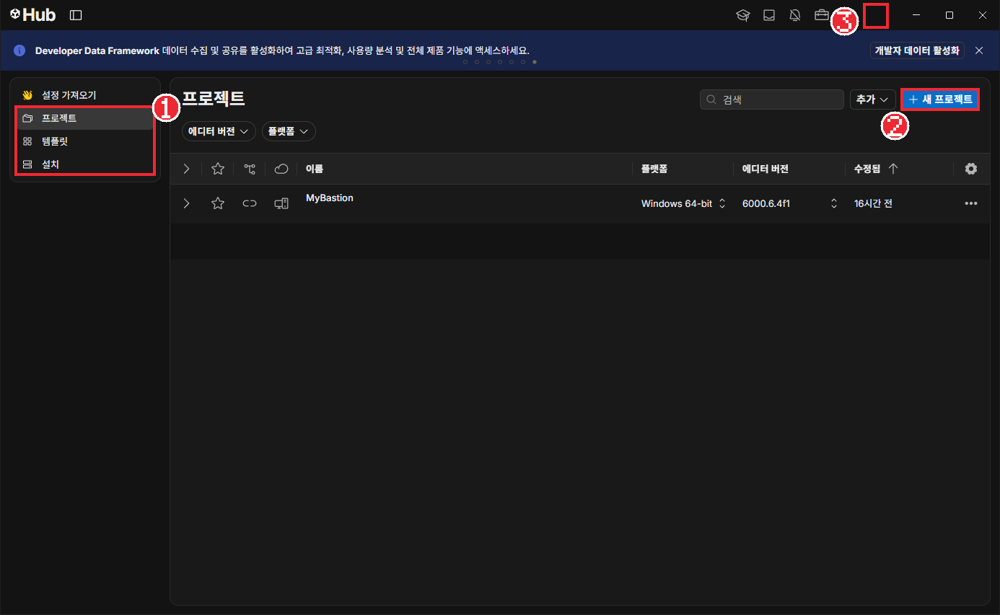
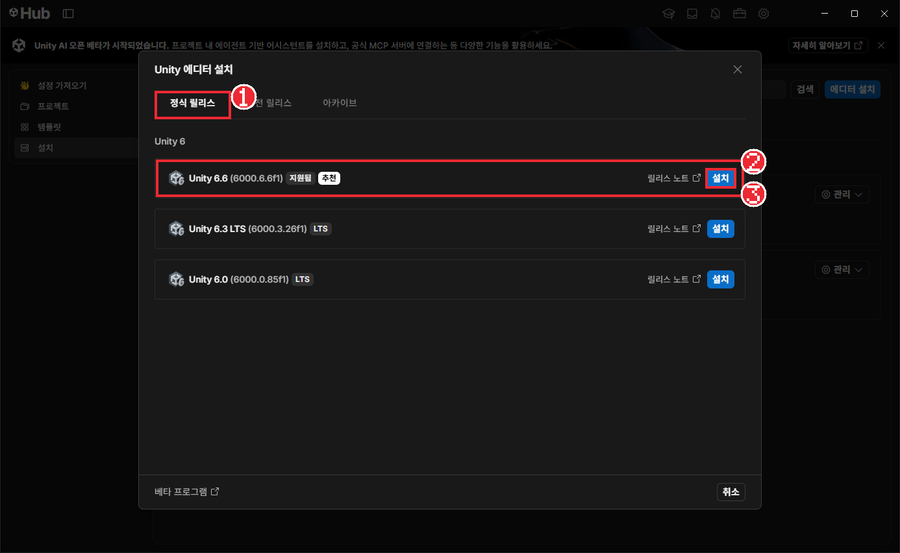
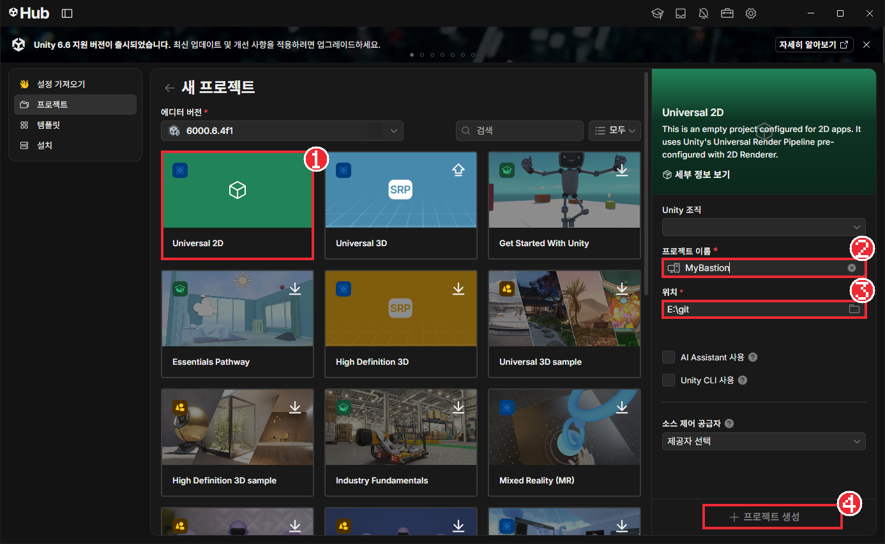
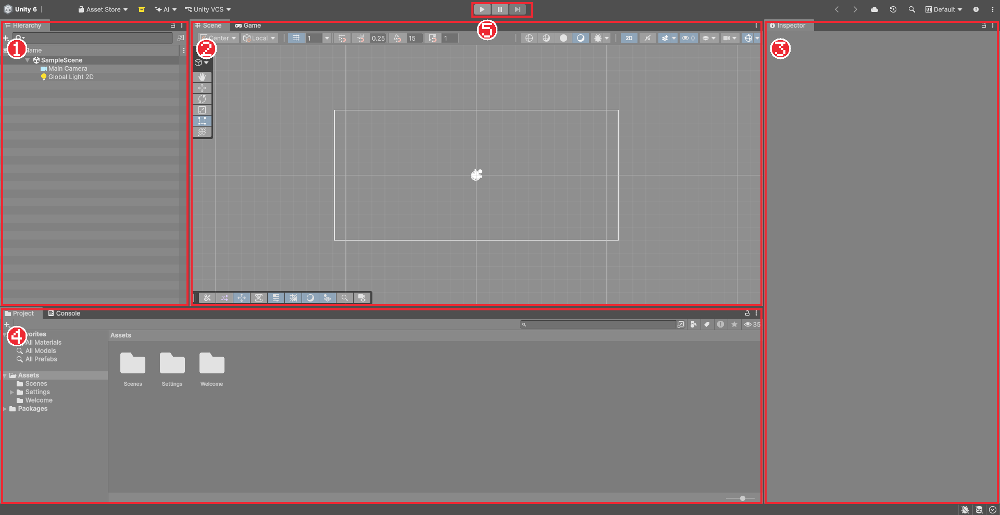

# Chapter 01 유니티 설치와 첫 프로젝트

## 학습 목표

- 게임 엔진이 게임을 만들 때 대신 해 주는 일을 설명할 수 있다.
- Unity Hub로 에디터를 설치하고 Universal 2D 템플릿으로 새 프로젝트를 만들 수 있다.
- 에디터의 Hierarchy, Scene, Game, Inspector, Project, Console 창이 각각 무엇을 보여 주는지 구분할 수 있다.
- Play 버튼으로 게임을 실행하고, 실행 중에 바꾼 값이 멈추면 되돌아간다는 것을 확인할 수 있다.

## 본문

### 01-1 게임 엔진이 하는 일

C# 과정의 마지막에 콘솔 창에서 뱀 게임을 만들었다면, 글자 하나를 옮기는 데도 화면을 지우고 다시 그리는 코드를 직접 써야 했을 것입니다. 2D 액션 게임은 여기에 할 일이 훨씬 많습니다. 그림을 1초에 수십 번 다시 그려야 하고, 키보드와 게임패드 입력을 읽어야 하고, 캐릭터가 땅에 떨어지고 벽에 막히는 계산을 해야 하며, 소리도 내야 합니다.

이런 일은 어떤 게임을 만들든 거의 똑같이 필요합니다. 그래서 이 공통 기능을 미리 만들어 두고, 개발자는 "이 게임만의 규칙"만 만들도록 도와주는 프로그램이 생겼습니다. 이것을 **게임 엔진**이라고 합니다. 화면 그리기, 입력, 물리 계산, 소리, 완성된 게임 파일 만들기를 엔진이 맡고, 우리는 기사가 어떻게 뛰고 적이 어떻게 공격하는지를 만듭니다.

**Unity**는 가장 널리 쓰이는 게임 엔진 중 하나입니다. 게임의 규칙은 이미 배운 C#으로 작성합니다. 이 과정에서는 Unity로 2D 횡스크롤 액션 게임 **Bastion**을 처음부터 만듭니다.

### 01-2 Unity Hub 설치

Unity는 두 개의 프로그램으로 나뉩니다.

| 프로그램 | 하는 일 |
|---|---|
| Unity Hub | Unity 에디터를 설치하고, 내 프로젝트 목록을 관리하는 관리 프로그램 |
| Unity 에디터 | 실제로 게임을 만드는 프로그램. 버전이 여러 개라 Hub에서 골라 설치한다 |

에디터의 **버전**은 Unity가 기능을 고쳐 내놓을 때마다 붙이는 번호입니다. 프로젝트마다 쓰는 버전이 정해져 있어서, Hub가 여러 버전을 한곳에서 관리해 줍니다.

1. Unity 공식 다운로드 페이지(`https://unity.com/download`)에서 Unity Hub를 받아 설치한다.
2. Hub를 실행하고 Unity 계정으로 로그인한다. 계정이 없으면 같은 화면에서 만든다.
3. 라이선스를 고르라는 창이 나오면 **Personal**(개인용 무료)을 고른다.

Hub는 컴퓨터 언어에 따라 한국어로 보이기도 합니다. 이 장의 스크린샷은 한국어 Hub이고, 본문에는 한국어 이름과 영어 이름을 함께 적었습니다.

### 01-3 에디터 설치

이어서 에디터를 설치합니다.

1. Hub 왼쪽에서 **설치**(Installs)를 누르고 오른쪽 위 **에디터 설치**(Install Editor)를 누른다.
2. **정식 릴리스**(Official releases) 탭에서 Unity 6 버전(이 자료는 6000.6 기준)을 골라 **설치**(Install)를 누른다.
3. 추가 기능(모듈)을 고르는 화면에서 **Microsoft Visual Studio Community**와 **Windows Build Support**가 체크되어 있는지 확인하고 설치한다.

**모듈**은 에디터에 덧붙여 설치하는 기능입니다. Visual Studio는 C# 코드를 편집하는 프로그램이고, Windows Build Support는 완성한 게임을 Windows용 실행 파일로 만드는 기능입니다. 설치에는 시간이 꽤 걸리므로 기다립니다.

### 01-4 첫 프로젝트 만들기

**프로젝트**는 게임 하나를 만드는 데 필요한 그림, 소리, 코드, 설정을 모두 담은 폴더입니다. Hub는 이 폴더를 만들어 주고 에디터로 열어 줍니다.

1. Hub 왼쪽에서 **프로젝트**(Projects)를 누르고 오른쪽 위 **새 프로젝트**(New project)를 누른다.
2. 템플릿 목록에서 **Universal 2D**를 고른다.
3. 오른쪽의 **프로젝트 이름**(Project name)에 `MyBastion`을 적는다. 아래로 목록이 펼쳐지면 **새 로컬 프로젝트 생성**을 고른다.
4. **위치**(Location)에서 프로젝트 폴더를 둘 위치를 고른다. 경로에 한글이 없는 곳이 안전하다. 위치 칸이 빨갛게 되며 "허용하지 않습니다"라고 나오면 없는 드라이브나 쓸 수 없는 폴더이므로 다른 위치를 고른다.
5. **프로젝트 생성**(Create project)을 누른다.

**템플릿**은 미리 설정을 맞춰 둔 빈 프로젝트입니다. Universal 2D는 2D 게임용 렌더링(화면 그리기) 설정과 2D 기능이 처음부터 들어 있는 템플릿입니다. 잠시 뒤 에디터가 열립니다. 튜토리얼 안내 창이 뜨면 닫아도 됩니다.

> 경로에 한글이나 공백이 있으면 일부 도구가 파일을 찾지 못하는 일이 있습니다. `C:\UnityProjects\MyBastion`처럼 영어로만 된 경로를 권합니다.

### 01-5 에디터 화면 구성

에디터는 여러 개의 **창**으로 나뉘어 있습니다. 처음 열면 아래와 같은 배치입니다.

| 번호 | 창 | 보여 주는 것 |
|---|---|---|
| 1 | Hierarchy | 지금 열린 장면에 놓인 물체 목록 |
| 2 | Scene / Game | Scene은 장면을 꾸미는 작업 화면, Game은 플레이어가 보게 될 화면 |
| 3 | Inspector | 선택한 물체나 파일의 자세한 설정 |
| 4 | Project / Console | Project는 프로젝트 폴더 안의 파일, Console은 메시지와 오류 |
| 5 | Play 버튼 | 게임 실행, 일시정지, 한 프레임씩 진행 |

게임 속 한 장면을 Unity에서는 **씬**(Scene)이라고 부릅니다. 지금 열린 씬은 템플릿에 들어 있던 `SampleScene`입니다. Hierarchy를 보면 그 안에 `Main Camera`(화면을 비추는 카메라)와 `Global Light 2D`(장면 전체를 밝히는 조명)가 들어 있습니다.

Hierarchy에서 `Main Camera`를 한 번 눌러 보세요. Inspector에 카메라의 설정이 나타납니다. 이처럼 **무언가를 선택하면 Inspector가 그 대상의 설정을 보여 준다**는 것이 Unity 사용법의 기본입니다.

Project 창의 `Assets` 폴더는 실제 컴퓨터의 `MyBastion/Assets` 폴더와 같습니다. 프로젝트에 넣는 그림, 소리, 코드는 모두 이 폴더 아래에 둡니다.

### 01-6 Play 버튼과 실행 모드

화면 위 가운데의 ▶ 버튼을 누르면 게임이 실행됩니다. 이 상태를 **플레이 모드**라고 부르고, 다시 누르면 멈춥니다.

1. ▶ 버튼을 누른다. Scene 탭 옆의 **Game** 탭이 앞으로 나오고 카메라가 비추는 화면이 보인다.
2. Hierarchy에서 `Main Camera`를 선택하고 Inspector의 Camera 항목에서 **Environment**를 펼친 뒤 **Background** 색을 아무 색으로 바꾼다. Game 화면의 배경색이 바로 바뀐다.
3. ▶ 버튼을 다시 눌러 멈춘다. 배경색이 원래대로 돌아간다.

플레이 모드에서 바꾼 값은 **멈추면 모두 되돌아갑니다.** 실행 중에 값을 바꿔 보며 어울리는 값을 찾을 때는 편하지만, 그 값을 남기려면 멈춘 뒤에 다시 입력해야 합니다. 실수로 플레이 모드에서 작업하다 결과를 잃는 일이 많으니, 작업 전에 ▶ 버튼이 꺼져 있는지 확인하는 습관을 들입니다.

### 01-7 따라하기 — 첫 프로젝트 확인

1. Hub에서 Universal 2D 템플릿으로 `MyBastion` 프로젝트를 만든다.
2. 에디터에서 Hierarchy, Scene, Game, Inspector, Project, Console 창을 하나씩 눌러 위치를 익힌다.
3. `Main Camera`를 선택해 Inspector에 설정이 나타나는지 확인한다.
4. 플레이 모드에서 카메라 배경색을 바꾸고, 멈췄을 때 되돌아가는 것을 확인한다.
5. 에디터를 닫고 Hub의 Projects 목록에서 `MyBastion`을 눌러 다시 연다.

5번처럼 다음부터는 Hub의 Projects 목록에서 프로젝트를 눌러 엽니다. 씬을 직접 만들고 물체를 놓는 일은 다음 장에서 합니다.

### 연습문제

1. 문제: Unity Hub와 Unity 에디터가 각각 하는 일을 한 줄씩 쓰세요.
2. 문제: 다음 설명에 맞는 창 이름을 쓰세요.  
   - 입력: (가) 선택한 물체의 설정을 보여 준다 (나) 지금 씬에 놓인 물체 목록 (다) 오류 메시지가 나온다
   - 출력: 창 이름 세 개
3. 문제: 플레이 모드에서 카메라 위치를 바꾼 뒤 멈추면 어떻게 되는지, 그 값을 남기려면 어떻게 해야 하는지 쓰세요.  
   - 조건: "플레이 모드"라는 말을 포함할 것

### 정답 포인트

- Hub는 에디터 설치와 프로젝트 목록 관리, 에디터는 실제 게임 제작. (가) Inspector (나) Hierarchy (다) Console. 플레이 모드에서 바꾼 값은 멈추면 되돌아가므로, 멈춘 뒤 다시 바꿔야 남는다.

---

[상위 문서로 돌아가기](./README.md)
