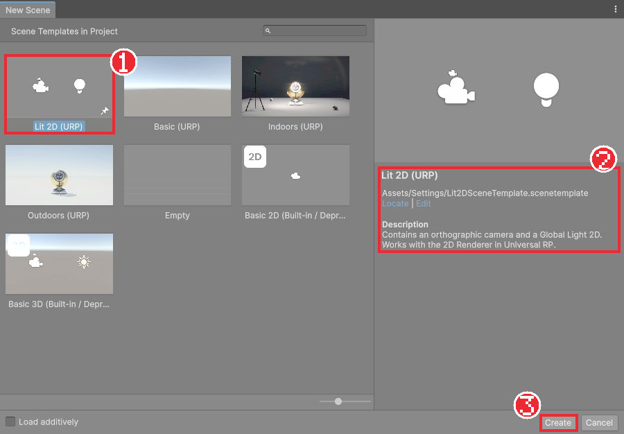
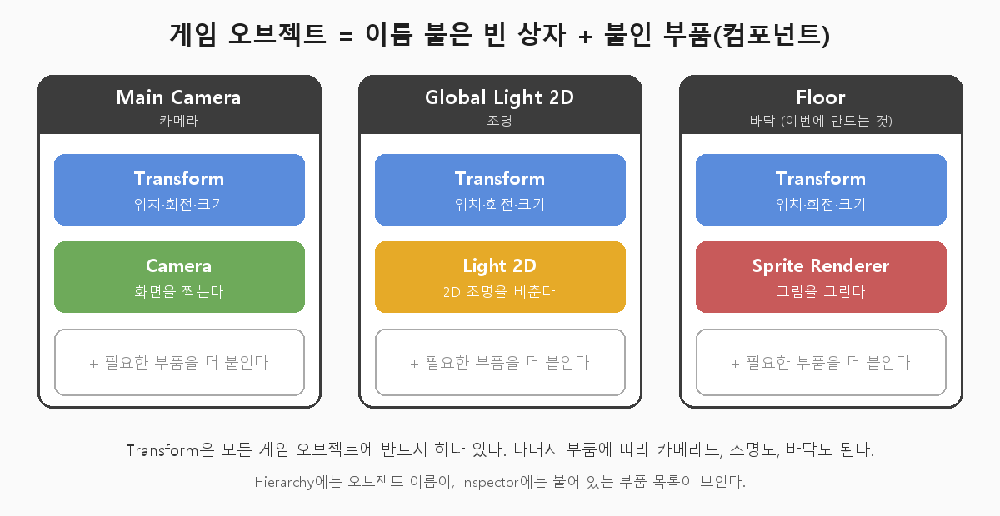
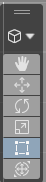
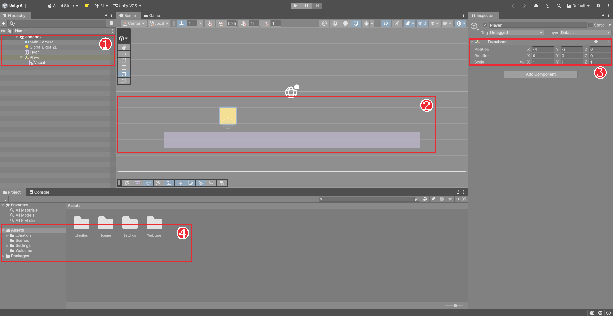
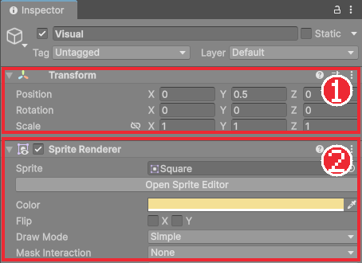

# Chapter 02 씬과 게임 오브젝트

## 학습 목표

- 새 씬을 만들어 프로젝트 폴더에 저장할 수 있다.
- 게임 오브젝트를 만들고 Transform의 Position, Rotation, Scale로 위치·회전·크기를 바꿀 수 있다.
- Scene 뷰에서 화면을 옮기고 확대하며, 이동·회전·크기 도구를 골라 쓸 수 있다.
- 부모-자식 관계를 만들고, 자식의 위치가 부모 기준이라는 것을 설명할 수 있다.

## 본문

### 02-1 폴더 정리와 새 씬 만들기

게임을 만들다 보면 그림, 소리, 코드 파일이 수백 개로 늘어납니다. 처음부터 내 파일을 모아 둘 폴더를 정해 두면 나중에 찾기 쉽습니다. 이 과정에서는 직접 만드는 것을 모두 `Assets/_Bastion` 폴더에 넣습니다. 이름 앞의 `_`는 폴더 목록에서 맨 위에 오게 하려는 관습으로 붙이는 접두사입니다.

1. Project 창에서 `Assets` 폴더를 우클릭하고 **Create > Folder**를 눌러 `_Bastion` 폴더를 만든다.
2. `_Bastion` 안에 같은 방법으로 `Scenes` 폴더를 만든다.

이제 씬을 만듭니다. Chapter 01에서 본 것처럼 **씬**은 게임 속 한 장면이고, 파일 하나로 저장됩니다. 타이틀 화면, 스테이지 1처럼 장면마다 씬 파일을 따로 만듭니다. 지금 만들 씬은 기능을 시험해 보는 연습장이라 `Sandbox`라고 부르겠습니다.

1. 메뉴에서 **File > New Scene**을 누른다.
2. 템플릿 목록에서 **Lit 2D (URP)**를 고르고 **Create**를 누른다.
3. **File > Save** (단축키 `Ctrl + S`)를 누르고 `Assets/_Bastion/Scenes` 폴더에 `Sandbox`라는 이름으로 저장한다.

새 씬에는 카메라(`Main Camera`)와 2D 조명(`Global Light 2D`)이 미리 들어 있습니다. Hierarchy 맨 위에 씬 이름 `Sandbox`가 보이면 성공입니다. 씬을 고친 뒤 저장하지 않으면 씬 이름 옆에 `*` 표시가 붙습니다. 작업 중에는 `Ctrl + S`를 자주 누르는 습관을 들입니다.

> 목록의 다른 템플릿(Basic, Indoors, Empty 등)이 무엇인지, 왜 Lit 2D (URP)를 골라야 하는지는 [부록 A New Scene 창과 씬 템플릿](./appendix-a-scene-templates.md)에서 자세히 설명합니다.

### 02-2 게임 오브젝트와 Transform

씬에 놓이는 모든 물체를 **게임 오브젝트**(GameObject)라고 합니다. 카메라도, 조명도, 앞으로 만들 기사와 적도 모두 게임 오브젝트입니다.

게임 오브젝트 자체는 이름만 붙은 빈 상자에 가깝습니다. 여기에 **컴포넌트**(Component)라는 부품을 붙여서 역할을 정합니다. 카메라 부품을 붙이면 카메라가 되고, 그림 그리는 부품을 붙이면 화면에 보이는 물체가 됩니다. 위치·회전·크기를 담는 Transform은 모든 게임 오브젝트에 반드시 하나 붙어 있습니다. 컴포넌트는 다음 장에서 자세히 다룹니다.

화면에 보이는 첫 오브젝트로 바닥을 만들어 봅니다.

1. Hierarchy 왼쪽 위의 **+** 버튼을 누르고 **2D Object > Sprites > Square**를 고른다.
2. 생긴 `Square`를 우클릭해 **Rename**을 누르고 이름을 `Floor`로 바꾼다.

**스프라이트**(Sprite)는 2D 게임에서 화면에 그리는 그림 한 장입니다. Square는 Unity가 기본으로 주는 흰 사각형 스프라이트입니다.

`Floor`를 선택하면 Inspector 맨 위에 **Transform**이 보입니다. Transform은 오브젝트가 어디에, 어떤 각도로, 얼마나 크게 놓였는지를 정하는 세 묶음의 숫자입니다.

| 항목 | 뜻 | 예 |
|---|---|---|
| Position | 위치. X는 오른쪽, Y는 위쪽 | (0, -3, 0)이면 가운데에서 3칸 아래 |
| Rotation | 회전 각도. 2D에서는 Z만 쓴다 | Z가 90이면 반시계 방향으로 90도 |
| Scale | 크기 배율. 1이 원래 크기 | X가 16이면 가로로 16배 |

Unity의 거리 단위는 **유닛**(unit)입니다. Square 스프라이트는 가로세로 1유닛입니다. 지금 카메라는 화면 높이에 10유닛이 들어가게 설정되어 있으므로, 1유닛은 화면 높이의 10분의 1쯤 됩니다. 2D 게임에서 Position의 Z는 거의 0으로 둡니다.

`Floor`의 Transform을 아래처럼 바꿔 봅니다.

- Position: X `0`, Y `-3`, Z `0`
- Scale: X `16`, Y `1`, Z `1`

Inspector의 **Sprite Renderer** 항목에서 **Color**를 눌러 회색으로 바꾸면 바닥처럼 보입니다. Sprite Renderer는 스프라이트를 화면에 그리는 부품인데, 자세한 내용은 다음 장에서 다룹니다.

### 02-3 Scene 뷰 조작

Scene 뷰는 씬을 꾸미는 작업 화면입니다. 오른쪽 위 툴바의 **2D** 버튼이 켜져 있으면 2D 게임에 맞게 정면에서 내려다봅니다. 꺼져 있다면 눌러서 켭니다.

| 하고 싶은 일 | 방법 |
|---|---|
| 화면 옮기기 | 마우스 가운데 버튼을 누른 채 끌기 |
| 확대·축소 | 마우스 휠 |
| 선택한 오브젝트로 화면 맞추기 | Hierarchy에서 오브젝트를 더블클릭하거나, Scene 뷰에서 `F` 키 |

Scene 뷰 왼쪽 위의 도구 모음에서 오브젝트를 다루는 방법을 고릅니다.

| 도구 | 단축키 | 하는 일 |
|---|---|---|
| View (손) | `Q` | 화면 옮기기만 하고 오브젝트는 건드리지 않는다 |
| Move | `W` | 화살표를 끌어 위치를 바꾼다 |
| Rotate | `E` | 원을 끌어 회전한다 |
| Scale | `R` | 네모 손잡이를 끌어 크기를 바꾼다 |
| Rect | `T` | 2D에서 테두리를 끌어 크기와 위치를 함께 바꾼다 |

`W`를 누르고 `Floor`를 선택하면 빨간 화살표(X)와 초록 화살표(Y)가 나타납니다. 화살표를 끌면 Inspector의 Position 숫자도 함께 바뀝니다. 마우스로 대충 옮긴 뒤 Inspector에서 숫자로 깔끔하게 맞추는 방법을 자주 씁니다.

### 02-4 부모와 자식

이제 플레이어 자리를 만듭니다. 플레이어는 나중에 그림, 공격 범위, 효과 등 여러 오브젝트를 묶어서 움직여야 합니다. Unity에서는 오브젝트를 다른 오브젝트 아래에 넣어 **부모-자식 관계**를 만들 수 있습니다. 부모가 움직이면 자식도 함께 움직입니다.

1. Hierarchy의 **+** 버튼에서 **Create Empty**를 눌러 빈 오브젝트를 만들고 이름을 `Player`로 바꾼다.
2. `Player`의 Position을 X `-4`, Y `-2`로 둔다.
3. **+ > 2D Object > Sprites > Square**로 사각형을 하나 더 만들고 이름을 `Visual`로 바꾼다.
4. Hierarchy에서 `Visual`을 끌어 `Player` 위에 놓는다. `Visual`이 `Player` 아래로 들여 써지면 자식이 된 것이다.
5. `Visual`의 Position을 X `0`, Y `0.5`로 두고, Color를 노란색으로 바꾼다.

**빈 오브젝트**(Create Empty)는 Transform만 있고 화면에 보이는 것이 없는 오브젝트입니다. 여러 오브젝트를 묶는 상자 역할로 자주 씁니다.

`Visual`을 선택하고 Inspector를 보면 Position이 (0, 0.5, 0)입니다. 화면에서는 `Player`보다 0.5유닛 위에 있습니다. **자식의 Transform 값은 부모를 기준으로 한 값**이기 때문입니다. `Player`를 옮기면 `Visual`의 숫자는 그대로인데 화면에서는 함께 움직입니다.

`Visual`을 0.5만큼 올린 이유는 `Player`의 위치를 사각형의 **발밑**으로 맞추기 위해서입니다. 사각형의 높이가 1이므로 중심을 0.5 올리면 바닥면이 `Player` 위치에 옵니다. 캐릭터의 위치를 발 기준으로 두면, 나중에 "바닥에 서 있는가"를 계산하기 쉽습니다.

### 02-5 따라하기 — 연습장 씬 만들기

1. `Assets/_Bastion/Scenes` 폴더를 만들고 Lit 2D 템플릿으로 `Sandbox` 씬을 만들어 저장한다.
2. Square로 `Floor`를 만들어 Position (0, -3, 0), Scale (16, 1, 1), 회색으로 둔다.
3. 빈 오브젝트 `Player`를 (-4, -2, 0)에 만들고, 자식으로 노란 Square `Visual`을 (0, 0.5, 0)에 둔다.
4. `W` 도구로 `Player`를 이리저리 옮겨 `Visual`이 함께 움직이는지 확인한다.
5. Game 탭을 눌러 카메라에 바닥과 노란 사각형이 보이는지 확인하고 `Ctrl + S`로 저장한다.

이 씬은 다음 장에서 스크립트를 붙여 사각형을 움직이는 데 씁니다.

### 연습문제

1. 문제: Transform의 세 항목 이름과 뜻을 한 줄씩 쓰세요.
2. 문제: 부모 `Player`의 Position이 (3, 1, 0)이고 자식 `Visual`의 Position이 (0, 0.5, 0)일 때, `Visual`이 화면에서 실제로 놓인 위치를 쓰세요.  
   - 입력: 부모 (3, 1, 0), 자식 (0, 0.5, 0)
   - 출력: 실제 위치 (x, y, z)
   - 조건: 부모의 회전과 크기는 기본값이라고 가정
3. 문제: Scene 뷰에서 오브젝트를 옮기는 도구와 화면만 옮기는 도구의 단축키를 각각 쓰세요.

### 정답 포인트

- Position 위치, Rotation 회전, Scale 크기. 자식 값은 부모 기준이므로 (3, 1.5, 0). 오브젝트 이동은 Move `W`, 화면 이동은 View `Q`.

---

[다음 문서: Chapter 03 컴포넌트와 첫 스크립트](./03-component-first-script.md)

[상위 문서로 돌아가기](./README.md)
