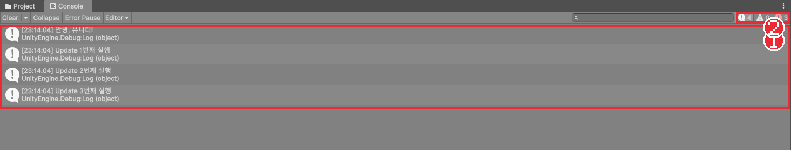
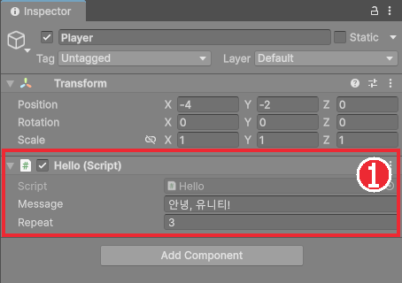
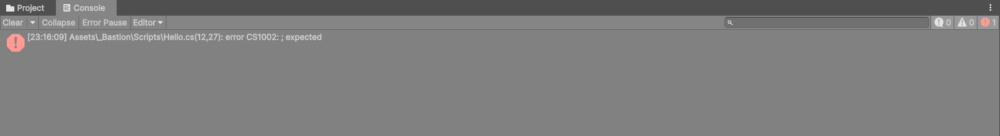

# Chapter 03 컴포넌트와 첫 스크립트

## 학습 목표

- 게임 오브젝트가 컴포넌트를 조합해 기능을 얻는다는 것을 설명할 수 있다.
- C# 스크립트를 만들어 게임 오브젝트에 컴포넌트로 붙일 수 있다.
- `Start`와 `Update`가 언제 실행되는지 구분하고, `Debug.Log`로 Console 창에 메시지를 찍을 수 있다.
- `[SerializeField]`로 Inspector에서 값을 바꿀 수 있는 변수를 만들고, Console의 컴파일 오류를 읽고 고칠 수 있다.

## 본문

### 03-1 컴포넌트

Chapter 02에서 만든 `Visual`을 선택하면 Inspector에 **Transform**과 **Sprite Renderer** 두 묶음이 보였습니다. 이 묶음 하나하나를 **컴포넌트**(Component)라고 합니다. 컴포넌트는 게임 오브젝트에 끼우는 부품입니다.

게임 오브젝트 자체는 이름과 Transform만 가진 빈 상자에 가깝습니다. 여기에 Sprite Renderer를 끼우면 그림이 보이고, 카메라 컴포넌트를 끼우면 화면을 비추고, 앞으로 배울 물리 컴포넌트를 끼우면 중력을 받습니다. Unity로 게임을 만든다는 것은 **알맞은 컴포넌트를 골라 끼우고, 없는 기능은 직접 컴포넌트로 만드는 일**입니다.

Inspector 맨 아래의 **Add Component** 버튼을 누르면 Unity가 미리 만들어 둔 컴포넌트 목록이 나옵니다. 지금은 구경만 하고 닫습니다. 이 장에서는 직접 만든 C# 코드를 컴포넌트로 끼워 봅니다.

### 03-2 스크립트 만들기

1. Project 창의 `Assets/_Bastion` 안에 `Scripts` 폴더를 만든다.
2. `Scripts` 폴더를 우클릭하고 **Create > Scripting > MonoBehaviour Script**를 누른다.
3. 이름을 `Hello`로 적고 `Enter`를 누른다.
4. 만들어진 `Hello` 파일을 더블클릭하면 Visual Studio가 열린다.

> 파일 이름과 코드 안의 클래스 이름은 반드시 같아야 합니다. 이름을 잘못 적었다면 파일을 지우고 다시 만드는 편이 간단합니다.

Visual Studio에 아래와 같은 기본 코드가 들어 있습니다.

```csharp
using UnityEngine;

public class Hello : MonoBehaviour
{
    // Start is called once before the first execution of Update after the MonoBehaviour is created
    void Start()
    {

    }

    // Update is called once per frame
    void Update()
    {

    }
}
```

#### 코드 해석

- `using UnityEngine;`: Unity가 제공하는 기능(`Debug`, `Transform` 등)을 이 파일에서 쓰겠다는 선언입니다.
- `public class Hello : MonoBehaviour`: `Hello` 클래스가 `MonoBehaviour`를 상속합니다. **MonoBehaviour**는 "게임 오브젝트에 붙일 수 있는 컴포넌트"의 부모 클래스입니다. 이것을 상속해야 Inspector에서 오브젝트에 붙일 수 있습니다.
- `Start()`: 게임이 시작되어 이 컴포넌트가 처음 동작할 때 **한 번** 실행됩니다.
- `Update()`: 화면이 한 장 그려질 때마다 **매번** 실행됩니다.

화면 한 장을 **프레임**이라고 합니다. 게임은 1초에 보통 60장 안팎의 프레임을 그리므로 `Update`도 1초에 60번 안팎 실행됩니다. `Start`와 `Update`는 우리가 부르지 않아도 Unity가 알맞은 때에 불러 줍니다. 이렇게 엔진이 정해진 때에 불러 주는 함수를 **이벤트 함수**라고 부릅니다.

### 03-3 Debug.Log와 Console

코드가 언제 실행되는지 눈으로 확인하려면 메시지를 찍어 보면 됩니다. C# 콘솔 프로그램의 `Console.WriteLine` 대신 Unity에서는 `Debug.Log`를 씁니다. `Debug.Log("글자")`처럼 괄호 안에 찍을 내용을 넣으면 에디터의 **Console** 창에 나타납니다.

`Hello.cs`를 아래처럼 고치고 저장합니다.

```csharp
using UnityEngine;

public class Hello : MonoBehaviour
{
    int frameCount;

    void Start()
    {
        Debug.Log("안녕, 유니티!");
    }

    void Update()
    {
        if (frameCount < 3)
        {
            frameCount++;
            Debug.Log("Update " + frameCount + "번째 실행");
        }
    }
}
```

#### 코드 해석

- `Start`에서 한 번 인사말을 찍습니다.
- `Update`는 매 프레임 실행되므로 그냥 찍으면 1초에 수십 줄이 쌓입니다. `frameCount`로 처음 3번만 찍게 막았습니다.

### 03-4 스크립트를 컴포넌트로 붙이기

스크립트 파일은 만들기만 해서는 실행되지 않습니다. 게임 오브젝트에 붙어 있어야 그 오브젝트와 함께 동작합니다.

1. Unity 에디터로 돌아온다. 오른쪽 아래에 잠깐 동그라미가 돌며 코드를 다시 읽어 들인다. 이 과정을 **컴파일**이라고 한다.
2. Hierarchy에서 `Player`를 선택한다.
3. Project 창의 `Hello` 파일을 Inspector의 빈 곳으로 끌어다 놓는다. Inspector의 **Add Component**에서 `Hello`를 검색해 눌러도 된다.
4. ▶ 버튼을 눌러 실행하고, 아래쪽 **Console** 탭을 눌러 메시지를 확인한다.



인사말이 한 줄, Update 메시지가 세 줄 찍힙니다. 메시지를 한 번 누르면 아래쪽에 자세한 내용이 나오고, 더블클릭하면 그 줄을 찍은 코드가 Visual Studio에서 열립니다. Console 위쪽의 **Clear**는 메시지를 지우고, 오른쪽 위의 세 숫자는 차례대로 일반 메시지, 경고, 오류의 개수입니다.

> 에디터 버전에 따라 내 코드와 관계없는 빨간 메시지가 처음에 몇 줄 찍히기도 합니다. 메시지에 내 스크립트 파일 이름(`Assets/_Bastion/...`)이 없다면 에디터 내부 메시지이므로 무시해도 됩니다.

### 03-5 Inspector에 값 보여 주기

인사말을 바꾸려면 매번 코드를 고쳐야 할까요? 변수를 Inspector에 보이게 하면 코드를 건드리지 않고 에디터에서 값을 바꿀 수 있습니다.

```csharp
using UnityEngine;

public class Hello : MonoBehaviour
{
    [SerializeField] string message = "안녕, 유니티!";
    [SerializeField] int repeat = 3;

    int frameCount;

    void Start()
    {
        Debug.Log(message);
    }

    void Update()
    {
        if (frameCount < repeat)
        {
            frameCount++;
            Debug.Log("Update " + frameCount + "번째 실행");
        }
    }
}
```

#### 코드 해석

- `[SerializeField]`: 변수 앞에 붙이면 그 변수가 Inspector에 나타나고, 에디터에서 바꾼 값이 씬 파일에 저장됩니다. 대괄호로 감싼 이런 표시를 **어트리뷰트**라고 합니다.
- `= "안녕, 유니티!"`: 컴포넌트를 처음 붙였을 때의 기본값입니다. Inspector에서 바꾸면 그 값이 우선합니다.
- `frameCount`에는 `[SerializeField]`가 없으므로 Inspector에 보이지 않습니다. 실행 중에만 쓰는 값은 감춰 둡니다.



Inspector에서 **Message**를 다른 문장으로, **Repeat**를 5로 바꾸고 실행하면 코드는 그대로인데 결과가 바뀝니다. 변수를 `public`으로 선언해도 Inspector에 나타나지만, 그러면 다른 스크립트도 마음대로 값을 바꿀 수 있게 됩니다. 이 과정에서는 Inspector에만 보이고 바깥에서는 못 고치는 `[SerializeField]` 방식을 씁니다.

### 03-6 컴파일 오류 읽기

코드에 문법 오류가 있으면 Unity는 스크립트를 컴파일하지 못하고, ▶ 버튼을 눌러도 실행되지 않습니다. 일부러 오류를 내 봅니다.

1. `Debug.Log(message);`의 마지막 `;`를 지우고 저장한다.
2. 에디터로 돌아와 Console을 본다.



오류 메시지는 `파일 경로(줄, 칸): error 오류번호: 설명` 순서입니다. `Hello.cs(12,27)`은 Hello.cs 파일의 12번째 줄 27번째 칸, `; expected`는 "세미콜론이 있어야 한다"는 뜻입니다. 메시지를 더블클릭하면 그 줄로 바로 이동합니다. `;`를 다시 넣고 저장하면 오류가 사라집니다.

오류가 여러 개면 **맨 위의 오류부터** 고칩니다. 앞의 오류 하나 때문에 뒤에 엉뚱한 오류가 줄줄이 생기는 일이 많기 때문입니다.

### 03-7 따라하기 — 첫 스크립트

1. `Assets/_Bastion/Scripts`에 `Hello` 스크립트를 만들고 `[SerializeField]` 변수 두 개를 넣는다.
2. `Player`에 `Hello`를 붙이고 실행해 Console에 메시지가 찍히는지 확인한다.
3. Inspector에서 Message와 Repeat를 바꾸고 다시 실행해 결과가 바뀌는지 확인한다.
4. `;`를 하나 지워 컴파일 오류를 내고, 오류 메시지의 줄 번호를 보고 고친다.
5. 확인이 끝나면 `Player`의 `Hello` 컴포넌트 오른쪽 `⋮` 메뉴에서 **Remove Component**로 떼어 둔다.

5번에서 떼어 낸 컴포넌트는 지워질 뿐, `Hello.cs` 파일은 Project 창에 그대로 남습니다. 다음 장에서는 `Update`를 이용해 오브젝트를 움직입니다.

### 연습문제

1. 문제: `Start`와 `Update`가 각각 언제, 몇 번 실행되는지 한 줄씩 쓰세요.
2. 문제: 아래 변수 중 Inspector에 나타나는 것을 모두 고르세요.  
   - 입력: (가) `[SerializeField] float speed = 5f;` (나) `float timer;` (다) `[SerializeField] string playerName;`
   - 출력: 기호
3. 문제: Console에 `Mover.cs(8,14): error CS0103: The name 'spead' does not exist in the current context`가 나왔습니다. 어느 파일의 몇 번째 줄을 봐야 하는지, 무엇이 문제일 가능성이 높은지 쓰세요.

### 정답 포인트

- `Start`는 시작할 때 한 번, `Update`는 매 프레임. Inspector에는 (가)와 (다). Mover.cs의 8번째 줄이며, `spead`라는 이름이 없다는 뜻이므로 `speed`의 오타일 가능성이 높다.

---

[상위 문서로 돌아가기](./README.md)
