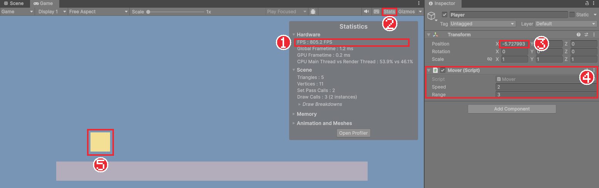

# Chapter 04 스크립트로 움직이기

## 학습 목표

- 스크립트에서 `transform.position`을 바꿔 게임 오브젝트를 움직일 수 있다.
- 프레임 속도가 컴퓨터마다 다르다는 것과 그때 생기는 문제를 설명할 수 있다.
- `Time.deltaTime`을 곱해 어느 컴퓨터에서나 같은 속도로 움직이게 만들 수 있다.
- `Vector3`로 방향과 거리를 표현하고, 조건문으로 왕복 이동을 만들 수 있다.

## 본문

### 04-1 스크립트에서 위치 바꾸기

Chapter 03에서 `Update`는 매 프레임 실행된다고 배웠습니다. 매 프레임 위치를 조금씩 옮기면 화면에서는 오브젝트가 움직이는 것처럼 보입니다. 만화를 한 장씩 넘기면 그림이 움직여 보이는 것과 같은 원리입니다.

스크립트가 붙은 오브젝트의 Transform은 `transform`이라는 이름으로 바로 쓸 수 있습니다. `transform.position`은 Inspector의 Position 값과 같습니다.

`Assets/_Bastion/Scripts`에 `Mover` 스크립트를 만들고 아래처럼 적어 `Player`에 붙여 봅니다. Chapter 03에서 쓴 `Hello`는 떼어 둔 상태여야 합니다.

```csharp
using UnityEngine;

public class Mover : MonoBehaviour
{
    void Update()
    {
        transform.position += new Vector3(0.02f, 0f, 0f);
    }
}
```

#### 코드 해석

- `new Vector3(0.02f, 0f, 0f)`: x로 0.02, y와 z로 0만큼의 값입니다. **Vector3**는 숫자 세 개(x, y, z)를 묶은 자료형이고, 위치나 이동량을 나타낼 때 씁니다. 2D 게임용으로 x, y만 묶은 **Vector2**도 있습니다.
- `+=`: 지금 위치에 이동량을 더합니다. 매 프레임 오른쪽으로 0.02유닛씩 옮겨집니다.
- 숫자 뒤의 `f`는 `float` 값이라는 표시입니다. Unity의 위치와 속도는 모두 `float`입니다.

▶ 버튼을 누르면 노란 사각형이 오른쪽으로 미끄러져 갑니다.

### 04-2 프레임 속도 문제

위 코드에는 숨은 문제가 있습니다. 1초에 그려지는 프레임 수를 **프레임 속도**(FPS, Frames Per Second)라고 하는데, 이 값은 컴퓨터 성능과 화면 설정에 따라 크게 다릅니다.

Game 뷰 위쪽의 **Stats** 버튼을 누르면 지금 프레임 속도를 볼 수 있습니다.



> 이 그림은 04-4의 왕복 버전 `Mover`로 찍어서 Inspector에 Speed와 Range 칸이 보이고 사각형도 왼쪽에 있습니다. 지금 코드로는 칸이 없고 사각형은 오른쪽으로만 갑니다. FPS를 보는 방법은 같습니다.

위 화면에서는 FPS가 800이 넘습니다. 아무것도 없는 씬이라 에디터가 매우 빨리 그리기 때문입니다. 같은 코드를 1초에 60프레임 그리는 컴퓨터에서 실행하면 어떻게 될까요?

| 컴퓨터 | 1초 동안 Update 횟수 | 1초 동안 이동 거리 |
|---|---|---|
| 60 FPS | 60번 | 0.02 × 60 = 1.2유닛 |
| 800 FPS | 800번 | 0.02 × 800 = 16유닛 |

빠른 컴퓨터에서는 캐릭터가 훨씬 빨리 달립니다. 게임이 컴퓨터마다 다르게 동작하면 안 되므로 이 문제를 고쳐야 합니다.

### 04-3 Time.deltaTime

`Time.deltaTime`은 **바로 앞 프레임부터 지금 프레임까지 흐른 시간(초)** 입니다. 60 FPS면 약 0.0167초, 800 FPS면 약 0.00125초입니다. 프레임이 자주 그려질수록 작아집니다.

"1초에 움직일 거리"에 `Time.deltaTime`을 곱하면 "이번 프레임에 움직일 거리"가 됩니다.

| 컴퓨터 | 한 프레임 이동 (속도 2) | 1초 동안 이동 거리 |
|---|---|---|
| 60 FPS | 2 × 0.0167 = 0.033 | 0.033 × 60 = 2유닛 |
| 800 FPS | 2 × 0.00125 = 0.0025 | 0.0025 × 800 = 2유닛 |

어느 컴퓨터에서나 1초에 2유닛을 움직입니다. `Mover`를 아래처럼 고칩니다.

```csharp
using UnityEngine;

public class Mover : MonoBehaviour
{
    [SerializeField] float speed = 2f;

    void Update()
    {
        transform.position += Vector3.right * (speed * Time.deltaTime);
    }
}
```

#### 코드 해석

- `speed`: 1초에 움직일 유닛 수입니다. `[SerializeField]`로 Inspector에서 바꿀 수 있게 했습니다.
- `Vector3.right`: (1, 0, 0)을 줄여 쓴 이름입니다. 오른쪽을 가리키는 길이 1짜리 방향입니다. `Vector3.left`, `Vector3.up`, `Vector3.down`도 있습니다.
- `Vector3.right * (speed * Time.deltaTime)`: 방향에 거리를 곱해 이번 프레임의 이동량을 만듭니다. Vector3에 숫자를 곱하면 x, y, z가 모두 그만큼 커집니다.

**`Update`에서 무언가를 시간에 따라 바꿀 때는 항상 `Time.deltaTime`을 곱한다**고 기억해 두세요. 이동, 회전, 타이머가 모두 해당합니다.

### 04-4 왕복 이동

조건문으로 방향을 바꾸면 좌우로 왕복하는 오브젝트를 만들 수 있습니다. 나중에 순찰하는 적을 만들 때도 같은 생각을 씁니다.

```csharp
using UnityEngine;

public class Mover : MonoBehaviour
{
    [SerializeField] float speed = 2f;
    [SerializeField] float range = 3f;

    float startX;
    int direction = 1;

    void Start()
    {
        startX = transform.position.x;
    }

    void Update()
    {
        transform.position += Vector3.right * (direction * speed * Time.deltaTime);

        float offset = transform.position.x - startX;
        if (offset > range)
            direction = -1;
        else if (offset < -range)
            direction = 1;
    }
}
```

#### 코드 해석

- `startX`: 시작할 때의 x 위치를 `Start`에서 한 번 기억합니다.
- `direction`: 1이면 오른쪽, -1이면 왼쪽입니다. 방향 벡터에 곱해 이동 방향을 뒤집습니다.
- `offset`: 시작 위치에서 얼마나 떨어졌는지입니다. `range`보다 오른쪽으로 멀어지면 왼쪽으로, 왼쪽으로 멀어지면 오른쪽으로 돌립니다.

실행하면 사각형이 시작 위치를 중심으로 좌우 3유닛 사이를 오갑니다. 실행 중에 Inspector의 **Speed**를 바꿔 보면 곧바로 빨라지거나 느려집니다. Chapter 01에서 배운 대로 멈추면 원래 값으로 돌아오니, 마음에 드는 값을 찾았다면 멈춘 뒤 다시 입력합니다.

### 04-5 따라하기 — 왕복하는 사각형

1. `Mover` 스크립트를 04-4의 코드로 작성해 `Player`에 붙인다.
2. Game 뷰의 **Stats**를 켜고 실행해 FPS 값을 확인한다.
3. `Time.deltaTime`을 지운 코드와 넣은 코드를 번갈아 실행해 속도 차이를 비교한다. 지운 코드는 확인 뒤 되돌린다.
4. Speed를 4, Range를 5로 바꿔 왕복 거리와 속도가 바뀌는지 확인한다.
5. 확인이 끝나면 `Mover` 컴포넌트를 떼어 둔다.

이 장에서는 키보드 입력 없이 정해진 대로만 움직였습니다. 다음 장에서 기사 그림을 가져오고, 그 뒤에 키보드로 조종합니다.

### 연습문제

1. 문제: `Time.deltaTime`이 무엇인지, 왜 이동량에 곱해야 하는지 한 문장씩 쓰세요.  
   - 조건: "프레임"이라는 말을 포함할 것
2. 문제: 오브젝트를 1초에 3유닛씩 위로 올리는 `Update` 코드를 한 줄로 쓰세요.  
   - 출력: `transform.position += ...;` 형태의 코드 한 줄
3. 문제: 04-4의 `Mover`를 고쳐, 좌우 대신 위아래로 왕복하게 만드세요.  
   - 입력: 04-4 코드
   - 출력: 바꿔야 하는 줄과 바꾼 내용
   - 조건: `startX`도 알맞은 이름과 값으로 바꿀 것

### 정답 포인트

- `Time.deltaTime`은 앞 프레임부터 흐른 시간(초)이며, 곱하지 않으면 프레임 속도가 높은 컴퓨터에서 더 빨리 움직인다. `transform.position += Vector3.up * (3f * Time.deltaTime);`. 3번은 `Vector3.right`를 `Vector3.up`으로, `startX`를 `startY = transform.position.y`로, `offset` 계산을 y로 바꾼다.

---

[상위 문서로 돌아가기](./README.md)
