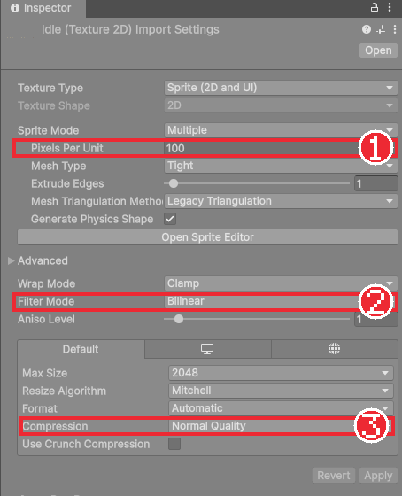
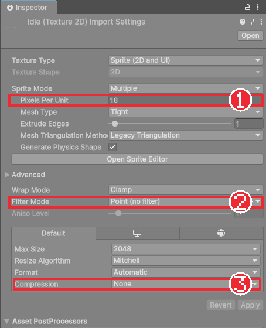
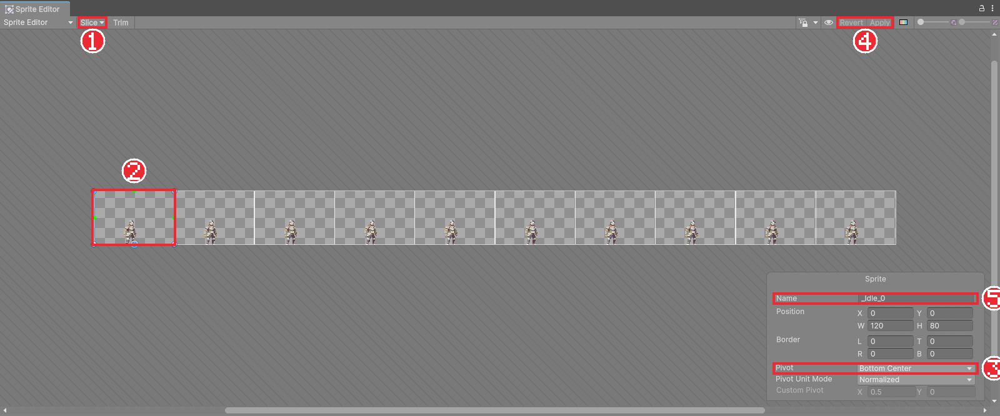
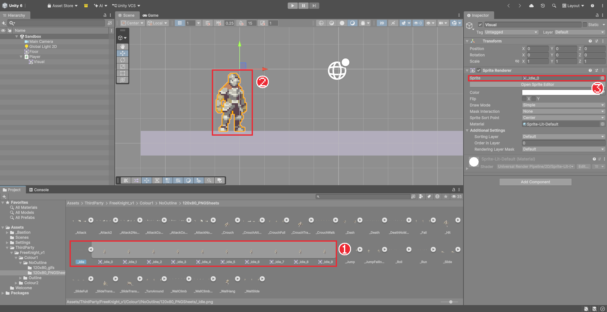

# Chapter 05 에셋 가져오기와 스프라이트

## 학습 목표

- 무료 에셋도 사용 조건(라이선스)이 다르다는 것을 알고, 이 과정에서 쓰는 에셋의 조건을 구분할 수 있다.
- 픽셀 아트 그림을 프로젝트에 넣고 Pixels Per Unit, Filter Mode, Compression을 알맞게 설정할 수 있다.
- Sprite Editor로 한 장에 여러 동작이 그려진 그림을 프레임 단위로 자르고 피벗을 정할 수 있다.
- 자른 스프라이트를 플레이어의 `Visual`에 넣어 기사가 바닥 위에 서게 만들 수 있다.

## 본문

### 05-1 에셋과 라이선스

게임에 들어가는 그림, 소리, 글꼴 같은 재료를 **에셋**(Asset)이라고 합니다. 혼자서 모든 그림을 그릴 수는 없으므로 다른 사람이 만들어 공개한 무료 에셋을 많이 씁니다. 그런데 "무료"라고 해서 마음대로 써도 되는 것은 아닙니다. 만든 사람이 정한 사용 조건을 **라이선스**라고 하고, 에셋마다 다릅니다.

| 조건 | 뜻 |
|---|---|
| CC0 | 저작권을 포기한 에셋. 출처 표기 없이 수정, 상업 이용, 다시 나눠 주기가 모두 된다 |
| 무료, 재배포 금지 | 내 게임에 넣어 쓰는 것은 되지만, 에셋 파일 자체를 다른 사람에게 나눠 주면 안 된다 |
| 크레딧 표기 조건 | 쓸 수 있지만 게임이나 문서에 만든 사람을 적어야 한다 |

이 과정에서 쓰는 에셋은 아래와 같습니다. 재배포 금지 에셋은 강사가 나눠 줄 수 없으므로 각자 에셋 판매 사이트인 itch.io에서 이름으로 검색해 무료로 받습니다. 나머지는 강사가 묶어서 나눠 줍니다.

| 용도 | 에셋 이름 | 만든 사람 | 조건 | 받는 방법 |
|---|---|---|---|---|
| 플레이어 기사 | Fantasy Knight | aamatniekss | 무료, 재배포 금지 | 각자 itch.io에서 받기 |
| 보스 | Undead Executioner | Kronovi- | 무료, 재배포 금지 | 각자 itch.io에서 받기 |
| 해골 병사 등 몬스터 | Monsters Creatures Fantasy 1, 2 | LuizMelo | CC0 | 강사 배포 |
| 성채 배경·타일·마법사 | GothicVania Church Pack | ansimuz | CC0 | 강사 배포 |
| 함정 | Animated Traps | Stealthix | CC0 | 강사 배포 |
| 한글 글꼴 | Galmuri | 이민서 | OFL(무료, 함께 배포 가능) | 강사 배포 |

> 포트폴리오를 공개 저장소에 올릴 때 재배포 금지 에셋까지 올리면 조건을 어기게 됩니다. Chapter 35에서 이런 파일을 저장소에서 빼는 방법을 다룹니다.

### 05-2 ThirdParty 폴더에 원본 넣기

남이 만든 에셋은 내가 만든 것과 섞이지 않게 `Assets/ThirdParty` 폴더에 모읍니다. 그리고 **원본 파일은 고치지 않습니다.** 원본을 고쳐 두면 나중에 에셋을 다시 받았을 때 고친 내용이 사라지고, 어디를 바꿨는지도 알기 어렵습니다.

1. Project 창의 `Assets`에 `ThirdParty` 폴더를 만든다.
2. 받은 Fantasy Knight 압축 파일을 풀어 나온 폴더 이름을 `FreeKnight_v1`로 맞춘다.
3. 윈도우 탐색기에서 `FreeKnight_v1` 폴더를 Unity의 Project 창 `ThirdParty` 폴더 위로 끌어다 놓는다.

Unity는 폴더에 들어온 파일을 자기가 쓸 수 있는 형태로 바꿔 둡니다. 이 과정을 **임포트**(Import)라고 합니다. 파일이 많으면 진행 막대가 잠시 나타납니다.

`FreeKnight_v1/Colour1/NoOutline/120x80_PNGSheets` 폴더를 열면 `_Idle`, `_Run`, `_Attack` 같은 그림 파일이 있습니다. 하나를 눌러 보면 가로로 긴 그림에 기사가 여러 번 그려져 있습니다. 동작 하나의 프레임들을 한 장에 이어 붙인 이런 그림을 **스프라이트 시트**라고 합니다.

### 05-3 임포트 설정

`_Idle`을 선택하면 Inspector에 그림을 어떻게 읽어 들일지 정하는 **Import Settings**가 나옵니다. 기본값 그대로 쓰면 픽셀 아트가 흐릿하고 엄청 작게 보입니다.

세 가지를 바꿉니다.

| 항목 | 기본값 | 바꿀 값 | 이유 |
|---|---|---|---|
| Pixels Per Unit | 100 | **16** | 그림 16픽셀을 1유닛으로 본다. 이 게임의 바닥 타일 한 칸이 16픽셀이라, 타일 한 칸이 정확히 1유닛이 된다 |
| Filter Mode | Bilinear | **Point (no filter)** | Bilinear는 픽셀 사이를 부드럽게 섞어 흐려진다. Point는 픽셀을 네모 그대로 키운다 |
| Compression | Normal Quality | **None** | 압축하면 파일은 작아지지만 색이 뭉개진다. 작은 픽셀 아트는 압축하지 않는다 |

**Pixels Per Unit**(PPU)은 그림의 픽셀 몇 개를 Unity의 1유닛으로 칠지 정하는 값입니다. 기본값 100이면 높이 80픽셀인 그림이 0.8유닛밖에 안 되어 바닥(1유닛)보다 작습니다. 모든 그림의 PPU를 16으로 통일하면 그림 크기를 비교하기 쉽습니다.

폴더 안의 그림을 한꺼번에 바꾸면 편합니다.

1. `120x80_PNGSheets` 폴더 안의 그림을 첫 번째 것을 누르고 `Shift`를 누른 채 마지막 것을 눌러 모두 고른다.
2. Inspector에서 Pixels Per Unit을 `16`, Filter Mode를 `Point (no filter)`, Compression을 `None`으로 바꾼다.
3. 오른쪽 아래의 **Apply**를 누른다.

### 05-4 Sprite Editor로 자르기

스프라이트 시트는 아직 그림 한 장입니다. 프레임 하나하나를 따로 쓰려면 잘라야 합니다. 이 기사 그림은 프레임 하나가 가로 120, 세로 80픽셀입니다.

1. `_Idle`을 선택하고 Inspector의 **Open Sprite Editor**를 누른다.
2. Sprite Editor 창 왼쪽 위의 **Slice**를 누른다.
3. **Type**을 `Grid By Cell Size`로 바꾸고 **Pixel Size**를 X `120`, Y `80`으로 적는다.
4. **Pivot**을 `Bottom`으로 고르고 **Slice** 버튼을 누른다.
5. 창 오른쪽 위의 **Apply**를 눌러 저장한다.

잘린 칸을 하나 누르면 오른쪽 아래에 그 프레임의 이름과 위치가 나옵니다. 이름은 `_Idle_0`, `_Idle_1`처럼 순서대로 붙습니다.

**피벗**(Pivot)은 스프라이트의 기준점입니다. 오브젝트의 Position이 스프라이트의 어느 지점에 놓일지를 정합니다. Bottom(아래 가운데)으로 두면 기사의 발밑이 기준이 됩니다. Chapter 02에서 사각형을 0.5만큼 올려 `Player`의 위치를 발밑에 맞췄던 일을 피벗으로 한 번에 해결한 것입니다.

나머지 그림(`_Run`, `_Attack` 등)도 같은 방법으로 자릅니다. 그림마다 반복하기 번거롭다면 지금은 `_Idle`, `_Run`, `_Jump`, `_Fall`만 잘라 두고, 필요한 그림은 해당 장에서 잘라도 됩니다.

> 완성본 프로젝트에는 `ThirdParty` 폴더에 그림을 넣기만 하면 이 설정과 자르기를 자동으로 해 주는 에디터 스크립트(`PixelSpriteImporter`)가 들어 있습니다. 그림이 수백 장일 때 손으로 하던 일을 코드로 바꾼 예입니다. 지금은 손으로 하는 방법을 먼저 익힙니다.

### 05-5 기사 세우기

이제 노란 사각형을 기사로 바꿉니다.

1. Hierarchy에서 `Player`의 자식 `Visual`을 선택한다.
2. Project 창에서 `_Idle` 왼쪽의 작은 화살표를 눌러 잘린 프레임을 펼친다.
3. `_Idle_0`을 Inspector의 Sprite Renderer **Sprite** 칸으로 끌어다 놓는다.
4. **Color**를 흰색으로 되돌린다. 색은 그림에 곱해지므로 흰색이어야 원래 색이 나온다.
5. `Visual`의 Position을 (0, 0, 0)으로 둔다. 피벗이 발밑이므로 더 올릴 필요가 없다.
6. `Player`의 Position Y를 `-2.5`로 바꾼다. 바닥 `Floor`의 윗면 높이다.

바닥 `Floor`는 Position Y가 -3이고 높이가 1이므로 윗면이 -2.5입니다. 기사의 발이 정확히 바닥 윗면에 닿습니다. 숫자로 위치를 맞출 수 있는 것은 PPU를 통일하고 피벗을 발밑에 두었기 때문입니다.

### 05-6 따라하기 — 기사 가져오기

1. `Assets/ThirdParty/FreeKnight_v1`에 기사 에셋을 넣는다.
2. `120x80_PNGSheets` 폴더의 그림을 모두 골라 PPU 16, Point, 압축 None으로 설정한다.
3. `_Idle`, `_Run`, `_Jump`, `_Fall`을 120×80 크기, Bottom 피벗으로 자른다.
4. `Visual`의 스프라이트를 `_Idle_0`으로 바꾸고 기사가 바닥 위에 서게 위치를 맞춘다.
5. Game 탭에서 기사가 또렷한 픽셀로 보이는지 확인하고 씬을 저장한다.

기사는 아직 그림일 뿐이라 움직이지 않습니다. 다음 장에서 키보드 입력을 받아 좌우로 움직입니다.

### 연습문제

1. 문제: 높이 80픽셀인 그림의 Pixels Per Unit이 16일 때와 100일 때, Unity에서의 높이를 각각 쓰세요.  
   - 출력: 유닛 단위 숫자 두 개
2. 문제: 픽셀 아트가 흐릿하게 보일 때 바꿔야 하는 설정 이름과 값을 쓰세요.
3. 문제: 피벗을 Bottom으로 둔 기사와 Center로 둔 기사를 똑같이 Position Y `-2.5`에 놓으면 화면에서 어떻게 다른지 설명하세요.  
   - 조건: "발"이라는 말을 포함할 것

### 정답 포인트

- 80 ÷ 16 = 5유닛, 80 ÷ 100 = 0.8유닛. Filter Mode를 Point (no filter)로. Bottom은 발이 -2.5 바닥에 닿고, Center는 그림 가운데가 -2.5에 오므로 발이 바닥 아래로 파묻힌다.

---

[상위 문서로 돌아가기](./README.md)
