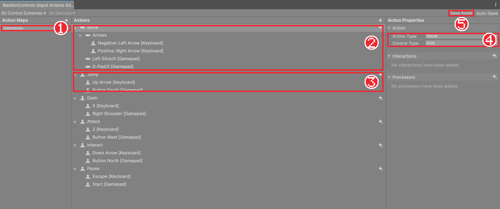
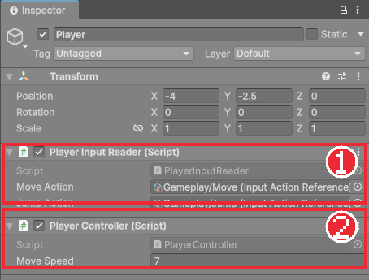

# Chapter 06 입력 시스템

## 학습 목표

- 키 이름을 코드에 직접 쓰지 않고 액션과 바인딩으로 입력을 나누는 이유를 설명할 수 있다.
- Input Actions 에셋에 Move, Jump 액션을 만들고 키보드와 게임패드를 연결할 수 있다.
- `InputActionReference`로 액션을 스크립트에 연결하고, `ReadValue`, `IsPressed`, `performed` 이벤트로 입력을 읽을 수 있다.
- 입력값만큼 기사를 좌우로 움직이고, 움직이는 방향을 바라보게 만들 수 있다.

## 본문

### 06-1 왜 액션으로 나누는가

입력을 가장 단순하게 읽는 방법은 "오른쪽 화살표 키가 눌렸는가"를 코드에서 직접 묻는 것입니다. 그런데 게임이 커지면 문제가 생깁니다. 게임패드도 지원하려면 같은 질문을 패드 버튼으로 한 번 더 써야 하고, 나중에 점프 키를 바꾸려면 코드 곳곳을 찾아 고쳐야 합니다.

그래서 Unity의 **Input System**은 입력을 두 단계로 나눕니다.

| 단계 | 뜻 | 예 |
|---|---|---|
| 액션(Action) | 게임 안에서 하는 행동 | 이동, 점프, 공격 |
| 바인딩(Binding) | 그 행동에 연결된 실제 키나 버튼 | 점프 = 위 화살표, 패드 A 버튼 |

코드는 "점프 액션이 눌렸는가"만 묻습니다. 어떤 키가 점프인지는 에셋 파일에서 정하므로, 키를 바꾸거나 게임패드를 추가해도 코드를 고칠 필요가 없습니다. Universal 2D 템플릿은 처음부터 Input System을 쓰도록 설정되어 있습니다.

이 게임의 조작은 아래와 같습니다. 이 장에서는 이동과 점프만 만들고, 나머지는 해당 기능을 만드는 장에서 추가합니다.

| 키보드 | 게임패드 | 행동 |
|---|---|---|
| ← / → | 왼쪽 스틱, 방향 패드 | 이동 |
| ↑ | A (아래 버튼) | 점프 |
| Z | X (왼쪽 버튼) | 공격 (Chapter 18) |
| X | RB | 구르기 (Chapter 17) |
| ↓ | Y (위 버튼) | 대화 (Chapter 30) |
| Esc | Start | 일시정지 (Chapter 33) |

### 06-2 Input Actions 에셋 만들기

액션과 바인딩은 **Input Actions** 에셋 파일 하나에 모아 둡니다.

1. `Assets/_Bastion`에 `Input` 폴더를 만든다.
2. `Input` 폴더를 우클릭하고 **Create > Input Actions**를 눌러 이름을 `BastionControls`로 짓는다.
3. 만들어진 파일을 더블클릭해 편집 창을 연다.

편집 창은 세 칸으로 나뉩니다. 왼쪽 **Action Maps**는 액션 묶음, 가운데 **Actions**는 액션과 바인딩, 오른쪽 **Properties**는 고른 항목의 설정입니다. 액션 묶음은 "게임 플레이 중", "메뉴 화면" 처럼 상황별로 나눌 때 씁니다. 이 게임은 하나면 충분합니다.

1. Action Maps의 **+**를 눌러 `Gameplay` 묶음을 만든다.
2. 처음 생긴 액션 이름을 `Move`로 바꾸고, Properties에서 **Action Type**을 `Value`, **Control Type**을 `Axis`로 둔다.
3. `Move` 오른쪽의 **+**를 누르고 **Add Positive\Negative Binding**을 고른다. 생긴 묶음의 이름을 `Arrows`로 바꾸고, **Negative**에 `Left Arrow`, **Positive**에 `Right Arrow`를 지정한다.
4. `Move`의 **+**에서 **Add Binding**을 눌러 `Left Stick/X [Gamepad]`를 지정한다.
5. Actions의 **+**로 `Jump` 액션을 만들고 Action Type을 `Button`으로 둔다. 바인딩에 `Up Arrow [Keyboard]`와 `Button South [Gamepad]`를 지정한다.
6. 창 오른쪽 위의 **Save Asset**을 눌러 저장한다.



바인딩의 **Path** 칸을 누르면 장치별 목록에서 키를 고를 수 있고, **Listen** 버튼을 누른 뒤 실제 키를 누르면 그 키가 바로 들어갑니다. 위 그림은 이 과정을 끝까지 마친 완성본이라 Dash, Attack 같은 액션이 더 있습니다.

| 설정 | 뜻 |
|---|---|
| Action Type `Value` + Control Type `Axis` | -1에서 1 사이의 숫자 하나를 돌려준다. 왼쪽은 -1, 오른쪽은 1, 안 누르면 0 |
| Action Type `Button` | 눌렸는지, 떼었는지를 알려 준다 |
| Positive\Negative Binding | 키 두 개를 하나의 축으로 묶는다. Negative 키는 -1, Positive 키는 1 |

### 06-3 입력을 읽는 스크립트

이제 액션을 읽는 스크립트를 만듭니다. 입력을 읽는 일만 맡는 스크립트를 따로 두면, 나중에 이동, 공격, 대화 기능이 모두 같은 곳에서 입력을 가져갈 수 있습니다.

`Assets/_Bastion/Scripts`에 `Player` 폴더를 만들고, 그 안에 `PlayerInputReader` 스크립트를 만들어 아래처럼 적습니다.

```csharp
using UnityEngine;
using UnityEngine.InputSystem;

namespace Bastion.Player
{
    /// <summary>
    /// Input System 액션을 읽어 다른 스크립트가 쓰기 쉬운 값으로 바꿔 둔다.
    /// </summary>
    public sealed class PlayerInputReader : MonoBehaviour
    {
        [SerializeField] InputActionReference moveAction;
        [SerializeField] InputActionReference jumpAction;

        public float MoveX { get; private set; }
        public bool JumpHeld { get; private set; }

        void OnEnable()
        {
            moveAction.action.Enable();
            jumpAction.action.Enable();
            jumpAction.action.performed += OnJumpPerformed;
        }

        void OnDisable()
        {
            jumpAction.action.performed -= OnJumpPerformed;
        }

        void Update()
        {
            MoveX = moveAction.action.ReadValue<float>();
            JumpHeld = jumpAction.action.IsPressed();
        }

        void OnJumpPerformed(InputAction.CallbackContext context)
        {
            Debug.Log("점프 키를 눌렀다");
        }
    }
}
```

#### 코드 해석

- `using UnityEngine.InputSystem;`: Input System의 기능을 씁니다.
- `namespace Bastion.Player`: 이 게임의 코드를 `Bastion` 이름 아래에 모읍니다. 다른 에셋의 클래스와 이름이 겹치지 않게 하려는 것입니다. 완성본도 같은 이름을 씁니다.
- `InputActionReference`: Input Actions 에셋 안의 액션 하나를 가리키는 칸입니다. Inspector에서 연결합니다. `.action`으로 실제 액션을 꺼냅니다.
- `OnEnable` / `OnDisable`: 컴포넌트가 켜질 때와 꺼질 때 Unity가 부르는 이벤트 함수입니다. 켜질 때 액션을 사용 상태(`Enable`)로 만들고 이벤트를 구독하며, 꺼질 때 구독을 해제합니다.
- `ReadValue<float>()`: 액션의 지금 값을 읽습니다. Move는 Axis라서 -1~1의 `float`입니다.
- `IsPressed()`: 버튼이 지금 눌려 있으면 `true`입니다.
- `performed += OnJumpPerformed`: 버튼을 누른 순간에 `OnJumpPerformed`를 불러 달라고 등록합니다. C# 과정에서 배운 이벤트 구독과 같습니다. "누르고 있는가"는 `IsPressed`, "방금 눌렀는가"는 `performed`로 구분해 씁니다.
- `MoveX { get; private set; }`: 다른 스크립트는 읽기만 하고, 값은 이 클래스만 바꿉니다.

### 06-4 액션 연결하기

1. `Player`에 `PlayerInputReader`를 붙인다.
2. Project 창에서 `BastionControls` 왼쪽의 화살표를 눌러 펼친다. `Gameplay/Move`, `Gameplay/Jump` 같은 항목이 보인다.
3. `Gameplay/Move`를 Inspector의 **Move Action** 칸에, `Gameplay/Jump`를 **Jump Action** 칸에 끌어다 놓는다.
4. 실행하고 위 화살표 키를 눌러 Console에 "점프 키를 눌렀다"가 찍히는지 확인한다.

키를 눌러도 반응이 없으면 Game 뷰를 한 번 클릭하세요. 에디터에서는 Game 뷰가 선택되어 있어야 게임이 키 입력을 받습니다.

### 06-5 좌우로 움직이기

입력을 읽었으니 이동을 만듭니다. Chapter 04의 `Mover`와 같은 방법이지만, 방향을 입력값으로 정합니다. `Scripts/Player`에 `PlayerController`를 만듭니다.

```csharp
using UnityEngine;

namespace Bastion.Player
{
    /// <summary>
    /// 플레이어 이동. 지금은 입력값만큼 좌우로 옮기고, 움직이는 방향을 바라보게 한다.
    /// </summary>
    [RequireComponent(typeof(PlayerInputReader))]
    public sealed class PlayerController : MonoBehaviour
    {
        [SerializeField] float moveSpeed = 7f;

        PlayerInputReader input;

        public int FacingDirection { get; private set; } = 1;

        void Awake()
        {
            input = GetComponent<PlayerInputReader>();
        }

        void Update()
        {
            transform.position += Vector3.right * (input.MoveX * moveSpeed * Time.deltaTime);
            UpdateFacing(input.MoveX);
        }

        void UpdateFacing(float moveX)
        {
            if (Mathf.Abs(moveX) < 0.01f)
                return;

            int direction = moveX > 0f ? 1 : -1;
            if (direction == FacingDirection)
                return;

            FacingDirection = direction;
            // 크기(Scale)를 뒤집는 대신 Y축으로 180도 돌려 자식 오브젝트까지 함께 뒤집는다.
            transform.rotation = Quaternion.Euler(0f, direction > 0 ? 0f : 180f, 0f);
        }
    }
}
```

#### 코드 해석

- `[RequireComponent(typeof(PlayerInputReader))]`: 이 컴포넌트를 붙이면 `PlayerInputReader`도 반드시 함께 있게 합니다. 없으면 Unity가 자동으로 붙여 줍니다.
- `Awake()`: `Start`보다 먼저, 오브젝트가 만들어질 때 한 번 실행되는 이벤트 함수입니다. 같은 오브젝트의 다른 컴포넌트를 찾아 두는 일은 보통 `Awake`에서 합니다.
- `GetComponent<PlayerInputReader>()`: 같은 오브젝트에 붙은 `PlayerInputReader`를 가져옵니다.
- `input.MoveX * moveSpeed * Time.deltaTime`: 왼쪽이면 음수, 오른쪽이면 양수라 방향이 저절로 정해집니다.
- `Mathf.Abs(moveX) < 0.01f`: 입력이 거의 없으면 방향을 바꾸지 않습니다. 손을 떼도 마지막에 보던 쪽을 계속 봅니다.
- `Quaternion.Euler(0f, 180f, 0f)`: Y축으로 180도 돌린 회전입니다. 2D에서 Y축으로 뒤집으면 좌우가 반전됩니다. `Quaternion`은 회전을 나타내는 자료형이고, `Euler`로 각도를 넣어 만듭니다.

Transform의 Scale X를 -1로 바꿔도 좌우가 뒤집히지만, 회전으로 뒤집는 쪽을 고른 이유가 있습니다. 나중에 기사의 앞쪽에 공격 판정 같은 자식 오브젝트를 둘 때, 회전은 자식의 위치와 방향까지 자연스럽게 함께 돌려 주기 때문입니다.

`Player`에 `PlayerController`를 붙이고 실행해 좌우 화살표로 기사를 움직여 봅니다.



### 06-6 따라하기 — 키보드로 기사 움직이기

1. `BastionControls` 에셋에 `Gameplay` 묶음과 `Move`, `Jump` 액션을 만들고 저장한다.
2. `PlayerInputReader`와 `PlayerController`를 작성해 `Player`에 붙이고 액션을 연결한다.
3. 실행해 좌우 화살표로 이동하고, 방향을 바꾸면 기사가 그쪽을 바라보는지 확인한다.
4. 위 화살표를 누르면 Console에 메시지가 찍히는지 확인한다.
5. 게임패드가 있다면 연결해 왼쪽 스틱으로도 움직이는지 확인한다.

지금 기사는 바닥 끝을 지나도 떨어지지 않고 허공을 걷습니다. 위치를 직접 바꾸기만 할 뿐, 중력이나 충돌 같은 물리 계산이 없기 때문입니다. 다음 장에서 물리 컴포넌트를 붙입니다.

### 연습문제

1. 문제: 액션과 바인딩의 차이를 예를 들어 한 문장씩 쓰세요.
2. 문제: 점프 키를 위 화살표에서 스페이스바로 바꾸려면 어디를 고쳐야 하는지 쓰세요.  
   - 조건: 코드를 고쳐야 하는지 여부를 함께 쓸 것
3. 문제: `PlayerInputReader`에 공격 액션(`attackAction`)을 추가하고, 누른 순간에 "공격!"을 Console에 찍게 하려면 무엇을 추가해야 하는지 순서대로 쓰세요.  
   - 출력: 변수 선언, OnEnable, OnDisable, 함수 네 곳에 추가할 내용

### 정답 포인트

- 액션은 행동(점프), 바인딩은 실제 키(위 화살표). BastionControls 에셋에서 Jump의 바인딩만 바꾸면 되고 코드는 고치지 않는다. `[SerializeField] InputActionReference attackAction;` 선언 → OnEnable에서 `Enable()`과 `performed +=` → OnDisable에서 `performed -=` → `Debug.Log("공격!")`을 찍는 함수.

---

[상위 문서로 돌아가기](./README.md)
