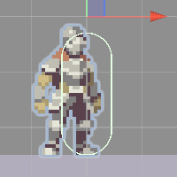
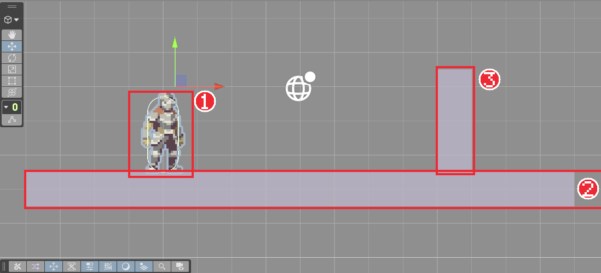
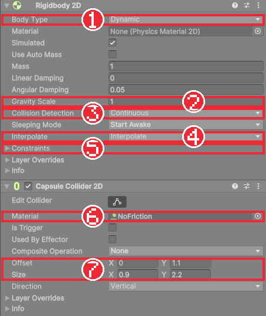

# Chapter 07 물리와 충돌

## 학습 목표

- Rigidbody 2D와 Collider 2D가 각각 맡는 일을 구분할 수 있다.
- `linearVelocity`로 속도를 정해 물리 계산과 함께 캐릭터를 움직일 수 있다.
- `Update`와 `FixedUpdate`의 차이를 설명하고, 물리 코드는 `FixedUpdate`에 둘 수 있다.
- 캐릭터가 넘어지거나 떨리거나 벽에 달라붙는 문제를 Constraints, Interpolate, 마찰 0 재질로 해결할 수 있다.

## 본문

### 07-1 물리 엔진이 하는 일

Chapter 06의 기사는 바닥 끝을 지나도 허공을 걷고, 벽도 그냥 통과합니다. 위치를 직접 바꾸기만 했기 때문입니다. 떨어지고, 부딪히고, 밀리는 계산을 매번 직접 하려면 끝이 없습니다.

Unity에는 이런 계산을 대신하는 **물리 엔진**이 들어 있습니다. 물리 엔진에 맡길 오브젝트에는 두 종류의 컴포넌트를 붙입니다.

| 컴포넌트 | 하는 일 | 비유 |
|---|---|---|
| Rigidbody 2D | 질량, 속도, 중력을 갖게 한다. 물리 엔진이 매번 위치를 계산한다 | 몸무게와 관성 |
| Collider 2D | 부딪히는 모양을 정한다. 다른 콜라이더와 겹치지 않게 막는다 | 몸의 겉모습 |

움직이는 플레이어에는 둘 다 붙이고, 가만히 있는 바닥과 벽에는 Collider 2D만 붙입니다. Rigidbody가 없는 콜라이더는 움직이지 않는 벽처럼 취급됩니다.

### 07-2 Rigidbody 2D와 Collider 2D 붙이기

1. `Player`를 선택하고 **Add Component**에서 `Rigidbody 2D`를 붙인다.
2. 실행해 본다. 기사가 아래로 떨어져 바닥을 뚫고 사라진다.

중력은 받았지만 부딪힐 모양이 없어서 그대로 통과했습니다. 콜라이더를 붙입니다.

3. `Player`에 `Capsule Collider 2D`를 붙이고 **Offset**을 (0, 1.1), **Size**를 (0.9, 2.2)로 둔다.
4. `Floor`에 `Box Collider 2D`를 붙인다. 크기는 스프라이트에 맞춰 자동으로 정해진다.
5. Square로 `Wall`을 하나 더 만들어 Position (4.5, -1, 0), Scale (1, 3, 1)로 두고 `Box Collider 2D`를 붙인다.
6. 실행하면 기사가 바닥 위에 서고, 오른쪽으로 걸어가면 벽에 막힌다.

캡슐 모양을 쓰는 이유는 아래쪽이 둥글어서 바닥의 작은 턱에 덜 걸리기 때문입니다. Offset을 1.1 올린 것은 `Player`의 위치가 발밑이므로 콜라이더의 중심을 키의 절반만큼 올리기 위해서입니다.

콜라이더를 붙이고 보니 초록 선이 기사 그림보다 오른쪽에 있습니다.



기사 그림이 120×80 칸의 가운데가 아니라 조금 왼쪽에 그려져 있기 때문입니다. 그림을 고치는 대신 `Visual`의 Position X를 `0.34375`로 옮겨 그림을 콜라이더에 맞춥니다. 이 값은 그림이 치우친 5.5픽셀을 유닛으로 바꾼 것(5.5 ÷ 16)입니다. **판정(콜라이더)이 기준이고 그림은 그 위에 맞춰 얹는다**는 생각은 앞으로도 계속 씁니다.



### 07-3 속도로 움직이기

Rigidbody가 붙은 오브젝트를 `transform.position`으로 옮기면 물리 엔진의 계산을 무시하고 순간이동시키는 셈이라, 벽에 파고들거나 덜덜 떨립니다. 물리 오브젝트는 **속도**를 정해 주고 이동은 물리 엔진에 맡깁니다.

`PlayerController`를 아래처럼 고칩니다.

```csharp
using UnityEngine;

namespace Bastion.Player
{
    /// <summary>
    /// 플레이어 이동. Rigidbody 2D의 속도를 바꿔 물리 계산(중력, 충돌)과 함께 움직인다.
    /// </summary>
    [RequireComponent(typeof(Rigidbody2D), typeof(PlayerInputReader))]
    public sealed class PlayerController : MonoBehaviour
    {
        [SerializeField] float moveSpeed = 7f;

        Rigidbody2D body;
        PlayerInputReader input;

        public int FacingDirection { get; private set; } = 1;

        void Awake()
        {
            body = GetComponent<Rigidbody2D>();
            input = GetComponent<PlayerInputReader>();
        }

        void Update()
        {
            UpdateFacing(input.MoveX);
        }

        void FixedUpdate()
        {
            // 가로 속도만 입력으로 정하고, 세로 속도(중력으로 떨어지는 속도)는 그대로 둔다.
            body.linearVelocity = new Vector2(input.MoveX * moveSpeed, body.linearVelocity.y);
        }

        void UpdateFacing(float moveX)
        {
            if (Mathf.Abs(moveX) < 0.01f)
                return;

            int direction = moveX > 0f ? 1 : -1;
            if (direction == FacingDirection)
                return;

            FacingDirection = direction;
            transform.rotation = Quaternion.Euler(0f, direction > 0 ? 0f : 180f, 0f);
        }
    }
}
```

#### 코드 해석

- `body.linearVelocity`: Rigidbody의 속도입니다. `Vector2`로 (가로, 세로) 속도를 1초당 유닛 단위로 정합니다. 속도는 "1초에 이만큼"이라 `Time.deltaTime`을 곱하지 않습니다. 물리 엔진이 시간에 맞춰 위치를 옮깁니다.
- `new Vector2(input.MoveX * moveSpeed, body.linearVelocity.y)`: 가로 속도는 입력으로 정하고, 세로 속도는 지금 값을 그대로 둡니다. 세로까지 0으로 덮어쓰면 중력으로 떨어지던 속도가 매번 지워져 공중에 둥둥 뜹니다.
- `FixedUpdate()`: 물리 계산 직전에 실행되는 이벤트 함수입니다.

### 07-4 Update와 FixedUpdate

Unity는 화면 그리기와 물리 계산을 서로 다른 박자로 돌립니다.

| 함수 | 실행 간격 | 여기에 둘 일 |
|---|---|---|
| `Update` | 화면 한 장마다. 컴퓨터마다 다르다 | 입력 확인, 방향 바꾸기, 연출 |
| `FixedUpdate` | 고정 간격(기본 0.02초, 1초에 50번) | 속도 바꾸기, 힘 주기 등 물리 처리 |

물리 계산은 박자가 일정해야 결과가 안정적이라 고정 간격으로 돕니다. 그래서 속도를 바꾸는 코드는 `FixedUpdate`에 둡니다. 반대로 키 입력은 `Update`에서 읽습니다. `FixedUpdate`는 화면 프레임 사이에 실행되지 않을 수도 있어서, 짧게 눌렀다 뗀 입력을 놓칠 수 있기 때문입니다. 이 게임은 `PlayerInputReader`가 `Update`에서 입력을 읽어 두고, `PlayerController`가 `FixedUpdate`에서 그 값을 가져다 씁니다.

### 07-5 넘어짐, 떨림, 벽 달라붙기

이대로 실행하면 세 가지 문제가 보입니다.

**넘어짐.** 벽 모서리에 부딪히면 기사가 옆으로 쓰러져 데굴데굴 구릅니다. 물리 엔진이 회전까지 계산하기 때문입니다. Rigidbody 2D의 **Constraints**를 펼치고 **Freeze Rotation Z**를 체크해 회전을 막습니다.

**떨림.** 카메라가 따라가기 시작하면(Chapter 14) 캐릭터가 미세하게 떨려 보입니다. 물리는 1초에 50번, 화면은 1초에 60번 이상 갱신되어 박자가 어긋나기 때문입니다. **Interpolate**를 `Interpolate`로 두면 물리 계산 사이의 위치를 부드럽게 채워 그려 줍니다.

**벽 달라붙기.** 벽 쪽으로 키를 누른 채 점프하면(Chapter 08) 벽에 붙어 미끄러지지 않습니다. 콜라이더 사이의 **마찰** 때문입니다. 마찰이 0인 재질을 만들어 플레이어 콜라이더에 씌웁니다.

1. `Assets/_Bastion`에 `Data` 폴더를 만든다.
2. `Data`에서 **Create > 2D > Physics Material 2D**를 눌러 `NoFriction`을 만들고, Inspector에서 **Friction**을 `0`으로 둔다.
3. `Player`의 Capsule Collider 2D **Material** 칸에 `NoFriction`을 넣는다.

마지막으로 **Collision Detection**을 `Continuous`로 둡니다. 빠르게 움직이는 물체가 한 프레임 사이에 얇은 벽을 건너뛰어 통과하는 일을 막아 줍니다.



| 설정 | 값 | 막는 문제 |
|---|---|---|
| Constraints | Freeze Rotation Z 체크 | 넘어져 구르기 |
| Interpolate | Interpolate | 카메라가 따라갈 때 떨림 |
| Collision Detection | Continuous | 빠를 때 벽 통과 |
| 콜라이더 Material | NoFriction (마찰 0) | 벽에 달라붙기 |

**Body Type**은 그대로 `Dynamic`입니다. 물리 엔진이 힘과 중력을 계산해 움직이는 종류입니다. 코드로만 움직이고 중력과 충돌 반응은 받지 않는 `Kinematic`, 절대 움직이지 않는 `Static`도 있는데, 보스처럼 공중에 떠서 코드로 움직이는 대상에 `Kinematic`을 씁니다(Chapter 25).

### 07-6 따라하기 — 물리로 움직이는 기사

1. `Player`에 Rigidbody 2D와 Capsule Collider 2D를 붙이고 위 표대로 설정한다.
2. `Visual`의 Position X를 0.34375로 옮겨 그림과 콜라이더를 맞춘다.
3. `Floor`와 `Wall`에 Box Collider 2D를 붙인다.
4. `PlayerController`를 속도 방식으로 고치고 실행해, 벽에 막히고 바닥 끝에서 떨어지는지 확인한다.
5. Freeze Rotation Z를 잠깐 꺼서 벽 모서리에 부딪힐 때 넘어지는 것을 확인한 뒤 다시 켠다.

이제 기사가 땅을 딛고 섰습니다. 다음 장에서는 점프를 만들고, "지금 바닥에 서 있는가"를 판단하는 방법을 배웁니다.

### 연습문제

1. 문제: 바닥, 벽, 플레이어 중 Rigidbody 2D가 필요한 것과 Collider 2D가 필요한 것을 각각 쓰세요.
2. 문제: 아래 코드의 문제를 찾아 고치세요.  
   - 입력: `void FixedUpdate() { body.linearVelocity = new Vector2(input.MoveX * moveSpeed, 0f); }`
   - 출력: 문제 설명 한 줄과 고친 코드
3. 문제: 키 입력은 `Update`에서, 속도 변경은 `FixedUpdate`에서 하는 이유를 각각 한 문장으로 쓰세요.

### 정답 포인트

- Rigidbody 2D는 플레이어만, Collider 2D는 셋 다. 세로 속도를 0으로 덮어써 중력으로 떨어지지 않으므로 `body.linearVelocity.y`로 둔다. 입력은 매 화면 프레임 확인해야 놓치지 않고, 물리는 고정 간격으로 계산되므로 속도 변경도 그 박자에 맞춘다.

---

[다음 문서: Chapter 08 점프와 바닥 판정](./08-jump-ground-check.md)

[상위 문서로 돌아가기](./README.md)
