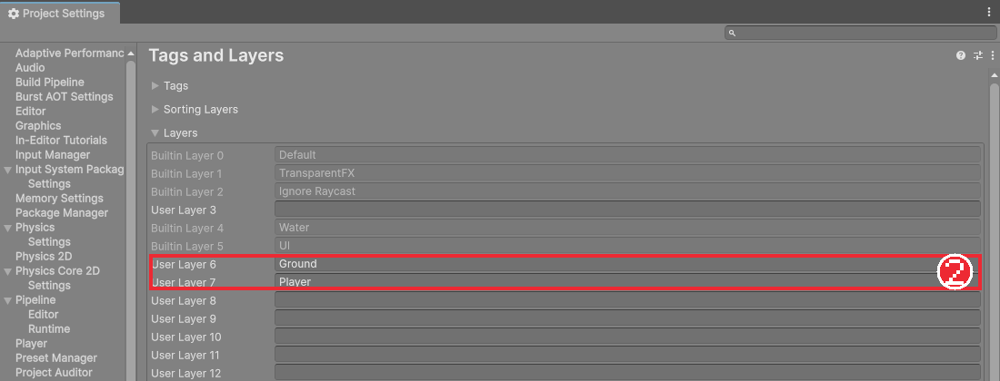
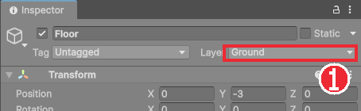
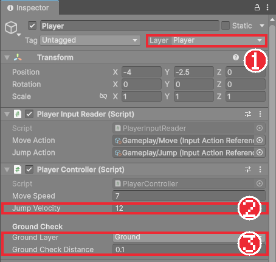

# Chapter 08 점프와 바닥 판정

## 학습 목표

- 레이어를 만들어 오브젝트를 종류별로 나누고, `LayerMask`로 원하는 레이어만 골라 검사할 수 있다.
- 레이캐스트와 콜라이더 캐스트가 무엇인지 설명하고, 콜라이더 캐스트로 바닥에 서 있는지 판단할 수 있다.
- 접촉면의 법선으로 바닥과 벽을 구분할 수 있다.
- 바닥에 서 있을 때만 점프하도록 만들 수 있다.

## 본문

### 08-1 점프는 언제 해도 될까

점프 자체는 간단합니다. 위쪽 속도를 한 번 크게 주면 중력이 알아서 끌어내립니다. 문제는 **언제** 점프를 허락하느냐입니다. 공중에서도 점프 키가 먹으면 계속 눌러 하늘로 날아가 버립니다. 그래서 "지금 발이 바닥에 닿아 있는가"를 매번 알아내야 합니다.

바닥은 지금은 `Floor` 하나뿐이지만 곧 타일맵, 떠 있는 발판, 경사로가 생깁니다. 이들을 이름으로 하나하나 확인할 수는 없으므로, "바닥 종류"라는 표시를 붙여 한꺼번에 다룹니다. 이 표시가 **레이어**입니다.

### 08-2 레이어 만들기

**레이어**(Layer)는 게임 오브젝트를 종류별로 나누는 번호표입니다. 오브젝트 하나는 레이어를 하나 가지며, 물리 검사나 카메라 표시에서 "이 레이어만" 골라 쓸 수 있습니다.

1. Inspector 오른쪽 위의 **Layer** 드롭다운에서 **Add Layer...**를 누른다. Tags and Layers 설정 화면이 열린다.
2. **User Layer 6**에 `Ground`, **User Layer 7**에 `Player`를 적는다.



3. `Floor`와 `Wall`을 선택하고 Inspector의 **Layer**를 `Ground`로 바꾼다.
4. `Player`의 Layer를 `Player`로 바꾼다. 자식에게도 적용할지 묻는 창이 뜨면 **Yes, change children**을 누른다.



레이어 번호 0~5는 Unity가 미리 쓰는 자리라 6번부터 씁니다. 완성본과 번호를 맞춰 두면 나중에 비교하기 쉽습니다. 이후 장에서 `Enemy`(8), `Projectile`(9)도 추가합니다.

### 08-3 레이캐스트와 콜라이더 캐스트

바닥에 서 있는지 알아보는 가장 흔한 방법은 발밑으로 짧은 선을 쏘아 무언가에 닿는지 보는 것입니다. 보이지 않는 광선을 쏘아 맞는 것을 찾는 일을 **레이캐스트**(Raycast)라고 합니다.

```csharp
bool hit = Physics2D.Raycast(transform.position, Vector2.down, 0.1f, groundLayer);
```

`Physics2D.Raycast(시작점, 방향, 거리, 레이어)`처럼 씁니다. 그런데 광선은 굵기가 없는 선이라, 기사 발의 가운데에서 한 줄만 쏘면 발판 끝에 한쪽 발만 걸쳤을 때 바닥을 찾지 못합니다.

그래서 이 게임은 선 대신 **콜라이더 모양 그대로를 아래로 살짝 밀어 보는** 방법을 씁니다. 이것을 **콜라이더 캐스트**라고 합니다. 캡슐 전체로 검사하므로 발끝만 걸쳐도 바닥을 찾습니다.

| 방법 | 검사하는 모양 | 장점 | 단점 |
|---|---|---|---|
| Raycast | 굵기 없는 선 | 간단하고 가볍다 | 발판 끝에서 놓친다 |
| Collider Cast | 내 콜라이더 모양 | 몸 전체로 검사해 빈틈이 없다 | 조금 더 계산한다 |

### 08-4 법선으로 바닥과 벽 구분하기

콜라이더를 아래로 밀었을 때 벽 옆면에 스쳐도 무언가에 닿습니다. 벽에 붙어 있을 때 점프가 되면 벽을 타고 계속 올라갈 수 있으니 바닥과 벽을 구분해야 합니다.

부딪힌 면이 바라보는 방향을 **법선**(normal)이라고 합니다. 평평한 바닥의 법선은 위쪽 (0, 1), 오른쪽을 향한 벽 옆면의 법선은 (1, 0)입니다. 법선의 y가 충분히 크면(이 게임은 0.7보다 크면) 위를 향한 면, 즉 바닥으로 봅니다. 0.7은 약 45도까지 기울어진 경사도 바닥으로 인정하는 값입니다.

### 08-5 점프 코드

먼저 `PlayerInputReader`가 점프를 "눌렀다는 사실"을 기억하게 합니다. 누른 순간에 표시를 세우고, 처리한 쪽이 표시를 지웁니다.

```csharp
using UnityEngine;
using UnityEngine.InputSystem;

namespace Bastion.Player
{
    /// <summary>
    /// Input System 액션을 읽어 다른 스크립트가 쓰기 쉬운 값으로 바꿔 둔다.
    /// </summary>
    public sealed class PlayerInputReader : MonoBehaviour
    {
        [SerializeField] InputActionReference moveAction;
        [SerializeField] InputActionReference jumpAction;

        public float MoveX { get; private set; }
        public bool JumpHeld { get; private set; }
        /// <summary>점프를 눌렀고 아직 처리하지 않았으면 true.</summary>
        public bool JumpPressed { get; private set; }

        void OnEnable()
        {
            moveAction.action.Enable();
            jumpAction.action.Enable();
            jumpAction.action.performed += OnJumpPerformed;
        }

        void OnDisable()
        {
            jumpAction.action.performed -= OnJumpPerformed;
        }

        void Update()
        {
            MoveX = moveAction.action.ReadValue<float>();
            JumpHeld = jumpAction.action.IsPressed();
        }

        void OnJumpPerformed(InputAction.CallbackContext context) => JumpPressed = true;

        /// <summary>점프 입력을 처리했다고 표시한다.</summary>
        public void ConsumeJump() => JumpPressed = false;
    }
}
```

#### 코드 해석

- `JumpPressed`: 키를 누른 순간 `true`가 되고, `ConsumeJump()`를 부를 때까지 남아 있습니다. 입력은 `Update` 박자, 점프 처리는 `FixedUpdate` 박자라서 "누른 순간"을 그대로 넘기면 놓칠 수 있습니다. 표시를 세워 두면 다음 물리 단계에서 확실히 처리됩니다.
- `=> JumpPressed = true;`: 한 줄짜리 함수를 `=>`로 줄여 쓴 형태입니다.

이어서 `PlayerController`에 바닥 판정과 점프를 넣습니다.

```csharp
using UnityEngine;

namespace Bastion.Player
{
    /// <summary>
    /// 플레이어 이동과 점프. 아래로 콜라이더를 살짝 밀어 보아 바닥에 서 있는지 판단한다.
    /// </summary>
    [RequireComponent(typeof(Rigidbody2D), typeof(Collider2D), typeof(PlayerInputReader))]
    public sealed class PlayerController : MonoBehaviour
    {
        [SerializeField] float moveSpeed = 7f;
        [SerializeField] float jumpVelocity = 12f;

        [Header("Ground Check")]
        [SerializeField] LayerMask groundLayer;
        [SerializeField] float groundCheckDistance = 0.1f;

        Rigidbody2D body;
        Collider2D bodyCollider;
        PlayerInputReader input;
        readonly RaycastHit2D[] groundHits = new RaycastHit2D[4];

        public int FacingDirection { get; private set; } = 1;
        public bool IsGrounded { get; private set; }

        void Awake()
        {
            body = GetComponent<Rigidbody2D>();
            bodyCollider = GetComponent<Collider2D>();
            input = GetComponent<PlayerInputReader>();
        }

        void Update()
        {
            UpdateFacing(input.MoveX);
        }

        void FixedUpdate()
        {
            UpdateGrounded();

            body.linearVelocity = new Vector2(input.MoveX * moveSpeed, body.linearVelocity.y);

            if (input.JumpPressed)
            {
                input.ConsumeJump();
                if (IsGrounded)
                    body.linearVelocity = new Vector2(body.linearVelocity.x, jumpVelocity);
            }
        }

        void UpdateGrounded()
        {
            var filter = new ContactFilter2D { useLayerMask = true, layerMask = groundLayer, useTriggers = false };
            int count = bodyCollider.Cast(Vector2.down, filter, groundHits, groundCheckDistance);

            IsGrounded = false;
            for (int i = 0; i < count; i++)
            {
                // 벽 옆면에 닿은 것은 바닥으로 보지 않는다.
                if (groundHits[i].normal.y > 0.7f)
                {
                    IsGrounded = true;
                    break;
                }
            }

            // 위로 올라가는 중에는 발판을 스쳐도 바닥에 선 것으로 보지 않는다.
            if (IsGrounded && body.linearVelocity.y > 0.01f)
                IsGrounded = false;
        }

        void UpdateFacing(float moveX)
        {
            if (Mathf.Abs(moveX) < 0.01f)
                return;

            int direction = moveX > 0f ? 1 : -1;
            if (direction == FacingDirection)
                return;

            FacingDirection = direction;
            transform.rotation = Quaternion.Euler(0f, direction > 0 ? 0f : 180f, 0f);
        }
    }
}
```

#### 코드 해석

- `LayerMask groundLayer`: 검사할 레이어를 고르는 칸입니다. Inspector에 레이어 목록이 체크 상자로 나옵니다.
- `[Header("Ground Check")]`: Inspector에 굵은 소제목을 넣어 칸을 묶어 보여 줍니다. 동작에는 영향이 없습니다.
- `ContactFilter2D`: 검사 조건 묶음입니다. 여기서는 "groundLayer에 속하고, 트리거(Chapter 21)가 아닌 콜라이더만"입니다.
- `bodyCollider.Cast(방향, 조건, 결과배열, 거리)`: 내 콜라이더를 아래로 0.1만큼 밀어 보고, 부딪힌 것들을 `groundHits` 배열에 채운 뒤 개수를 돌려줍니다. 결과를 담을 배열을 미리 만들어 두고 재사용하면 매 프레임 새 배열을 만들지 않아도 됩니다.
- `groundHits[i].normal.y > 0.7f`: 부딪힌 면의 법선이 충분히 위를 향하면 바닥입니다.
- 마지막 `if`: 점프 직후 올라가는 동안 발판 모서리를 스치면 바닥으로 잘못 판단해 공중에서 또 점프할 수 있습니다. 위로 움직이는 중에는 바닥이 아니라고 봅니다.

### 08-6 연결하고 시험하기

1. `Player`의 PlayerController에서 **Ground Layer**를 `Ground`로 고른다.
2. 실행하고 위 화살표를 눌러 점프한다. 공중에서 다시 눌러도 점프하지 않아야 한다.
3. 벽에 붙은 채 위 화살표를 연타해 벽을 타고 오르지 못하는지 확인한다.



**Ground Layer**를 `Nothing`으로 두면 어떤 바닥도 찾지 못해 점프가 전혀 되지 않습니다. 점프가 안 될 때 가장 먼저 확인할 곳입니다.

### 08-7 따라하기 — 점프하는 기사

1. `Ground`, `Player` 레이어를 만들고 바닥, 벽, 플레이어에 지정한다.
2. `PlayerInputReader`에 `JumpPressed`와 `ConsumeJump`를 추가한다.
3. `PlayerController`에 바닥 판정과 점프를 넣고 Ground Layer를 연결한다.
4. Jump Velocity를 8, 12, 16으로 바꿔 가며 점프 높이를 비교한다.
5. 점프한 뒤 공중에 오래 떠 있는 느낌이 드는지, 착지 직전에 누른 점프가 무시되는지 직접 확인해 둔다.

5번에서 느낀 "둥실둥실 뜨는 점프"와 "씹히는 입력"은 다음 장에서 고칩니다. 액션 게임의 손맛은 이런 작은 차이에서 나옵니다.

### 연습문제

1. 문제: 레이캐스트 대신 콜라이더 캐스트로 바닥을 검사하는 이유를 한 문장으로 쓰세요.  
   - 조건: "발판 끝"이라는 말을 포함할 것
2. 문제: 다음 면의 법선이 주어졌을 때 바닥으로 인정되는 것을 고르세요.  
   - 입력: (가) (0, 1) (나) (1, 0) (다) (0.6, 0.8) (라) (-0.8, 0.6)
   - 조건: 기준은 `normal.y > 0.7`
3. 문제: 점프가 전혀 되지 않을 때 확인할 곳 세 가지를 쓰세요.

### 정답 포인트

- 선 하나는 발판 끝에 발끝만 걸쳤을 때 놓치지만 콜라이더 모양은 몸 전체로 검사한다. (가)와 (다). Ground Layer 설정, 바닥 오브젝트의 Layer가 Ground인지, 바닥에 콜라이더가 있는지(그리고 점프 액션 연결).

---

[상위 문서로 돌아가기](./README.md)
