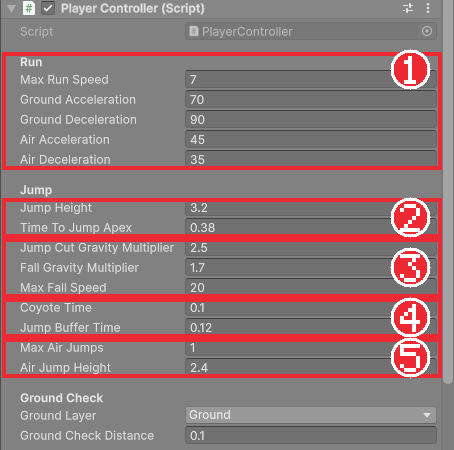

# Chapter 09 손맛 있는 점프

## 학습 목표

- 점프 높이와 정점 시간으로 중력과 점프 속도를 계산하고, 중력을 직접 적용할 수 있다.
- 가변 점프, 빠른 낙하, 가감속으로 조작감을 다듬을 수 있다.
- 코요테 타임과 점프 버퍼가 해결하는 문제를 설명하고 구현할 수 있다.
- 공중 점프(더블점프)를 횟수 제한과 함께 만들 수 있다.

## 본문

### 09-1 Chapter 08의 점프가 아쉬운 이유

Chapter 08의 점프를 해 보면 몇 가지가 거슬립니다.

| 느낌 | 원인 |
|---|---|
| 너무 높이, 둥실둥실 뜬다 | Unity 기본 중력(9.81)은 현실 기준이라 게임에서는 느리게 느껴진다 |
| 높이 조절이 안 된다 | 버튼을 짧게 눌러도 길게 눌러도 똑같이 뛴다 |
| 미끄러지듯 멈춘다, 혹은 너무 딱딱하다 | 속도가 입력과 동시에 0이나 최고 속도로 바로 바뀐다 |
| 발판 끝에서 점프가 안 먹는다 | 발이 떨어진 바로 다음 순간에는 바닥 판정이 꺼져 있다 |
| 착지 직전에 누른 점프가 무시된다 | 공중에서 누른 입력은 바로 버려진다 |

잘 만든 플랫포머 게임들은 이 문제들을 모두 손봅니다. 하나씩 고쳐 봅니다. 이 장의 수치는 완성본과 같습니다.

### 09-2 중력을 직접 계산하기

Rigidbody 2D의 중력은 숫자 하나(Gravity Scale)로만 조절할 수 있어서 "3칸 높이까지 0.38초 만에 올라간다" 같은 목표를 맞추기 어렵습니다. 그래서 Rigidbody의 중력을 끄고(`gravityScale = 0`), 필요한 중력을 직접 계산해 속도에 더합니다.

기획에서 정하기 쉬운 값은 **점프 높이**(h)와 **정점까지 걸리는 시간**(t)입니다. 물리 공식으로 이 둘에서 중력(g)과 처음 속도(v)를 거꾸로 구할 수 있습니다.

| 구할 값 | 공식 | h = 3.2, t = 0.38일 때 |
|---|---|---|
| 중력 g | g = 2h ÷ t² | 2 × 3.2 ÷ 0.1444 ≈ 44.3 |
| 점프 속도 v | v = g × t | 44.3 × 0.38 ≈ 16.8 |
| 공중 점프 속도 (높이 h₂) | v = √(2 × g × h₂) | √(2 × 44.3 × 2.4) ≈ 14.6 |

현실 중력보다 4배 이상 강한 중력으로 빠르게 올라갔다 빠르게 내려오는 것이 액션 게임다운 점프입니다. 코드로는 계산식을 프로퍼티로 둡니다.

```csharp
float Gravity => 2f * jumpHeight / (timeToJumpApex * timeToJumpApex);
float JumpVelocity => Gravity * timeToJumpApex;
float AirJumpVelocity => Mathf.Sqrt(2f * Gravity * airJumpHeight);
```

`jumpHeight`와 `timeToJumpApex`만 바꾸면 중력과 점프 속도가 저절로 맞춰집니다. 공중에 있을 때만 매 물리 단계마다 중력만큼 세로 속도를 줄입니다. 바닥에 서 있을 때는 바닥이 받쳐 주므로 중력을 쌓지 않습니다.

### 09-3 가변 점프와 빠른 낙하

중력에 **배율**을 곱해 상황마다 다르게 적용합니다.

```csharp
void ApplyGravity()
{
    float multiplier = 1f;
    if (body.linearVelocity.y < 0f)
        multiplier = fallGravityMultiplier;
    else if (body.linearVelocity.y > 0f && !input.JumpHeld)
        multiplier = jumpCutGravityMultiplier;

    float y = body.linearVelocity.y - Gravity * multiplier * Time.fixedDeltaTime;
    body.linearVelocity = new Vector2(body.linearVelocity.x, Mathf.Max(y, -maxFallSpeed));
}
```

#### 코드 해석

- 떨어지는 중(`y < 0`)에는 중력을 1.7배로 해 **빠르게 낙하**합니다. 올라갈 때보다 내려올 때가 빨라야 점프가 묵직하게 느껴집니다.
- 올라가는 중인데 점프 버튼을 뗐으면(`!input.JumpHeld`) 중력을 2.5배로 해 곧바로 꺾여 내려옵니다. 짧게 누르면 낮게, 길게 누르면 높게 뛰는 **가변 점프**입니다.
- `Time.fixedDeltaTime`: `FixedUpdate`의 간격(0.02초)입니다. 속도 변화도 시간에 비례하므로 곱합니다.
- `Mathf.Max(y, -maxFallSpeed)`: 떨어지는 속도가 끝없이 커지지 않게 최대 낙하 속도(20)에서 멈춥니다.

직접 재 보면 길게 누른 점프는 약 3유닛, 바로 뗀 점프는 약 1.1유닛까지 올라갑니다.

### 09-4 가속과 감속

입력을 넣자마자 최고 속도가 되고 떼자마자 멈추면 로봇처럼 딱딱합니다. 반대로 너무 느리게 가속하면 미끄러운 얼음 같습니다. 목표 속도를 향해 **일정한 비율로 다가가게** 만들어 그 사이를 고릅니다.

```csharp
void ApplyHorizontalMovement(float acceleration, float deceleration)
{
    float target = input.MoveX * maxRunSpeed;
    float rate = Mathf.Abs(target) > 0.01f ? acceleration : deceleration;
    float x = Mathf.MoveTowards(body.linearVelocity.x, target, rate * Time.fixedDeltaTime);
    body.linearVelocity = new Vector2(x, body.linearVelocity.y);
}
```

#### 코드 해석

- `Mathf.MoveTowards(현재, 목표, 최대 변화량)`: 현재 값을 목표 쪽으로 최대 변화량만큼만 옮긴 값을 돌려줍니다. 목표를 넘어가지 않습니다.
- 입력이 있으면 가속(`acceleration`), 없으면 감속(`deceleration`) 비율을 씁니다. 가속 70이면 최고 속도 7까지 0.1초, 감속 90이면 약 0.08초에 멈춥니다.
- 바닥과 공중에 다른 값을 줍니다. 공중에서는 가속 45, 감속 35로 조금 둔하게 해 점프 중 방향을 너무 쉽게 꺾지 못하게 합니다.

### 09-5 코요테 타임

발판 끝에서 달리다가 점프를 누르면, 사람 눈에는 아직 발판 위인데 게임은 이미 공중이라고 판단해 점프가 무시되는 일이 생깁니다. 반응 시간 0.1초 차이로 생기는 억울한 순간입니다.

**코요테 타임**은 바닥을 떠난 뒤에도 아주 잠깐(0.1초) 동안은 지상 점프를 허락하는 기법입니다. 만화 속 코요테가 절벽을 지나서도 잠시 공중을 달리다 떨어지는 모습에서 이름을 땄습니다.

```csharp
bool IsInCoyoteTime => Time.time - LastGroundedTime <= coyoteTime;
```

바닥에 서 있는 동안 매 물리 단계마다 `LastGroundedTime`에 지금 시각을 기록해 두고, 그 시각으로부터 0.1초 안이면 점프를 허락합니다. 점프하는 순간 `LastGroundedTime`을 아주 먼 과거(`float.NegativeInfinity`)로 돌려, 코요테 시간 안에 두 번 뛰는 일을 막습니다.

### 09-6 점프 버퍼

반대 상황도 있습니다. 착지 직전에 점프를 눌렀는데 아직 공중이라 무시되면, 플레이어는 "분명 눌렀는데"라고 느낍니다. **점프 버퍼**는 누른 입력을 잠깐(0.12초) 보관했다가 그 사이에 착지하면 바로 뛰게 하는 기법입니다.

이를 위해 `PlayerInputReader`가 "눌렸다/안 눌렸다" 대신 **눌린 시각**을 기록하게 바꿉니다.

```csharp
const float NotPressed = float.NegativeInfinity;

public float LastJumpPressedTime { get; private set; } = NotPressed;

void OnJumpPerformed(InputAction.CallbackContext context) => LastJumpPressedTime = Time.time;

public void ConsumeJump() => LastJumpPressedTime = NotPressed;
```

쓰는 쪽에서는 "보관 시간 안에 눌렸는가"를 묻습니다.

```csharp
bool HasBufferedJump => Time.time - input.LastJumpPressedTime <= jumpBufferTime;
```

`Time.time`은 게임이 시작된 뒤 흐른 시간(초)입니다. 입력을 처리하면 `ConsumeJump()`로 시각을 지워 같은 입력으로 두 번 뛰지 않게 합니다. 앞으로 공격과 구르기 입력도 같은 방식으로 보관합니다.

### 09-7 더블점프

공중에서 한 번 더 뛰는 **공중 점프**를 넣습니다. 남은 횟수를 세다가 착지하면 다시 채웁니다.

```csharp
void TryJump()
{
    if (!HasBufferedJump)
        return;

    // 바닥에 있거나 막 떨어졌으면 지상 점프, 아니면 남은 공중 점프를 쓴다.
    if (IsGrounded || IsInCoyoteTime)
        Jump();
    else if (AirJumpsRemaining > 0)
        AirJump();
}
```

공중 점프는 높이를 2.4로 지상 점프보다 조금 낮게 둡니다. `maxAirJumps`를 0으로 하면 더블점프가 없는 게임, 2로 하면 트리플점프가 됩니다.

### 09-8 전체 코드

지금까지의 내용을 합친 `PlayerInputReader`와 `PlayerController`입니다.

```csharp
using UnityEngine;
using UnityEngine.InputSystem;

namespace Bastion.Player
{
    /// <summary>
    /// Input System 액션을 읽어 다른 스크립트가 쓰기 쉬운 값으로 바꿔 둔다.
    /// 버튼은 "눌린 시각"을 기록해 두고, 쓰는 쪽에서 보관 시간 안에 눌렸는지 판단한다.
    /// </summary>
    public sealed class PlayerInputReader : MonoBehaviour
    {
        [SerializeField] InputActionReference moveAction;
        [SerializeField] InputActionReference jumpAction;

        const float NotPressed = float.NegativeInfinity;

        public float MoveX { get; private set; }
        public bool JumpHeld { get; private set; }
        public float LastJumpPressedTime { get; private set; } = NotPressed;

        void OnEnable()
        {
            moveAction.action.Enable();
            jumpAction.action.Enable();
            jumpAction.action.performed += OnJumpPerformed;
        }

        void OnDisable()
        {
            jumpAction.action.performed -= OnJumpPerformed;
        }

        void Update()
        {
            MoveX = moveAction.action.ReadValue<float>();
            JumpHeld = jumpAction.action.IsPressed();
        }

        void OnJumpPerformed(InputAction.CallbackContext context) => LastJumpPressedTime = Time.time;

        public void ConsumeJump() => LastJumpPressedTime = NotPressed;
    }
}
```

```csharp
using UnityEngine;

namespace Bastion.Player
{
    /// <summary>
    /// 플레이어 이동과 점프. 중력을 직접 계산해 점프 높이와 체공 시간을 원하는 대로 맞춘다.
    /// </summary>
    [RequireComponent(typeof(Rigidbody2D), typeof(Collider2D), typeof(PlayerInputReader))]
    public sealed class PlayerController : MonoBehaviour
    {
        [Header("Run")]
        [SerializeField] float maxRunSpeed = 7f;
        [SerializeField] float groundAcceleration = 70f;
        [SerializeField] float groundDeceleration = 90f;
        [SerializeField] float airAcceleration = 45f;
        [SerializeField] float airDeceleration = 35f;

        [Header("Jump")]
        [SerializeField] float jumpHeight = 3.2f;
        [SerializeField] float timeToJumpApex = 0.38f;
        [SerializeField] float jumpCutGravityMultiplier = 2.5f;
        [SerializeField] float fallGravityMultiplier = 1.7f;
        [SerializeField] float maxFallSpeed = 20f;
        [SerializeField] float coyoteTime = 0.1f;
        [SerializeField] float jumpBufferTime = 0.12f;
        [SerializeField] int maxAirJumps = 1;
        [SerializeField] float airJumpHeight = 2.4f;

        [Header("Ground Check")]
        [SerializeField] LayerMask groundLayer;
        [SerializeField] float groundCheckDistance = 0.1f;

        Rigidbody2D body;
        Collider2D bodyCollider;
        PlayerInputReader input;
        readonly RaycastHit2D[] groundHits = new RaycastHit2D[4];

        public int FacingDirection { get; private set; } = 1;
        public bool IsGrounded { get; private set; }
        public float LastGroundedTime { get; private set; } = float.NegativeInfinity;
        public int AirJumpsRemaining { get; private set; }

        // 점프 높이와 정점까지 걸리는 시간으로 중력과 점프 속도를 거꾸로 계산한다.
        float Gravity => 2f * jumpHeight / (timeToJumpApex * timeToJumpApex);
        float JumpVelocity => Gravity * timeToJumpApex;
        float AirJumpVelocity => Mathf.Sqrt(2f * Gravity * airJumpHeight);

        bool HasBufferedJump => Time.time - input.LastJumpPressedTime <= jumpBufferTime;
        bool IsInCoyoteTime => Time.time - LastGroundedTime <= coyoteTime;

        void Awake()
        {
            body = GetComponent<Rigidbody2D>();
            bodyCollider = GetComponent<Collider2D>();
            input = GetComponent<PlayerInputReader>();
            // 중력은 Rigidbody 대신 직접 적용한다.
            body.gravityScale = 0f;
        }

        void Update()
        {
            UpdateFacing(input.MoveX);
            TryJump();
        }

        void FixedUpdate()
        {
            UpdateGrounded();

            if (IsGrounded)
            {
                ApplyHorizontalMovement(groundAcceleration, groundDeceleration);
            }
            else
            {
                ApplyHorizontalMovement(airAcceleration, airDeceleration);
                ApplyGravity();
            }
        }

        void TryJump()
        {
            if (!HasBufferedJump)
                return;

            // 바닥에 있거나 막 떨어졌으면 지상 점프, 아니면 남은 공중 점프를 쓴다.
            if (IsGrounded || IsInCoyoteTime)
                Jump();
            else if (AirJumpsRemaining > 0)
                AirJump();
        }

        void Jump()
        {
            input.ConsumeJump();
            LastGroundedTime = float.NegativeInfinity; // 코요테 시간 안에 두 번 뛰지 않게 한다
            body.linearVelocity = new Vector2(body.linearVelocity.x, JumpVelocity);
        }

        void AirJump()
        {
            input.ConsumeJump();
            AirJumpsRemaining--;
            body.linearVelocity = new Vector2(body.linearVelocity.x, AirJumpVelocity);
        }

        void ApplyHorizontalMovement(float acceleration, float deceleration)
        {
            float target = input.MoveX * maxRunSpeed;
            float rate = Mathf.Abs(target) > 0.01f ? acceleration : deceleration;
            float x = Mathf.MoveTowards(body.linearVelocity.x, target, rate * Time.fixedDeltaTime);
            body.linearVelocity = new Vector2(x, body.linearVelocity.y);
        }

        void ApplyGravity()
        {
            float multiplier = 1f;
            if (body.linearVelocity.y < 0f)
                multiplier = fallGravityMultiplier;
            else if (body.linearVelocity.y > 0f && !input.JumpHeld)
                multiplier = jumpCutGravityMultiplier;

            float y = body.linearVelocity.y - Gravity * multiplier * Time.fixedDeltaTime;
            body.linearVelocity = new Vector2(body.linearVelocity.x, Mathf.Max(y, -maxFallSpeed));
        }

        void UpdateGrounded()
        {
            var filter = new ContactFilter2D { useLayerMask = true, layerMask = groundLayer, useTriggers = false };
            int count = bodyCollider.Cast(Vector2.down, filter, groundHits, groundCheckDistance);

            IsGrounded = false;
            for (int i = 0; i < count; i++)
            {
                if (groundHits[i].normal.y > 0.7f)
                {
                    IsGrounded = true;
                    break;
                }
            }

            if (IsGrounded && body.linearVelocity.y > 0.01f)
                IsGrounded = false;

            if (IsGrounded)
            {
                LastGroundedTime = Time.time;
                AirJumpsRemaining = maxAirJumps;
            }
        }

        void UpdateFacing(float moveX)
        {
            if (Mathf.Abs(moveX) < 0.01f)
                return;

            int direction = moveX > 0f ? 1 : -1;
            if (direction == FacingDirection)
                return;

            FacingDirection = direction;
            transform.rotation = Quaternion.Euler(0f, direction > 0 ? 0f : 180f, 0f);
        }
    }
}
```

#### 코드 해석

- 점프 판단(`TryJump`)은 `Update`에, 속도 계산은 `FixedUpdate`에 둡니다. 점프는 속도를 한 번 바꾸는 일이라 입력을 받은 그 프레임에 바로 처리해도 됩니다.
- 바닥에 있을 때는 중력을 쌓지 않고, 공중에서만 `ApplyGravity`를 부릅니다.



### 09-9 따라하기 — 점프 다듬기

1. 위 코드로 두 스크립트를 바꾸고 실행한다.
2. 점프 버튼을 짧게 누를 때와 길게 누를 때 높이가 다른지 확인한다.
3. 발판(벽) 위에서 달리다 끝에서 늦게 점프해도 뛰어지는지, 착지 직전에 누른 점프가 먹는지 확인한다.
4. 공중에서 한 번 더 뛰어지고, 세 번째는 안 되는지 확인한다.
5. Jump Height를 5, Time To Jump Apex를 0.5로 바꿔 보고 느낌을 비교한 뒤 원래 값으로 돌린다.

수치가 Inspector에 열 개 넘게 늘어났습니다. 다음 장에서는 이 수치들을 코드와 분리해 따로 저장하는 방법을 배웁니다.

### 연습문제

1. 문제: 점프 높이 4, 정점 시간 0.4초일 때 중력과 점프 속도를 계산하세요.  
   - 출력: g와 v (소수 첫째 자리까지)
2. 문제: 코요테 타임과 점프 버퍼가 각각 어떤 억울한 상황을 막는지 한 문장씩 쓰세요.
3. 문제: 점프 버튼을 떼도 높이가 똑같다면 어느 부분을 확인해야 하는지 쓰세요.  
   - 조건: 변수 이름 두 개 이상을 포함할 것

### 정답 포인트

- g = 2 × 4 ÷ 0.16 = 50.0, v = 50 × 0.4 = 20.0. 코요테 타임은 발판 끝에서 조금 늦게 누른 점프, 점프 버퍼는 착지 직전에 조금 일찍 누른 점프를 살린다. `ApplyGravity`의 `jumpCutGravityMultiplier`가 1보다 큰지, `input.JumpHeld`가 Jump 액션의 `IsPressed()`로 갱신되는지 확인한다.

---

[상위 문서로 돌아가기](./README.md)
