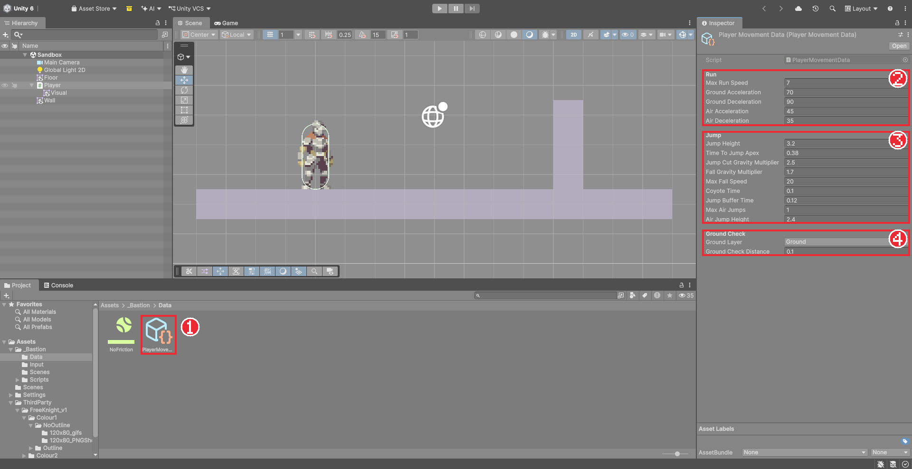
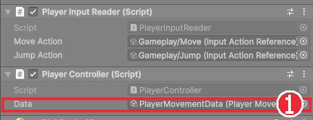

# Chapter 10 ScriptableObject로 수치 나누기

## 학습 목표

- 코드와 수치를 나눠 두면 좋은 점을 설명할 수 있다.
- `ScriptableObject`를 상속한 데이터 클래스를 만들고 `[CreateAssetMenu]`로 에셋을 만들 수 있다.
- `[Header]`, `[Tooltip]`, `[Min]`으로 데이터 에셋의 Inspector를 읽기 쉽게 꾸밀 수 있다.
- 플레이 중에 데이터 에셋을 고치면 멈춘 뒤에도 값이 남는다는 차이를 알고 주의할 수 있다.

## 본문

### 10-1 수치는 어디에 두어야 할까

Chapter 09에서 `PlayerController`의 Inspector에 수치가 열다섯 개 가까이 늘었습니다. 지금은 문제없어 보이지만 몇 가지 불편이 생깁니다.

- 수치가 컴포넌트에 들어 있어, 플레이어 오브젝트를 열어야만 고칠 수 있다.
- 쉬움·어려움처럼 수치 묶음을 여러 벌 두고 바꿔 끼우기 어렵다.
- 나중에 적 열 마리가 같은 수치를 쓴다면 열 번 고쳐야 한다.
- 기획자가 수치를 고치다 실수로 다른 설정을 건드릴 수 있다.

해결 방법은 **수치만 담는 파일**을 따로 만들고, 컴포넌트는 그 파일을 가리키게 하는 것입니다. Unity에서 이런 데이터 파일을 만드는 도구가 **ScriptableObject**입니다.

| 구분 | MonoBehaviour | ScriptableObject |
|---|---|---|
| 붙는 곳 | 씬의 게임 오브젝트 | Project 창의 에셋 파일 |
| 주된 용도 | 동작(이동, 공격) | 데이터(수치, 설정, 대사) |
| 여럿이 함께 쓰기 | 오브젝트마다 따로 | 에셋 하나를 여러 오브젝트가 가리킴 |

### 10-2 데이터 클래스 만들기

`Scripts/Player`에 `PlayerMovementData` 스크립트를 만들고 아래처럼 적습니다. Chapter 09에서 `PlayerController`에 있던 수치를 그대로 옮긴 것입니다.

```csharp
using UnityEngine;

namespace Bastion.Player
{
    /// <summary>
    /// 플레이어 이동 수치. 점프는 높이와 정점 도달 시간으로 정의하고 중력과 초기 속도를 역산한다.
    /// </summary>
    [CreateAssetMenu(fileName = "PlayerMovementData", menuName = "Bastion/Player Movement Data")]
    public sealed class PlayerMovementData : ScriptableObject
    {
        [Header("Run")]
        [Min(0f)] public float MaxRunSpeed = 7f;
        [Min(0f)] public float GroundAcceleration = 70f;
        [Min(0f)] public float GroundDeceleration = 90f;
        [Min(0f)] public float AirAcceleration = 45f;
        [Min(0f)] public float AirDeceleration = 35f;

        [Header("Jump")]
        [Min(0.1f)] public float JumpHeight = 3.2f;
        [Min(0.05f)] public float TimeToJumpApex = 0.38f;
        [Tooltip("점프 버튼을 일찍 떼었을 때 상승 중 중력 배율 (가변 점프)")]
        [Min(1f)] public float JumpCutGravityMultiplier = 2.5f;
        [Tooltip("하강 중 중력 배율")]
        [Min(1f)] public float FallGravityMultiplier = 1.7f;
        [Min(0f)] public float MaxFallSpeed = 20f;
        [Tooltip("발판을 벗어난 뒤에도 점프를 허용하는 시간")]
        [Min(0f)] public float CoyoteTime = 0.1f;
        [Tooltip("착지 직전에 누른 점프 입력을 보관하는 시간")]
        [Min(0f)] public float JumpBufferTime = 0.12f;
        [Tooltip("공중에서 추가로 뛸 수 있는 횟수 (1 = 더블점프)")]
        [Min(0)] public int MaxAirJumps = 1;
        [Tooltip("공중 점프 높이")]
        [Min(0.1f)] public float AirJumpHeight = 2.4f;

        [Header("Ground Check")]
        public LayerMask GroundLayer;
        [Min(0f)] public float GroundCheckDistance = 0.1f;

        public float Gravity => 2f * JumpHeight / (TimeToJumpApex * TimeToJumpApex);
        public float JumpVelocity => Gravity * TimeToJumpApex;
        public float AirJumpVelocity => Mathf.Sqrt(2f * Gravity * AirJumpHeight);
    }
}
```

#### 코드 해석

- `: ScriptableObject`: 이 클래스가 데이터 에셋이 된다는 뜻입니다. 게임 오브젝트에 붙이는 것이 아니라 파일로 만듭니다.
- `[CreateAssetMenu(...)]`: Project 창의 **Create** 메뉴에 이 에셋을 만드는 항목을 추가합니다. `menuName`이 메뉴 경로, `fileName`이 새 파일의 기본 이름입니다.
- `public float MaxRunSpeed = 7f;`: 데이터 클래스는 값을 담는 것이 목적이라 필드를 `public`으로 두고, 이름도 대문자로 시작합니다. 다른 스크립트가 `data.MaxRunSpeed`처럼 바로 읽습니다.
- `[Tooltip("...")]`: Inspector에서 그 칸에 마우스를 올리면 설명이 뜹니다. 숫자의 뜻을 적어 두면 기획자가 고치기 쉽습니다.
- `[Min(0f)]`: 이 값보다 작게 입력하지 못하게 막습니다. 점프 높이에 음수를 넣는 실수를 막아 줍니다.
- `Gravity`, `JumpVelocity`: 계산식도 데이터와 함께 둡니다. 수치를 쓰는 쪽은 결과만 가져다 씁니다.

### 10-3 데이터 에셋 만들기

1. Project 창에서 `Assets/_Bastion/Data` 폴더를 우클릭한다.
2. **Create > Bastion > Player Movement Data**를 누른다. `PlayerMovementData` 에셋이 생긴다.
3. 에셋을 선택하고 Inspector에서 **Ground Layer**를 `Ground`로 고른다. 나머지 값은 코드에 적은 기본값이 들어 있다.



`[Header]`로 묶은 덕분에 Run, Jump, Ground Check가 나뉘어 보입니다. Jump 항목에 마우스를 올려 툴팁이 뜨는지도 확인해 봅니다.

### 10-4 컴포넌트가 데이터를 가리키게 하기

`PlayerController`의 수치 필드를 모두 지우고, 데이터 에셋을 가리키는 칸 하나만 둡니다. 수치를 쓰던 곳은 `data.` 을 붙여 읽습니다. 바뀌는 부분만 보면 아래와 같습니다.

```csharp
[SerializeField] PlayerMovementData data;

public PlayerMovementData Data => data;

bool HasBufferedJump => Time.time - input.LastJumpPressedTime <= data.JumpBufferTime;
bool IsInCoyoteTime => Time.time - LastGroundedTime <= data.CoyoteTime;

void FixedUpdate()
{
    UpdateGrounded();

    if (IsGrounded)
    {
        ApplyHorizontalMovement(data.GroundAcceleration, data.GroundDeceleration);
    }
    else
    {
        ApplyHorizontalMovement(data.AirAcceleration, data.AirDeceleration);
        ApplyGravity();
    }
}

void Jump()
{
    input.ConsumeJump();
    LastGroundedTime = float.NegativeInfinity;
    body.linearVelocity = new Vector2(body.linearVelocity.x, data.JumpVelocity);
}
```

#### 코드 해석

- `[SerializeField] PlayerMovementData data;`: Inspector에 에셋을 끌어다 넣는 칸이 생깁니다.
- `public PlayerMovementData Data => data;`: 다른 스크립트(나중의 상태, 애니메이션)가 같은 수치를 읽을 수 있게 내보냅니다. 바꾸지는 못하게 읽기 전용으로 둡니다.
- 나머지 함수도 같은 방법으로 `maxRunSpeed` → `data.MaxRunSpeed`, `Gravity` → `data.Gravity`처럼 바꿉니다. `ApplyHorizontalMovement`, `AirJump`, `ApplyGravity`, `UpdateGrounded`의 수치를 모두 `data.`으로 바꿨는지 확인합니다.

코드를 바꾸고 나서 `Player`를 선택하면 PlayerController에 **Data** 칸 하나만 남습니다. 여기에 `PlayerMovementData` 에셋을 끌어다 넣습니다.



Data 칸이 비어 있으면 실행하는 순간 `NullReferenceException` 오류가 납니다. "없는 것(null)을 쓰려 했다"는 뜻으로, Unity에서 가장 자주 보는 오류입니다. 이 오류가 나면 Inspector에서 빈 칸이 없는지부터 확인합니다.

### 10-5 플레이 중 수정은 남는다

Chapter 01에서 플레이 모드 중 바꾼 값은 멈추면 되돌아간다고 배웠습니다. 그런데 이것은 **씬에 있는 컴포넌트의 값**에 해당하는 이야기입니다. 데이터 에셋은 씬 밖의 파일이라 플레이 중에 바꾼 값이 **멈춘 뒤에도 그대로 남습니다.**

이 차이는 장점이기도 합니다. 플레이하면서 Jump Height를 조금씩 바꿔 가며 가장 손맛 좋은 값을 찾으면, 멈춘 뒤 다시 입력할 필요가 없습니다. 반대로 시험 삼아 이상한 값을 넣었다면 직접 되돌려야 합니다. 바꾸기 전 값을 적어 두는 습관을 들입니다.

### 10-6 따라하기 — 수치 분리

1. `PlayerMovementData` 스크립트를 만들고, `Data` 폴더에 에셋을 만들어 Ground Layer를 설정한다.
2. `PlayerController`의 수치 필드를 `data` 하나로 바꾸고, 수치를 쓰는 곳을 모두 `data.`으로 고친다.
3. `Player`의 Data 칸에 에셋을 넣고 실행해, Chapter 09와 똑같이 움직이는지 확인한다.
4. 플레이 중에 에셋의 Max Run Speed를 12로 바꾸고 멈춘다. 값이 남아 있는지 확인한 뒤 7로 되돌린다.
5. 에셋을 복제(`Ctrl + D`)해 `PlayerMovementData_Floaty`를 만들고 Jump Height 5, Time To Jump Apex 0.6으로 바꾼다. Data 칸에 바꿔 끼워 보며 느낌을 비교한 뒤 원래 에셋으로 되돌린다.

5번처럼 에셋만 바꿔 끼우면 코드 수정 없이 전혀 다른 조작감을 시험할 수 있습니다. 이 게임은 앞으로 공격, 적, 보스의 수치도 모두 같은 방식으로 나눕니다. 다음 장부터는 레벨을 만듭니다.

### 연습문제

1. 문제: MonoBehaviour와 ScriptableObject의 차이를 "붙는 곳"과 "용도" 기준으로 한 줄씩 쓰세요.
2. 문제: 실행하자마자 `NullReferenceException`이 `PlayerController.FixedUpdate`에서 났습니다. 가장 먼저 의심할 곳을 쓰세요.
3. 문제: 적의 수치를 담을 `EnemyData`를 만든다고 할 때, `[CreateAssetMenu]`의 `menuName`과 필드 두 개를 지어 코드로 쓰세요.  
   - 조건: 필드 하나에는 `[Tooltip]`, 하나에는 `[Min]`을 붙일 것

### 정답 포인트

- MonoBehaviour는 게임 오브젝트에 붙어 동작을, ScriptableObject는 에셋 파일로 데이터를 담는다. PlayerController의 Data 칸이 비어 있는지 확인한다. 예: `[CreateAssetMenu(menuName = "Bastion/Enemy Data")] public sealed class EnemyData : ScriptableObject { [Tooltip("순찰 속도")] public float PatrolSpeed = 1.5f; [Min(0f)] public float DetectRange = 7f; }`

---

[상위 문서로 돌아가기](./README.md)
