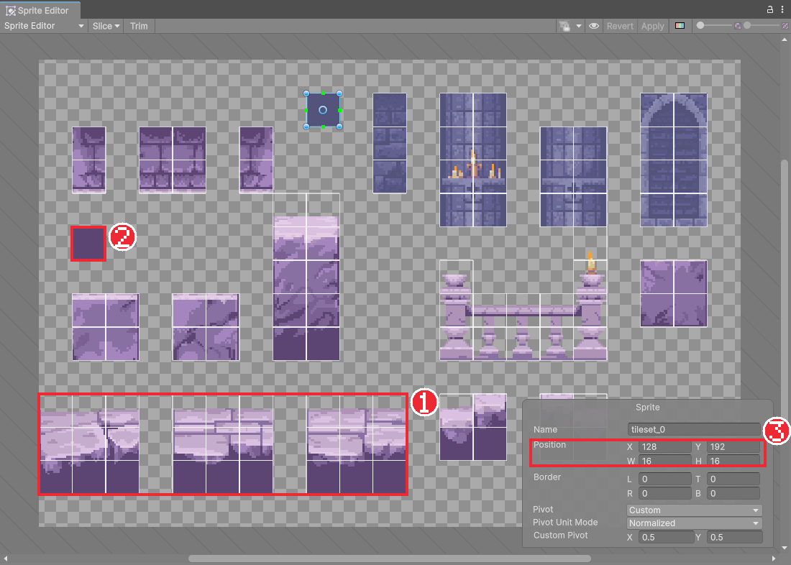
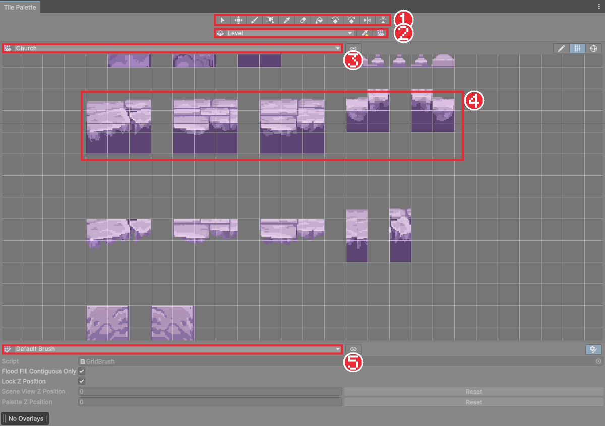
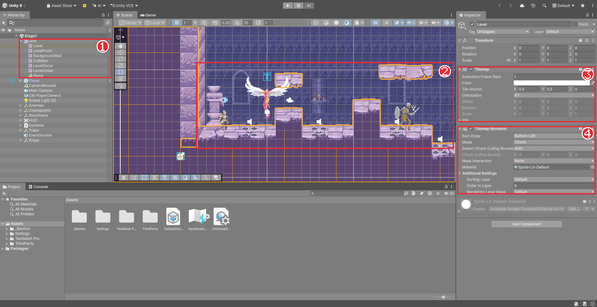

# Chapter 11 타일맵과 타일 팔레트

## 학습 목표

- 레벨을 작은 그림 조각(타일)으로 만드는 이유를 설명할 수 있다.
- 타일셋 그림을 16×16 칸으로 자르고, 타일 팔레트를 만들어 타일을 등록할 수 있다.
- Grid와 Tilemap을 만들고 브러시, 사각형 채우기, 지우개, 스포이트로 레벨을 칠할 수 있다.
- Active Tilemap으로 어느 타일맵에 칠할지 고를 수 있다.

## 본문

### 11-1 타일로 레벨 만들기

성채 바닥과 벽을 큰 그림 한 장으로 그리면 수정할 때마다 그림을 새로 그려야 합니다. 대신 바닥 한 칸, 벽 한 칸처럼 **같은 크기의 작은 조각**을 준비해 두고 바둑판에 늘어놓으면, 조각 몇 개만으로 넓은 레벨을 자유롭게 만들 수 있습니다.

| 용어 | 뜻 |
|---|---|
| 타일(Tile) | 바둑판 한 칸에 놓는 그림 조각 |
| 타일셋(Tileset) | 타일로 쓸 조각들을 한 장에 모아 그린 그림 |
| 그리드(Grid) | 타일을 놓는 바둑판. 칸 크기를 정한다 |
| 타일맵(Tilemap) | 그리드 위에 타일을 칠해 둔 한 장의 층 |
| 타일 팔레트(Tile Palette) | 칠할 타일을 골라 쓰는 물감 판 |

이 게임의 타일셋은 GothicVania Church 팩의 `tileset.png`입니다. 한 칸이 16×16픽셀이라, Chapter 05에서 정한 PPU 16에 따라 **타일 한 칸이 정확히 1유닛**이 됩니다.

### 11-2 타일셋 자르기

1. 강사가 나눠 준 `gothicvania church files` 폴더를 `Assets/ThirdParty`에 넣는다.
2. `ENVIRONMENT/tileset.png`를 선택하고 Import Settings를 Chapter 05와 같이 PPU `16`, Filter Mode `Point`, Compression `None`, Sprite Mode `Multiple`로 두고 Apply를 누른다.
3. **Open Sprite Editor**를 누르고 **Slice**에서 Type `Grid By Cell Size`, Pixel Size `16 × 16`, Pivot `Center`로 자른 뒤 Apply를 누른다.

자르고 나면 바닥, 기둥, 창문, 촛대 같은 조각이 16픽셀 칸으로 나뉩니다. 빈 칸(완전히 투명한 곳)은 자르지 않습니다. Slice 창의 **Keep Empty Rects**가 꺼져 있는지 확인합니다.

### 11-3 스테이지 씬과 Grid 만들기

이제 실제 게임 레벨이 될 씬을 만듭니다.

1. **File > New Scene**에서 Lit 2D (URP) 템플릿으로 새 씬을 만들고 `Assets/_Bastion/Scenes/Stage1`로 저장한다.
2. `Sandbox` 씬을 열어 Hierarchy의 `Player`를 선택하고 `Ctrl + C`로 복사한 뒤, `Stage1`을 열고 `Ctrl + V`로 붙여 넣는다.
3. Hierarchy의 **+ > 2D Object > Tilemap > Rectangular**를 누른다. `Grid` 아래에 `Tilemap`이 생긴다.
4. `Tilemap`의 이름을 `Level`로 바꾼다.

`Grid`는 칸의 크기(Cell Size, 기본 1×1)를 정하고, 그 아래의 `Level`이 실제로 타일을 담는 층입니다. 한 Grid 아래에 타일맵을 여러 장 겹쳐 둘 수 있는데, 다음 장에서 배경과 장식을 다른 층으로 나눕니다.

### 11-4 타일 팔레트 만들기

1. 메뉴에서 **Window > 2D > Tile Palette**를 눌러 창을 연다.
2. 창 가운데의 팔레트 목록에서 **Create New Palette**를 고르고 이름을 `Church`로 지어 `Assets/_Bastion/Art/Palettes` 폴더에 만든다.
3. Project 창에서 잘라 둔 `tileset.png`를 팔레트 창의 빈 바둑판으로 끌어다 놓는다.
4. 타일 에셋을 저장할 폴더를 물으면 `Assets/_Bastion/Art/Tiles/Church` 폴더를 만들어 고른다.

스프라이트 조각마다 **타일 에셋**이 하나씩 만들어지고, 팔레트에는 원본 그림과 같은 배치로 놓입니다. 팔레트는 물감 판이고, 실제 레벨에 칠해지는 것은 이 타일 에셋입니다.

> 위 그림은 완성본의 `Church` 팔레트입니다. 원본 타일 아래쪽에 완성본 제작자가 만든 파생 타일(발판 밑면, 벽 블록 등)이 더 들어 있습니다. 강사가 나눠 주는 완성본의 `Assets/_Bastion/Art` 폴더를 가져오면 같은 팔레트를 쓸 수 있습니다.

### 11-5 칠하기 도구

팔레트 창 위쪽 도구 모음에서 도구를 고르고, 팔레트에서 타일을 누른 뒤 Scene 뷰에 칠합니다.

| 도구 | 단축키 | 하는 일 |
|---|---|---|
| Paintbrush (붓) | `B` | 누르거나 끄는 칸에 타일을 칠한다 |
| Box Fill (사각형 채우기) | `U` | 끈 사각형 범위를 타일로 채운다 |
| Eraser (지우개) | `D` (또는 `Shift`를 누른 채 칠하기) | 칸을 지운다 |
| Picker (스포이트) | `I` | Scene에 칠해진 타일을 집어 붓에 담는다 |
| Select / Move | `S` / `M` | 칠한 범위를 골라 옮긴다 |

팔레트에서 **여러 칸을 끌어 고르면** 그 모양 그대로 덩어리째 칠할 수 있습니다. 붓에 타일을 담은 상태에서 `[`, `]`는 회전, `Shift + [`, `Shift + ]`는 좌우·위아래 뒤집기입니다.

칠하기 전에 항상 **Active Tilemap**(칠할 대상 타일맵)을 확인합니다. 타일맵이 여러 장이 되면, 엉뚱한 층에 칠해 그리기 순서와 충돌이 꼬이는 실수가 가장 흔합니다.

### 11-6 바닥 칠하기 규칙

이 타일셋의 바닥은 3×3 칸 덩어리로 그려져 있습니다. 완성본은 다음 규칙으로 칠했습니다.

- 바닥은 3×3 덩어리를 통째로 골라 **3칸 단위로** 이어 칠한다. 덩어리 중간에서 끊으면 이음매가 어색하다.
- 덩어리는 세 종류가 있으니 번갈아 써서 같은 무늬 반복을 줄인다.
- 덩어리 아래는 어둠 타일로 맵 바닥까지 채운다.
- 높은 땅은 같은 덩어리를 높여 놓고 그 아래를 어둠으로 채운다.
- 높이 차이는 점프로 오를 수 있게 3칸 이하로, 공중 점프를 써야 하는 곳은 5칸 정도로 둔다. Chapter 09의 점프 높이 3.2, 공중 점프 2.4를 기준으로 정한 값이다.

### 11-7 따라하기 — 첫 구간 칠하기

1. `tileset.png`를 잘라 `Church` 팔레트를 만든다.
2. `Stage1` 씬에 `Grid`와 `Level` 타일맵을 만들고 `Player`를 옮겨 온다.
3. Active Tilemap이 `Level`인지 확인하고, 3×3 바닥 덩어리로 가로 30칸쯤 되는 바닥을 칠한다.
4. 중간에 2~3칸 높은 땅과 구덩이 하나를 만든다. 덩어리 아래는 어둠 타일로 채운다.
5. `Player`를 바닥 위에 놓고 실행한다. 기사가 타일 바닥을 그대로 뚫고 떨어진다.

5번처럼 타일맵은 아직 그림일 뿐 충돌이 없습니다. 충돌은 Chapter 13에서 붙입니다. 그 전에 다음 장에서 배경과 장식 층을 나누고 그리기 순서를 정리합니다.

### 연습문제

1. 문제: 타일, 타일셋, 타일맵, 타일 팔레트를 각각 한 줄로 설명하세요.
2. 문제: 타일 한 칸이 16픽셀이고 PPU가 16일 때, 가로 30칸 바닥의 길이는 몇 유닛인지 쓰세요.
3. 문제: 바닥을 칠했는데 Scene 뷰에 아무것도 보이지 않습니다. 확인할 곳 두 가지를 쓰세요.  
   - 조건: "Active Tilemap"이라는 말을 포함할 것

### 정답 포인트

- 타일은 한 칸 조각, 타일셋은 조각 모음 그림, 타일맵은 칠해 둔 층, 팔레트는 칠할 타일을 고르는 판. 30유닛. Active Tilemap이 의도한 타일맵인지, 그 타일맵(또는 Grid)이 꺼져 있거나 카메라 밖에 있지 않은지 확인한다.

---

[상위 문서로 돌아가기](./README.md)
