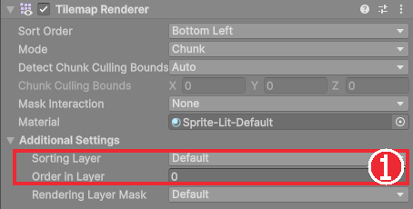
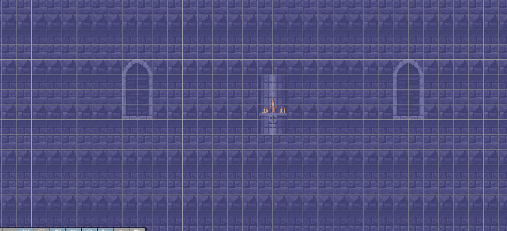
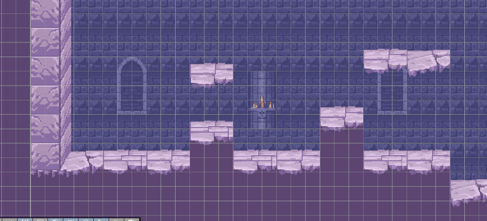
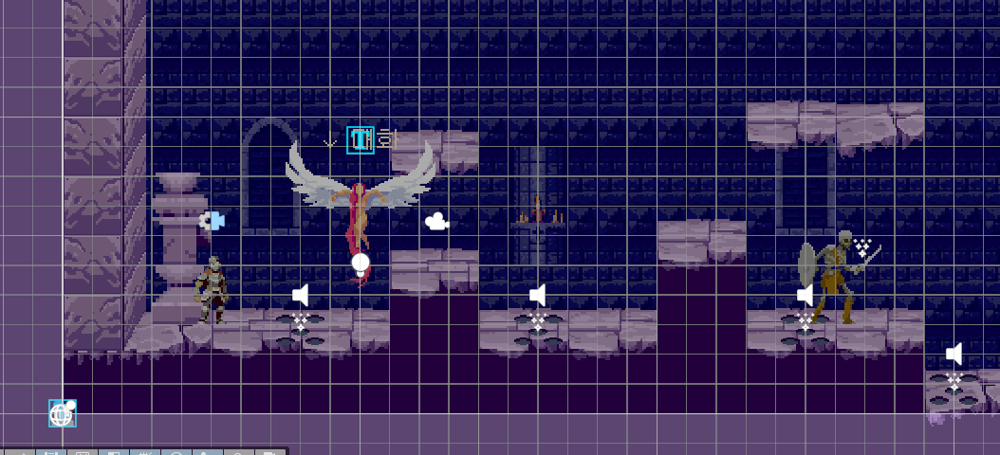

# Chapter 12 그리기 순서와 레벨 꾸미기

## 학습 목표

- 2D 게임에서 그림이 겹칠 때 무엇이 앞에 그려질지 정하는 방법을 설명할 수 있다.
- Sorting Layer와 Order in Layer의 차이를 알고, 이 게임의 그리기 순서 표를 따라 값을 정할 수 있다.
- 배경, 바닥, 장식을 서로 다른 타일맵 층으로 나눠 칠할 수 있다.
- 그림 한 장짜리 장식은 스프라이트 오브젝트로 놓고 피벗과 순서를 맞출 수 있다.

## 본문

### 12-1 무엇이 앞에 그려질까

3D 게임은 카메라와의 거리로 앞뒤가 정해지지만, 2D 게임은 모든 그림이 같은 평면(Z = 0)에 있습니다. 그래서 겹친 그림 중 무엇을 위에 그릴지 따로 알려 줘야 합니다. 정하지 않으면 Unity가 마음대로 그려서, 실행할 때마다 기사가 벽 뒤로 숨거나 배경이 바닥을 덮는 일이 생깁니다.

Sprite Renderer와 Tilemap Renderer에는 순서를 정하는 칸이 두 개 있습니다.

| 칸 | 뜻 |
|---|---|
| Sorting Layer | 큰 묶음. 묶음 목록에서 아래에 있을수록 앞에 그린다 |
| Order in Layer | 같은 묶음 안의 순서. 숫자가 클수록 앞에 그린다 |

먼저 Sorting Layer로 비교하고, 같으면 Order in Layer로 비교합니다. 이 게임은 그림 종류가 많지 않아 Sorting Layer는 기본값(`Default`) 하나만 쓰고 **Order in Layer 숫자만으로** 순서를 정합니다. 숫자 하나로 전체 순서가 한눈에 보여서 관리하기 쉽습니다.

### 12-2 이 게임의 그리기 순서

완성본에서 정한 순서입니다. 새 그림을 추가할 때 이 표에서 자리를 찾아 숫자를 정합니다.

| Order in Layer | 대상 |
|---|---|
| -100 | 배경 벽 (`BackgroundWall`) |
| -1 | 벽 뒤로 이어지는 바닥 (`LevelUnder`) |
| 0 | 지형 (`Level`), 발판 밑 돌 조각 (`LevelDecor`) |
| 1 | 벽 옆면 (`LevelFront`) |
| 2 | 함정 |
| 3~4 | 체크포인트 촛대와 촛불 |
| 5~6 | 적, 보스, NPC |
| 10 | 플레이어 |
| 20 | 투사체 |
| 30 | 공격 예고 입자 |

숫자 사이를 넉넉히 비워 둔 데에는 이유가 있습니다. 나중에 "적보다 앞, 플레이어보다 뒤"인 그림이 생기면 7이나 8을 쓰면 되고, 다른 숫자를 고칠 필요가 없습니다.

### 12-3 타일맵 층 나누기

한 장의 타일맵에는 한 칸에 타일 하나만 놓을 수 있습니다. 바닥 뒤로 벽돌 벽이 보이게 하려면 벽돌 벽을 **다른 타일맵**에 칠해야 합니다.

1. Hierarchy에서 `Grid`를 우클릭하고 **2D Object > Tilemap > Rectangular**를 눌러 타일맵을 하나 더 만든다. 이름을 `BackgroundWall`로 바꾼다.
2. `BackgroundWall`의 Tilemap Renderer에서 **Order in Layer**를 `-100`으로 둔다.
3. 같은 방법으로 `LevelDecor`(0), `LevelFront`(1), `LevelUnder`(-1)를 만든다.
4. Tile Palette의 **Active Tilemap**을 `BackgroundWall`로 바꾸고, 벽돌 타일을 Box Fill(`U`)로 화면 전체에 채운다.
5. 벽돌 위에 아치 창문과 촛대 벽 타일을 군데군데 덮어 칠한다.

각 층의 역할은 아래와 같습니다. 앞 장에서 칠한 바닥은 `Level`에 있습니다.

| 타일맵 | 순서 | 칠하는 것 |
|---|---|---|
| `BackgroundWall` | -100 | 배경 벽돌, 창문, 촛대 벽 |
| `LevelUnder` | -1 | 벽 뒤로 이어지는 바닥 |
| `Level` | 0 | 바닥, 발판, 벽 블록 |
| `LevelDecor` | 0 | 떠 있는 발판 밑으로 흩어지는 돌 조각 |
| `LevelFront` | 1 | 지형 앞에 겹쳐 그리는 벽 옆면 |

`Level`과 `LevelDecor`는 순서가 같은 0이지만 서로 겹치는 칸에 칠하지 않으므로 문제가 없습니다. 층을 나눠 두면 다음 장에서 "어느 층에만 충돌을 줄지"도 층 단위로 정할 수 있습니다.

### 12-4 스프라이트 장식과 피벗

창문처럼 바둑판에 맞는 그림은 타일로 칠하고, 촛대 기둥이나 석상처럼 칸에 맞지 않는 큰 그림은 **스프라이트 오브젝트**로 놓습니다. Project 창에서 스프라이트를 Scene 뷰로 끌어다 놓으면 Sprite Renderer가 붙은 오브젝트가 바로 만들어집니다.

바닥 위에 서는 장식은 피벗을 **Bottom**으로 두면 Position Y를 바닥 높이에 맞추기만 하면 됩니다. Chapter 05의 기사와 같은 방법입니다. 피벗을 바꾸려면 그림의 Import Settings에서 Sprite Mode가 `Single`일 때는 **Pivot** 칸을, `Multiple`일 때는 Sprite Editor에서 칸마다 Pivot을 고칩니다.

장식 오브젝트도 위 순서 표에 맞춰 Order in Layer를 정합니다. 배경 장식은 -50쯤, 바닥 앞에 놓는 소품은 1~2로 둡니다.

### 12-5 따라하기 — 성채 꾸미기

1. `Grid` 아래에 `BackgroundWall`, `LevelUnder`, `LevelDecor`, `LevelFront` 타일맵을 만들고 순서 표대로 Order in Layer를 정한다.
2. `BackgroundWall`에 벽돌 벽을 채우고 창문과 촛대 벽을 칠한다.
3. 떠 있는 발판 두세 개를 `Level`에 칠하고, 발판 밑에 `LevelDecor`로 돌 조각을 흩어 둔다.
4. `Player`의 `Visual`(Sprite Renderer)의 Order in Layer를 `10`으로 둔다.
5. Game 뷰에서 기사가 벽 앞에 그려지는지, 발판 뒤로 숨지 않는지 확인한다.

이제 레벨이 그럴듯해 보이지만 아직 기사는 바닥을 뚫고 떨어집니다. 다음 장에서 타일맵에 충돌을 붙입니다.

### 연습문제

1. 문제: Sorting Layer가 같은 두 그림 A(Order 3)와 B(Order 7)가 겹칠 때 어느 쪽이 앞에 보이는지 쓰세요.
2. 문제: 적(5)보다 앞, 플레이어(10)보다 뒤에 그려야 하는 "적의 무기 잔상"의 Order in Layer를 정하고 이유를 쓰세요.
3. 문제: 배경 벽돌을 바닥과 같은 `Level` 타일맵에 칠하면 생기는 문제를 쓰세요.  
   - 조건: "한 칸"이라는 말을 포함할 것

### 정답 포인트

- B가 앞. 6~9 중 하나(예: 7), 순서 표의 빈 자리라 다른 값을 고치지 않아도 된다. 한 칸에 타일은 하나만 놓을 수 있어 벽돌을 칠하면 그 칸의 바닥이 지워지고, 바닥 뒤로 벽이 보이게 겹칠 수 없다.

---

[상위 문서로 돌아가기](./README.md)
