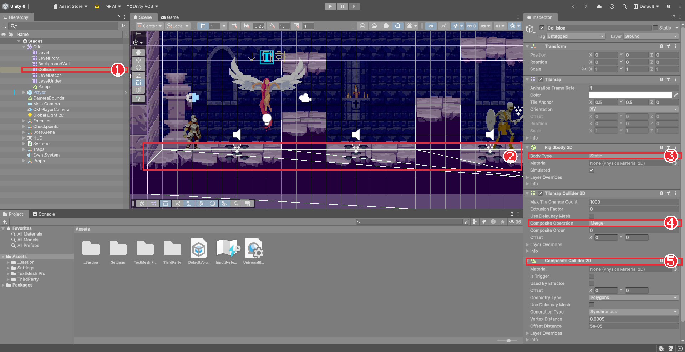
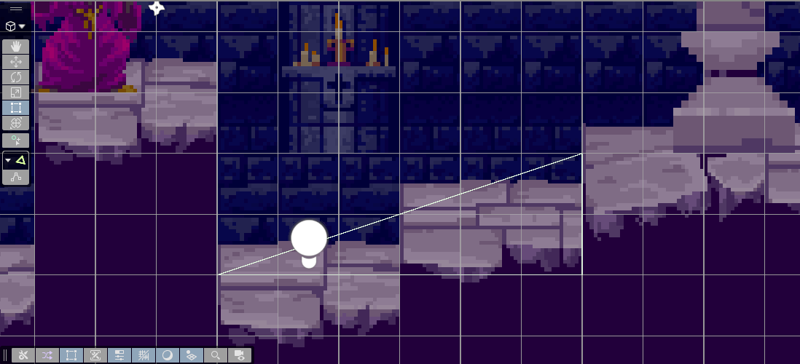

# Chapter 13 타일맵 충돌

## 학습 목표

- Tilemap Collider 2D와 Composite Collider 2D로 타일맵에 충돌을 붙일 수 있다.
- 그림용 타일맵과 충돌용 타일맵을 나누는 이유를 설명하고, 충돌 전용 타일맵을 만들 수 있다.
- Polygon Collider 2D로 계단 위에 경사로 충돌을 직접 그릴 수 있다.
- 경사에서 미끄러지거나 튀어 오르는 문제를 바닥에 붙이기로 해결할 수 있다.

## 본문

### 13-1 Tilemap Collider 2D

Chapter 07에서 바닥 사각형에 Box Collider 2D를 붙였듯이, 타일맵에도 콜라이더를 붙입니다. 타일맵 전용 콜라이더인 **Tilemap Collider 2D**는 칠해진 칸마다 충돌 모양을 자동으로 만들어 줍니다.

1. `Grid/Level`을 선택하고 `Tilemap Collider 2D`를 붙인다.
2. 실행하면 기사가 타일 바닥 위에 선다.

그런데 바닥을 달리다 보면 가끔 뭔가에 걸려 덜컥 멈춥니다. 칸마다 따로 만든 네모가 나란히 붙어 있어서, 그 이음매의 아주 작은 틈에 캡슐 모서리가 걸리기 때문입니다. 칸이 수천 개면 물리 계산도 그만큼 무거워집니다.

### 13-2 Composite Collider 2D로 합치기

**Composite Collider 2D**는 여러 콜라이더를 **하나의 큰 모양으로 합쳐** 줍니다. 이음매가 사라지고 계산도 가벼워집니다.

1. `Level`에 `Composite Collider 2D`를 붙인다. 함께 필요한 `Rigidbody 2D`가 자동으로 붙는다.
2. 붙은 Rigidbody 2D의 **Body Type**을 `Static`으로 바꾼다. 바닥은 움직이지 않으므로 물리 엔진이 계산하지 않게 한다.
3. Tilemap Collider 2D의 **Composite Operation**을 `Merge`로 둔다. "이 콜라이더를 합치기에 넣는다"는 뜻이다.
4. `Level`의 Layer를 `Ground`로 바꾼다. Chapter 08의 바닥 판정이 이 레이어만 보기 때문이다.

### 13-3 그림과 충돌 나누기

완성본은 한 걸음 더 나아가 **그림용 타일맵과 충돌용 타일맵을 따로** 둡니다. `Level`, `LevelFront`에는 콜라이더를 붙이지 않고, 그림이 없는 `Collision` 타일맵에만 콜라이더를 붙입니다.

이유는 이 타일셋의 시점에 있습니다. 바닥 그림은 위에서 비스듬히 내려다본 모습이라 바닥 **윗면이 그림에 보입니다**. 그림 모양대로 충돌을 만들면 기사가 윗면 그림의 맨 위 끝을 밟아 바닥 위에 둥 떠 보입니다. 사람 눈에는 윗면 안쪽을 밟아야 자연스럽습니다. 또 바닥 조각마다 윗면 높이가 1픽셀씩 달라, 그림 모양 그대로면 이음매에 걸립니다.

그래서 충돌용 타일맵에는 **각 기둥의 맨 윗칸을 빼고** 네모 타일을 깝니다. 그러면 충돌의 윗면이 그림의 윗면보다 한 칸(16픽셀) 아래, 즉 윗면 그림 안쪽에 옵니다.



1. `Grid` 아래에 `Collision` 타일맵을 만든다. Layer는 `Ground`로 둔다.
2. `Collision`에 Tilemap Collider 2D(Composite Operation `Merge`), Composite Collider 2D, Rigidbody 2D(`Static`)를 붙인다.
3. `Collision`의 **Tilemap Renderer**는 체크를 꺼서 화면에 그리지 않는다.
4. 아무 네모 그림으로 타일 하나를 만들어(예: `Assets/_Bastion/Art/Tiles/Collision`) 팔레트에 넣고, Active Tilemap을 `Collision`으로 바꿔 바닥 기둥의 맨 윗칸 아래부터 칠한다.
5. 13-1에서 `Level`에 붙였던 콜라이더 세 개는 떼어 낸다.

> 완성본에는 `Level`이나 `LevelFront`를 칠할 때마다 위 규칙대로 `Collision`을 자동으로 다시 만드는 에디터 스크립트(`Scripts/Editor/LevelCollisionBuilder.cs`)가 있습니다. 손으로 칠해 원리를 익힌 뒤, 이 파일을 내 프로젝트의 같은 위치로 복사하면 충돌 칠하기를 생략할 수 있습니다. 에디터 스크립트는 게임이 아니라 **에디터 작업을 자동화하는 코드**로, `Editor` 폴더에 두면 완성된 게임에는 들어가지 않습니다.

### 13-4 경사로

계단 그림 위를 걸어 오르려 하면, 칸 단위로 깐 충돌은 계단 모양이라 턱에 막힙니다. 이럴 때는 경사면을 직접 그립니다.

1. `Grid` 아래에 빈 오브젝트 `Ramp`를 만들고 Layer를 `Ground`로 둔다.
2. `Polygon Collider 2D`를 붙이고 **Edit Collider** 버튼을 누른다.
3. Scene 뷰에서 점을 끌어 계단 아래 끝, 위 끝, 그리고 그 아래 모서리를 잇는 삼각형을 만든다. 선 위를 누르면 점이 추가되고, `Ctrl`을 누른 채 점을 누르면 지워진다.



### 13-5 경사에서 붙어 다니기

경사로를 만들고 걸어 보면 두 가지 문제가 생깁니다. 가만히 서 있으면 아래로 미끄러지고, 내려갈 때는 경사면에서 살짝 떠서 통통 튑니다. 바닥에 서 있을 때는 중력을 주지 않는데(Chapter 09), 경사면 위에서는 물리 엔진이 남은 속도를 비스듬히 바꾸기 때문입니다.

해결 방법은 **지상에서는 세로 속도를 직접 정하는 것**입니다. 가만히 있으면 0으로 두어 미끄러지지 않게 하고, 움직이는 중에는 아래로 약하게 눌러 내리막에서도 바닥에서 떨어지지 않게 합니다.

`PlayerMovementData`의 Ground Check 묶음에 수치를 하나 추가합니다.

```csharp
[Tooltip("지상에서 이동 중 바닥(경사 포함)에 붙어 있게 하는 아래 방향 속도")]
[Min(0f)] public float GroundStickSpeed = 4f;
```

`PlayerController`에 함수를 추가하고, 바닥에 있을 때 부릅니다.

```csharp
void FixedUpdate()
{
    UpdateGrounded();

    if (IsGrounded)
    {
        ApplyHorizontalMovement(data.GroundAcceleration, data.GroundDeceleration);
        StickToGround();
    }
    else
    {
        ApplyHorizontalMovement(data.AirAcceleration, data.AirDeceleration);
        ApplyGravity();
    }
}

/// <summary>
/// 지상에서는 중력을 누적하지 않는다. 가만히 있으면 세로 속도 0 (경사에서 미끄러지지 않음),
/// 움직이는 중에는 약하게 눌러 내리막에서도 바닥에서 떨어지지 않게 한다.
/// </summary>
void StickToGround()
{
    float vy = Mathf.Abs(body.linearVelocity.x) > 0.01f ? -data.GroundStickSpeed : 0f;
    body.linearVelocity = new Vector2(body.linearVelocity.x, vy);
}
```

#### 코드 해석

- `Mathf.Abs(body.linearVelocity.x) > 0.01f`: 가로로 움직이는 중이면 아래로 4만큼 누릅니다. 평지에서는 바닥이 막고 있어 실제로 내려가지 않고, 내리막에서는 경사를 따라 붙어 내려갑니다.
- 가만히 서 있으면 세로 속도를 0으로 두어 경사에서도 제자리에 섭니다.
- 점프하는 순간에는 `Jump()`가 세로 속도를 위로 바꾸고, 다음 물리 단계부터는 공중 처리로 넘어가므로 바닥에 붙이는 힘이 점프를 막지 않습니다.

### 13-6 따라하기 — 걸을 수 있는 레벨

1. `Collision` 타일맵을 만들어 콜라이더 세 개를 붙이고, 그림 바닥의 윗칸을 뺀 자리에 충돌 타일을 칠한다.
2. 실행해 기사가 바닥 윗면 그림 안쪽을 밟는지, 이음매에서 걸리지 않는지 확인한다.
3. 계단 그림 위에 `Ramp`를 만들어 경사로를 그린다.
4. `GroundStickSpeed`와 `StickToGround`를 추가하고, 경사에서 멈춰 서도 미끄러지지 않는지, 내려갈 때 튀지 않는지 확인한다.
5. Chapter 11의 구덩이에 떨어지면 끝없이 떨어지는지 확인한다. 떨어졌을 때 다시 시작하는 처리는 Chapter 29에서 만든다.

레벨을 걸어 다닐 수 있게 되었습니다. 그런데 기사가 화면 밖으로 나가면 보이지 않습니다. 다음 장에서 카메라가 기사를 따라가게 합니다.

### 연습문제

1. 문제: Tilemap Collider 2D만 쓸 때와 Composite Collider 2D로 합칠 때의 차이를 두 가지 쓰세요.
2. 문제: 충돌 타일을 각 기둥의 맨 윗칸을 빼고 까는 이유를 쓰세요.  
   - 조건: "윗면"이라는 말을 포함할 것
3. 문제: 경사에 가만히 서 있으면 미끄러질 때 `StickToGround`의 어느 부분이 이를 막는지 쓰세요.

### 정답 포인트

- 합치면 칸 사이 이음매가 없어 걸리지 않고, 콜라이더 수가 줄어 계산이 가볍다. 비스듬한 시점이라 바닥 윗면이 그림에 보이므로, 한 칸 아래에 충돌을 두어 윗면 그림 안쪽을 밟게 한다. 가로 속도가 거의 0이면 세로 속도를 0으로 두는 부분.

---

[상위 문서로 돌아가기](./README.md)
