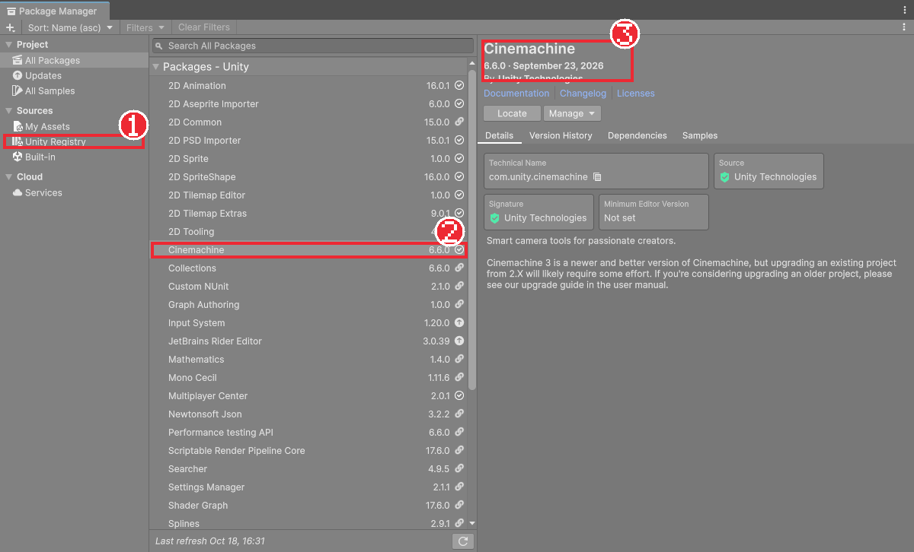
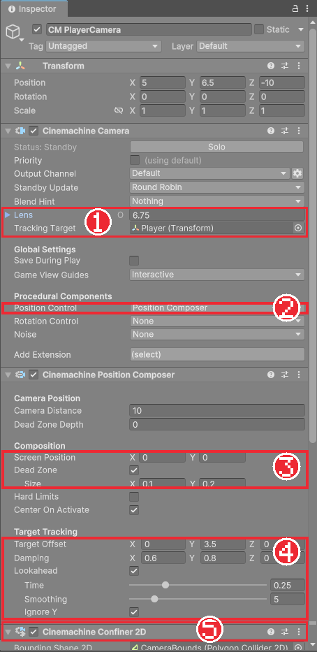
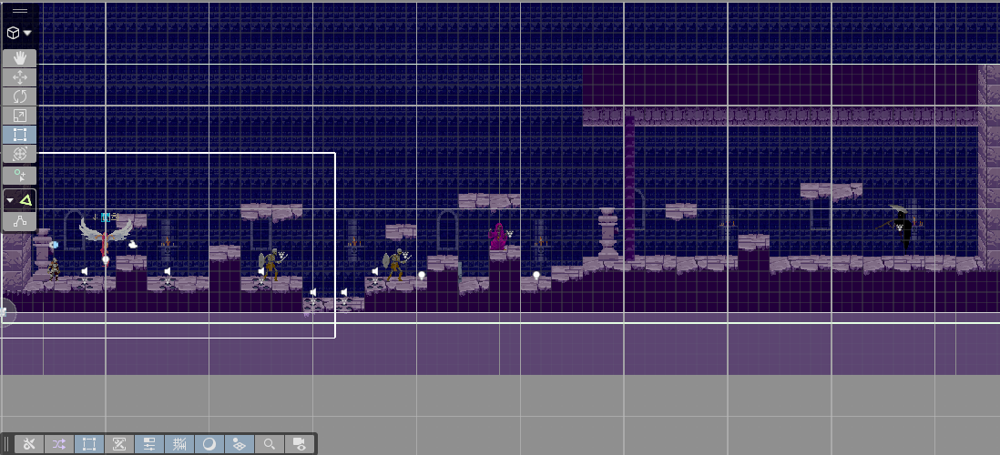
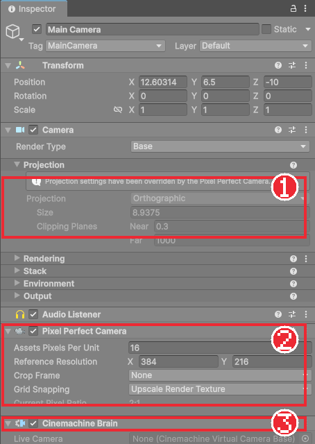

# Chapter 14 카메라

## 학습 목표

- Package Manager로 Cinemachine 패키지를 설치할 수 있다.
- Cinemachine Camera와 Position Composer로 플레이어를 부드럽게 따라가는 카메라를 만들 수 있다.
- Confiner 2D로 카메라가 레벨 밖을 비추지 않게 범위를 막을 수 있다.
- Orthographic과 Perspective의 차이를 알고, Pixel Perfect Camera로 픽셀 아트를 또렷하게 보이게 할 수 있다.

## 본문

### 14-1 카메라가 따라가야 하는 이유

레벨이 화면보다 넓어지면 기사가 화면 밖으로 나가 버립니다. 카메라를 플레이어의 자식으로 넣으면 따라가기는 하지만, 기사가 점프할 때마다 화면 전체가 같이 출렁여 어지럽습니다. 좋은 카메라는 **조금 늦게, 부드럽게** 따라가고, 기사가 조금 움직이는 정도로는 꿈쩍하지 않으며, 레벨 끝에서는 바깥의 빈 공간을 비추지 않습니다.

이런 카메라를 직접 만들려면 코드가 꽤 필요합니다. Unity가 제공하는 **Cinemachine**(시네머신) 패키지를 쓰면 설정만으로 만들 수 있습니다.

### 14-2 패키지 설치

**패키지**는 Unity에 기능을 덧붙이는 추가 묶음입니다. Input System, 2D Tilemap도 패키지입니다.

1. 메뉴에서 **Window > Package Manager**를 연다.
2. 왼쪽에서 **Unity Registry**를 고르고 검색창에 `Cinemachine`을 입력한다.
3. **Cinemachine**을 고르고 **Install**을 누른다.

설치가 끝나면 Install 버튼이 사라지고, 왼쪽 위 **Project** 목록에 Cinemachine이 체크 표시와 함께 나타납니다.

### 14-3 Orthographic과 Perspective

카메라가 세상을 비추는 방식은 두 가지입니다.

| 방식 | 보이는 모습 | 쓰는 곳 |
|---|---|---|
| Perspective (원근) | 멀리 있는 것은 작게 보인다 | 3D 게임 |
| Orthographic (직교) | 거리와 관계없이 같은 크기로 보인다 | 2D 게임 |

2D 템플릿의 카메라는 처음부터 Orthographic입니다. Orthographic 카메라는 **Size**로 얼마나 넓게 보일지 정하는데, Size는 화면 세로 길이의 절반(유닛)입니다. Size 5면 화면 높이에 10유닛이 들어갑니다.

### 14-4 Cinemachine Camera 만들기

Cinemachine은 실제 카메라(`Main Camera`)를 직접 움직이지 않습니다. 대신 "이런 식으로 찍어 줘"라는 지시를 담은 **Cinemachine Camera** 오브젝트를 따로 두고, `Main Camera`에 붙은 **Cinemachine Brain**이 그 지시대로 실제 카메라를 움직입니다. 지시만 바꾸면 보스방 카메라, 대화 카메라처럼 여러 구도를 쉽게 전환할 수 있습니다.

1. Hierarchy의 **+ > Cinemachine > Targeted Cameras > Follow Camera**를 누르고 이름을 `CM PlayerCamera`로 바꾼다. `Main Camera`에는 Cinemachine Brain이 자동으로 붙는다.
2. `CM PlayerCamera`의 **Tracking Target**에 `Player`를 끌어다 넣는다.
3. **Position Control**이 `Position Composer`인지 확인한다.

**Position Composer**는 대상을 화면의 정해진 자리에 두도록 카메라 위치를 맞추는 부품입니다. 완성본은 아래처럼 설정했습니다.

| 설정 | 값 | 뜻 |
|---|---|---|
| Target Offset | (0, 3.5, 0) | 기사 발밑보다 3.5유닛 위를 화면 중앙에 둔다. 발밑이 중앙이면 위쪽이 너무 안 보인다 |
| Dead Zone | 0.1 × 0.2 | 화면 가운데 이 범위 안에서 움직이는 동안은 카메라가 움직이지 않는다. 점프할 때 화면이 덜 출렁인다 |
| Damping | (0.6, 0.8) | 따라가는 데 걸리는 시간. 클수록 늦게, 부드럽게 따라간다 |
| Lookahead Time | 0.25 | 달리는 방향을 미리 조금 더 보여 준다 |
| Lookahead Ignore Y | 체크 | 위아래로는 미리 보지 않는다. 점프 때 화면이 튀지 않게 한다 |

실행해 기사를 움직이면 카메라가 살짝 늦게 따라오고, 달리는 쪽으로 화면이 조금 더 열립니다.

### 14-5 Confiner 2D로 범위 막기

레벨 왼쪽 끝으로 가면 카메라가 레벨 바깥의 빈 공간까지 비춥니다. 카메라가 움직일 수 있는 범위를 도형으로 정해 막습니다.

1. 빈 오브젝트 `CameraBounds`를 만들고 `Polygon Collider 2D`를 붙인다.
2. **Is Trigger**를 체크한다. 다른 물체와 부딪히지 않게 하기 위해서다.
3. **Edit Collider**로 점을 옮겨 레벨 전체를 감싸는 사각형을 만든다.
4. `CM PlayerCamera`의 **Add Extension**에서 `CinemachineConfiner2D`를 추가하고, **Bounding Shape 2D**에 `CameraBounds`를 넣는다.

이제 레벨 끝에서는 카메라가 멈추고 기사만 화면 가장자리로 이동합니다. 카메라 화면 전체가 도형 안에 들어오도록 막기 때문에, 도형은 레벨 그림보다 조금 안쪽으로 그립니다.

### 14-6 Pixel Perfect Camera

픽셀 아트를 아무 크기로나 확대하면 어떤 픽셀은 2칸, 어떤 픽셀은 3칸으로 늘어나 그림이 울퉁불퉁하게 보이고, 움직일 때 반짝거립니다. **Pixel Perfect Camera**는 그림의 픽셀 하나가 화면에서 항상 같은 개수의 픽셀로 보이도록 카메라 크기를 맞춰 줍니다.

1. `Main Camera`에 `Pixel Perfect Camera`를 붙인다.
2. **Assets Pixels Per Unit**을 `16`, **Reference Resolution**을 `384 × 216`으로 둔다.
3. **Grid Snapping**을 `Upscale Render Texture`로 둔다.
4. `CM PlayerCamera`의 **Add Extension**에서 `CinemachinePixelPerfect`를 추가한다.

기준 해상도 384×216은 1920×1080의 정확히 5분의 1입니다. 그래서 1920×1080 모니터에서는 그림의 1픽셀이 화면의 5×5픽셀로 고르게 커집니다. 세로 216픽셀 ÷ 16 = 13.5유닛이 한 화면에 들어오고, 이것이 Orthographic Size 6.75(절반)가 되는 이유입니다. **Upscale Render Texture**는 작은 해상도로 먼저 그린 뒤 통째로 키우는 방식이라, 회전하거나 움직이는 그림도 픽셀 격자에서 벗어나지 않습니다.

### 14-7 따라하기 — 따라오는 카메라

1. Cinemachine 패키지를 설치하고 `CM PlayerCamera`를 만들어 Player를 따라가게 한다.
2. Position Composer를 위 표대로 설정한다.
3. `CameraBounds`를 만들어 Confiner 2D에 연결한다.
4. `Main Camera`에 Pixel Perfect Camera를, `CM PlayerCamera`에 CinemachinePixelPerfect를 추가한다.
5. 실행해 Damping을 0과 2로 바꿔 보며 차이를 느껴 보고 완성본 값으로 돌린다. Chapter 07에서 Rigidbody의 Interpolate를 켠 덕분에 카메라가 따라가도 기사가 떨리지 않는다.

이것으로 레벨 만들기가 끝났습니다. 다음 장부터는 기사가 달리고 뛰는 모습을 애니메이션으로 보여 줍니다.

### 연습문제

1. 문제: Orthographic 카메라의 Size가 6.75일 때 화면 세로에 몇 유닛이 보이는지 쓰세요.
2. 문제: Cinemachine Camera와 Cinemachine Brain이 각각 어디에 있고 무슨 일을 하는지 한 줄씩 쓰세요.
3. 문제: 기준 해상도를 384×216으로 정한 이유를 쓰세요.  
   - 조건: "1920×1080"을 포함할 것

### 정답 포인트

- 13.5유닛. Cinemachine Camera는 별도 오브젝트로 "어떻게 찍을지" 지시를 담고, Brain은 Main Camera에 붙어 그 지시대로 실제 카메라를 움직인다. 384×216은 1920×1080의 정확히 1/5이라 픽셀이 5배로 고르게 커진다.

---

[상위 문서로 돌아가기](./README.md)
