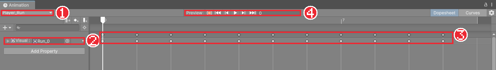
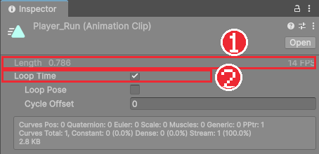

# Chapter 15 스프라이트 애니메이션

## 학습 목표

- 스프라이트 애니메이션이 프레임 그림을 빠르게 바꿔 보여 주는 원리를 설명할 수 있다.
- Animation 창에서 애니메이션 클립을 만들고 스프라이트 프레임을 넣을 수 있다.
- 샘플 속도(초당 프레임 수)와 반복(Loop Time)을 정할 수 있다.
- 자식 오브젝트(`Visual`)의 스프라이트를 부모의 Animator가 바꾸는 구조를 이해할 수 있다.

## 본문

### 15-1 스프라이트 애니메이션의 원리

Chapter 05에서 `_Run` 그림을 열면 달리는 기사가 열 번 그려져 있었습니다. 이 그림을 1초에 열 몇 장씩 차례로 바꿔 보여 주면 기사가 달리는 것처럼 보입니다. 플립북과 같은 원리입니다.

Unity에서는 "어느 시간에 어떤 그림을 보여 줄지"를 기록한 파일을 **애니메이션 클립**(Animation Clip)이라고 하고, 오브젝트에 붙어서 클립을 재생하는 컴포넌트를 **Animator**라고 합니다.

| 이름 | 종류 | 하는 일 |
|---|---|---|
| Animation Clip | 에셋 파일 (`.anim`) | 시간별로 바꿀 값(여기서는 스프라이트)을 기록 |
| Animator | 컴포넌트 | 클립을 재생한다. 어떤 클립을 언제 틀지는 Animator Controller가 정한다 |
| Animator Controller | 에셋 파일 (`.controller`) | 여러 클립 사이를 어떻게 오갈지 정한 표 (다음 장) |

### 15-2 첫 클립 만들기

1. `Assets/_Bastion`에 `Animations/Player` 폴더를 만든다.
2. Hierarchy에서 `Player`(부모)를 선택한다.
3. 메뉴에서 **Window > Animation > Animation**을 눌러 Animation 창을 연다.
4. 창 가운데의 **Create** 버튼을 누르고 `Animations/Player` 폴더에 `Player_Idle`이라는 이름으로 저장한다.

이 순간 Unity가 세 가지를 한꺼번에 해 줍니다. `Player_Idle.anim` 클립을 만들고, `Player`라는 이름의 Animator Controller를 만들고, `Player` 오브젝트에 Animator 컴포넌트를 붙여 그 컨트롤러를 연결합니다.

### 15-3 프레임 넣기

1. Project 창에서 `_Idle` 그림을 펼쳐 `_Idle_0`부터 `_Idle_9`까지 모두 고른다. 첫 프레임을 누르고 `Shift`를 누른 채 마지막 프레임을 누르면 된다.
2. 고른 프레임들을 Animation 창의 오른쪽 시간 영역으로 끌어다 놓는다.
3. Animation 창 왼쪽에 `Visual : Sprite`라는 줄이 생기고, 시간 영역에 마름모 표시가 열 개 생긴다.

> 그림은 완성본의 `Player_Run` 클립이라 줄 이름이 `Visual : Run_0`처럼 보이고 키프레임도 11개입니다. 지금 만드는 `Player_Idle`은 `Visual : Sprite` 줄에 마름모 열 개가 생깁니다.

마름모 하나를 **키프레임**(Keyframe)이라고 합니다. "이 시간에 이 값으로 바꿔라"라는 표시입니다. 그림을 `Player`가 아니라 `Visual`에서 바꾸는 이유는 Sprite Renderer가 자식인 `Visual`에 붙어 있기 때문입니다. Animator는 부모(`Player`)에 붙어 있지만 자식의 값도 바꿀 수 있고, 클립에는 `Visual`이라는 자식 이름(경로)이 함께 기록됩니다. 그래서 `Visual`의 이름을 바꾸면 애니메이션이 끊기니 주의합니다.

Animation 창 위쪽의 ▶ 버튼을 누르면 Scene 뷰에서 미리 볼 수 있습니다.

### 15-4 샘플 속도

방금 넣은 프레임은 기본 속도인 1초에 60장 간격으로 놓여 너무 빨리 지나갑니다. 클립이 1초에 몇 프레임을 보여 줄지를 **샘플 속도**(Sample Rate)라고 합니다.

1. Animation 창 오른쪽 위의 `⋮` 메뉴에서 **Show Sample Rate**를 켠다.
2. 나타난 **Samples** 칸에 `12`를 적는다.

키프레임 간격은 그대로 한 칸씩이고, 한 칸이 1/12초가 되어 1초에 12장을 보여 줍니다. 완성본의 플레이어 클립은 아래처럼 정했습니다. 픽셀 아트는 보통 1초에 8~15장이 자연스럽습니다.

| 클립 | 그림 | 프레임 수 | 샘플 속도 | 반복 |
|---|---|---|---|---|
| `Player_Idle` | `_Idle` | 10 | 12 | 반복 |
| `Player_Run` | `_Run` | 10 | 14 | 반복 |
| `Player_Jump` | `_Jump` | 3 | 12 | 한 번 |
| `Player_Fall` | `_Fall` | 3 | 12 | 반복 |
| `Player_Dash` | `_Roll` | 12 | 30 | 한 번 |

> 프레임을 넣은 뒤 마지막 프레임 다음 칸에 마지막 그림을 한 번 더 넣으면, 마지막 그림도 다른 그림과 같은 시간만큼 보입니다. 넣지 않으면 마지막 그림이 잠깐 깜빡이고 끝납니다.

### 15-5 반복 설정

달리기나 서 있기는 끝나면 처음으로 돌아가 계속 반복해야 하고, 점프는 한 번만 재생하고 마지막 그림에 머물러야 합니다. Project 창에서 클립 파일을 선택하면 Inspector에서 **Loop Time**으로 정합니다.

### 15-6 클립 더 만들기

나머지 클립도 같은 방법으로 만듭니다. Animation 창 왼쪽 위의 클립 이름 칸을 누르면 **Create New Clip...**이 있어, 같은 오브젝트에 클립을 계속 추가할 수 있습니다.

1. `Player_Run`, `Player_Jump`, `Player_Fall`, `Player_Dash`를 위 표대로 만든다. `Player_Dash`에는 `_Roll` 그림을 쓴다.
2. 각 클립의 Samples와 Loop Time을 표대로 맞춘다.
3. 공격(`_AttackNoMovement` 등), 피격(`_Hit`), 사망(`_DeathNoMovement`) 클립은 해당 장(Chapter 18, 19)에서 같은 방법으로 만든다.

실행하면 기사가 숨 쉬듯 Idle 애니메이션을 반복합니다. 하지만 달려도 뛰어도 계속 Idle만 나옵니다. 처음 만든 클립이 기본으로 재생되고, 다른 클립으로 넘어가는 규칙이 아직 없기 때문입니다.

### 15-7 따라하기 — 기사 애니메이션 클립

1. `Player`를 선택하고 Animation 창에서 `Player_Idle` 클립을 만들어 `_Idle` 프레임 열 장을 넣는다.
2. Samples를 12로 두고 ▶로 미리 본다.
3. 나머지 네 클립을 표대로 만든다.
4. 각 클립 파일의 Loop Time을 확인한다.
5. 실행해 Idle 애니메이션이 반복되는지 확인한다.

다음 장에서 Animator Controller로 "달리면 Run, 공중이면 Jump"처럼 클립을 바꾸는 규칙을 만듭니다.

### 연습문제

1. 문제: 프레임 10장짜리 클립의 샘플 속도가 12일 때 한 번 재생하는 데 걸리는 시간을 쓰세요.  
   - 출력: 초 단위, 소수 둘째 자리까지
2. 문제: Animation Clip, Animator, Animator Controller의 차이를 한 줄씩 쓰세요.
3. 문제: `Visual` 오브젝트의 이름을 `Sprite`로 바꿨더니 애니메이션이 재생되지 않습니다. 이유를 쓰세요.

### 정답 포인트

- 10 ÷ 12 ≈ 0.83초. 클립은 시간별 값 기록 파일, Animator는 재생하는 컴포넌트, Controller는 클립 사이 전환 규칙. 클립에는 바꿀 대상이 `Visual`이라는 자식 이름(경로)으로 기록되어 있어 이름이 바뀌면 대상을 찾지 못한다.

---

[다음 문서: Chapter 16 애니메이터 컨트롤러](./16-animator-controller.md)

[상위 문서로 돌아가기](./README.md)
