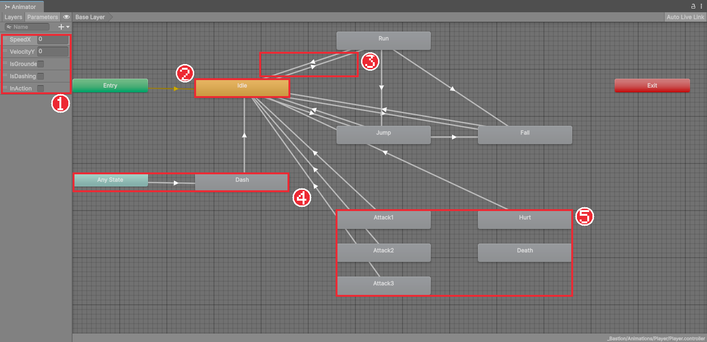
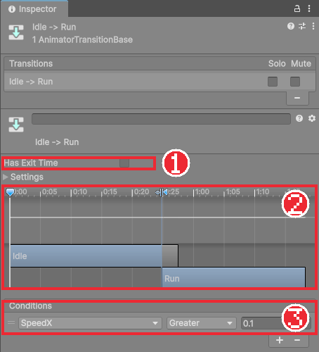

# Chapter 16 애니메이터 컨트롤러

## 학습 목표

- Animator Controller의 상태, 전이, 파라미터가 각각 무엇인지 설명할 수 있다.
- 파라미터 조건으로 Idle, Run, Jump, Fall 사이를 오가는 전이를 만들 수 있다.
- Has Exit Time과 Transition Duration을 픽셀 아트 게임에 맞게 설정할 수 있다.
- 스크립트에서 Animator 파라미터를 바꾸고, `Animator.Play`로 상태를 직접 재생할 수 있다.

## 본문

### 16-1 상태와 전이

기사는 서 있다가 달리고, 뛰어올랐다가 떨어지고, 다시 서 있습니다. 이렇게 "지금 무엇을 하는 중인가"를 **상태**(State)라고 하고, 한 상태에서 다른 상태로 넘어가는 길을 **전이**(Transition)라고 합니다. Animator Controller는 상태마다 재생할 클립을 정하고, 어떤 조건에서 어느 상태로 넘어갈지를 그림으로 그려 둔 표입니다.

조건에 쓰는 값을 **파라미터**(Parameter)라고 합니다. 스크립트가 "지금 가로 속도는 5", "지금 바닥에 있다" 같은 파라미터 값을 Animator에 알려 주면, Animator가 조건을 보고 알아서 상태를 바꿉니다.

| 파라미터 종류 | 값 | 이 게임에서 |
|---|---|---|
| Float | 소수 | `SpeedX`(가로 속도 크기), `VelocityY`(세로 속도) |
| Bool | 참/거짓 | `IsGrounded`, `IsDashing`, `InAction` |
| Int | 정수 | 쓰지 않음 |
| Trigger | 한 번 켜졌다 저절로 꺼짐 | 쓰지 않음 |

### 16-2 Animator 창

`Player`를 선택하고 메뉴의 **Window > Animation > Animator**를 엽니다. Chapter 15에서 만든 클립이 상태(네모)로 놓여 있습니다.



| 상자 | 뜻 |
|---|---|
| 주황색 상태 | 기본 상태. 처음 시작할 때 재생된다. 우클릭 **Set as Layer Default State**로 바꾼다 |
| Entry (초록) | 시작점. 기본 상태로 이어진다 |
| Any State (하늘색) | "어느 상태에서든" 넘어갈 수 있는 출발점 |
| Exit (빨강) | 상태 묶음을 빠져나가는 끝점. 이 게임에서는 쓰지 않는다 |

### 16-3 파라미터와 전이 만들기

1. 왼쪽 위의 **Parameters** 탭에서 **+**를 눌러 `SpeedX`(Float), `VelocityY`(Float), `IsGrounded`(Bool)를 만든다.
2. `Idle`을 우클릭하고 **Make Transition**을 누른 뒤 `Run`을 누르면 화살표가 생긴다.
3. 화살표를 누르고 Inspector에서 **Has Exit Time**을 끄고, **Settings**를 펼쳐 **Transition Duration**을 `0`으로 둔다.
4. **Conditions**의 **+**를 눌러 `SpeedX` `Greater` `0.1`을 넣는다.



같은 방법으로 아래 전이를 모두 만듭니다. 완성본과 같은 표입니다.

| 출발 | 도착 | 조건 |
|---|---|---|
| Idle | Run | `SpeedX` > 0.1 |
| Run | Idle | `SpeedX` < 0.1 |
| Idle, Run | Jump | `IsGrounded` = false 이고 `VelocityY` > 0.01 |
| Idle, Run | Fall | `IsGrounded` = false 이고 `VelocityY` < 0.01 |
| Jump | Fall | `VelocityY` < 0 |
| Jump, Fall | Idle | `IsGrounded` = true |

조건을 여러 개 넣으면 **모두** 만족해야 넘어갑니다. Jump와 Fall에서 바로 Run으로 가는 길은 없지만, Idle로 착지한 다음 프레임에 Idle → Run 조건이 맞으면 곧바로 Run으로 넘어갑니다.

### 16-4 Has Exit Time과 Transition Duration

| 설정 | 켜거나 키우면 | 이 게임 |
|---|---|---|
| Has Exit Time | 지금 클립이 정해진 시점까지 재생된 뒤에야 넘어간다 | 끈다. 입력에 바로 반응해야 한다 |
| Transition Duration | 두 클립을 그 시간만큼 섞으며 넘어간다 | 0. 스프라이트 그림은 섞을 수 없다 |

3D 캐릭터는 뼈의 위치를 섞어 부드럽게 넘어가지만, 스프라이트는 그림 두 장을 섞을 방법이 없어 Duration이 있으면 전환이 늦게 느껴질 뿐입니다. 2D 픽셀 아트 게임에서는 거의 항상 둘 다 끕니다.

### 16-5 스크립트에서 파라미터 넘기기

파라미터에 값을 넣는 일은 별도 스크립트가 맡습니다. 이동 코드와 애니메이션 코드를 나눠 두면, 애니메이션을 바꿔도 이동 코드는 그대로입니다.

먼저 `PlayerController`에 지금 속도를 읽을 수 있는 프로퍼티를 하나 추가합니다.

```csharp
public Vector2 Velocity => body.linearVelocity;
```

`Scripts/Player`에 `PlayerAnimator`를 만듭니다.

```csharp
using UnityEngine;

namespace Bastion.Player
{
    /// <summary>
    /// PlayerController의 상태를 Animator로 전달한다. 게임 로직은 애니메이션에 의존하지 않는다.
    /// </summary>
    [RequireComponent(typeof(PlayerController))]
    public sealed class PlayerAnimator : MonoBehaviour
    {
        [SerializeField] Animator animator;

        static readonly int SpeedX = Animator.StringToHash("SpeedX");
        static readonly int VelocityY = Animator.StringToHash("VelocityY");
        static readonly int IsGrounded = Animator.StringToHash("IsGrounded");

        PlayerController player;

        void Awake() => player = GetComponent<PlayerController>();

        void LateUpdate()
        {
            animator.SetFloat(SpeedX, Mathf.Abs(player.Velocity.x));
            animator.SetFloat(VelocityY, player.Velocity.y);
            animator.SetBool(IsGrounded, player.IsGrounded);
        }
    }
}
```

#### 코드 해석

- `Animator.StringToHash("SpeedX")`: 파라미터 이름을 숫자로 바꿔 둡니다. 매 프레임 글자를 비교하는 것보다 빠르고, 이름 오타를 한곳에서만 고치면 됩니다. `static readonly`라서 프로그램 전체에서 한 번만 계산합니다.
- `animator.SetFloat(이름, 값)`, `SetBool(이름, 값)`: 파라미터 값을 바꿉니다.
- `Mathf.Abs(...)`: 왼쪽으로 달릴 때 속도가 음수이므로 크기만 넘깁니다. 방향은 Chapter 06의 회전이 처리합니다.
- `LateUpdate()`: 모든 `Update`가 끝난 뒤에 실행되는 이벤트 함수입니다. 이번 프레임의 이동 결과가 다 정해진 뒤에 애니메이션 값을 넘깁니다.

`Player`에 `PlayerAnimator`를 붙이고 **Animator** 칸에 `Player`의 Animator 컴포넌트를 넣습니다. 실행하면 달릴 때 Run, 뛰면 Jump, 떨어질 때 Fall이 재생됩니다. 실행 중에 Animator 창을 열어 두면 지금 재생 중인 상태에 파란 진행 막대가 보여 확인하기 좋습니다.

### 16-6 Animator.Play로 직접 재생하기

공격이나 피격처럼 **정확한 순간에 처음부터** 재생해야 하는 동작은 조건 전이보다 코드에서 직접 트는 편이 확실합니다. 완성본의 Attack, Hurt, Death 상태에 들어오는 화살표가 없는 이유입니다.

```csharp
animator.Play("Hurt", 0, 0f);
```

`Play(상태 이름, 레이어 번호, 시작 위치)` 형태입니다. 레이어 0은 기본 레이어, 시작 위치 0은 클립의 처음입니다. 같은 상태를 재생 중이어도 처음부터 다시 틉니다. 이 방법은 Chapter 18에서 공격 콤보에 씁니다.

나간 뒤에는 어떻게 돌아올까요? 완성본은 `InAction`이라는 Bool 파라미터를 두고, 공격·피격·사망 중에는 `true`로 둡니다. 동작이 끝나 `false`가 되면 각 상태에서 Idle로 가는 전이(`InAction` = false)가 동작합니다.

### 16-7 블렌드 트리

**블렌드 트리**(Blend Tree)는 파라미터 값에 따라 여러 클립 중 하나를 고르거나 섞어 재생하는 특별한 상태입니다. 예를 들어 `SpeedX` 값으로 0~1이면 걷기, 1 이상이면 달리기를 고르는 상태 하나를 만들 수 있습니다. 상태 화면 빈 곳을 우클릭해 **Create State > From New Blend Tree**로 만들고, 더블클릭해 클립과 기준 값을 넣습니다.

3D 캐릭터는 걷기와 달리기를 섞어 자연스럽게 속도를 바꾸는 데 많이 씁니다. 스프라이트는 섞을 수 없어서, 이 게임처럼 동작 수가 적으면 전이로 나누는 쪽이 더 알기 쉽습니다. 걷기·달리기·전력 질주처럼 속도별 그림이 여러 개라면 블렌드 트리로 정리하는 것도 좋은 방법입니다.

### 16-8 따라하기 — 움직임에 맞는 애니메이션

1. Player 컨트롤러에 `SpeedX`, `VelocityY`, `IsGrounded` 파라미터를 만든다.
2. 16-3의 표대로 전이를 만들고, 모든 전이의 Has Exit Time을 끄고 Duration을 0으로 둔다.
3. `PlayerController`에 `Velocity`를 추가하고 `PlayerAnimator`를 작성해 붙인다.
4. 실행해 서기, 달리기, 점프, 낙하가 알맞게 바뀌는지 확인한다.
5. 일부러 Idle → Run 전이의 Has Exit Time을 켜고 실행해, 달리기 시작이 늦어지는 것을 확인한 뒤 다시 끈다.

공중 점프를 하면 이미 Jump 상태라 애니메이션이 처음부터 다시 나오지 않는 문제가 있습니다. 다음 장에서 구르기를 넣으며 이 문제도 함께 해결합니다.

### 연습문제

1. 문제: Run에서 Jump로 넘어가는 조건 두 개를 쓰고, 둘 다 필요한 이유를 쓰세요.
2. 문제: 픽셀 아트 게임에서 Has Exit Time과 Transition Duration을 끄는 이유를 각각 쓰세요.
3. 문제: `PlayerAnimator`가 `Update`가 아니라 `LateUpdate`에서 값을 넘기는 이유를 쓰세요.

### 정답 포인트

- `IsGrounded` = false 와 `VelocityY` > 0.01. 공중인 것과 올라가는 중인 것을 함께 확인해야 떨어지는 중(Fall)과 구분된다. Has Exit Time은 입력 반응을 늦추고, Duration은 그림을 섞지 못해 전환만 늦어진다. 이번 프레임의 이동이 끝난 뒤의 값을 넘기기 위해서다.

---

[다음 문서: Chapter 17 상태 머신과 구르기](./17-state-machine-roll.md)

[상위 문서로 돌아가기](./README.md)
