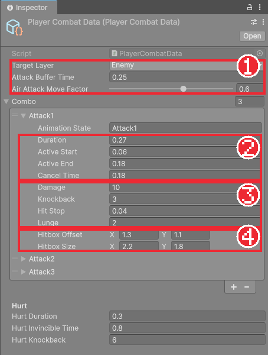
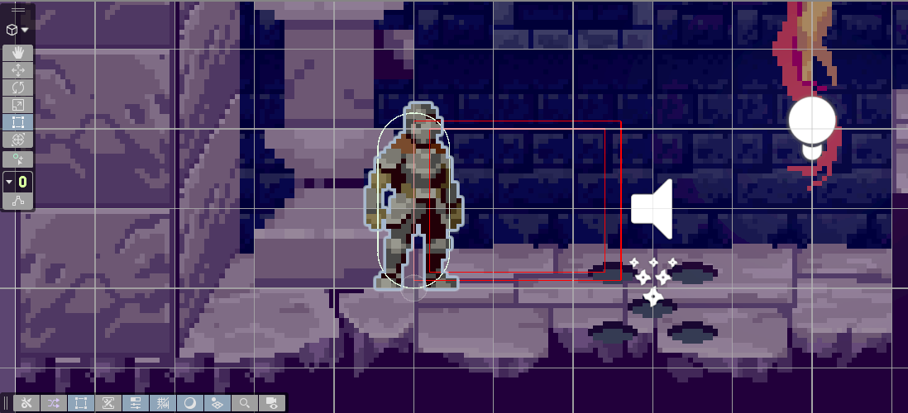

# Chapter 18 공격 판정과 콤보

## 학습 목표

- 공격 한 번을 "언제부터 언제까지 어디를 때리는가"라는 시간표 데이터로 나타낼 수 있다.
- `Physics2D.OverlapBox`로 공격 범위 안의 대상을 찾고, 한 번 휘두를 때 같은 대상을 한 번만 때리게 할 수 있다.
- 인터페이스(`IDamageable`)로 때리는 쪽과 맞는 쪽을 분리할 수 있다.
- 입력 버퍼와 캔슬 시점이 있는 3타 콤보를 공격 상태로 구현하고 Gizmos로 판정 범위를 볼 수 있다.

## 본문

### 18-1 판정은 언제, 어디서

칼을 휘두르는 애니메이션은 0.3초쯤 걸리지만, 실제로 적이 맞아야 하는 순간은 칼이 앞으로 뻗은 아주 짧은 구간입니다. 휘두르기 시작하자마자 맞거나, 칼을 거둔 뒤에도 맞으면 어색합니다. 그래서 공격 한 번을 **시간표**로 정의합니다.

```text
0초 ────── 0.06 ══════ 0.18 ──────── 0.27초
  준비       판정 구간     캔슬 가능 → 끝
```

| 값 | 뜻 |
|---|---|
| Duration | 동작 전체 길이 |
| ActiveStart ~ ActiveEnd | 판정이 살아 있는 구간 |
| CancelTime | 이 시점 이후에는 다음 콤보나 구르기로 끊고 넘어갈 수 있다 |
| Damage, Knockback | 피해량, 밀어내는 힘 |
| HitStop | 맞았을 때 화면을 잠깐 멈추는 시간 (Chapter 20) |
| Lunge | 공격하면서 앞으로 내딛는 속도 |
| HitboxOffset, HitboxSize | 판정 상자의 위치와 크기 (오른쪽을 볼 때 기준) |

판정 상자를 칼에 콜라이더로 붙여 두는 방법도 있지만, 이 게임은 판정 구간 동안 **매 물리 단계마다 "이 상자 안에 누가 있나"를 직접 물어봅니다**. 콜라이더 방식은 "들어온 순간"에만 알려 주어 프레임 타이밍에 따라 놓칠 수 있는데, 직접 물어보면 판정 시간을 코드가 정확히 정합니다. 테스트하기도 쉽습니다.

### 18-2 공격 한 동작의 데이터

`Scripts/Combat` 폴더를 만들고 `AttackStep.cs`를 작성합니다.

```csharp
using System;
using UnityEngine;

namespace Bastion.Combat
{
    /// <summary>
    /// 공격 한 동작의 데이터. 시간은 동작 시작 기준(초), 히트박스는 오른쪽을 바라볼 때 기준이다.
    /// </summary>
    [Serializable]
    public sealed class AttackStep
    {
        public string AnimationState = "Attack1";
        [Min(0.01f)] public float Duration = 0.3f;
        [Min(0f)] public float ActiveStart = 0.07f;
        [Min(0f)] public float ActiveEnd = 0.2f;
        [Tooltip("이 시간 이후부터 다음 콤보나 대시로 캔슬할 수 있다")]
        [Min(0f)] public float CancelTime = 0.2f;

        [Min(0)] public int Damage = 10;
        [Min(0f)] public float Knockback = 4f;
        [Tooltip("히트 시 경직 연출 시간 (실시간)")]
        [Min(0f)] public float HitStop = 0.05f;
        [Tooltip("공격 시작 시 앞으로 내딛는 속도")]
        public float Lunge = 2f;

        public Vector2 HitboxOffset = new Vector2(1.3f, 1.1f);
        public Vector2 HitboxSize = new Vector2(2.2f, 1.8f);

        public bool IsActive(float elapsed) => elapsed >= ActiveStart && elapsed <= ActiveEnd;
    }
}
```

`[Serializable]`을 붙이면 MonoBehaviour나 ScriptableObject가 아닌 일반 클래스도 Inspector에 펼쳐서 보여 주고 저장할 수 있습니다. 공격 데이터를 배열로 늘어놓아 콤보를 만들 수 있습니다.

### 18-3 맞는 쪽의 약속

공격하는 코드가 "맞은 것이 해골인가, 마법사인가, 보스인가"를 일일이 알아야 한다면 적이 늘 때마다 공격 코드를 고쳐야 합니다. 대신 **맞을 수 있는 것이라면 누구나 지킬 약속**을 인터페이스로 정해 두고, 공격하는 쪽은 그 약속만 봅니다.

```csharp
namespace Bastion.Combat
{
    public interface IDamageable
    {
        bool IsDead { get; }

        /// <returns>실제로 피해가 들어갔으면 true (무적, 사망, 방어 등으로 막히면 false)</returns>
        bool TakeDamage(in DamageInfo info);
    }
}
```

```csharp
using UnityEngine;

namespace Bastion.Combat
{
    public readonly struct DamageInfo
    {
        public readonly int Amount;
        /// <summary>넉백 방향 (정규화). 보통 공격자 → 피격자 방향.</summary>
        public readonly Vector2 Direction;
        public readonly float Knockback;
        public readonly GameObject Source;

        public DamageInfo(int amount, Vector2 direction, float knockback, GameObject source)
        {
            Amount = amount;
            Direction = direction;
            Knockback = knockback;
            Source = source;
        }
    }
}
```

#### 코드 해석

- `IDamageable`: 맞을 수 있는 대상의 약속입니다. 죽었는지 알려 주고, 피해를 받는 함수가 있어야 합니다.
- `DamageInfo`: 피해 한 번에 필요한 정보(양, 방향, 넉백, 때린 오브젝트)를 묶은 값입니다. `readonly struct`는 만든 뒤 바꿀 수 없는 작은 값 묶음입니다. 피해 정보가 전달되는 도중에 바뀌지 않게 막습니다.
- `in DamageInfo info`: 구조체를 복사하지 않고 읽기 전용으로 넘깁니다.

### 18-4 판정 질의

`HitboxQuery.cs`는 상자 안의 대상을 찾아 피해를 주는 공용 함수입니다. 플레이어, 적, 보스가 모두 씁니다.

```csharp
using System.Collections.Generic;
using UnityEngine;

namespace Bastion.Combat
{
    /// <summary>
    /// OverlapBox 기반 근접 판정. 트리거 콜라이더 대신 판정 프레임에 직접 질의해서 타이밍을 코드가 결정한다.
    /// </summary>
    public static class HitboxQuery
    {
        static readonly Collider2D[] Buffer = new Collider2D[16];

        public static Vector2 WorldCenter(Transform owner, int facing, Vector2 offset) =>
            (Vector2)owner.position + new Vector2(offset.x * facing, offset.y);

        /// <summary>
        /// 히트박스 안의 IDamageable을 찾아 아직 맞지 않은 대상에게 피해를 준다.
        /// </summary>
        /// <returns>이번 호출에서 새로 피해를 준 대상 수</returns>
        public static int Apply(Transform owner, int facing, AttackStep step, LayerMask targetMask,
            HashSet<IDamageable> alreadyHit)
        {
            Vector2 center = WorldCenter(owner, facing, step.HitboxOffset);
            var filter = new ContactFilter2D { useLayerMask = true, layerMask = targetMask, useTriggers = true };
            int count = Physics2D.OverlapBox(center, step.HitboxSize, 0f, filter, Buffer);

            int hits = 0;
            for (int i = 0; i < count; i++)
            {
                var target = Buffer[i].GetComponentInParent<IDamageable>();
                if (target == null || target.IsDead || !alreadyHit.Add(target))
                    continue;

                var direction = new Vector2(facing, 0f);
                if (target.TakeDamage(new DamageInfo(step.Damage, direction, step.Knockback, owner.gameObject)))
                    hits++;
            }
            return hits;
        }

        public static void DrawGizmo(Transform owner, int facing, AttackStep step)
        {
            Gizmos.DrawWireCube(WorldCenter(owner, facing, step.HitboxOffset), step.HitboxSize);
        }
    }
}
```

#### 코드 해석

- `WorldCenter`: 오른쪽 기준으로 적은 Offset을, 왼쪽을 볼 때(`facing` = -1)는 x를 뒤집어 실제 위치를 계산합니다.
- `Physics2D.OverlapBox(중심, 크기, 각도, 조건, 결과배열)`: 상자와 겹치는 콜라이더를 찾아 배열에 채우고 개수를 돌려줍니다. Chapter 08의 Cast처럼 결과 배열을 재사용합니다.
- `GetComponentInParent<IDamageable>()`: 맞은 콜라이더나 그 부모에서 약속을 지키는 컴포넌트를 찾습니다. 인터페이스로도 찾을 수 있습니다.
- `alreadyHit.Add(target)`: `HashSet`은 같은 값을 두 번 넣으면 `false`를 돌려줍니다. 판정 구간 동안 매 물리 단계마다 검사하지만, 한 번 휘두를 때 같은 대상은 한 번만 맞습니다.
- `DrawGizmo`: Scene 뷰에 판정 상자를 선으로 그립니다. **Gizmos**는 Scene 뷰에서만 보이는 개발용 그림입니다.

### 18-5 공격 수치

`Scripts/Player`에 `PlayerCombatData.cs`를 만듭니다. Hurt 묶음은 다음 장에서 씁니다.

```csharp
using Bastion.Combat;
using UnityEngine;

namespace Bastion.Player
{
    [CreateAssetMenu(fileName = "PlayerCombatData", menuName = "Bastion/Player Combat Data")]
    public sealed class PlayerCombatData : ScriptableObject
    {
        public LayerMask TargetLayer;
        [Tooltip("공격 입력을 미리 보관하는 시간")]
        [Min(0f)] public float AttackBufferTime = 0.25f;
        [Tooltip("공중 공격 시 수평 속도 배율")]
        [Range(0f, 1f)] public float AirAttackMoveFactor = 0.6f;
        public AttackStep[] Combo =
        {
            new AttackStep { AnimationState = "Attack1", Duration = 0.27f, ActiveStart = 0.06f, ActiveEnd = 0.18f, CancelTime = 0.18f, Damage = 10, Knockback = 3f, HitStop = 0.04f, Lunge = 2f },
            new AttackStep { AnimationState = "Attack2", Duration = 0.4f, ActiveStart = 0.13f, ActiveEnd = 0.27f, CancelTime = 0.27f, Damage = 12, Knockback = 3.5f, HitStop = 0.05f, Lunge = 2.5f },
            new AttackStep { AnimationState = "Attack3", Duration = 0.6f, ActiveStart = 0.33f, ActiveEnd = 0.47f, CancelTime = 0.5f, Damage = 22, Knockback = 8f, HitStop = 0.09f, Lunge = 4f, HitboxSize = new Vector2(2.6f, 2.0f) },
        };

        [Header("Hurt")]
        [Min(0f)] public float HurtDuration = 0.3f;
        [Min(0f)] public float HurtInvincibleTime = 0.8f;
        [Min(0f)] public float HurtKnockback = 6f;
    }
}
```

1타 10, 2타 12, 3타 22의 피해를 줍니다. 마지막 타는 판정이 늦게 나오지만 넉백과 히트스톱이 가장 커서 "마무리 한 방"처럼 느껴지게 했습니다.

`Data` 폴더에 **Create > Bastion > Player Combat Data**로 에셋을 만들고 **Target Layer**를 정합니다. 적이 쓸 레이어 `Enemy`를 Chapter 08처럼 **User Layer 8**에 만들고 고릅니다.



### 18-6 공격 상태

`PlayerAttackState.cs`입니다. 콤보 중 어디까지 왔는지(`ComboIndex`)와 이번 동작이 시작된 시각을 기억합니다.

```csharp
using System.Collections.Generic;
using Bastion.Combat;
using UnityEngine;

namespace Bastion.Player
{
    /// <summary>
    /// 3타 콤보. 각 동작은 AttackStep의 시간표대로 판정하고, 캔슬 시점 이후 버퍼된 입력으로 다음 동작이나 대시로 넘어간다.
    /// </summary>
    public sealed class PlayerAttackState : PlayerState
    {
        readonly HashSet<IDamageable> hitThisSwing = new HashSet<IDamageable>();
        float stepStartTime;

        public int ComboIndex { get; private set; }
        public AttackStep CurrentStep => Player.CombatData.Combo[ComboIndex];

        public PlayerAttackState(PlayerController player) : base(player) { }

        public void BeginCombo()
        {
            ComboIndex = 0;
            if (Player.StateMachine.CurrentState == this)
                StartStep();
            else
                Player.StateMachine.ChangeState(this);
        }

        public override void Enter() => StartStep();

        void StartStep()
        {
            Player.Input.ConsumeAttack();
            Player.UpdateFacing(Player.Input.MoveX);
            hitThisSwing.Clear();
            stepStartTime = Time.time;

            if (Player.IsGrounded)
                Player.SetVelocity(new Vector2(Player.FacingDirection * CurrentStep.Lunge, Player.Velocity.y));

            Player.RaiseAttackStarted(ComboIndex);
        }

        public override void Tick()
        {
            float elapsed = Time.time - stepStartTime;
            if (elapsed < CurrentStep.CancelTime)
                return;

            if (Player.HasBufferedDash && Player.IsDashReady && (Player.IsGrounded || Player.CanAirDash))
            {
                Player.StateMachine.ChangeState(Player.DashState);
                return;
            }

            if (Player.HasBufferedAttack && ComboIndex < Player.CombatData.Combo.Length - 1)
            {
                ComboIndex++;
                StartStep();
                return;
            }

            if (elapsed >= CurrentStep.Duration)
                ReturnToMovement();
        }

        public override void FixedTick()
        {
            float elapsed = Time.time - stepStartTime;

            if (Player.IsGrounded)
            {
                // 지상 공격 중에는 런지 속도를 서서히 줄인다.
                float x = Mathf.MoveTowards(Player.Velocity.x, 0f, Player.Data.GroundDeceleration * 0.5f * Time.fixedDeltaTime);
                Player.SetVelocity(new Vector2(x, Player.Velocity.y));
            }
            else
            {
                Player.ApplyHorizontalMovement(Player.Data.AirAcceleration, Player.Data.AirDeceleration, Player.CombatData.AirAttackMoveFactor);
            }
            Player.ApplyGravity();

            if (CurrentStep.IsActive(elapsed))
            {
                int hits = HitboxQuery.Apply(Player.transform, Player.FacingDirection, CurrentStep,
                    Player.CombatData.TargetLayer, hitThisSwing);
                if (hits > 0)
                    Player.RaiseAttackLanded(CurrentStep, hits);
            }
        }
    }
}
```

#### 코드 해석

- `StartStep`: 한 동작을 시작할 때 입력을 소비하고, 바라볼 방향을 정하고, 이번 휘두르기에 맞은 대상 목록을 비웁니다. 땅에서는 `Lunge` 속도로 앞으로 내딛습니다.
- `Tick`: **캔슬 시점 전에는 아무 입력도 받지 않습니다.** 그 뒤에 보관된 구르기 입력이 있으면 구르기로, 공격 입력이 있으면 다음 타로 넘어갑니다. 3타까지 끝나거나 입력이 없으면 동작이 끝날 때 이동 상태로 돌아갑니다.
- `HasBufferedAttack`: 공격 버튼은 0.25초 보관합니다. 1타가 끝나기 조금 전에 연타해도 2타로 이어지는 이유입니다. 이 보관과 캔슬 시점 덕분에 콤보가 "끊김 없이 이어지면서도 아무 때나 끊기지는 않는" 느낌이 됩니다.
- `FixedTick`: 판정 구간이면 `HitboxQuery.Apply`로 때리고, 맞힌 대상이 있으면 `AttackLanded` 이벤트를 알립니다.

### 18-7 컨트롤러와 다른 상태 고치기

`PlayerController`에 아래를 추가합니다.

```csharp
[SerializeField] PlayerCombatData combatData;

public PlayerCombatData CombatData => combatData;
public PlayerAttackState AttackState { get; private set; }

/// <summary>공격이 대상을 맞혔을 때 (동작, 맞힌 수). 히트스톱 등 연출용.</summary>
public event Action<AttackStep, int> AttackLanded;
/// <summary>콤보 동작이 시작될 때 (콤보 인덱스).</summary>
public event Action<int> AttackStarted;

// Awake에 추가
AttackState = new PlayerAttackState(this);

public bool HasBufferedAttack => Time.time - Input.LastAttackPressedTime <= combatData.AttackBufferTime;

/// <summary>지상/공중 상태에서 공통으로 쓰는 행동 우선순위: 대시 → 공격.</summary>
public bool TryStartDashOrAttack()
{
    if (HasBufferedDash && IsDashReady && (IsGrounded || CanAirDash))
    {
        StateMachine.ChangeState(DashState);
        return true;
    }
    if (HasBufferedAttack)
    {
        AttackState.BeginCombo();
        return true;
    }
    return false;
}

internal void RaiseAttackStarted(int comboIndex) => AttackStarted?.Invoke(comboIndex);

internal void RaiseAttackLanded(AttackStep step, int hits) => AttackLanded?.Invoke(step, hits);

void OnDrawGizmosSelected()
{
    if (combatData == null)
        return;
    Gizmos.color = Color.red;
    foreach (var step in combatData.Combo)
        HitboxQuery.DrawGizmo(transform, Application.isPlaying ? FacingDirection : 1, step);
}
```

- Chapter 17의 `TryStartDash()`를 `TryStartDashOrAttack()`으로 바꾸고, `PlayerGroundedState`와 `PlayerAirborneState`의 `Tick`에서도 이 이름으로 부릅니다. 구르기가 공격보다 먼저입니다. 위험할 때 회피가 공격보다 우선해야 하기 때문입니다.
- `internal`: 같은 프로젝트 안의 코드(공격 상태)만 부를 수 있게 합니다. 이벤트를 아무 데서나 발생시키지 못하게 막는 용도입니다.
- `OnDrawGizmosSelected()`: 오브젝트를 선택했을 때만 Unity가 부르는 함수입니다. 세 동작의 판정 상자를 빨간 선으로 보여 줍니다.



**입력.** `Attack` 액션(Button, `Z [Keyboard]`, `Button West [Gamepad]`)을 만들고, `PlayerInputReader`에 구르기와 같은 방식으로 `attackAction`, `LastAttackPressedTime`, `OnAttackPerformed`, `ConsumeAttack`을 추가합니다.

**애니메이션.** `_AttackNoMovement`(4장), `_Attack2NoMovement`(6장), `_AttackComboNoMovement`(10장)로 `Player_Attack1~3` 클립을 만들고 반복은 끕니다. Animator에 같은 이름의 상태 `Attack1~3`을 두고, `InAction`(Bool) 파라미터와 각 공격 상태에서 Idle로 가는 전이(`InAction` = false)를 만듭니다. `PlayerAnimator`에 추가합니다.

```csharp
static readonly int InAction = Animator.StringToHash("InAction");

// OnEnable / OnDisable에 추가
player.AttackStarted += OnAttackStarted;
player.AttackStarted -= OnAttackStarted;

void OnAttackStarted(int comboIndex) =>
    animator.Play(player.CombatData.Combo[comboIndex].AnimationState, 0, 0f);

// LateUpdate에 추가
animator.SetBool(InAction, state == player.AttackState);
```

`NoMovement` 그림을 쓰는 이유는, 그림 안에서 기사가 앞으로 걸어 나가면 실제 위치(Lunge)와 두 번 움직인 것처럼 보이기 때문입니다. 이동은 코드가, 그림은 제자리 동작만 맡습니다.

### 18-8 허수아비로 시험하기

적은 Chapter 21에서 만들므로, 지금은 맞기만 하는 허수아비로 판정을 시험합니다.

```csharp
using UnityEngine;

namespace Bastion.Combat
{
    /// <summary>공격 판정을 시험하는 허수아비. 맞으면 Console에 피해를 찍는다.</summary>
    public sealed class TrainingDummy : MonoBehaviour, IDamageable
    {
        public bool IsDead => false;

        public bool TakeDamage(in DamageInfo info)
        {
            Debug.Log($"{name}: {info.Amount} 피해, 넉백 {info.Knockback}");
            return true;
        }
    }
}
```

1. Square로 `Dummy`를 만들어 바닥 위에 세우고 Scale (1, 2, 1), Layer `Enemy`로 둔다.
2. `Box Collider 2D`와 `TrainingDummy`를 붙인다.
3. 기사 앞에서 Z를 한 번, 세 번 연타해 Console에 `10`, `12`, `22` 피해가 찍히는지 확인한다.
4. 허수아비 뒤를 향해 공격하면 찍히지 않는지 확인한다.

`$"..."`는 문자열 안에 `{}`로 값을 끼워 넣는 C# 문법입니다. 허수아비는 Chapter 21에서 진짜 적이 생기면 지웁니다.

### 18-9 따라하기 — 3타 콤보

1. `Scripts/Combat`에 `AttackStep`, `IDamageable`, `DamageInfo`, `HitboxQuery`를 만든다.
2. `PlayerCombatData` 에셋을 만들고 `Enemy` 레이어를 Target Layer로 고른다.
3. `PlayerAttackState`를 만들고 `PlayerController`와 두 이동 상태를 18-7대로 고친다.
4. 입력과 애니메이션을 연결하고, 허수아비로 콤보 피해가 10 → 12 → 22로 들어가는지 확인한다.
5. 공격 도중 X를 눌러 캔슬 시점 이후에 구르기로 끊기는지 확인한다.

허수아비는 맞아도 아무 반응이 없습니다. 다음 장에서 체력과 피격 반응을 만듭니다.

### 연습문제

1. 문제: 공격 판정을 콜라이더 충돌 대신 `OverlapBox` 질의로 하는 이유를 쓰세요.
2. 문제: 판정 구간이 0.06~0.18초이고 물리 단계가 0.02초마다 돌 때, 한 번 휘두르는 동안 같은 적이 몇 번 맞는지와 그 이유를 쓰세요.
3. 문제: 2타의 판정 상자를 1.5배 넓히고 피해를 15로 올리려면 어디를 고쳐야 하는지 쓰세요.  
   - 조건: 코드를 고쳐야 하는지 여부를 함께 쓸 것

### 정답 포인트

- 판정 시간을 코드가 정확히 정하고 프레임 타이밍에 따라 놓치지 않으며 테스트하기 쉽다. 한 번. 구간 동안 여러 번 검사하지만 `HashSet`에 이미 맞은 대상이 들어 있어 건너뛴다. PlayerCombatData 에셋의 Combo[1](Attack2)에서 Hitbox Size와 Damage만 바꾸면 되고 코드는 고치지 않는다.

---

[다음 문서: Chapter 19 체력과 피해](./19-health-damage.md)

[상위 문서로 돌아가기](./README.md)
