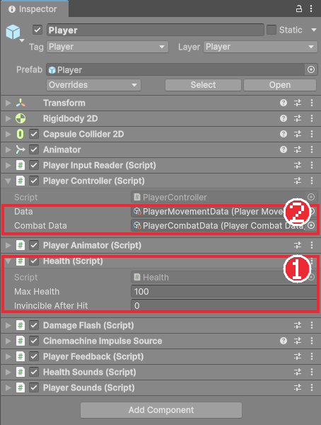

# Chapter 19 체력과 피해

## 학습 목표

- 체력, 무적 시간, 사망을 관리하는 `Health` 컴포넌트를 `IDamageable`로 구현할 수 있다.
- C# 이벤트로 "맞았다", "죽었다"를 알리고, 다른 컴포넌트가 구독해 반응하게 만들 수 있다.
- 플레이어의 피격 상태(넉백, 경직, 무적)와 사망 상태를 만들 수 있다.
- 구르기 중 무적 시간을 체력의 무적과 연결할 수 있다.

## 본문

### 19-1 체력을 누가 관리할까

플레이어, 해골 병사, 마법사, 보스, 보스가 부르는 졸개까지 모두 체력이 있고, 맞으면 줄고, 0이 되면 죽습니다. 이 공통 부분을 각자 따로 만들면 같은 코드가 다섯 벌 생깁니다. 그래서 체력만 담당하는 컴포넌트 `Health`를 하나 만들어 모두에게 붙입니다.

그런데 맞았을 때의 **반응**은 제각각입니다. 플레이어는 뒤로 밀리며 잠깐 조작이 안 되고, 해골은 방패로 막기도 하고, 보스는 밀리지 않습니다. `Health`가 이 반응까지 다 알면 다시 복잡해집니다. 그래서 `Health`는 **"맞았다", "죽었다"는 사실만 이벤트로 알리고**, 반응은 각 오브젝트의 다른 컴포넌트가 이벤트를 듣고 처리합니다.

### 19-2 Health 컴포넌트

`Scripts/Combat/Health.cs`를 만듭니다.

```csharp
using System;
using UnityEngine;

namespace Bastion.Combat
{
    /// <summary>
    /// 체력과 무적 시간을 관리한다. 피격 반응(경직, 넉백, 연출)은 Damaged 이벤트를 구독해서 처리한다.
    /// </summary>
    public sealed class Health : MonoBehaviour, IDamageable
    {
        [SerializeField, Min(1)] int maxHealth = 100;
        [Tooltip("피격 후 무적 시간")]
        [SerializeField, Min(0f)] float invincibleAfterHit;

        public int Max => maxHealth;
        public int Current { get; private set; }
        public bool IsDead => Current <= 0;
        public float InvincibleUntil { get; set; } = float.NegativeInfinity;
        public bool IsInvincible => Time.time < InvincibleUntil;

        /// <summary>true를 반환하면 피해를 막는다 (예: 방패 방어).</summary>
        public Func<DamageInfo, bool> BlockFilter { get; set; }

        public event Action<DamageInfo> Damaged;
        public event Action<DamageInfo> Blocked;
        public event Action Died;
        public event Action<int, int> Changed;

        void Awake() => Current = maxHealth;

        public bool TakeDamage(in DamageInfo info)
        {
            if (IsDead || IsInvincible)
                return false;

            if (BlockFilter != null && BlockFilter(info))
            {
                Blocked?.Invoke(info);
                return false;
            }

            Current = Mathf.Max(0, Current - info.Amount);
            InvincibleUntil = Time.time + invincibleAfterHit;
            Changed?.Invoke(Current, maxHealth);
            Damaged?.Invoke(info);

            if (IsDead)
                Died?.Invoke();
            return true;
        }

        public void ResetHealth()
        {
            Current = maxHealth;
            InvincibleUntil = float.NegativeInfinity;
            Changed?.Invoke(Current, maxHealth);
        }
    }
}
```

#### 코드 해석

- `: MonoBehaviour, IDamageable`: 컴포넌트이면서 Chapter 18의 "맞을 수 있는 대상" 약속을 지킵니다. 그래서 `HitboxQuery`가 `Health`를 찾아 피해를 줄 수 있습니다.
- `InvincibleUntil`: 이 시각까지는 무적입니다. 무적을 "남은 시간"이 아니라 "끝나는 시각"으로 저장하면 매 프레임 시간을 빼 줄 필요가 없고, 피격 무적과 구르기 무적이 겹쳐도 더 늦은 시각만 남기면 됩니다.
- `TakeDamage`: 죽었거나 무적이면 무시하고, 방어(`BlockFilter`)에 걸리면 `Blocked`만 알리고, 아니면 체력을 줄이고 `Changed`, `Damaged`를 알린 뒤 0이 되면 `Died`까지 알립니다. 실제로 피해가 들어갔는지를 `bool`로 돌려줍니다.
- `event Action<DamageInfo> Damaged`: **이벤트**는 "일이 생기면 알려 줄 테니 듣고 싶은 함수를 등록하라"는 통로입니다. `Action<T>`는 값 하나를 받는 함수 모양입니다. C# 과정에서 배운 `event`와 같습니다.
- `BlockFilter`: 함수를 담는 칸입니다. 해골 병사가 "정면에서 온 공격이면 30% 확률로 막는다"는 함수를 넣어 둡니다(Chapter 22). `Health`는 방어 규칙을 몰라도 됩니다.
- `ResetHealth`: 체크포인트에서 체력을 채울 때 씁니다(Chapter 26).

Chapter 18의 허수아비에서 `TrainingDummy`를 떼고 `Health`를 붙여 보세요. Max Health를 30으로 두고 세 번 때리면 `IsDead`가 되어 더 이상 맞지 않습니다.

### 19-3 이벤트를 구독하는 법

이벤트를 듣는 쪽은 항상 같은 모양으로 씁니다.

```csharp
void OnEnable()
{
    health.Damaged += OnDamaged;
    health.Died += OnDied;
}

void OnDisable()
{
    health.Damaged -= OnDamaged;
    health.Died -= OnDied;
}
```

`OnEnable`에서 등록(`+=`)하고 `OnDisable`에서 반드시 해제(`-=`)합니다. 해제하지 않으면 오브젝트가 사라진 뒤에도 이벤트가 이미 없는 오브젝트의 함수를 부르려다 오류가 납니다.

### 19-4 피격 상태와 사망 상태

`Scripts/Player`에 두 상태를 추가합니다.

```csharp
using Bastion.Combat;
using UnityEngine;

namespace Bastion.Player
{
    public sealed class PlayerHurtState : PlayerState
    {
        float endTime;

        public PlayerHurtState(PlayerController player) : base(player) { }

        public void Begin(in DamageInfo info)
        {
            var data = Player.CombatData;
            endTime = Time.time + data.HurtDuration;
            Player.Health.InvincibleUntil = Time.time + data.HurtInvincibleTime;

            float direction = Mathf.Sign(info.Direction.x == 0f ? -Player.FacingDirection : info.Direction.x);
            Player.SetVelocity(new Vector2(direction * data.HurtKnockback, data.HurtKnockback * 0.5f));

            Player.StateMachine.ChangeState(this);
        }

        public override void FixedTick()
        {
            Player.ApplyGravity();
            if (Time.time >= endTime)
                ReturnToMovement();
        }
    }
}
```

```csharp
using UnityEngine;

namespace Bastion.Player
{
    public sealed class PlayerDeadState : PlayerState
    {
        public PlayerDeadState(PlayerController player) : base(player) { }

        public override void Enter() => Player.SetVelocity(new Vector2(0f, Player.Velocity.y));

        public override void FixedTick()
        {
            float x = Mathf.MoveTowards(Player.Velocity.x, 0f, Player.Data.GroundDeceleration * Time.fixedDeltaTime);
            Player.SetVelocity(new Vector2(x, Player.Velocity.y));
            Player.ApplyGravity();
        }
    }
}
```

#### 코드 해석

- `Begin`: 맞으면 0.3초 동안 피격 상태가 되고, 0.8초 동안 무적입니다. 공격이 온 방향(`info.Direction`)으로 비스듬히 위로 밀려납니다. 방향 정보가 없으면 바라보는 반대쪽으로 밀립니다.
- 피격 상태에는 이동, 점프, 공격 코드가 없으므로 경직 동안 아무것도 못 합니다. 0.3초가 지나면 이동 상태로 돌아가지만 무적은 0.8초까지 남아, 연달아 맞지 않고 빠져나올 시간이 생깁니다.
- 사망 상태는 가로 속도를 서서히 줄이고 중력만 받습니다. 다른 상태로 나가는 코드가 없으므로 다시 일어나지 않습니다. 재시작은 Chapter 29에서 만듭니다.

### 19-5 컨트롤러에 연결하기

`PlayerController`에 아래를 추가합니다.

```csharp
[RequireComponent(typeof(Health))]   // 클래스 위의 RequireComponent 줄 아래에 추가

public Health Health { get; private set; }
public PlayerHurtState HurtState { get; private set; }
public PlayerDeadState DeadState { get; private set; }
public bool IsInvincible => Health.IsInvincible;

// Awake에 추가
Health = GetComponent<Health>();
HurtState = new PlayerHurtState(this);
DeadState = new PlayerDeadState(this);

void OnEnable()
{
    Health.Damaged += OnDamaged;
    Health.Died += OnDied;
}

void OnDisable()
{
    Health.Damaged -= OnDamaged;
    Health.Died -= OnDied;
}

void OnDamaged(DamageInfo info)
{
    if (!Health.IsDead)
        HurtState.Begin(info);
}

void OnDied() => StateMachine.ChangeState(DeadState);
```

구르기 무적은 `PlayerDashState.Enter`에 한 줄을 추가해 연결합니다. 이미 남아 있는 무적이 더 길면 줄이지 않도록 `Mathf.Max`로 더 늦은 시각을 고릅니다.

```csharp
Player.Health.InvincibleUntil = Mathf.Max(Player.Health.InvincibleUntil, Time.time + Player.Data.DashInvincibleTime);
```

`Player`에 `Health`를 붙이고 Max Health를 100으로 둡니다. 적은 아직 없으므로, 플레이 중에 아래 코드를 잠깐 `PlayerController.Update`에 넣어 맞는 모습을 확인하고 지웁니다.

```csharp
if (UnityEngine.InputSystem.Keyboard.current.hKey.wasPressedThisFrame)
    Health.TakeDamage(new DamageInfo(20, new Vector2(-FacingDirection, 0f), 0f, null));
```



### 19-6 피격과 사망 애니메이션

`_Hit`(1장)으로 `Player_Hurt`, `_DeathNoMovement`(10장)로 `Player_Death` 클립을 만들고 반복은 끕니다. Animator에 `Hurt`, `Death` 상태를 두고 `Hurt`에서 Idle로 가는 전이(`InAction` = false)를 만듭니다. `Death`에서는 나가는 전이를 만들지 않습니다.

`PlayerAnimator`는 상태 머신의 `StateChanged` 이벤트를 구독해, 피격·사망 상태로 바뀌는 순간 해당 애니메이션을 처음부터 틉니다.

```csharp
static readonly int HurtState = Animator.StringToHash("Hurt");
static readonly int DeathState = Animator.StringToHash("Death");

// OnEnable / OnDisable에 추가
player.StateMachine.StateChanged += OnStateChanged;
player.StateMachine.StateChanged -= OnStateChanged;

void OnStateChanged(IState previous, IState next)
{
    if (next == player.HurtState)
        animator.Play(HurtState, 0, 0f);
    else if (next == player.DeadState)
        animator.Play(DeathState, 0, 0f);
}

// LateUpdate의 InAction을 바꾼다
animator.SetBool(InAction, state == player.AttackState || state == player.HurtState || state == player.DeadState);
```

이것으로 완성본의 `PlayerAnimator`와 같아졌습니다. 게임 로직은 애니메이션에 전혀 의존하지 않고, 애니메이션 쪽이 로직의 상태와 이벤트를 따라갑니다. 그래서 애니메이션이 없어도 게임은 똑같이 돌아가고, Chapter 34의 테스트도 애니메이션 없이 로직만 검사할 수 있습니다.

### 19-7 따라하기 — 맞고 쓰러지는 기사

1. `Health`를 만들어 허수아비와 `Player`에 붙인다.
2. `PlayerHurtState`, `PlayerDeadState`를 만들고 컨트롤러에 연결한다.
3. 구르기 무적 한 줄을 넣는다.
4. H 키 시험 코드로 맞아 보며, 밀려나고 0.8초 동안 연달아 맞지 않는지, 다섯 번째에 쓰러지는지 확인한다. 확인 뒤 시험 코드를 지운다.
5. 허수아비를 Max Health 30으로 두고 콤보로 쓰러뜨려 본다.

맞고 때리는 판정은 완성되었지만 아직 손맛이 밋밋합니다. 다음 장에서 화면 멈춤, 흔들림, 깜빡임으로 타격감을 더합니다.

### 연습문제

1. 문제: `Health`가 피격 반응을 직접 처리하지 않고 이벤트로 알리기만 하는 이유를 쓰세요.
2. 문제: 체력 100인 플레이어가 피해 20을 받은 직후 0.5초 뒤에 피해 20을 또 받으면 체력은 얼마인지 쓰세요.  
   - 조건: HurtInvincibleTime은 0.8초
3. 문제: 이벤트를 `OnEnable`에서 구독했는데 `OnDisable`에서 해제하지 않으면 생길 수 있는 문제를 쓰세요.

### 정답 포인트

- 맞았을 때 반응이 오브젝트마다 달라서 `Health`는 공통 부분(체력, 무적)만 맡고 반응은 듣는 쪽에 맡기기 위해서다. 80. 두 번째는 무적 시간 안이라 무시된다. 오브젝트가 꺼지거나 사라진 뒤에도 이벤트가 그 함수를 불러 오류가 나거나 엉뚱하게 동작한다.

---

[상위 문서로 돌아가기](./README.md)
