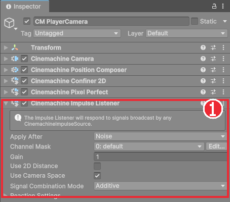
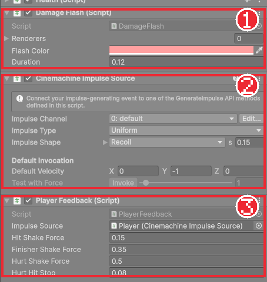

# Chapter 20 타격감

## 학습 목표

- 타격감을 만드는 연출(히트스톱, 화면 흔들림, 피격 깜빡임)이 각각 무엇인지 설명할 수 있다.
- 코루틴으로 "잠깐 기다렸다가 되돌리는" 동작을 만들 수 있다.
- `Time.timeScale`로 게임 시간을 멈추고, 멈춘 동안에도 흐르는 실제 시간으로 되돌릴 수 있다.
- 게임 로직은 이벤트만 발생시키고 연출 컴포넌트가 그 이벤트를 듣는 구조로 연출을 붙일 수 있다.

## 본문

### 20-1 손맛은 어디서 오는가

판정이 정확해도 칼이 적을 그냥 스쳐 지나가는 것처럼 보이면 시원하지 않습니다. 액션 게임은 "맞았다"는 느낌을 눈과 손에 전달하려고 몇 가지 연출을 겹쳐 씁니다.

| 연출 | 하는 일 | 느낌 |
|---|---|---|
| 히트스톱 | 맞는 순간 게임을 0.04~0.09초 멈춘다 | 칼이 살에 걸리는 묵직함 |
| 화면 흔들림 | 카메라를 맞은 방향으로 살짝 흔든다 | 충격 |
| 피격 깜빡임 | 맞은 쪽 그림을 잠깐 붉게 칠한다 | 누가 맞았는지 분명히 보임 |


이 연출들은 게임 규칙과 관계가 없습니다. 그래서 이 게임은 **로직은 "일이 일어났다"는 이벤트만 발생시키고, 연출은 별도 컴포넌트가 이벤트를 듣고 처리**합니다. Chapter 18의 `AttackLanded`, Chapter 19의 `Health.Damaged`가 그 이벤트입니다. 연출을 빼거나 바꿔도 로직과 테스트는 그대로입니다.

### 20-2 코루틴

"붉게 칠하고, 0.12초 뒤에 원래 색으로 되돌린다"를 만들려면 0.12초를 기다려야 합니다. `Update`에서 시간을 재며 확인해도 되지만, Unity에는 기다리는 일을 간단히 쓰는 **코루틴**(Coroutine)이 있습니다.

```csharp
IEnumerator Flash()
{
    spriteRenderer.color = Color.red;
    yield return new WaitForSeconds(0.12f);
    spriteRenderer.color = Color.white;
}

// 시작할 때
StartCoroutine(Flash());
```

- `IEnumerator`를 돌려주는 함수가 코루틴입니다.
- `yield return new WaitForSeconds(0.12f);`에서 함수가 잠시 멈추고, 0.12초 뒤 Unity가 그 다음 줄부터 이어서 실행합니다.
- `StartCoroutine(함수())`로 시작하고, `StopCoroutine`이나 `StopAllCoroutines`로 멈춥니다. 코루틴은 그것을 시작한 컴포넌트가 꺼지면 함께 멈춥니다.
- `yield return null;`은 "다음 프레임까지 기다리기"입니다.

### 20-3 히트스톱

게임 전체의 시간 흐름 배율이 `Time.timeScale`입니다. 1이면 보통, 0.5면 느리게, 0이면 멈춥니다. 0이 되면 `Time.deltaTime`이 0이 되어 움직임이 멈추고, 물리 계산(`FixedUpdate`)도 멈춥니다. 그런데 멈춘 시간을 기준으로 기다리면 영영 깨어나지 못하므로, 되돌리는 시각은 **멈춰도 흐르는 실제 시간**(`Time.unscaledTime`)으로 잽니다.

`Scripts/Combat/HitStop.cs`입니다.

```csharp
using UnityEngine;

namespace Bastion.Combat
{
    /// <summary>
    /// 타격 순간 게임 시간을 잠깐 멈춰 타격감을 만든다. 겹친 요청은 가장 늦게 끝나는 시점까지 유지한다.
    /// </summary>
    public sealed class HitStop : MonoBehaviour
    {
        static HitStop instance;

        float resumeAt = float.NegativeInfinity;
        float savedTimeScale = 1f;
        bool stopped;

        public static bool IsStopped => instance != null && instance.stopped;

        public static void Request(float duration)
        {
            if (duration <= 0f)
                return;

            if (instance == null)
            {
                var go = new GameObject(nameof(HitStop));
                DontDestroyOnLoad(go);
                instance = go.AddComponent<HitStop>();
            }
            instance.Begin(duration);
        }

        void Begin(float duration)
        {
            if (!stopped)
            {
                savedTimeScale = Time.timeScale;
                stopped = true;
            }
            resumeAt = Mathf.Max(resumeAt, Time.unscaledTime + duration);
            Time.timeScale = 0f;
        }

        void Update()
        {
            if (stopped && Time.unscaledTime >= resumeAt)
                Resume();
        }

        void Resume()
        {
            stopped = false;
            Time.timeScale = savedTimeScale;
        }

        void OnDestroy()
        {
            if (stopped)
                Resume();
            if (instance == this)
                instance = null;
        }
    }
}
```

#### 코드 해석

- `static HitStop instance`: 히트스톱 오브젝트는 게임에 하나만 있으면 됩니다. 처음 요청이 올 때 직접 만들고(`new GameObject`, `AddComponent`), 이후에는 그것을 씁니다. 씬에 미리 놓아 둘 필요가 없습니다.
- `DontDestroyOnLoad(go)`: 씬이 바뀌어도 이 오브젝트를 지우지 않습니다.
- `Request(duration)`: 어디서든 `HitStop.Request(0.05f)`처럼 부릅니다. 이미 멈춘 중에 또 요청이 오면, 더 늦게 끝나는 쪽에 맞춥니다.
- `Update`: `timeScale`이 0이어도 `Update`는 계속 불립니다. 멈추는 것은 시간 값과 물리 계산입니다. 그래서 여기서 실제 시간으로 끝났는지 확인할 수 있습니다.
- `OnDestroy`: 멈춘 채로 사라지면 게임이 영원히 멈추므로 되돌려 둡니다.

### 20-4 피격 깜빡임

`Scripts/Combat/DamageFlash.cs`입니다. `Health`가 있는 오브젝트라면 무엇에든 붙일 수 있습니다.

```csharp
using System.Collections;
using UnityEngine;

namespace Bastion.Combat
{
    /// <summary>피격 시 스프라이트를 잠깐 붉게 물들인다.</summary>
    [RequireComponent(typeof(Health))]
    public sealed class DamageFlash : MonoBehaviour
    {
        [SerializeField] SpriteRenderer[] renderers;
        [SerializeField] Color flashColor = new Color(1f, 0.35f, 0.35f);
        [SerializeField, Min(0f)] float duration = 0.12f;

        Health health;
        Color[] originalColors;
        Coroutine routine;

        void Awake()
        {
            health = GetComponent<Health>();
            if (renderers == null || renderers.Length == 0)
                renderers = GetComponentsInChildren<SpriteRenderer>();
            originalColors = new Color[renderers.Length];
            for (int i = 0; i < renderers.Length; i++)
                originalColors[i] = renderers[i].color;
        }

        void OnEnable() => health.Damaged += OnDamaged;

        void OnDisable()
        {
            health.Damaged -= OnDamaged;
            Restore();
        }

        void OnDamaged(DamageInfo _)
        {
            if (routine != null)
                StopCoroutine(routine);
            routine = StartCoroutine(Flash());
        }

        IEnumerator Flash()
        {
            for (int i = 0; i < renderers.Length; i++)
                renderers[i].color = flashColor;
            // 히트스톱 중에도 깜빡임이 보이도록 실시간 기준으로 기다린다.
            yield return new WaitForSecondsRealtime(duration);
            Restore();
            routine = null;
        }

        void Restore()
        {
            for (int i = 0; i < renderers.Length; i++)
                renderers[i].color = originalColors[i];
        }
    }
}
```

#### 코드 해석

- `renderers`를 비워 두면 `GetComponentsInChildren`으로 자식의 Sprite Renderer를 모두 찾습니다. 그림이 `Visual` 자식에 있어도 됩니다.
- 이미 깜빡이는 중에 또 맞으면 앞의 코루틴을 멈추고 새로 시작합니다.
- `WaitForSecondsRealtime`: 히트스톱으로 `timeScale`이 0이어도 실제 시간 기준으로 기다립니다. `WaitForSeconds`를 쓰면 히트스톱 동안 시간이 멈춰 깜빡임이 늘어납니다.
- `OnDamaged(DamageInfo _)`: 받은 값을 쓰지 않을 때는 이름을 `_`로 둡니다.

### 20-5 화면 흔들림

Cinemachine에는 충격을 카메라에 전달하는 **Impulse** 기능이 있습니다. 충격을 보내는 **Impulse Source**와 받는 **Impulse Listener**로 나뉩니다.

1. `CM PlayerCamera`의 **Add Extension**에서 `CinemachineImpulseListener`를 추가한다.
2. `Player`에 `Cinemachine Impulse Source`를 붙인다. **Impulse Shape**는 `Recoil`, 길이는 0.15초로 둔다.



충격을 언제 보낼지는 플레이어 연출 스크립트가 정합니다. `Scripts/Player/PlayerFeedback.cs`입니다.

```csharp
using Bastion.Combat;
using Unity.Cinemachine;
using UnityEngine;

namespace Bastion.Player
{
    /// <summary>
    /// 플레이어 전투 연출: 공격 적중 시 히트스톱과 카메라 흔들림, 피격 시 더 강한 흔들림.
    /// </summary>
    [RequireComponent(typeof(PlayerController))]
    public sealed class PlayerFeedback : MonoBehaviour
    {
        [SerializeField] CinemachineImpulseSource impulseSource;
        [SerializeField, Min(0f)] float hitShakeForce = 0.15f;
        [SerializeField, Min(0f)] float finisherShakeForce = 0.35f;
        [SerializeField, Min(0f)] float hurtShakeForce = 0.5f;
        [SerializeField, Min(0f)] float hurtHitStop = 0.08f;

        PlayerController player;
        Health health;

        // 다른 컴포넌트의 Awake 순서에 의존하지 않도록 필요한 참조를 직접 가져온다.
        void Awake()
        {
            player = GetComponent<PlayerController>();
            health = GetComponent<Health>();
        }

        void OnEnable()
        {
            player.AttackLanded += OnAttackLanded;
            health.Damaged += OnDamaged;
        }

        void OnDisable()
        {
            player.AttackLanded -= OnAttackLanded;
            health.Damaged -= OnDamaged;
        }

        void OnAttackLanded(AttackStep step, int hits)
        {
            HitStop.Request(step.HitStop);
            bool isFinisher = step == player.CombatData.Combo[player.CombatData.Combo.Length - 1];
            Shake(new Vector2(player.FacingDirection, 0f), isFinisher ? finisherShakeForce : hitShakeForce);
        }

        void OnDamaged(DamageInfo info)
        {
            HitStop.Request(hurtHitStop);
            Shake(info.Direction, hurtShakeForce);
        }

        void Shake(Vector2 direction, float force)
        {
            if (impulseSource != null)
                impulseSource.GenerateImpulseWithVelocity(direction.normalized * force);
        }
    }
}
```

#### 코드 해석

- `using Unity.Cinemachine;`: Cinemachine의 클래스를 씁니다.
- `OnAttackLanded`: 공격이 맞으면 그 동작의 `HitStop` 시간만큼 멈추고, 바라보는 방향으로 흔듭니다. 마지막 타는 더 세게 흔듭니다.
- `OnDamaged`: 내가 맞으면 더 세게 흔들고 0.08초 멈춥니다. 맞은 쪽이 플레이어라는 것이 분명히 느껴집니다.
- `GenerateImpulseWithVelocity(방향 × 세기)`: 그 방향으로 충격을 보냅니다. 카메라의 Listener가 받아 흔듭니다.
- 주석의 "Awake 순서" 이야기: 여러 컴포넌트의 `Awake`가 어떤 순서로 불릴지는 정해져 있지 않습니다. 그래서 다른 컴포넌트가 `Awake`에서 채우는 값(예: `player.Health`)에 기대지 않고, 필요한 컴포넌트를 직접 `GetComponent`로 가져옵니다. 완성본 개발 중 실제로 이 문제로 오류가 났던 자리입니다.



### 20-6 따라하기 — 손맛 더하기

1. `HitStop`, `DamageFlash`, `PlayerFeedback`을 만든다.
2. `Player`와 허수아비에 `DamageFlash`를 붙인다.
3. 카메라에 Impulse Listener, `Player`에 Impulse Source와 `PlayerFeedback`을 붙이고 Source 칸을 연결한다.
4. 허수아비를 때려 보며 3타에서 멈춤과 흔들림이 가장 큰지 확인한다.
5. `PlayerCombatData`의 HitStop을 모두 0으로 바꿔 차이를 느껴 보고 되돌린다.

5번을 해 보면 숫자 몇 개가 손맛을 얼마나 바꾸는지 알 수 있습니다. 다음 장부터는 진짜 적을 만듭니다.

### 연습문제

1. 문제: `Time.timeScale = 0`일 때 멈추는 것과 계속 실행되는 것을 하나씩 쓰세요.
2. 문제: `DamageFlash`에서 `WaitForSecondsRealtime` 대신 `WaitForSeconds`를 쓰면 히트스톱과 겹칠 때 어떻게 되는지 쓰세요.
3. 문제: 플레이어가 맞을 때 화면을 하얗게 번쩍이는 연출을 더하려면, 어떤 이벤트를 구독하는 새 컴포넌트를 만들면 되는지 쓰고, `PlayerController`를 고쳐야 하는지도 쓰세요.

### 정답 포인트

- 멈춤: `Time.deltaTime`·물리 계산(`FixedUpdate`), 계속: `Update`·`Time.unscaledTime`. 히트스톱 동안 기다리는 시간이 흐르지 않아 그만큼 깜빡임이 길어진다. `Health.Damaged`를 구독하면 되고 `PlayerController`는 고칠 필요가 없다.

---

[상위 문서로 돌아가기](./README.md)
