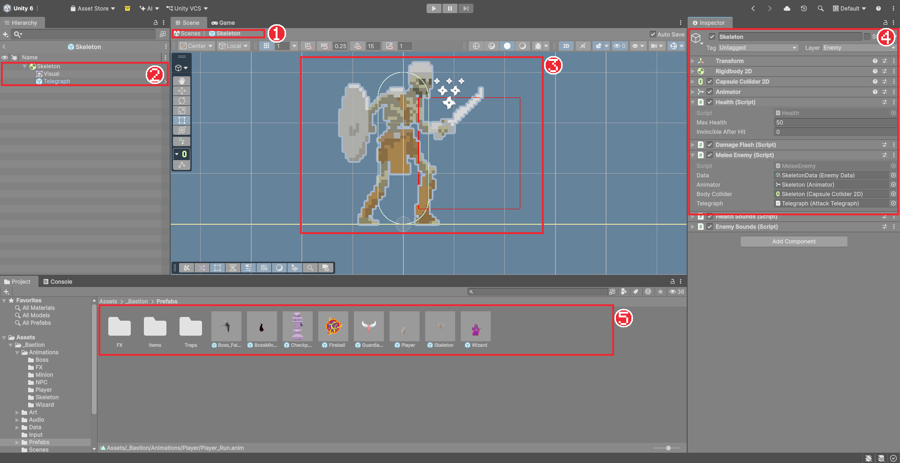
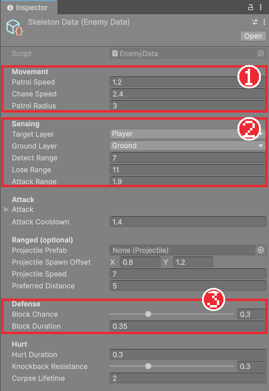

# Chapter 21 프리팹과 첫 번째 적

## 학습 목표

- 프리팹을 만들고, 프리팹 편집 모드와 인스턴스의 오버라이드(Apply, Revert)를 구분해 쓸 수 있다.
- 적의 공통 기능을 추상 클래스 `EnemyController`로, 수치를 `EnemyData`로 나눌 수 있다.
- 레이캐스트로 앞이 벽이거나 낭떠러지인지 감지해 순찰하는 적을 만들 수 있다.
- 태그와 레이어 충돌 표로 플레이어와 적이 서로 밀지 않게 설정할 수 있다.

## 본문

### 21-1 프리팹이 필요한 이유

해골 병사를 레벨에 다섯 마리 놓는다고 해 봅시다. 하나를 완성한 뒤 `Ctrl + D`로 복제하면 다섯 마리가 생기지만, 나중에 해골의 체력을 바꾸려면 다섯 마리를 하나씩 고쳐야 합니다. 열 개 레벨에 흩어져 있다면 더 큰일입니다.

**프리팹**(Prefab)은 완성된 게임 오브젝트를 **설계도 파일**로 저장한 것입니다. 레벨에는 설계도에서 찍어 낸 **인스턴스**를 놓습니다. 설계도를 고치면 모든 인스턴스가 함께 바뀝니다. Chapter 10의 데이터 에셋이 "수치를 여럿이 함께 쓰는" 방법이었다면, 프리팹은 "오브젝트 전체를 여럿이 함께 쓰는" 방법입니다.

| 작업 | 방법 |
|---|---|
| 프리팹 만들기 | Hierarchy의 오브젝트를 Project 창의 폴더로 끌어다 놓는다 |
| 인스턴스 놓기 | Project 창의 프리팹을 Scene 뷰나 Hierarchy로 끌어다 놓는다 |
| 설계도 고치기 | 프리팹을 더블클릭하거나 인스턴스 옆 `>`를 눌러 **프리팹 편집 모드**로 들어간다 |
| 인스턴스만 다르게 | 인스턴스의 값을 바꾼다. 바뀐 칸은 왼쪽에 파란 줄이 생긴다(오버라이드) |
| 인스턴스의 변경을 설계도로 | Inspector 위쪽 **Overrides > Apply All** |
| 인스턴스를 설계도대로 되돌리기 | **Overrides > Revert All** |



그림은 뒤 장까지 마친 완성본입니다. 자식 `Telegraph`(Chapter 24), Health Sounds와 Enemy Sounds(Chapter 32), Prefabs 폴더의 다른 프리팹들은 아직 없어도 됩니다. 이 장에서 만드는 해골은 자식 `Visual` 하나와 21-7의 컴포넌트만 가집니다.

프리팹 편집 모드에서는 배경이 파랗게 바뀌고, 위쪽에 지금 어느 프리팹을 고치는지 경로가 보입니다. 왼쪽 화살표나 경로의 `Scenes`를 누르면 씬으로 돌아갑니다. **Auto Save**가 켜져 있으면 고치는 즉시 저장됩니다.

지금까지 만든 `Player`도 프리팹으로 만들어 둡니다. `Assets/_Bastion/Prefabs` 폴더를 만들고 `Player`를 끌어다 놓습니다. 이제 Hierarchy에서 `Player`의 이름이 파랗게 보입니다.

### 21-2 해골 병사 그림 준비

해골은 Monsters Creatures Fantasy 팩의 `Skeleton` 폴더 그림을 씁니다. 동작마다 가로로 긴 그림이고 프레임은 정사각형(150×150)입니다.

1. `Skeleton` 폴더의 그림을 Chapter 05처럼 PPU 16, Point, 압축 None으로 설정한다.
2. Sprite Editor에서 `Grid By Cell Size` 150×150, Pivot `Bottom`으로 자른다.
3. `Assets/_Bastion/Animations/Skeleton` 폴더에 `Idle`, `Walk`, `Attack`, `Block`(Shield 그림), `Hurt`(Take Hit 그림), `Death` 클립을 만든다. 이름은 `Skeleton_Idle`처럼 짓고, Animator 상태 이름은 `Idle`, `Walk`처럼 짧게 둔다.

적의 Animator Controller에는 **전이를 하나도 만들지 않습니다.** 적의 애니메이션은 모두 코드에서 `Animator.Play`로 바로 틉니다(Chapter 16의 직접 재생). 적은 플레이어처럼 연속 입력이 아니라 "순찰 시작", "공격 시작"처럼 상태가 바뀌는 순간에만 애니메이션이 바뀌기 때문에 이 방법이 더 단순합니다.

### 21-3 적 수치

`Scripts/Enemy/EnemyData.cs`입니다. 해골과 마법사가 같은 클래스를 쓰고, 에셋만 두 개 만듭니다. 원거리와 방어 묶음은 다음 장들에서 씁니다.

```csharp
using Bastion.Combat;
using UnityEngine;

namespace Bastion.Enemy
{
    [CreateAssetMenu(fileName = "EnemyData", menuName = "Bastion/Enemy Data")]
    public sealed class EnemyData : ScriptableObject
    {
        [Header("Movement")]
        [Min(0f)] public float PatrolSpeed = 1.5f;
        [Min(0f)] public float ChaseSpeed = 3f;
        [Tooltip("시작 위치 기준 순찰 반경")]
        [Min(0f)] public float PatrolRadius = 3f;

        [Header("Sensing")]
        public LayerMask TargetLayer;
        public LayerMask GroundLayer;
        [Min(0f)] public float DetectRange = 7f;
        [Tooltip("이 거리 밖으로 벗어나면 추적을 포기")]
        [Min(0f)] public float LoseRange = 11f;
        [Min(0f)] public float AttackRange = 1.8f;

        [Header("Attack")]
        public AttackStep Attack = new AttackStep { AnimationState = "Attack", Duration = 0.8f, ActiveStart = 0.4f, ActiveEnd = 0.55f, CancelTime = 0.8f, Damage = 15, Knockback = 5f, Lunge = 0f };
        [Min(0f)] public float AttackCooldown = 1.2f;

        [Header("Ranged (optional)")]
        public Projectile ProjectilePrefab;
        public Vector2 ProjectileSpawnOffset = new Vector2(0.8f, 1.2f);
        [Min(0f)] public float ProjectileSpeed = 7f;
        [Tooltip("원거리 적이 유지하려는 최소 거리")]
        [Min(0f)] public float PreferredDistance = 5f;

        [Header("Defense")]
        [Range(0f, 1f)] public float BlockChance;
        [Min(0f)] public float BlockDuration = 0.35f;

        [Header("Hurt")]
        [Min(0f)] public float HurtDuration = 0.3f;
        [Range(0f, 1f)] public float KnockbackResistance = 0f;
        [Min(0f)] public float CorpseLifetime = 2f;
    }
}
```

`Projectile`은 Chapter 23에서 만드는 투사체 클래스라 지금은 컴파일 오류가 납니다. 그 줄(`public Projectile ProjectilePrefab;`)은 Chapter 23에서 넣어도 되고, 지금 `Scripts/Enemy`에 빈 클래스 `public sealed class Projectile : MonoBehaviour { }`를 만들어 두어도 됩니다.



### 21-4 적의 공통 기반

플레이어처럼 적도 상태 머신을 씁니다. 다만 적은 종류가 여럿이라, 모든 적에 공통인 것(이동, 감지, 피격, 사망)은 **추상 클래스** `EnemyController`에 두고, 적마다 다른 행동 상태는 자식 클래스(`MeleeEnemy`, `RangedEnemy`)가 정합니다. `abstract` 클래스는 그 자체로는 쓸 수 없고 상속해서 빈 부분을 채워야 하는 클래스입니다.

먼저 적 상태의 부모입니다. `Scripts/Enemy/EnemyState.cs`:

```csharp
using Bastion.Core;

namespace Bastion.Enemy
{
    public abstract class EnemyState : IState
    {
        protected readonly EnemyController Enemy;

        protected EnemyState(EnemyController enemy) => Enemy = enemy;

        public virtual void Enter() { }
        public virtual void Exit() { }
        public virtual void Tick() { }
        public virtual void FixedTick() { }
    }
}
```

다음은 `EnemyController.cs`입니다. 이 장에서는 순찰과 피격, 사망까지 다루고, 시야 감지와 방어, 공격 예고는 이어지는 장에서 추가합니다.

```csharp
using Bastion.Combat;
using Bastion.Core;
using UnityEngine;

namespace Bastion.Enemy
{
    /// <summary>
    /// 적 공통 기반: 물리 이동, 감지, 피격/사망 처리. 행동 상태 구성은 파생 클래스가 정한다.
    /// </summary>
    [RequireComponent(typeof(Rigidbody2D), typeof(Health))]
    public abstract class EnemyController : MonoBehaviour
    {
        [SerializeField] protected EnemyData data;
        [SerializeField] Animator animator;
        [SerializeField] Collider2D bodyCollider;

        Rigidbody2D body;

        public EnemyData Data => data;
        public Health Health { get; private set; }
        public StateMachine StateMachine { get; } = new StateMachine();
        public Transform Target { get; private set; }
        public int FacingDirection { get; private set; } = 1;
        public Vector2 HomePosition { get; private set; }
        public float LastAttackTime { get; set; } = float.NegativeInfinity;
        public Vector2 Velocity => body.linearVelocity;

        public EnemyHurtState HurtState { get; private set; }
        public EnemyDeadState DeadState { get; private set; }

        /// <summary>피격/방어가 끝난 뒤 돌아갈 기본 전투 상태.</summary>
        public abstract IState CombatState { get; }
        protected abstract IState InitialState { get; }

        protected virtual void Awake()
        {
            body = GetComponent<Rigidbody2D>();
            Health = GetComponent<Health>();
            HomePosition = transform.position;
            HurtState = new EnemyHurtState(this);
            DeadState = new EnemyDeadState(this);
        }

        protected virtual void OnEnable()
        {
            Health.Damaged += OnDamaged;
            Health.Died += OnDied;
        }

        protected virtual void OnDisable()
        {
            Health.Damaged -= OnDamaged;
            Health.Died -= OnDied;
        }

        protected virtual void Start()
        {
            var player = GameObject.FindGameObjectWithTag("Player");
            Target = player != null ? player.transform : null;
            StateMachine.Initialize(InitialState);
        }

        protected virtual void Update() => StateMachine.Tick();

        protected virtual void FixedUpdate() => StateMachine.FixedTick();

        /// <summary>앞에 벽이 있거나 발밑 앞쪽이 낭떠러지면 true.</summary>
        public bool IsBlockedAhead()
        {
            Bounds b = bodyCollider.bounds;
            Vector2 front = new Vector2(FacingDirection > 0 ? b.max.x : b.min.x, b.min.y);
            bool wall = Physics2D.Raycast(front + Vector2.up * 0.5f, Vector2.right * FacingDirection, 0.2f, data.GroundLayer);
            bool ground = Physics2D.Raycast(front + Vector2.right * FacingDirection * 0.2f + Vector2.up * 0.1f, Vector2.down, 0.6f, data.GroundLayer);
            return wall || !ground;
        }

        public void Face(float direction)
        {
            if (Mathf.Abs(direction) < 0.01f)
                return;
            int d = direction > 0f ? 1 : -1;
            if (d == FacingDirection)
                return;
            FacingDirection = d;
            transform.rotation = Quaternion.Euler(0f, d > 0 ? 0f : 180f, 0f);
        }

        public void MoveHorizontal(float speed) => body.linearVelocity = new Vector2(speed, body.linearVelocity.y);

        public void Stop() => MoveHorizontal(0f);

        public void SetVelocity(Vector2 velocity) => body.linearVelocity = velocity;

        public void PlayAnimation(string stateName)
        {
            if (animator != null)
                animator.Play(stateName, 0, 0f);
        }

        void OnDamaged(DamageInfo info)
        {
            if (!Health.IsDead)
                HurtState.Begin(info);
        }

        void OnDied()
        {
            StateMachine.ChangeState(DeadState);
            bodyCollider.enabled = false;
            body.bodyType = RigidbodyType2D.Kinematic;
            body.linearVelocity = Vector2.zero;
            Destroy(gameObject, data.CorpseLifetime);
        }
    }
}
```

#### 코드 해석

- `public abstract IState CombatState { get; }`: 자식 클래스가 반드시 채워야 하는 칸입니다. "맞고 나서 돌아갈 상태"는 적마다 다르기 때문입니다.
- `protected virtual void Awake()`: 자식 클래스가 `override`해서 자기 상태를 더 만들 수 있게 열어 둡니다. 자식에서는 `base.Awake()`를 먼저 불러 부모의 준비도 하게 합니다.
- `GameObject.FindGameObjectWithTag("Player")`: **태그**(Tag)가 `Player`인 오브젝트를 찾습니다. 태그는 레이어와 비슷한 이름표인데, 물리 계산이 아니라 "이 오브젝트가 무엇인지" 찾을 때 씁니다. `Player` 오브젝트의 Inspector 맨 위 **Tag**를 `Player`로 바꿔 둡니다.
- `IsBlockedAhead`: 콜라이더 앞쪽 끝에서 레이캐스트를 두 번 쏩니다. 하나는 앞으로 0.2만큼 쏘아 벽이 있는지, 하나는 앞 발밑에서 아래로 0.6만큼 쏘아 바닥이 있는지 봅니다. 벽이 있거나 바닥이 없으면 막힌 것입니다. `Physics2D.Raycast`는 맞은 것이 있으면 참으로 쓸 수 있는 결과를 돌려줍니다.
- `OnDied`: 죽으면 콜라이더를 꺼서 더 맞지 않게 하고, 물리를 멈추고, `Destroy(gameObject, 2초)`로 2초 뒤 오브젝트를 지웁니다. **Destroy**는 게임 오브젝트를 없애는 함수이고, 두 번째 값은 지연 시간입니다.

### 21-5 피격과 사망 상태

`Scripts/Enemy/EnemyCommonStates.cs`에 모든 적이 함께 쓰는 상태를 둡니다.

```csharp
using Bastion.Combat;
using UnityEngine;

namespace Bastion.Enemy
{
    public sealed class EnemyHurtState : EnemyState
    {
        float endTime;

        public EnemyHurtState(EnemyController enemy) : base(enemy) { }

        public void Begin(in DamageInfo info)
        {
            endTime = Time.time + Enemy.Data.HurtDuration;
            float knockback = info.Knockback * (1f - Enemy.Data.KnockbackResistance);
            Enemy.SetVelocity(new Vector2(Mathf.Sign(info.Direction.x) * knockback, Enemy.Velocity.y));
            // 맞으면 공격자 쪽을 바라본다.
            Enemy.Face(-info.Direction.x);

            if (Enemy.StateMachine.CurrentState == this)
                Enter();
            else
                Enemy.StateMachine.ChangeState(this);
        }

        public override void Enter() => Enemy.PlayAnimation("Hurt");

        public override void FixedTick()
        {
            float x = Mathf.MoveTowards(Enemy.Velocity.x, 0f, 20f * Time.fixedDeltaTime);
            Enemy.MoveHorizontal(x);
            if (Time.time >= endTime)
                Enemy.StateMachine.ChangeState(Enemy.CombatState);
        }
    }

    public sealed class EnemyDeadState : EnemyState
    {
        public EnemyDeadState(EnemyController enemy) : base(enemy) { }

        public override void Enter() => Enemy.PlayAnimation("Death");
    }
}
```

맞는 중에 또 맞으면(`CurrentState == this`) 상태를 바꾸지 않고 `Enter`만 다시 불러 피격 애니메이션을 처음부터 틉니다. `KnockbackResistance`가 0.3이면 넉백의 70%만 받습니다.

### 21-6 순찰하는 해골

`Scripts/Enemy/MeleeEnemy.cs`입니다. 이 장에서는 순찰 상태 하나만 만듭니다.

```csharp
using Bastion.Core;
using UnityEngine;

namespace Bastion.Enemy
{
    /// <summary>순찰 → 추적 → 근접 공격. 예: Skeleton.</summary>
    public sealed class MeleeEnemy : EnemyController
    {
        PatrolState patrol;

        public override IState CombatState => patrol;
        protected override IState InitialState => patrol;

        protected override void Awake()
        {
            base.Awake();
            patrol = new PatrolState(this);
        }

        sealed class PatrolState : EnemyState
        {
            public PatrolState(MeleeEnemy enemy) : base(enemy) { }

            public override void Enter() => Enemy.PlayAnimation("Walk");

            public override void FixedTick()
            {
                float offset = Enemy.transform.position.x - Enemy.HomePosition.x;
                if (Mathf.Abs(offset) > Enemy.Data.PatrolRadius && Mathf.Sign(offset) == Enemy.FacingDirection)
                    Enemy.Face(-Enemy.FacingDirection);
                else if (Enemy.IsBlockedAhead())
                    Enemy.Face(-Enemy.FacingDirection);

                Enemy.MoveHorizontal(Enemy.FacingDirection * Enemy.Data.PatrolSpeed);
            }
        }
    }
}
```

#### 코드 해석

- 상태 클래스를 `MeleeEnemy` 안에 **중첩 클래스**로 두었습니다. 이 적만 쓰는 상태라 바깥에 드러낼 필요가 없습니다.
- 시작 위치에서 순찰 반경(3)보다 멀어지면, 또는 앞이 막히면 뒤돌아섭니다. Chapter 04의 `Mover`와 같은 생각에 벽과 낭떠러지 감지를 더한 것입니다.

### 21-7 해골 프리팹 만들기

1. 빈 오브젝트 `Skeleton`을 만들고 Layer를 `Enemy`로 둔다. 자식 `Visual`에 해골 그림(Order in Layer 5)을 넣는다.
2. `Skeleton`에 Rigidbody 2D(Freeze Rotation Z, Interpolate), Capsule Collider 2D, Animator, `Health`(Max Health 50), `DamageFlash`, `MeleeEnemy`를 붙인다.
3. `MeleeEnemy`의 Data, Animator, Body Collider 칸을 채운다. `Data` 폴더에 `SkeletonData` 에셋을 만들어 Target Layer `Player`, Ground Layer `Ground`로 둔다.
4. `Skeleton`을 `Prefabs` 폴더로 끌어다 프리팹으로 만든다.
5. 레벨 곳곳에 해골 프리팹을 두세 마리 놓는다.

### 21-8 레이어 충돌 표

실행해 보면 기사와 해골이 서로 밀치고, 해골끼리도 부딪혀 엉킵니다. 액션 게임에서는 보통 몸끼리는 통과하고 **공격 판정으로만** 피해를 주고받게 합니다. 어떤 레이어끼리 부딪힐지는 **Edit > Project Settings > Physics 2D > Layer Collision Matrix** 표에서 정합니다. 체크를 끄면 그 두 레이어는 서로 통과합니다.

| | Ground | Player | Enemy | Projectile |
|---|---|---|---|---|
| Ground | 충돌 | 충돌 | 충돌 | 충돌 |
| Player | | 충돌 | **통과** | 충돌 |
| Enemy | | | **통과** | **통과** |
| Projectile | | | | **통과** |

`Projectile` 레이어(9번)는 Chapter 23에서 만듭니다. 미리 표를 맞춰 둬도 됩니다. 공격 판정(`OverlapBox`)은 이 표와 상관없이 지정한 레이어를 찾으므로 몸이 통과해도 공격은 잘 맞습니다.

### 21-9 따라하기 — 순찰하는 해골 병사

1. `Player`를 프리팹으로 만들고 Tag를 `Player`로 둔다.
2. 해골 그림을 자르고 애니메이션 클립과 전이 없는 컨트롤러를 만든다.
3. `EnemyData`, `EnemyState`, `EnemyController`, `EnemyCommonStates`, `MeleeEnemy`를 만든다.
4. 해골 프리팹을 만들어 레벨에 놓고, 발판 끝과 벽에서 뒤돌아서는지 확인한다.
5. 레이어 충돌 표를 고쳐 몸끼리 통과하게 하고, 기사의 콤보로 해골을 쓰러뜨린다. 2초 뒤 사라지는지 확인한다.
6. 프리팹 편집 모드에서 Health의 Max Health를 30으로 바꾸고, 레벨의 해골 모두가 바뀌는지 확인한 뒤 50으로 되돌린다.

Chapter 18의 허수아비는 이제 지워도 됩니다. 다음 장에서 해골이 기사를 발견해 쫓아오고 공격하게 만듭니다.

### 연습문제

1. 문제: 프리팹의 설계도를 고치는 것과 인스턴스 하나만 고치는 것의 차이를 쓰고, 인스턴스의 변경을 설계도에 반영하는 메뉴 이름을 쓰세요.
2. 문제: `IsBlockedAhead`가 쏘는 레이캐스트 두 개가 각각 무엇을 확인하는지 쓰세요.
3. 문제: 기사와 해골이 서로 밀치지 않으면서도 기사의 공격은 해골에게 맞는 이유를 쓰세요.  
   - 조건: "레이어 충돌 표"와 "OverlapBox"를 포함할 것

### 정답 포인트

- 설계도를 고치면 모든 인스턴스가 바뀌고 인스턴스만 고치면 그 하나만 다르다(오버라이드). Overrides > Apply All. 앞쪽 벽 유무와 앞 발밑 바닥 유무. 레이어 충돌 표에서 Player와 Enemy가 서로 통과하도록 꺼도, OverlapBox는 표와 관계없이 지정한 Enemy 레이어의 콜라이더를 찾기 때문이다.

---

[다음 문서: Chapter 22 적 AI 상태](./22-enemy-ai.md)

[상위 문서로 돌아가기](./README.md)
