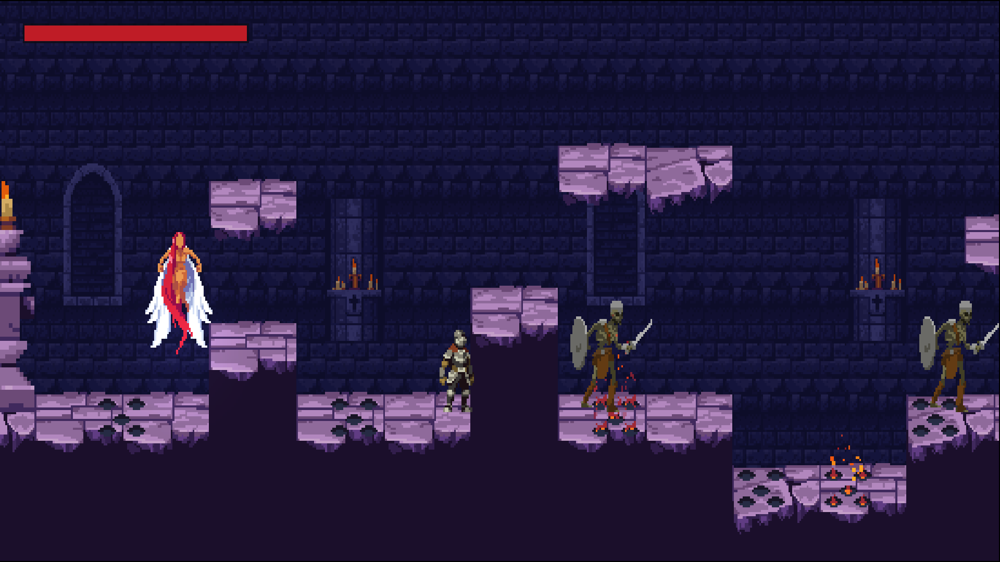

# Chapter 22 적 AI 상태

## 학습 목표

- 거리와 시야(벽 너머는 못 봄)로 플레이어를 감지할 수 있다.
- 순찰 → 추적 → 공격으로 이어지는 적의 상태 흐름을 만들 수 있다.
- 공격 시간표(`AttackStep`)와 쿨다운으로 적의 근접 공격을 만들 수 있다.
- `Health.BlockFilter`로 정면 공격을 확률적으로 막는 방패 방어를 만들 수 있다.

## 본문

### 22-1 적의 생각을 상태로 나누기

해골 병사가 할 일을 말로 적어 보면 이렇습니다.

1. 평소에는 제자리 근처를 왔다 갔다 한다. **(순찰)**
2. 기사가 보이면 쫓아간다. **(추적)**
3. 칼이 닿을 거리면 멈춰서 벤다. 벤 뒤에는 잠깐 쉰다. **(공격)**
4. 기사가 멀리 달아나면 다시 순찰로 돌아간다.

이 문장들이 그대로 상태와 전이가 됩니다. Chapter 17에서 만든 상태 머신과 Chapter 21의 `EnemyController`에 상태 두 개를 더하면 됩니다.



### 22-2 시야 감지

"기사가 보이는가"는 두 가지로 판단합니다. 감지 거리 안에 있는가, 그리고 둘 사이에 벽이 없는가입니다. 벽 너머의 기사까지 알아채면 적이 벽에 붙어 버둥거리게 됩니다. `EnemyController`에 추가합니다.

```csharp
public float DistanceToTarget => Target == null ? float.PositiveInfinity : Vector2.Distance(transform.position, Target.position);
public float HorizontalDirectionToTarget => Target == null ? FacingDirection : Mathf.Sign(Target.position.x - transform.position.x);

public bool CanSeeTarget(float range)
{
    if (Target == null || DistanceToTarget > range)
        return false;
    var targetHealth = Target.GetComponent<Health>();
    if (targetHealth != null && targetHealth.IsDead)
        return false;

    // 벽 너머의 대상은 보지 못한다.
    Vector2 eye = (Vector2)transform.position + Vector2.up * 1f;
    Vector2 to = (Vector2)Target.position + Vector2.up * 1f - eye;
    return !Physics2D.Raycast(eye, to.normalized, to.magnitude, data.GroundLayer);
}
```

#### 코드 해석

- `Vector2.Distance(a, b)`: 두 점 사이의 거리입니다.
- `eye`와 `to`: 적의 눈높이(발밑에서 1 위)에서 기사의 눈높이까지 가는 벡터입니다. `to.normalized`는 길이 1인 방향, `to.magnitude`는 길이입니다.
- 그 사이로 `Ground` 레이어만 보는 레이캐스트를 쏘아 맞는 것이 **없으면** 보이는 것입니다. 죽은 기사는 보이지 않는 것으로 칩니다.

### 22-3 추적 상태와 공격 상태

`MeleeEnemy`에 두 상태를 더합니다. 순찰 상태에는 "보이면 추적" 한 줄이 생깁니다.

```csharp
using System.Collections.Generic;
using Bastion.Combat;
using Bastion.Core;
using UnityEngine;

namespace Bastion.Enemy
{
    /// <summary>순찰 → 추적 → 근접 공격. 예: Skeleton.</summary>
    public sealed class MeleeEnemy : EnemyController
    {
        PatrolState patrol;
        ChaseState chase;
        AttackState attack;

        public override IState CombatState => chase;
        protected override IState InitialState => patrol;

        protected override void Awake()
        {
            base.Awake();
            patrol = new PatrolState(this);
            chase = new ChaseState(this);
            attack = new AttackState(this);
        }

        sealed class PatrolState : EnemyState
        {
            readonly MeleeEnemy owner;
            public PatrolState(MeleeEnemy enemy) : base(enemy) => owner = enemy;

            public override void Enter() => Enemy.PlayAnimation("Walk");

            public override void FixedTick()
            {
                if (Enemy.CanSeeTarget(Enemy.Data.DetectRange))
                {
                    Enemy.StateMachine.ChangeState(owner.chase);
                    return;
                }

                float offset = Enemy.transform.position.x - Enemy.HomePosition.x;
                if (Mathf.Abs(offset) > Enemy.Data.PatrolRadius && Mathf.Sign(offset) == Enemy.FacingDirection)
                    Enemy.Face(-Enemy.FacingDirection);
                else if (Enemy.IsBlockedAhead())
                    Enemy.Face(-Enemy.FacingDirection);

                Enemy.MoveHorizontal(Enemy.FacingDirection * Enemy.Data.PatrolSpeed);
            }
        }

        sealed class ChaseState : EnemyState
        {
            readonly MeleeEnemy owner;
            bool walking;
            public ChaseState(MeleeEnemy enemy) : base(enemy) => owner = enemy;

            public override void Enter() => walking = false;

            public override void FixedTick()
            {
                if (!Enemy.CanSeeTarget(Enemy.Data.LoseRange))
                {
                    Enemy.StateMachine.ChangeState(owner.patrol);
                    return;
                }

                Enemy.Face(Enemy.HorizontalDirectionToTarget);
                float dx = Mathf.Abs(Enemy.Target.position.x - Enemy.transform.position.x);

                if (dx <= Enemy.Data.AttackRange)
                {
                    SetWalking(false);
                    Enemy.Stop();
                    if (Time.time - Enemy.LastAttackTime >= Enemy.Data.AttackCooldown)
                        Enemy.StateMachine.ChangeState(owner.attack);
                    return;
                }

                if (Enemy.IsBlockedAhead())
                {
                    SetWalking(false);
                    Enemy.Stop();
                    return;
                }

                SetWalking(true);
                Enemy.MoveHorizontal(Enemy.FacingDirection * Enemy.Data.ChaseSpeed);
            }

            void SetWalking(bool value)
            {
                if (walking == value)
                    return;
                walking = value;
                Enemy.PlayAnimation(value ? "Walk" : "Idle");
            }
        }

        sealed class AttackState : EnemyState
        {
            readonly MeleeEnemy owner;
            readonly HashSet<IDamageable> hit = new HashSet<IDamageable>();
            float startTime;
            bool released;
            public AttackState(MeleeEnemy enemy) : base(enemy) => owner = enemy;

            public override void Enter()
            {
                startTime = Time.time;
                released = false;
                hit.Clear();
                Enemy.Stop();
                Enemy.LastAttackTime = Time.time;
                Enemy.PlayAnimation(Enemy.Data.Attack.AnimationState);
            }

            public override void FixedTick()
            {
                var step = Enemy.Data.Attack;
                float elapsed = Time.time - startTime;
                if (step.IsActive(elapsed))
                {
                    if (!released)
                    {
                        released = true;
                        Enemy.RaiseAttackReleased();
                    }
                    HitboxQuery.Apply(Enemy.transform, Enemy.FacingDirection, step, Enemy.Data.TargetLayer, hit);
                }

                if (elapsed >= step.Duration)
                    Enemy.StateMachine.ChangeState(owner.chase);
            }
        }
    }
}
```

#### 코드 해석

- **추적 포기 거리가 감지 거리보다 깁니다**(감지 7, 포기 11). 같으면 경계선에서 기사가 한 발짝씩 움직일 때마다 추적과 순찰이 번갈아 바뀌어 적이 덜덜 떱니다. 들어올 때와 나갈 때의 기준을 다르게 두는 방법은 게임에서 자주 씁니다.
- `ChaseState`의 `walking`: 걷기와 서기 애니메이션을 매 프레임 다시 틀지 않도록, 바뀔 때만 `PlayAnimation`을 부릅니다.
- 공격 사거리 안이면 멈추고, 쿨다운(1.4초)이 지났으면 공격합니다. 낭떠러지 앞에서는 따라가지 않고 멈춥니다.
- `AttackState`: 플레이어의 공격과 같은 `AttackStep`과 `HitboxQuery`를 씁니다. 판정이 처음 시작되는 순간 `RaiseAttackReleased()`로 "지금 휘둘렀다"고 알립니다. Chapter 32에서 이 순간에 칼 소리를 냅니다.

`EnemyController`에는 이 알림을 위한 이벤트를 추가합니다.

```csharp
/// <summary>공격을 내지르는 순간 (근접 판정 시작, 투사체 발사). 효과음 등 연출용.</summary>
public event System.Action AttackReleased;

public void RaiseAttackReleased() => AttackReleased?.Invoke();
```

### 22-4 방패 방어

해골은 방패를 들고 있습니다. 정면에서 오는 공격을 30% 확률로 막게 해 봅니다. 방어 판단은 `Health`의 `BlockFilter`(Chapter 19)에 함수를 넣어 연결합니다. `EnemyController`에 추가합니다.

```csharp
public EnemyBlockState BlockState { get; private set; }

// Awake에 추가
BlockState = new EnemyBlockState(this);
Health.BlockFilter = ShouldBlock;

// OnEnable / OnDisable에 추가
Health.Blocked += OnBlocked;
Health.Blocked -= OnBlocked;

bool ShouldBlock(DamageInfo info)
{
    if (data.BlockChance <= 0f || StateMachine.CurrentState == HurtState)
        return false;
    // 정면에서 들어온 공격만 막는다 (공격 방향이 내가 바라보는 방향의 반대).
    bool fromFront = Mathf.Sign(info.Direction.x) == -FacingDirection;
    return fromFront && Random.value < data.BlockChance;
}

void OnBlocked(DamageInfo info) => StateMachine.ChangeState(BlockState);
```

`EnemyCommonStates.cs`에 방어 상태를 추가합니다.

```csharp
public sealed class EnemyBlockState : EnemyState
{
    float endTime;

    public EnemyBlockState(EnemyController enemy) : base(enemy) { }

    public override void Enter()
    {
        endTime = Time.time + Enemy.Data.BlockDuration;
        Enemy.Stop();
        Enemy.PlayAnimation("Block");
    }

    public override void Tick()
    {
        if (Time.time >= endTime)
            Enemy.StateMachine.ChangeState(Enemy.CombatState);
    }
}
```

#### 코드 해석

- `Health.BlockFilter = ShouldBlock;`: 함수 이름을 그대로 넣습니다. `Health`는 맞을 때마다 이 함수에 피해 정보를 넘겨 물어보고, `true`가 오면 피해 대신 `Blocked`를 알립니다.
- `fromFront`: 공격 방향(`info.Direction.x`)이 내가 바라보는 방향과 반대면, 공격이 내 앞에서 날아온 것입니다. 뒤에서 때리면 막지 못하므로, 구르기로 뒤로 돌아가 때리는 전략이 생깁니다.
- `Random.value`: 0~1 사이의 무작위 수입니다. 0.3보다 작을 확률은 30%입니다.
- 맞는 중(`HurtState`)에는 막지 않습니다. 콤보 1타가 들어가면 나머지도 들어가게 해 콤보를 보상합니다.

`SkeletonData`의 Block Chance를 0.3, Knockback Resistance를 0.3으로 둡니다.

### 22-5 Gizmos로 감지 범위 보기

감지 거리를 숫자로만 보면 감이 오지 않습니다. `EnemyController`에 Gizmos를 그려 둡니다.

```csharp
protected virtual void OnDrawGizmosSelected()
{
    if (data == null)
        return;
    Gizmos.color = Color.yellow;
    Gizmos.DrawWireSphere(transform.position, data.DetectRange);
    Gizmos.color = Color.red;
    HitboxQuery.DrawGizmo(transform, Application.isPlaying ? FacingDirection : 1, data.Attack);
}
```

해골을 선택하면 노란 원(감지 거리)과 빨간 상자(공격 범위)가 Scene 뷰에 보입니다. 해골을 배치할 때 "여기서 기사를 알아챌까"를 눈으로 확인할 수 있습니다.

### 22-6 따라하기 — 쫓아와 공격하는 해골

1. `EnemyController`에 시야 감지, `AttackReleased` 이벤트, 방어, Gizmos를 추가한다.
2. `MeleeEnemy`에 추적, 공격 상태를 추가한다.
3. `SkeletonData`의 수치를 완성본 화면(Chapter 21)대로 맞춘다. Attack은 Active Start 0.58, Damage 15 정도로 둔다.
4. 벽 뒤에 숨으면 해골이 쫓아오지 않는지, 멀리 달아나면 순찰로 돌아가는지 확인한다.
5. 정면에서 때리면 가끔 방패로 막고, 뒤에서 때리면 항상 맞는지 확인한다.

해골의 칼이 언제 날아올지 미리 알기 어렵다는 느낌이 들었다면 정상입니다. Chapter 24에서 공격 직전에 입자를 모아 예고합니다. 다음 장에서는 거리를 두고 화염구를 쏘는 마법사를 만듭니다.

### 연습문제

1. 문제: 추적을 포기하는 거리를 감지 거리보다 길게 두는 이유를 쓰세요.  
   - 조건: "경계"라는 말을 포함할 것
2. 문제: `CanSeeTarget`이 벽 너머의 기사를 보지 못하게 하는 방법을 쓰세요.
3. 문제: 방어 확률을 50%로 올리되, 이미 맞고 있는 중에는 막지 않게 하려면 무엇을 바꾸고 무엇을 그대로 두는지 쓰세요.

### 정답 포인트

- 같은 거리면 경계선에서 추적과 순찰이 계속 바뀌며 떨기 때문이다. 적과 기사의 눈높이 사이로 Ground 레이어만 보는 레이캐스트를 쏘아 벽에 맞으면 보이지 않는 것으로 친다. SkeletonData의 Block Chance만 0.5로 바꾸고, `ShouldBlock`의 `HurtState` 검사는 그대로 둔다.

---

[상위 문서로 돌아가기](./README.md)
