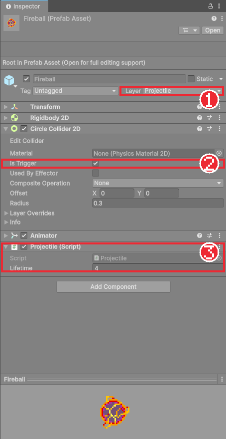
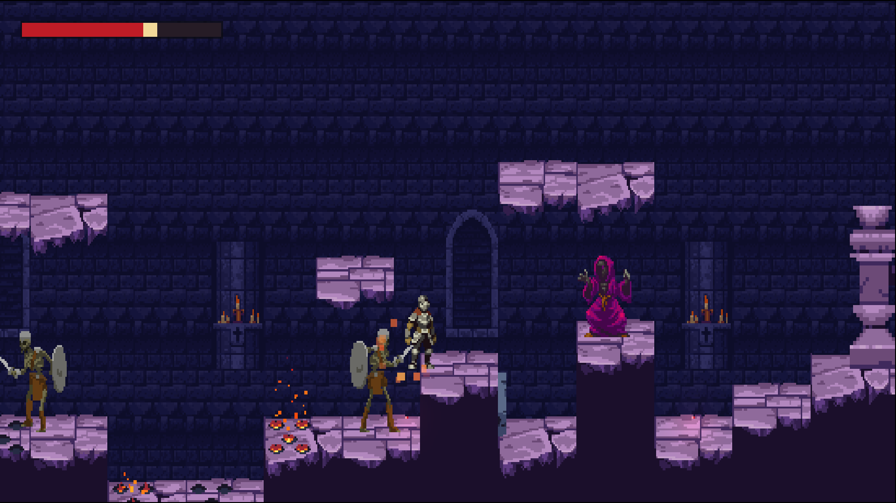

# Chapter 23 원거리 적과 투사체

## 학습 목표

- `Instantiate`로 실행 중에 프리팹을 만들어 내고, `Destroy`로 없앨 수 있다.
- 트리거 콜라이더와 `OnTriggerEnter2D`로 겹침을 감지할 수 있다.
- 레이어 마스크를 비트 연산으로 검사해, 맞힐 대상과 부딪혀 사라질 대상을 구분할 수 있다.
- 감지하면 시전하고 정해진 순간에 화염구를 쏘는 원거리 적을 만들 수 있다.

## 본문

### 23-1 실행 중에 오브젝트 만들기

지금까지 오브젝트는 모두 미리 씬에 놓아 두었습니다. 하지만 마법사가 쏘는 화염구는 언제 몇 개가 필요할지 알 수 없으므로, **쏘는 순간에 프리팹에서 하나씩 찍어 내야** 합니다.

```csharp
var copy = Instantiate(prefab, position, rotation);
```

`Instantiate(프리팹, 위치, 회전)`는 프리팹의 인스턴스를 하나 만들어 돌려줍니다. 프리팹이 컴포넌트 타입(예: `Projectile`)으로 지정되어 있으면 돌려받는 것도 그 컴포넌트라서 곧바로 함수를 부를 수 있습니다. 반대로 더 이상 필요 없는 오브젝트는 `Destroy(gameObject)`로 없앱니다. 만들기만 하고 없애지 않으면 화면 밖으로 날아간 화염구가 계속 쌓여 게임이 느려집니다.

### 23-2 트리거

화염구는 기사와 부딪혀 튕겨 나갈 필요가 없고, **닿았다는 사실만** 알면 됩니다. 콜라이더의 **Is Trigger**를 체크하면 물리적으로 막지 않고 통과하면서 겹침만 알려 줍니다.

| 콜라이더 | 물리 반응 | 알려 주는 함수 |
|---|---|---|
| 일반 | 서로 막고 밀어낸다 | `OnCollisionEnter2D(Collision2D)` |
| 트리거 | 통과한다 | `OnTriggerEnter2D(Collider2D)` |

트리거 알림이 오려면 **둘 중 하나 이상에 Rigidbody 2D**가 있어야 하고, 두 레이어가 레이어 충돌 표에서 **충돌로 체크**되어 있어야 합니다. 화염구를 `Enemy` 레이어에 두면 Chapter 21에서 Enemy와 Player를 통과로 설정했기 때문에 기사에게 알림이 오지 않습니다. 그래서 투사체 전용 레이어 `Projectile`(User Layer 9)을 만들고, Player, Ground와만 충돌하게 합니다.

### 23-3 투사체 스크립트

`Scripts/Enemy/Projectile.cs`입니다. Chapter 21에서 빈 클래스를 만들어 두었다면 내용을 채웁니다.

```csharp
using Bastion.Combat;
using UnityEngine;

namespace Bastion.Enemy
{
    /// <summary>직선 투사체. 대상에 닿으면 피해를 주고, 지형에 닿거나 수명이 다하면 사라진다.</summary>
    [RequireComponent(typeof(Rigidbody2D), typeof(Collider2D))]
    public sealed class Projectile : MonoBehaviour
    {
        [SerializeField, Min(0f)] float lifetime = 4f;

        Rigidbody2D body;
        AttackStep attack;
        LayerMask targetLayer;
        LayerMask groundLayer;
        GameObject owner;

        void Awake()
        {
            body = GetComponent<Rigidbody2D>();
            body.gravityScale = 0f;
            GetComponent<Collider2D>().isTrigger = true;
        }

        public void Launch(Vector2 velocity, AttackStep attackStep, LayerMask targets, LayerMask ground, GameObject source)
        {
            attack = attackStep;
            targetLayer = targets;
            groundLayer = ground;
            owner = source;
            body.linearVelocity = velocity;
            float angle = Mathf.Atan2(velocity.y, velocity.x) * Mathf.Rad2Deg;
            transform.rotation = Quaternion.Euler(0f, 0f, angle);
            Destroy(gameObject, lifetime);
        }

        void OnTriggerEnter2D(Collider2D other)
        {
            int layerBit = 1 << other.gameObject.layer;

            if ((targetLayer.value & layerBit) != 0)
            {
                var target = other.GetComponentInParent<IDamageable>();
                if (target != null && !target.IsDead)
                {
                    Vector2 direction = new Vector2(Mathf.Sign(body.linearVelocity.x), 0f);
                    target.TakeDamage(new DamageInfo(attack.Damage, direction, attack.Knockback, owner));
                }
                Destroy(gameObject);
            }
            else if ((groundLayer.value & layerBit) != 0)
            {
                Destroy(gameObject);
            }
        }
    }
}
```

#### 코드 해석

- `Awake`에서 중력을 끄고 트리거로 만들어, 프리팹 설정을 잊어도 직선으로 날아가게 합니다.
- `Launch`: 쏘는 쪽이 속도, 공격 데이터, 레이어를 넘겨 줍니다. 화염구 프리팹은 누가 쐈는지, 무엇을 맞혀야 하는지 미리 알 필요가 없습니다.
- `Mathf.Atan2(y, x) * Mathf.Rad2Deg`: 날아가는 방향의 각도를 구해 그림을 그 방향으로 돌립니다. `Atan2`는 방향 벡터에서 각도(라디안)를 구하는 함수이고, `Rad2Deg`를 곱해 도(degree)로 바꿉니다.
- `Destroy(gameObject, lifetime)`: 아무것도 맞히지 못해도 4초 뒤에는 사라지게 예약합니다.
- `1 << other.gameObject.layer`: 레이어 번호를 **비트 하나**로 바꿉니다. 9번 레이어면 1을 왼쪽으로 9칸 민 값(512)입니다. `LayerMask`는 여러 레이어를 이런 비트들의 합으로 저장하므로, `&`로 겹치는 비트가 있는지(0이 아닌지) 보면 "이 레이어가 마스크에 들어 있는가"를 알 수 있습니다.

### 23-4 화염구 프리팹

1. GothicVania Church 팩의 `SPRITES/fx/fireball` 프레임으로 화염구 애니메이션 클립을 만든다.
2. 빈 오브젝트 `Fireball`을 만들고 Layer를 `Projectile`로 둔다. 자식 `Visual`에 그림(Order in Layer 20)을 넣는다.
3. Rigidbody 2D(Gravity Scale 0, Collision Detection Continuous), Circle Collider 2D(Is Trigger, Radius 0.3), Animator, `Projectile`을 붙인다.
4. `Prefabs` 폴더로 끌어 프리팹을 만들고 씬의 원본은 지운다.



### 23-5 마법사

`Scripts/Enemy/RangedEnemy.cs`입니다. 대기하다가 기사가 보이면 바라보고, 쿨다운이 지나면 시전 상태로 넘어가 정해진 순간에 화염구를 쏩니다.

```csharp
using Bastion.Core;
using UnityEngine;

namespace Bastion.Enemy
{
    /// <summary>제자리에서 대상을 감지하면 거리를 유지하며 투사체를 쏜다. 예: Wizard.</summary>
    public sealed class RangedEnemy : EnemyController
    {
        IdleState idle;
        CastState cast;

        public override IState CombatState => idle;
        protected override IState InitialState => idle;

        protected override void Awake()
        {
            base.Awake();
            idle = new IdleState(this);
            cast = new CastState(this);
        }

        void Fire()
        {
            if (Data.ProjectilePrefab == null)
                return;
            Vector2 offset = Data.ProjectileSpawnOffset;
            Vector3 spawn = transform.position + new Vector3(offset.x * FacingDirection, offset.y, 0f);
            Vector2 aim = Target != null ? ((Vector2)Target.position + Vector2.up - (Vector2)spawn).normalized : new Vector2(FacingDirection, 0f);
            var projectile = Instantiate(Data.ProjectilePrefab, spawn, Quaternion.identity);
            projectile.Launch(aim * Data.ProjectileSpeed, Data.Attack, Data.TargetLayer, Data.GroundLayer, gameObject);
            RaiseAttackReleased();
        }

        sealed class IdleState : EnemyState
        {
            readonly RangedEnemy owner;
            public IdleState(RangedEnemy enemy) : base(enemy) => owner = enemy;

            public override void Enter()
            {
                Enemy.Stop();
                Enemy.PlayAnimation("Idle");
            }

            public override void FixedTick()
            {
                Enemy.Stop();
                if (!Enemy.CanSeeTarget(Enemy.Data.DetectRange))
                    return;

                Enemy.Face(Enemy.HorizontalDirectionToTarget);
                if (Time.time - Enemy.LastAttackTime >= Enemy.Data.AttackCooldown)
                    Enemy.StateMachine.ChangeState(owner.cast);
            }
        }

        sealed class CastState : EnemyState
        {
            readonly RangedEnemy owner;
            float startTime;
            bool fired;
            public CastState(RangedEnemy enemy) : base(enemy) => owner = enemy;

            public override void Enter()
            {
                startTime = Time.time;
                fired = false;
                Enemy.Stop();
                Enemy.LastAttackTime = Time.time;
                Enemy.PlayAnimation(Enemy.Data.Attack.AnimationState);
            }

            public override void FixedTick()
            {
                float elapsed = Time.time - startTime;
                // 투사체는 ActiveStart 시점에 한 번 발사한다.
                if (!fired && elapsed >= Enemy.Data.Attack.ActiveStart)
                {
                    fired = true;
                    owner.Fire();
                }
                if (elapsed >= Enemy.Data.Attack.Duration)
                    Enemy.StateMachine.ChangeState(owner.idle);
            }
        }
    }
}
```

#### 코드 해석

- `Fire`: 바라보는 쪽 손 위치(`ProjectileSpawnOffset`)에서 화염구를 만들고, 기사의 몸 가운데(발밑에서 1 위)를 겨냥해 쏩니다. 기사가 위아래에 있으면 비스듬히 날아갑니다.
- `Data.ProjectilePrefab`: `EnemyData`의 프리팹 칸입니다. 수치와 마찬가지로 "무엇을 쏠지"도 데이터 에셋에서 바꿀 수 있습니다.
- `CastState`: 근접 공격의 판정 구간 대신 **한 번만** 쏘도록 `fired` 표시를 둡니다. 공격 시간표의 `ActiveStart`가 발사 순간입니다.
- 이동 코드가 없으므로 마법사는 제자리에 서 있습니다. 순찰, 추적이 없는 대신 높은 발판에 세워 두면 까다로운 적이 됩니다.

### 23-6 마법사 배치

1. GothicVania 팩의 `SPRITES/wizard` 프레임으로 `Idle`, `Cast`(Fire 폴더 그림), `Hurt`, `Death` 상태의 클립과 컨트롤러를 만든다. 피격과 사망 전용 그림은 없으므로, 있는 그림 몇 장으로 짧은 `Hurt`, `Death` 클립을 만들어 둔다. 상태 이름만 맞으면 코드가 그대로 동작한다.
2. `Wizard` 프리팹을 해골과 같은 구조로 만들되 `MeleeEnemy` 대신 `RangedEnemy`를 붙인다.
3. `WizardData` 에셋을 만들고 Projectile Prefab에 `Fireball`, Attack의 Animation State를 `Cast`, Duration을 1, Active Start를 0.6으로 둔다. Block Chance는 0이다.
4. 높은 발판 위에 마법사를 놓는다.



### 23-7 따라하기 — 화염구 마법사

1. `Projectile` 레이어를 만들고 레이어 충돌 표에서 Player, Ground와만 충돌하게 한다.
2. `Projectile` 스크립트와 `Fireball` 프리팹을 만든다.
3. `RangedEnemy`와 `Wizard` 프리팹, `WizardData`를 만든다.
4. 실행해 화염구가 기사를 향해 날아오고, 맞으면 피해와 넉백을 주며 사라지는지 확인한다.
5. 화염구가 벽에 닿으면 사라지는지, 구르기 무적 중에는 맞지 않고 그냥 사라지는지 확인한다. 실행 중에 Hierarchy를 보며 화염구가 생겼다 사라지는지도 확인한다.

5번에서 무적 중에도 화염구가 사라지는 것은 `TakeDamage`가 `false`를 돌려줘도 `Destroy`하기 때문입니다. 무적일 때 통과하게 하고 싶다면 어떻게 고칠지 연습문제에서 생각해 봅니다. 다음 장에서는 적의 공격을 미리 알려 주는 입자 효과를 만듭니다.

### 연습문제

1. 문제: 화염구를 `Enemy` 레이어에 두면 기사를 맞히지 못하는 이유를 쓰세요.
2. 문제: 레이어 번호가 7일 때 `1 << 7`의 값을 쓰고, 마스크 값이 `192`(6번과 7번 레이어)일 때 7번 레이어가 들어 있는지 확인하는 식을 쓰세요.
3. 문제: 기사가 무적일 때는 화염구가 사라지지 않고 통과하게 고쳐 보세요.  
   - 입력: `OnTriggerEnter2D`의 대상 처리 부분
   - 출력: 바꾼 코드
   - 조건: `TakeDamage`의 돌려주는 값을 쓸 것

### 정답 포인트

- Chapter 21에서 Enemy와 Player 레이어를 서로 통과로 설정해 트리거 알림이 오지 않기 때문이다. `1 << 7` = 128, `(192 & 128) != 0`이 참이다. `if (target.TakeDamage(...)) Destroy(gameObject);`처럼 피해가 실제로 들어갔을 때만 없애고, 대상이 없거나 막혔으면 그대로 날아가게 한다.

---

[다음 문서: Chapter 24 파티클로 공격 예고](./24-particle-telegraph.md)

[상위 문서로 돌아가기](./README.md)
