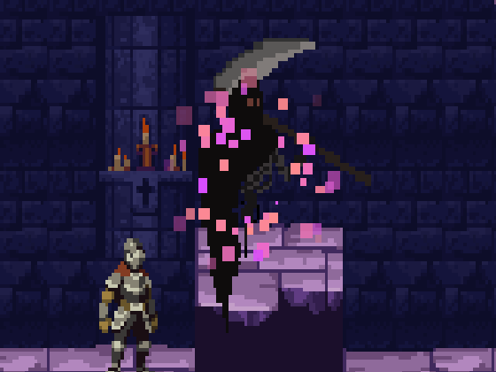
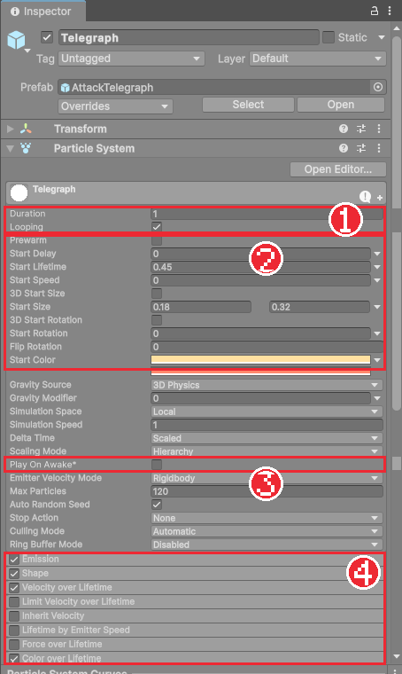

# Chapter 24 파티클로 공격 예고

## 학습 목표

- 액션 게임에서 공격 예고가 왜 필요한지 설명할 수 있다.
- Particle System의 Main, Emission, Shape, Velocity over Lifetime, Color over Lifetime 모듈을 설정할 수 있다.
- 입자가 일정 시간에 정확히 한 점으로 모여들도록 반지름과 수명으로 속도를 계산할 수 있다.
- 스크립트에서 입자를 재생하고 멈추는 예고 컴포넌트를 만들어 적의 공격에 연결할 수 있다.

## 본문

### 24-1 읽을 수 있는 공격

Chapter 22의 해골은 칼을 들어 올리는 동작이 짧아서, 처음 하는 사람은 언제 칼이 날아올지 알기 어렵습니다. 맞고 나서 "이건 피할 수 없었다"는 느낌이 들면 게임이 불공평하게 느껴집니다. 좋은 액션 게임의 적은 공격하기 전에 **"곧 공격한다"는 신호**를 보냅니다. 이것을 **예고**(Telegraph)라고 합니다.

이 게임은 적의 무기 주변으로 작은 빛 입자가 **모여들다가, 다 모이는 순간 공격 판정이 나오게** 했습니다. 입자가 모이는 것을 보고 구르면 피할 수 있습니다.



그림은 Chapter 25의 보스가 쓰는 분홍 예고입니다. 이 장에서 만드는 해골용 `AttackTelegraph`는 같은 방식으로 모여들지만 색은 연한 노랑에서 주황 사이입니다.

### 24-2 Particle System

작은 그림을 많이 뿜어 연기, 불꽃, 빛 같은 효과를 만드는 컴포넌트가 **Particle System**입니다. 하나하나의 그림을 **입자**(Particle)라고 합니다. Hierarchy의 **+ > Effects > Particle System**으로 만들면 기본 설정의 하얀 입자가 위로 뿜어져 나옵니다.

Particle System의 설정은 **모듈**이라는 묶음으로 나뉩니다. 맨 위의 Main 모듈 아래에 체크 상자가 달린 모듈들이 있고, 체크한 모듈만 동작합니다.

| 모듈 | 정하는 것 |
|---|---|
| Main | 입자 하나의 수명, 처음 속도, 크기, 색, 반복 여부 |
| Emission | 1초에 몇 개를 뿜을지 |
| Shape | 어떤 모양의 영역에서 뿜을지 (원, 원뿔, 상자 등) |
| Velocity over Lifetime | 사는 동안 받는 추가 속도 (중심 쪽, 바깥쪽 등) |
| Color over Lifetime | 사는 동안 색과 투명도 변화 |
| Size over Lifetime | 사는 동안 크기 변화 |
| Renderer | 어떤 재질로, 어느 순서로 그릴지 |

### 24-3 모여드는 입자 만들기

`Assets/_Bastion/Prefabs/FX` 폴더에 예고용 입자를 만듭니다. 완성본의 `AttackTelegraph` 설정입니다.

1. **+ > Effects > Particle System**으로 만들고 이름을 `AttackTelegraph`로 바꾼다.
2. **Main**: Duration 1, Looping 체크, Start Lifetime `0.45`, Start Speed `0`, Start Size `0.18 ~ 0.32`(오른쪽 화살표로 **Random Between Two Constants**), Start Color 연한 노랑에서 주황 사이, Simulation Space `Local`, **Play On Awake 끄기**.
3. **Emission**: Rate over Time `110`.
4. **Shape**: Shape `Circle`, Radius `1.1`, Radius Thickness `0`. 원의 테두리에서만 입자가 생긴다.
5. **Velocity over Lifetime**: 체크하고 **Radial**을 `-2.44`로 둔다.
6. **Color over Lifetime**: 처음은 투명, 중간은 불투명, 끝은 밝게 사라지는 그레이디언트를 만든다.
7. **Size over Lifetime**: 끝으로 갈수록 작아지는 곡선을 고른다.
8. **Renderer**: Material `Sprite-Unlit-Default`, Order in Layer `30`.



**Radial -2.44는 어디서 나왔을까요?** 입자는 반지름 1.1인 원 테두리에서 태어나 0.45초 동안 삽니다. 수명이 끝나는 순간 정확히 중심에 닿으려면 1초에 1.1 ÷ 0.45 ≈ 2.44만큼 중심 쪽으로 움직여야 합니다. Radial은 중심에서 바깥쪽이 양수라서 음수로 둡니다. 이렇게 맞춰 두면 입자가 "모이는" 모양이 분명해집니다.

**Simulation Space Local**은 입자가 부모를 따라 움직이게 합니다. 적이 움직이면 모여드는 입자도 함께 따라갑니다. `World`면 입자가 태어난 자리에 남아 뒤로 흩어집니다.

**Play On Awake**를 끄는 이유는 예고를 스크립트가 원할 때만 켜기 위해서입니다.

### 24-4 예고 컴포넌트

입자를 언제 켜고 끌지는 스크립트가 정합니다. `Scripts/Combat/AttackTelegraph.cs`입니다.

```csharp
using System.Collections;
using UnityEngine;

namespace Bastion.Combat
{
    /// <summary>
    /// 공격 예고 연출: 공격 판정 직전까지 무기/몸 주변으로 입자가 모여든다.
    /// 플레이어가 회피 타이밍을 읽을 수 있게 하는 신호.
    /// </summary>
    public sealed class AttackTelegraph : MonoBehaviour
    {
        [SerializeField] ParticleSystem particles;
        [Tooltip("예고가 끝날 때 남은 입자를 빠르게 정리할지")]
        [SerializeField] bool clearOnEnd;

        Coroutine routine;

        public int PlayCount { get; private set; }
        public bool IsPlaying => particles != null && particles.isEmitting;

        public void Play(float duration)
        {
            if (particles == null || duration <= 0f)
                return;

            PlayCount++;
            if (routine != null)
                StopCoroutine(routine);
            particles.Clear();
            particles.Play();
            routine = StartCoroutine(StopAfter(duration));
        }

        public void Stop()
        {
            if (routine != null)
            {
                StopCoroutine(routine);
                routine = null;
            }
            if (particles != null)
                particles.Stop(true, clearOnEnd ? ParticleSystemStopBehavior.StopEmittingAndClear : ParticleSystemStopBehavior.StopEmitting);
        }

        IEnumerator StopAfter(float duration)
        {
            yield return new WaitForSeconds(duration);
            routine = null;
            Stop();
        }

        void OnDisable() => Stop();
    }
}
```

#### 코드 해석

- `Play(duration)`: 남아 있던 입자를 지우고(`Clear`) 새로 뿜기 시작해(`Play`), `duration`초 뒤에 멈춥니다. Chapter 20의 코루틴을 씁니다.
- `Stop`: 기본은 **뿜기만 멈추고**(`StopEmitting`) 이미 나온 입자는 끝까지 살게 둡니다. 그래야 마지막 입자들이 중심으로 모여 사라지는 모습이 보입니다. `clearOnEnd`를 켜면 즉시 지웁니다.
- `PlayCount`: 몇 번 예고했는지 셉니다. 게임에는 필요 없지만 Chapter 34의 테스트가 "공격 전에 예고가 나왔는가"를 확인할 때 씁니다.

### 24-5 적에 연결하기

1. `AttackTelegraph` 오브젝트에 `AttackTelegraph` 컴포넌트를 붙이고 Particles 칸에 자기 자신의 Particle System을 넣는다. `FX` 폴더로 끌어 프리팹으로 만든다.
2. 해골 프리팹을 열고 `AttackTelegraph` 프리팹을 자식 `Telegraph`로 넣는다. 위치는 칼이 있는 곳(앞쪽 위)으로 옮긴다.

이렇게 프리팹 안에 다른 프리팹을 넣는 것을 **중첩 프리팹**(Nested Prefab)이라고 합니다. 예고 입자의 설정을 고치면 해골, 마법사 모두에 반영됩니다.

`EnemyController`에 예고 칸과 함수를 추가합니다.

```csharp
[SerializeField] AttackTelegraph telegraph;

public void PlayTelegraph(float duration)
{
    if (telegraph != null)
        telegraph.Play(duration);
}

void StopTelegraph()
{
    if (telegraph != null)
        telegraph.Stop();
}
```

맞거나 죽으면 공격이 취소되므로 예고도 멈춥니다. `OnDamaged`와 `OnDied`의 첫 줄에 `StopTelegraph();`를 넣습니다.

마지막으로 공격을 시작하는 순간 예고를 켭니다. `MeleeEnemy`의 `AttackState.Enter`와 `RangedEnemy`의 `CastState.Enter` 끝에 한 줄씩 추가합니다.

```csharp
// 판정 시작 직전까지 무기 주변으로 입자가 모인다.
Enemy.PlayTelegraph(Enemy.Data.Attack.ActiveStart);
```

예고 시간을 공격 시간표의 `ActiveStart`로 넘겼으므로, 입자가 모이기 시작해서 다 모이는 순간이 정확히 판정이 시작되는 순간입니다. 공격 수치를 바꾸면 예고 시간도 저절로 맞춰집니다.

### 24-6 따라하기 — 공격 예고

1. `AttackTelegraph` 입자를 24-3대로 만들고 `AttackTelegraph` 스크립트를 붙여 프리팹으로 만든다.
2. 해골과 마법사 프리팹에 `Telegraph` 자식으로 넣고 위치를 맞춘다.
3. `EnemyController`, `MeleeEnemy`, `RangedEnemy`에 예고 코드를 추가하고 프리팹의 Telegraph 칸을 연결한다.
4. 실행해 입자가 모이는 것을 보고 구르기로 해골의 공격을 피해 본다.
5. Radial을 -1로 바꿔 입자가 중심에 닿지 못하는 모습과 비교하고 되돌린다.

함정의 불기둥(Chapter 26)과 보스(다음 장)도 같은 예고 컴포넌트를 씁니다. 완성본의 `FireTelegraph`는 불티가 위로 뿜어지게, `AttackTelegraph_Boss`는 더 크고 분홍색으로 바꾼 같은 구조의 입자입니다.

### 연습문제

1. 문제: 반지름 2인 원에서 태어나 0.5초 뒤에 중심에 모이게 하려면 Radial 값을 얼마로 해야 하는지 쓰세요.
2. 문제: Simulation Space를 World로 바꾸면 달려오는 해골의 예고 입자가 어떻게 보이는지 쓰세요.
3. 문제: 예고 시간을 공격 데이터의 `ActiveStart`로 넘기면 좋은 점을 쓰세요.

### 정답 포인트

- 2 ÷ 0.5 = 4이므로 Radial -4. 입자가 태어난 자리에 남아 해골 뒤쪽으로 흩어져 무기 주변에 모이지 않는다. 판정 시작 순간과 예고가 끝나는 순간이 항상 일치하고, 공격 수치를 바꿔도 예고를 따로 고칠 필요가 없다.

---

[상위 문서로 돌아가기](./README.md)
