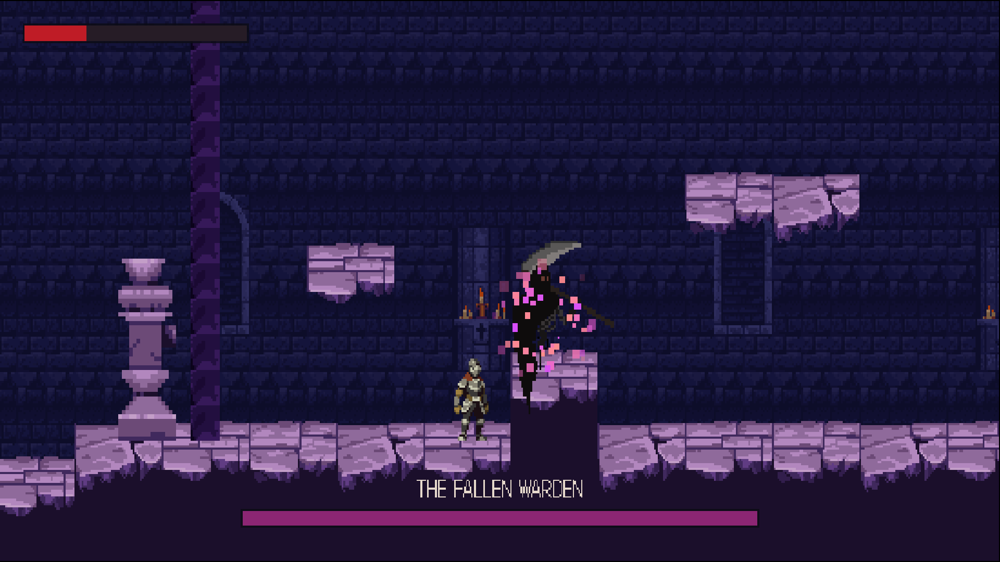
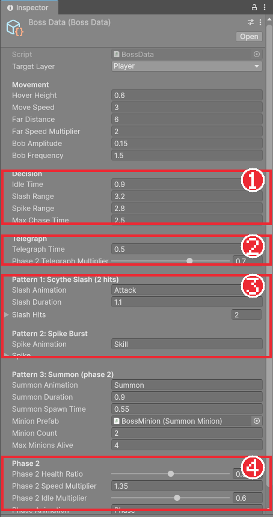
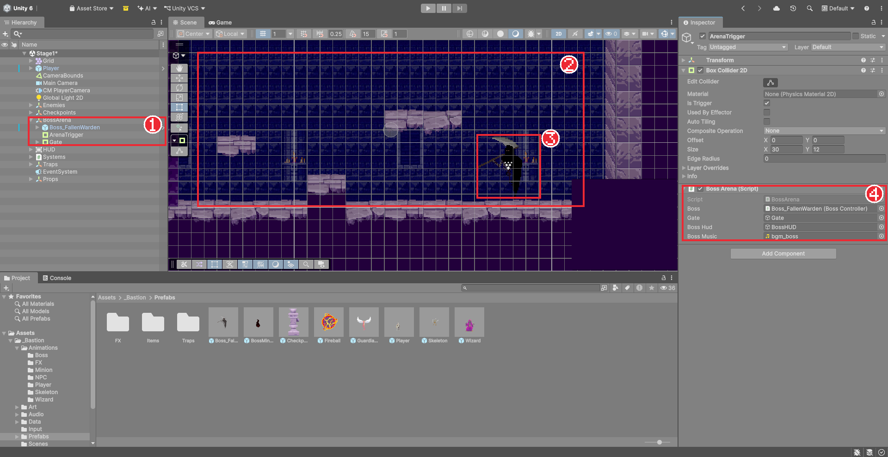

# Chapter 25 보스

## 학습 목표

- 보스전이 일반 적과 다른 점(패턴, 예비 동작, 페이즈)을 설명할 수 있다.
- 거리와 확률로 다음 패턴을 고르는 보스 상태 머신을 읽고 고칠 수 있다.
- Kinematic Rigidbody와 `MovePosition`으로 공중에 떠서 움직이는 보스를 만들 수 있다.
- 트리거로 보스방 입구를 닫고 전투를 시작하며, 체력 절반에서 2페이즈로 바꿀 수 있다.

## 본문

### 25-1 보스는 무엇이 다른가

일반 적은 "보이면 쫓아가서 벤다" 한 가지 행동만 반복합니다. 보스는 레벨의 마지막 시험이라 더 많은 것을 요구합니다.

| 요소 | 이 게임의 보스 "타락한 수호자" |
|---|---|
| 여러 패턴 | 낫 2연타, 가시 폭발(근거리 범위), 불꽃 정령 소환 |
| 패턴 선택 | 거리와 확률로 다음 행동을 고른다 |
| 예비 동작 | 공격 전에 0.5초 멈춰 입자를 모은다. 첫 판정이 너무 빨라 피할 수 없던 문제를 고친 것 |
| 페이즈 | 체력 50% 이하에서 2페이즈. 빨라지고 소환을 쓴다 |
| 슈퍼아머 | 맞아도 경직되지 않는다 |
| 보스방 | 들어오면 입구가 닫히고 보스 체력바가 뜬다 |



### 25-2 보스의 수치

보스도 수치를 `BossData` 에셋으로 나눕니다. 패턴마다 묶음이 있습니다.



| 묶음 | 주요 값 |
|---|---|
| Movement | 부유 높이 0.6, 이동 속도 3, 멀면 2배로 활공, 위아래로 둥실거리는 폭과 빠르기 |
| Decision | 행동 사이 대기 0.9초, 낫 사거리 3.2, 가시 사거리 2.8 |
| Telegraph | 예비 동작 0.5초, 2페이즈에서는 0.7배로 짧아짐 |
| Pattern 1~3 | 각 패턴의 애니메이션 이름, 길이, 판정 시간표(`AttackStep`) |
| Phase 2 | 체력 50%에서 전환, 속도 1.35배, 대기 0.6배 |

낫 2연타는 `AttackStep`을 배열로 두 개 가집니다. 한 동작 안에서 판정 구간이 두 번 나오는 공격입니다.

### 25-3 보스의 상태

보스 코드(`Scripts/Boss/BossController.cs`)는 400줄이 넘어서 이 문서에는 핵심만 싣습니다. 전체 코드는 완성본의 같은 파일을 열어 함께 읽으세요. 상태는 아래와 같습니다.

```text
[휴면] ─ 보스방 진입 ─▶ [대기] ─┬─ 가까우면 45% ─▶ [가시 폭발] ─┐
                                ├─ 그 밖 ─────────▶ [추적] ─ 사거리 ─▶ [낫 2연타] ─┤
                                └─ 2페이즈 30% ──▶ [소환] ─────────────────────┤
                                ▲                                                │
                                └─────────────── 끝나면 대기로 ───────────────────┘
 체력 50% 이하가 되는 순간 ─▶ [페이즈 전환] ─▶ [소환]        체력 0 ─▶ [사망]
```

보스의 상태들은 `BossController` 안에 중첩 클래스로 들어 있고, 공통 부모 `BossState`가 시작 시각과 경과 시간을 관리합니다.

```csharp
abstract class BossState : IState
{
    protected readonly BossController Boss;
    protected float StartTime;
    protected float Elapsed => Time.time - StartTime;
    protected BossState(BossController boss) => Boss = boss;
    public virtual void Enter() => StartTime = Time.time;
    public virtual void Exit() { }
    public virtual void Tick() { }
    public virtual void FixedTick() => Boss.Hover(0f);
}
```

### 25-4 공중에 떠서 움직이기

보스는 중력을 받지 않고 바닥 위를 둥실거리며 떠다닙니다. 물리 엔진이 밀거나 떨어뜨리면 안 되므로 Rigidbody 2D의 Body Type을 **Kinematic**으로 둡니다. Kinematic은 물리 엔진이 힘을 주지 않고 코드가 정한 위치로만 움직이는 종류입니다(Chapter 07).

```csharp
void Hover(float horizontalSpeed)
{
    float x = Mathf.Clamp(body.position.x + horizontalSpeed * Time.fixedDeltaTime, arenaRangeX.x, arenaRangeX.y);
    float y = arenaFloorY + data.HoverHeight + Mathf.Sin(Time.time * data.BobFrequency * Mathf.PI * 2f) * data.BobAmplitude;
    body.MovePosition(new Vector2(x, y));
}
```

- `body.MovePosition(위치)`: Kinematic 물체를 다음 물리 단계에 그 위치로 옮깁니다. `transform.position`을 바로 바꾸는 것과 달리 보간(Interpolate)과 충돌 감지가 함께 처리됩니다.
- `Mathf.Clamp(x, 최소, 최대)`: 보스가 보스방 밖으로 나가지 않게 x를 범위 안으로 자릅니다.
- `Mathf.Sin(...)`: 시간에 따라 -1과 1 사이를 오가는 값입니다. 여기에 폭(0.15)을 곱해 위아래로 둥실거리게 합니다.

### 25-5 패턴 고르기

대기 상태는 잠깐 쉰 뒤 다음 행동을 고릅니다.

```csharp
public override void Tick()
{
    Boss.FaceTarget();
    float wait = Boss.data.IdleTime * (Boss.Phase >= 2 ? Boss.data.Phase2IdleMultiplier : 1f);
    if (Elapsed < wait || !Boss.TargetAlive)
        return;

    // 2페이즈: 소환수가 적으면 일정 확률로 소환
    if (Boss.Phase >= 2 && Boss.AliveMinions() < Boss.data.MaxMinionsAlive && UnityEngine.Random.value < 0.3f)
    {
        Boss.StateMachine.ChangeState(Boss.summon);
        return;
    }

    if (Boss.DistanceX <= Boss.data.SpikeRange && UnityEngine.Random.value < 0.45f)
        Boss.StateMachine.ChangeState(Boss.spike);
    else
        Boss.StateMachine.ChangeState(Boss.chase);
}
```

가까이 있으면 45% 확률로 가시 폭발, 아니면 다가가서 낫을 휘두릅니다. 확률을 섞으면 플레이어가 순서를 외워 쉽게 이기지 못하고, 거리를 조건으로 두면 "가까이 붙으면 가시가 나올 수 있다"는 규칙을 배울 수 있습니다.

### 25-6 예비 동작

공격 상태는 들어오자마자 공격하지 않고, **애니메이션을 첫 프레임에 멈춘 채** 예고 입자를 모읍니다(Chapter 24). 시작 시각을 예비 동작만큼 뒤로 미루는 방법으로 구현했습니다.

```csharp
public override void Enter()
{
    base.Enter();
    released = false;
    Boss.FaceTarget();
    Boss.Play(Animation);

    // 예비 동작: 첫 프레임에서 멈춘 채 입자가 모이고, 그 뒤에 공격 시간표가 시작된다.
    float windup = Boss.data.TelegraphTime * (Boss.Phase >= 2 ? Boss.data.Phase2TelegraphMultiplier : 1f);
    StartTime = Time.time + windup;
    Boss.animator.speed = 0f;
    if (Boss.telegraph != null)
        Boss.telegraph.Play(windup + FirstActiveStart / Boss.SpeedMultiplier);
}
```

- `StartTime = Time.time + windup`: 경과 시간(`Elapsed`)이 처음 0.5초 동안 음수가 됩니다. 판정 시간표는 0초부터 시작하므로 그동안은 판정이 나오지 않습니다.
- `animator.speed = 0f`: 애니메이션을 멈춥니다. `FixedTick`에서 경과 시간이 0이 넘으면 속도를 다시 올립니다.
- 예고 시간은 "예비 동작 + 첫 판정까지"입니다. 입자가 다 모이는 순간이 첫 판정입니다.

### 25-7 페이즈 전환과 슈퍼아머

보스는 `Health.Damaged`를 듣고 체력이 절반 이하가 되는 순간 페이즈 전환 상태로 넘어갑니다.

```csharp
void OnDamaged(DamageInfo info)
{
    if (Phase == 1 && Health.Current <= Health.Max * data.Phase2HealthRatio && !Health.IsDead)
        StateMachine.ChangeState(phaseChange);
}
```

플레이어나 해골과 달리 맞아도 피격 상태로 가지 않습니다. 이것이 **슈퍼아머**입니다. 보스가 콤보에 갇혀 아무것도 못 하면 보스전이 너무 쉬워지기 때문입니다. 대신 타격감 연출(깜빡임, 화면 흔들림)은 그대로 나와 맞았다는 느낌은 줍니다.

페이즈 전환 상태는 1.4초 동안 무적으로 포효하고(`Health.InvincibleUntil`), 이후 바로 소환을 씁니다. 2페이즈에서는 `SpeedMultiplier`가 1.35가 되어 이동, 애니메이션, 판정 시간표가 함께 빨라집니다.

소환은 `SummonMinion` 프리팹(불꽃 정령)을 `Instantiate`하고 목록에 넣어 관리합니다. 동시에 살아 있는 수가 4를 넘지 않게 하고, 보스가 죽으면 남은 정령도 함께 없앱니다.

### 25-8 보스방

플레이어가 보스방에 들어오면 입구를 막고 전투를 시작합니다. `Scripts/Boss/BossArena.cs`입니다.

```csharp
using UnityEngine;

namespace Bastion.Boss
{
    /// <summary>플레이어가 아레나에 들어오면 입구를 막고 보스전을 시작한다.</summary>
    [RequireComponent(typeof(Collider2D))]
    public sealed class BossArena : MonoBehaviour
    {
        [SerializeField] BossController boss;
        [SerializeField] GameObject gate;
        [SerializeField] GameObject bossHud;

        bool started;

        void Awake()
        {
            GetComponent<Collider2D>().isTrigger = true;
            if (gate != null) gate.SetActive(false);
            if (bossHud != null) bossHud.SetActive(false);
        }

        void OnTriggerEnter2D(Collider2D other)
        {
            if (started || !other.CompareTag("Player"))
                return;

            started = true;
            if (gate != null) gate.SetActive(true);
            if (bossHud != null) bossHud.SetActive(true);
            boss.Activate();
        }
    }
}
```

#### 코드 해석

- 보스방 전체를 덮는 큰 트리거(Box Collider 2D)를 둡니다. Chapter 23의 트리거와 같습니다.
- `other.CompareTag("Player")`: 들어온 것이 플레이어인지 태그로 확인합니다. `other.tag == "Player"`보다 빠르고 오타를 경고해 줍니다.
- `gate.SetActive(true)`: 꺼 두었던 입구 벽(콜라이더와 그림이 있는 오브젝트)을 켭니다. **SetActive**는 게임 오브젝트를 켜고 끄는 함수입니다. 꺼진 오브젝트는 보이지도 않고 부딪히지도 않습니다.
- `boss.Activate()`: 휴면 상태의 보스를 깨웁니다. 휴면 중에는 무적이라 입구 밖에서 미리 때려 둘 수 없습니다.
- 보스 체력바(`bossHud`)는 Chapter 28에서 만듭니다. 지금은 비워 둬도 됩니다.



### 25-9 따라하기 — 보스전

1. 완성본에서 `BossData.cs`, `BossController.cs`, `SummonMinion.cs`, `BossArena.cs`를 가져와 `Scripts/Boss`에 넣고, 25-3~25-7의 설명을 따라가며 코드를 읽는다.
2. Undead Executioner 그림으로 보스 애니메이션(Idle, Attack, Skill, Summon, Phase, Death)을 만들고, 보스 프리팹(Kinematic Rigidbody 2D, Capsule Collider 2D, Health 400, DamageFlash, BossController, 자식 `Telegraph`에 `AttackTelegraph_Boss`)을 만든다.
3. 레벨 끝에 보스방을 만들고 `BossArena`의 트리거와 입구(`Gate`, Layer `Ground`)를 놓는다. `BossController`의 Arena Floor Y와 Arena Range X를 방에 맞춘다.
4. 보스방에 들어가 입구가 닫히고 보스가 깨어나는지, 공격 전에 입자가 모이는지 확인한다.
5. 보스 체력을 절반까지 깎아 포효 뒤 빨라지고 정령을 소환하는지 확인한다.

보스를 쓰러뜨려도 아직 아무 일도 일어나지 않습니다. 클리어 처리는 Chapter 29에서, 보스 배경음은 Chapter 32에서 넣습니다.

### 연습문제

1. 문제: 보스의 Rigidbody 2D를 Kinematic으로 두는 이유와 `MovePosition`을 쓰는 이유를 쓰세요.
2. 문제: 예비 동작 0.5초, 낫 첫 판정 0.17초일 때 1페이즈와 2페이즈에서 공격 상태에 들어온 뒤 첫 판정까지 걸리는 시간을 계산하세요.  
   - 조건: 2페이즈 예비 동작 배율 0.7, 속도 배율 1.35
3. 문제: 보스가 맞아도 경직되지 않게 한 이유를 쓰고, 그래도 맞았다는 느낌을 주는 장치를 두 가지 쓰세요.

### 정답 포인트

- 중력과 충돌 반응 없이 코드가 정한 위치로만 떠다니게 하려고 Kinematic을 쓰고, 보간과 충돌 감지를 유지하며 옮기려고 `MovePosition`을 쓴다. 1페이즈 0.5 + 0.17 = 0.67초, 2페이즈 0.35 + 0.17 ÷ 1.35 ≈ 0.48초. 콤보에 갇혀 보스전이 쉬워지지 않게 하려고(슈퍼아머), 피격 깜빡임과 화면 흔들림·히트스톱으로 맞은 느낌을 준다.

---

[상위 문서로 돌아가기](./README.md)
