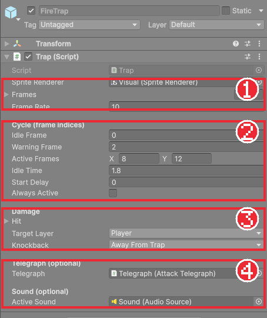
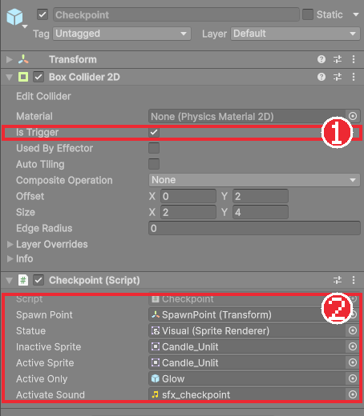

# Chapter 26 함정과 체크포인트

## 학습 목표

- 대기, 예고, 피해, 복귀를 반복하는 주기형 함정을 시간 계산으로 만들 수 있다.
- 스프라이트 프레임을 코드에서 직접 바꿔 그림과 피해 판정의 시간을 맞출 수 있다.
- 플레이어가 닿으면 부활 지점을 기억하는 체크포인트를 트리거로 만들 수 있다.
- `static` 클래스로 씬을 다시 불러와도 남는 값을 보관할 수 있다.

## 본문

### 26-1 레벨이 공격한다

지금까지 플레이어를 공격한 것은 적과 보스였습니다. 액션 게임의 레벨에는 **함정**도 있습니다. 함정은 생각하지 않고 움직이며, 정해진 박자로 작동합니다. 그래서 플레이어는 박자를 읽고 지나갈 때를 고릅니다. 적과는 다른 종류의 긴장을 줍니다.

함정이 늘어나면 죽는 일도 늘어납니다. 죽을 때마다 레벨 처음부터 다시 하면 지칩니다. 그래서 중간중간 **체크포인트**를 두어, 죽으면 마지막으로 지난 체크포인트에서 다시 시작하게 합니다.

이 장에서 만드는 것은 두 가지입니다.

| 오브젝트 | 하는 일 |
|---|---|
| 불기둥 함정 `FireTrap` | 3초마다 바닥에서 불기둥이 솟는다. 솟기 전에 불티가 모인다 |
| 밀치기 함정 `PushTrap` | 기둥이 앞으로 튀어나와 플레이어를 멀리 밀친다 |
| 체크포인트 `Checkpoint` | 촛대에 닿으면 불이 켜지고 체력이 가득 찬다. 죽으면 여기서 다시 시작한다 |

### 26-2 함정 한 번의 주기

불기둥 함정의 그림 `Assets/ThirdParty/Traps/Fire_Trap.png`는 가로로 이어 붙인 14장의 프레임입니다. 0번은 꺼진 구멍, 2~7번은 불씨가 피어오르는 모습, 8~12번은 불기둥, 13번은 꺼지는 모습입니다.

함정 한 번의 주기를 시간으로 펼치면 다음과 같습니다.

| 단계 | 보여 줄 프레임 | 피해 | 완성본 FireTrap의 시간 |
|---|---|---|---|
| 대기 (Idle) | 0번 고정 | 없음 | 1.8초 |
| 예고 (Warning) | 2번부터 차례로 | 없음 | 2~7번, 0.6초 |
| 피해 (Active) | 계속 차례로 | **있음** | 8~12번, 0.5초 |
| 복귀 (Recover) | 마지막까지 | 없음 | 13번, 0.1초 |

프레임은 1초에 10장씩 넘깁니다. 예고부터 끝까지 12장이므로 1.2초, 대기 1.8초를 더하면 한 주기가 **3초**입니다.

여기서 중요한 점은 **피해를 주는 순간이 그림의 불기둥과 정확히 겹쳐야 한다**는 것입니다. Chapter 15처럼 애니메이션 클립으로 그림을 넘기고 판정을 따로 계산하면 둘이 조금씩 어긋날 수 있습니다. 그래서 함정은 Animator를 쓰지 않고, **스크립트가 시간으로 프레임 번호를 계산해 그림과 판정을 함께 정합니다.**

### 26-3 Trap 컴포넌트

`Scripts/Hazards/Trap.cs`를 만듭니다. 소리 칸은 Chapter 32에서 추가하므로 지금은 뺀 모양입니다.

```csharp
using System.Collections.Generic;
using Bastion.Combat;
using UnityEngine;

namespace Bastion.Hazards
{
    /// <summary>
    /// 주기형 함정: 대기 → 예고 → 피해 → 복귀를 반복한다. 스프라이트 프레임을 코드가 직접 넘겨서
    /// 그림과 판정 시간이 항상 일치한다. alwaysActive면 상시 피해를 주는 고정 함정(가시 구덩이 등)이 된다.
    /// </summary>
    public sealed class Trap : MonoBehaviour
    {
        public enum Phase { Idle, Warning, Active, Recover }
        public enum KnockbackMode { AwayFromTrap, Forward }

        [SerializeField] SpriteRenderer spriteRenderer;
        [SerializeField] Sprite[] frames;
        [SerializeField, Min(1f)] float frameRate = 12f;

        [Header("Cycle (frame indices)")]
        [Tooltip("대기 중 보여줄 프레임")]
        [SerializeField, Min(0)] int idleFrame;
        [Tooltip("예고가 시작되는 프레임 (여기서부터 마지막 프레임까지 재생)")]
        [SerializeField, Min(0)] int warningFrame;
        [Tooltip("피해를 주는 프레임 범위 (포함)")]
        [SerializeField] Vector2Int activeFrames;
        [Tooltip("한 번 작동한 뒤 다음 작동까지 대기 시간")]
        [SerializeField, Min(0f)] float idleTime = 1.5f;
        [Tooltip("여러 함정을 엇갈리게 작동시키기 위한 시작 지연")]
        [SerializeField, Min(0f)] float startDelay;
        [Tooltip("항상 피해를 주는 고정 함정")]
        [SerializeField] bool alwaysActive;

        [Header("Damage")]
        [SerializeField] AttackStep hit = new AttackStep { Damage = 15, Knockback = 6f, HitboxOffset = new Vector2(0f, 0.5f), HitboxSize = new Vector2(1.6f, 1f) };
        [SerializeField] LayerMask targetLayer;
        [SerializeField] KnockbackMode knockback = KnockbackMode.AwayFromTrap;

        [Header("Telegraph (optional)")]
        [Tooltip("예고 단계에 재생할 입자 (그림만으로 예고가 잘 안 보일 때)")]
        [SerializeField] AttackTelegraph telegraph;

        readonly HashSet<IDamageable> hitThisCycle = new HashSet<IDamageable>();
        static readonly Collider2D[] Buffer = new Collider2D[8];
        int lastCycle = -1;
        float enabledTime;

        public Phase CurrentPhase { get; private set; } = Phase.Idle;
        public int CurrentFrame { get; private set; }
        public bool IsDangerous => alwaysActive || CurrentPhase == Phase.Active;

        float AnimationLength => frames == null || frames.Length == 0 ? 0f : (frames.Length - warningFrame) / frameRate;
        float CycleLength => idleTime + AnimationLength;
        int FacingDirection => transform.right.x >= 0f ? 1 : -1;

        // 활성화된 시점부터 대기 상태로 시작한다 (씬 로드 직후나 생성 직후 바로 작동하지 않도록).
        void OnEnable()
        {
            enabledTime = Time.time;
            lastCycle = -1;
        }

        void Update()
        {
            if (alwaysActive || frames == null || frames.Length == 0)
            {
                CurrentPhase = alwaysActive ? Phase.Active : Phase.Idle;
                return;
            }

            float time = Time.time - enabledTime - startDelay;
            if (time < 0f)
            {
                SetFrame(idleFrame, Phase.Idle);
                return;
            }

            int cycle = Mathf.FloorToInt(time / CycleLength);
            if (cycle != lastCycle)
            {
                lastCycle = cycle;
                hitThisCycle.Clear();
            }

            float t = time - cycle * CycleLength;
            if (t < idleTime)
            {
                SetFrame(idleFrame, Phase.Idle);
                return;
            }

            int frame = Mathf.Min(warningFrame + Mathf.FloorToInt((t - idleTime) * frameRate), frames.Length - 1);
            Phase phase = frame < activeFrames.x ? Phase.Warning
                : frame <= activeFrames.y ? Phase.Active
                : Phase.Recover;
            SetFrame(frame, phase);
        }

        void SetFrame(int frame, Phase phase)
        {
            if (phase == Phase.Warning && CurrentPhase != Phase.Warning && telegraph != null)
                telegraph.Play((activeFrames.x - frame) / frameRate);
            CurrentFrame = frame;
            CurrentPhase = phase;
            if (spriteRenderer != null && frames != null && frame < frames.Length)
                spriteRenderer.sprite = frames[frame];
        }

        void FixedUpdate()
        {
            if (!IsDangerous)
                return;

            // 고정 함정은 매 판정마다 새로 검사하고, 연속 피해는 피격 무적 시간이 막는다.
            if (alwaysActive)
                hitThisCycle.Clear();

            Vector2 center = (Vector2)transform.position + new Vector2(hit.HitboxOffset.x * FacingDirection, hit.HitboxOffset.y);
            var filter = new ContactFilter2D { useLayerMask = true, layerMask = targetLayer, useTriggers = false };
            int count = Physics2D.OverlapBox(center, hit.HitboxSize, 0f, filter, Buffer);
            for (int i = 0; i < count; i++)
            {
                var target = Buffer[i].GetComponentInParent<IDamageable>();
                if (target == null || target.IsDead || !hitThisCycle.Add(target))
                    continue;

                float x = knockback == KnockbackMode.Forward
                    ? FacingDirection
                    : Mathf.Sign(Buffer[i].transform.position.x - transform.position.x);
                target.TakeDamage(new DamageInfo(hit.Damage, new Vector2(x == 0f ? 1f : x, 0f), hit.Knockback, gameObject));
            }
        }

        void OnDrawGizmosSelected()
        {
            Gizmos.color = new Color(1f, 0.4f, 0f);
            HitboxQuery.DrawGizmo(transform, FacingDirection, hit);
        }
    }
}
```

#### 코드 해석

**시간 계산 (Update)**

- `time`: 함정이 켜진 뒤 흐른 시간에서 시작 지연을 뺀 값입니다. `Time.time`을 그대로 쓰지 않고 **켜진 시각**(`enabledTime`)을 빼는 이유는, 씬을 다시 불러오거나 함정을 새로 만들었을 때 주기 한가운데에서 시작해 갑자기 불이 솟는 일을 막기 위해서입니다.
- `cycle = FloorToInt(time / CycleLength)`: 지금이 몇 번째 주기인지입니다. 10초가 지났고 한 주기가 3초면 3번째 주기(0부터 셈)입니다.
- `t = time - cycle * CycleLength`: 이번 주기 안에서 흐른 시간입니다. 10초면 10 - 9 = 1초입니다. 나눗셈의 나머지와 같습니다.
- `t < idleTime`이면 대기 프레임을 보여 줍니다. 아니면 `(t - idleTime) * frameRate`로 예고가 시작된 뒤 몇 장째인지 계산해 `warningFrame`에 더합니다.
- 프레임 번호로 단계를 정합니다. `activeFrames.x`보다 앞이면 예고, `x`~`y` 사이면 피해, 그 뒤는 복귀입니다. **그림과 판정이 같은 숫자에서 나오므로 어긋날 수가 없습니다.**

**피해 판정 (FixedUpdate)**

- 피해 단계일 때만 Chapter 18과 같은 방식으로 상자 범위(`OverlapBox`)를 검사합니다. 판정 크기와 피해량은 공격 데이터와 같은 `AttackStep`에 담았습니다.
- `hitThisCycle`: 이번 주기에 이미 맞은 대상을 기억합니다. 불기둥이 0.5초 동안 켜져 있어도 한 번만 맞습니다. 새 주기가 시작되면 비웁니다. Chapter 18의 `hitThisSwing`과 같은 생각입니다.
- `knockback`: `AwayFromTrap`이면 함정에서 멀어지는 쪽으로, `Forward`면 함정이 바라보는 쪽으로 밉니다. 밀치기 함정은 `Forward`를 씁니다.
- `alwaysActive`: 가시 구덩이처럼 늘 위험한 함정용입니다. 매번 판정을 새로 하되, 연속 피해는 Chapter 19의 피격 무적 시간이 막아 줍니다.

**예고 (SetFrame)**

- 예고 단계에 처음 들어서는 순간 Chapter 24의 `AttackTelegraph`를 재생합니다. 재생 시간 `(activeFrames.x - frame) / frameRate`는 **불기둥이 솟을 때까지 남은 시간**입니다. 불티가 다 모이는 순간 불이 솟습니다.
- `CurrentPhase != Phase.Warning` 조건은 "이전 프레임에는 예고가 아니었다"는 뜻입니다. 예고 동안 매 프레임 입자를 다시 켜지 않도록 들어오는 순간 한 번만 실행합니다.

### 26-4 불기둥 함정 프리팹

1. Project 창에서 `Fire_Trap.png`를 고르고 Chapter 05의 픽셀 아트 설정(Pixels Per Unit 16, Filter Mode Point, Compression None)을 한다. Sprite Mode를 Multiple로 바꾸고 Sprite Editor의 **Slice > Grid By Cell Size**로 X는 32, Y는 그림 높이 그대로 두고 잘라 14장을 만든다. Pivot은 Bottom으로 둔다.
2. 빈 오브젝트 `FireTrap`을 만들고 `Trap` 컴포넌트를 붙인다. 자식 `Visual`에 Sprite Renderer를 붙이고 Sorting Layer는 Chapter 12의 캐릭터와 같은 층에 둔다.
3. `Trap`의 Sprite Renderer 칸에 `Visual`을 넣고, Frames 칸에 잘린 그림 14장을 순서대로 끌어 놓는다. Project 창에서 첫 장을 클릭하고 Shift+클릭으로 마지막 장까지 고른 뒤 Frames 이름 위로 끌면 한 번에 들어간다.
4. 아래 표대로 값을 넣는다.
5. 자식으로 Chapter 24의 `FireTelegraph` 프리팹을 넣고 Telegraph 칸에 연결한다.
6. `Prefabs/Traps` 폴더로 끌어 프리팹으로 만든다.

| 칸 | 값 | 뜻 |
|---|---|---|
| Frame Rate | 10 | 1초에 10장 |
| Idle Frame | 0 | 대기 중에는 꺼진 구멍 |
| Warning Frame | 2 | 2번부터 불씨가 피어오름 |
| Active Frames | X 8, Y 12 | 8~12번 동안 피해 |
| Idle Time | 1.8 | 다음 작동까지 쉬는 시간 |
| Hit | Damage 20, Knockback 5, Offset (0, 0.9), Size (1.3, 1.8) | 불기둥 크기에 맞춘 판정 |
| Target Layer | Player | 플레이어만 맞는다 |
| Knockback | Away From Trap | 불에서 멀어지게 |



함정을 선택하면 Scene 뷰에 주황색 판정 상자가 보입니다(`OnDrawGizmosSelected`). 불기둥 그림과 상자가 겹치도록 Hit의 Offset과 Size를 맞춥니다.

**밀치기 함정**도 같은 컴포넌트로 만듭니다. `Push_Trap_Right.png`를 같은 방법으로 잘라 쓰고 Frame Rate 12, Warning Frame 1, Active Frames 3~6, Idle Time 1.4, Damage 12, Knockback 10, **Knockback을 Forward**로 둡니다. 왼쪽으로 밀게 하려면 Transform의 Rotation Y를 180으로 돌립니다. `FacingDirection`이 `transform.right`의 방향을 보고 판정 위치와 미는 쪽을 뒤집습니다.

### 26-5 박자 엇갈리기

불기둥 세 개를 나란히 놓으면 세 개가 동시에 솟고 동시에 꺼져서, 꺼진 순간 그냥 걸어가면 됩니다. **Start Delay**를 0, 1, 2초로 다르게 주면 불이 차례로 솟는 물결이 되어, 플레이어가 한 칸씩 박자를 맞춰 건너야 합니다.

같은 프리팹을 여러 개 놓고 Start Delay만 바꾸는 것이 Chapter 21의 **프리팹 덮어쓰기**(Override)입니다. 바꾼 값은 Inspector에서 굵은 글씨로 보입니다. 완성본 Stage1에는 함정 7개가 있고, 그중 6개가 서로 다른 Start Delay를 갖습니다.

### 26-6 다시 불러와도 남는 값

이제 체크포인트를 만듭니다. 플레이어가 죽으면 Chapter 29에서 **씬을 다시 불러와** 처음 상태로 되돌립니다. 그런데 씬을 다시 불러오면 씬 안의 모든 오브젝트가 새로 만들어지므로, "어느 체크포인트를 지났는지"를 씬 안의 컴포넌트에 저장해 두면 함께 사라집니다.

씬과 상관없이 남아야 하는 값은 `static`에 둡니다. `static` 필드는 오브젝트가 아니라 **클래스 자체**에 붙어 있어서, 씬을 다시 불러와도 그대로 남습니다. `Scripts/Core/CheckpointSystem.cs`입니다.

```csharp
using UnityEngine;

namespace Bastion.Core
{
    /// <summary>
    /// 마지막으로 활성화한 체크포인트를 씬 재시작 사이에 기억한다.
    /// 도메인 리로드를 끈 에디터 설정에서도 플레이마다 초기화되도록 SubsystemRegistration에서 리셋한다.
    /// </summary>
    public static class CheckpointSystem
    {
        public static bool HasCheckpoint { get; private set; }
        public static string SceneName { get; private set; }
        public static Vector3 Position { get; private set; }

        [RuntimeInitializeOnLoadMethod(RuntimeInitializeLoadType.SubsystemRegistration)]
        static void ResetOnPlay() => Clear();

        public static void Activate(string sceneName, Vector3 position)
        {
            HasCheckpoint = true;
            SceneName = sceneName;
            Position = position;
        }

        public static void Clear()
        {
            HasCheckpoint = false;
            SceneName = null;
            Position = Vector3.zero;
        }
    }
}
```

#### 코드 해석

- `public static class`: 컴포넌트가 아니므로 오브젝트에 붙이지 않습니다. 어디서나 `CheckpointSystem.Position`처럼 바로 씁니다.
- `SceneName`: 체크포인트가 어느 씬의 것인지도 함께 기억합니다. 다른 스테이지로 넘어갔는데 이전 스테이지의 좌표로 옮겨지면 안 되기 때문입니다.
- `[RuntimeInitializeOnLoadMethod(SubsystemRegistration)]`: **플레이 버튼을 누를 때마다** Unity가 이 함수를 맨 먼저 불러 줍니다. 에디터에서 플레이를 멈췄다 다시 시작해도 지난번 체크포인트가 남아 있지 않게 비웁니다. Project Settings의 Enter Play Mode 설정에 따라 `static` 값이 플레이 사이에 남을 수 있어서 이렇게 직접 비웁니다.

### 26-7 Checkpoint 컴포넌트

`Scripts/Core/Checkpoint.cs`입니다. 활성화 소리는 Chapter 32에서 추가합니다.

```csharp
using System;
using Bastion.Combat;
using UnityEngine;

namespace Bastion.Core
{
    /// <summary>플레이어가 닿으면 부활 지점으로 등록하고 체력을 회복시킨다.</summary>
    [RequireComponent(typeof(Collider2D))]
    public sealed class Checkpoint : MonoBehaviour
    {
        [SerializeField] Transform spawnPoint;
        [SerializeField] SpriteRenderer statue;
        [SerializeField] Sprite inactiveSprite;
        [SerializeField] Sprite activeSprite;
        [Tooltip("활성화되면 켜지는 오브젝트 (불빛 등)")]
        [SerializeField] GameObject activeOnly;

        public bool IsActive { get; private set; }
        public Vector3 SpawnPosition => spawnPoint != null ? spawnPoint.position : transform.position;

        public static event Action<Checkpoint> Activated;

        void Awake()
        {
            GetComponent<Collider2D>().isTrigger = true;
            // 씬을 다시 불러왔을 때 이미 활성화한 체크포인트면 그 상태를 유지한다.
            IsActive = CheckpointSystem.HasCheckpoint && Vector3.Distance(CheckpointSystem.Position, SpawnPosition) < 0.01f;
            UpdateVisual();
        }

        void OnTriggerEnter2D(Collider2D other)
        {
            if (IsActive || !other.CompareTag("Player"))
                return;

            IsActive = true;
            CheckpointSystem.Activate(gameObject.scene.name, SpawnPosition);
            var health = other.GetComponentInParent<Health>();
            if (health != null && !health.IsDead)
                health.ResetHealth();
            UpdateVisual();
            Activated?.Invoke(this);
        }

        void UpdateVisual()
        {
            if (statue != null)
            {
                Sprite sprite = IsActive ? activeSprite : inactiveSprite;
                if (sprite != null)
                    statue.sprite = sprite;
            }
            if (activeOnly != null)
                activeOnly.SetActive(IsActive);
        }
    }
}
```

#### 코드 해석

- `[RequireComponent(typeof(Collider2D))]`: 이 컴포넌트를 붙이면 콜라이더도 꼭 있어야 한다고 Unity에 알립니다. 콜라이더 없이 붙이려 하면 Unity가 막아 줍니다. `Awake`에서 `isTrigger`를 켜 두므로 Inspector에서 깜빡해도 됩니다.
- `OnTriggerEnter2D`: Chapter 23, 25와 같은 트리거 감지입니다. 이미 켜진 체크포인트이거나 플레이어가 아니면 무시합니다.
- `CheckpointSystem.Activate(gameObject.scene.name, SpawnPosition)`: 이 체크포인트의 씬 이름과 부활 위치를 기억합니다. 부활 위치는 자식 `SpawnPoint`의 위치입니다. 촛대 한가운데가 아니라 바닥 위 알맞은 곳에 따로 둘 수 있습니다.
- `health.ResetHealth()`: Chapter 19에서 미리 만들어 둔 함수로 체력을 가득 채웁니다.
- `Awake`의 `IsActive` 계산: 죽어서 씬을 다시 불러오면 이 체크포인트도 새로 만들어집니다. 기억된 위치가 자기 부활 위치와 같으면 "내가 마지막 체크포인트"이므로 불이 켜진 채로 시작합니다. `Vector3.Distance(...) < 0.01f`로 비교하는 이유는 소수 계산에 아주 작은 오차가 생길 수 있어서 `==` 대신 "충분히 가까우면 같다"로 보기 때문입니다.
- `static event Action<Checkpoint> Activated`: "어느 체크포인트든 켜졌다"를 알리는 통로입니다. 완성본에는 아직 듣는 쪽이 없지만, 화면에 "체크포인트" 문구를 띄우고 싶을 때 UI가 이 이벤트 하나만 구독하면 됩니다. 체크포인트가 여러 개라도 한 번만 구독하면 되도록 `static`으로 만들었습니다.

### 26-8 체크포인트 프리팹

완성본 `Prefabs/Checkpoint.prefab`의 구성입니다.

| 오브젝트 | 컴포넌트 | 역할 |
|---|---|---|
| `Checkpoint` | Box Collider 2D (Is Trigger, Offset (0, 2), Size (2, 4)), Checkpoint | 플레이어가 닿는 영역 |
| └ `Visual` | Sprite Renderer (`Candle_Unlit`) | 꺼진 촛대 그림 |
| └ `SpawnPoint` | (없음) | 부활 위치 |
| └ `Glow` | `CandleFlicker` | 활성화되면 켜지는 불빛 묶음 |
| 　└ `Flame` | Sprite Renderer (`Candle_Flame`) | 불꽃 그림 |
| 　└ `Light` | Light 2D | 주변을 밝히는 빛 |



꺼진 그림과 켜진 그림을 따로 갈아 끼우는 대신, 이 촛대는 그림은 그대로 두고 **불꽃과 빛이 담긴 `Glow` 오브젝트를 켜는 방식**을 씁니다. 그래서 Inactive Sprite와 Active Sprite에 같은 그림이 들어 있습니다. 그림을 바꾸는 방식이 필요한 다른 체크포인트를 위해 두 칸을 남겨 두었습니다.

**Light 2D**는 URP 2D에서 주변을 밝히는 빛 컴포넌트입니다. Hierarchy의 **+ > Light > Spot Light 2D**로 만들고 Color를 주황, Intensity를 1 정도, Radius를 3 정도로 둡니다. `CandleFlicker`는 불꽃 크기와 빛의 세기를 조금씩 흔드는 꾸밈 스크립트입니다. 완성본에서 가져와 붙이기만 하면 됩니다.

### 26-9 따라하기 — 함정과 체크포인트

1. `Trap.cs`를 만들고 26-4대로 `FireTrap` 프리팹을 만든다. 실행해 불기둥이 3초마다 솟고, 솟기 전에 불티가 모이는지 확인한다.
2. 불기둥에 서서 한 번에 체력이 20만 줄고 같은 불기둥에서는 두 번 맞지 않는지 확인한다.
3. 불기둥 세 개를 나란히 놓고 Start Delay를 0, 1, 2로 다르게 줘서 차례로 솟게 한다.
4. `PushTrap`을 만들어 플레이어가 앞으로 밀려나는지 확인한다.
5. `CheckpointSystem.cs`, `Checkpoint.cs`를 만들고 체크포인트 프리팹을 레벨 중간에 놓는다. 플레이어의 Tag가 `Player`인지 확인한다.
6. 함정에 맞아 체력을 줄인 뒤 체크포인트에 닿아 불이 켜지고 체력이 가득 차는지 확인한다.

죽었을 때 체크포인트에서 다시 시작하는 처리는 Chapter 29의 `GameFlow`가 `CheckpointSystem.Position`을 읽어서 합니다.

### 연습문제

1. 문제: Frame Rate 10, Warning Frame 2, 프레임 14장, Idle Time 1.8일 때 함정이 켜진 뒤 10초가 지난 순간 몇 번 프레임을 보여 주고 어느 단계인지 계산하세요.  
   - 조건: Start Delay 0, Active Frames 8~12
2. 문제: `enabledTime`을 빼지 않고 `Time.time`으로만 주기를 계산하면 어떤 문제가 생기는지 쓰세요.
3. 문제: 체크포인트에서 지난 위치를 `Checkpoint` 컴포넌트의 일반 필드에 저장하면 안 되는 이유를 쓰세요.
4. 문제: 같은 불기둥에 0.5초 동안 서 있어도 한 번만 맞는 이유를 코드의 변수 이름으로 설명하세요.

### 정답 포인트

- 한 주기 1.8 + 12 ÷ 10 = 3초. 10초는 4번째 주기(cycle 3) 안의 1초이므로 1.8초보다 작아 대기 단계, 0번 프레임이다.
- 씬을 다시 불러온 시각이 주기 한가운데면 함정이 시작하자마자 불을 뿜는다. 같은 프리팹을 나중에 만들어도 박자가 플레이어가 도착한 순간과 상관없이 정해진다.
- 죽으면 씬을 다시 불러와 컴포넌트가 새로 만들어지므로 일반 필드의 값은 사라진다. 씬과 상관없이 남는 `static`에 둬야 한다.
- `hitThisCycle`이 이번 주기에 맞은 대상을 기억하고, `HashSet.Add`가 이미 있으면 `false`를 돌려줘 두 번째 피해를 건너뛴다. 새 주기에 들어서야 비워진다.

---

[상위 문서로 돌아가기](./README.md)
