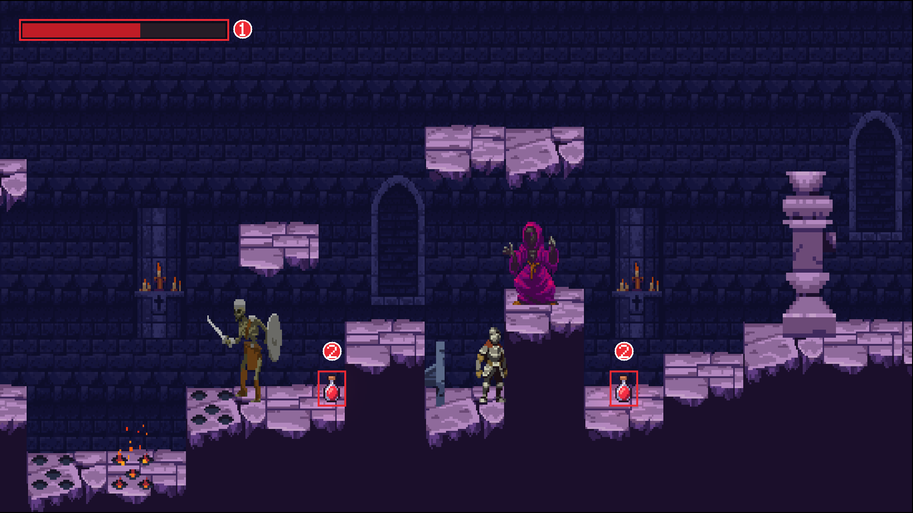
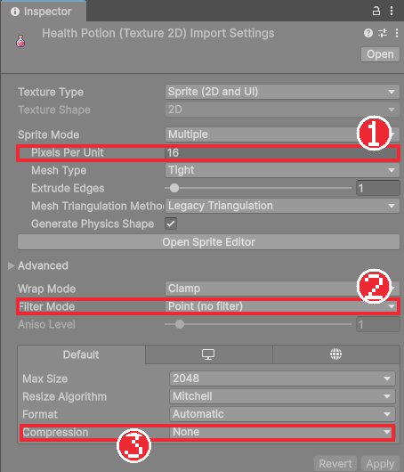
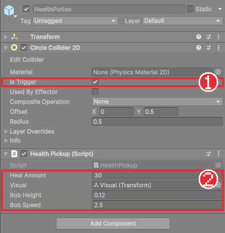

# Chapter 27 회복 아이템

## 학습 목표

- 직접 그린 작은 그림을 프로젝트의 픽셀 아트 기준에 맞게 가져올 수 있다.
- `Health`에 회복 기능과 회복 이벤트를 추가할 수 있다.
- `OnTriggerEnter2D`와 `OnTriggerStay2D`의 차이를 알고 알맞은 쪽을 고를 수 있다.
- `Mathf.Sin`으로 오브젝트를 위아래로 둥실거리게 만들 수 있다.

## 본문

### 27-1 숨 돌릴 곳

함정과 적이 늘어나면 체력이 금방 바닥납니다. 체크포인트(Chapter 26)는 체력을 가득 채워 주지만 띄엄띄엄 있습니다. 그 사이에 **회복 물약**을 두면 "조금만 더 가면 물약이 있다"는 목표가 생기고, 어려운 구간 앞에서 숨을 돌릴 수 있습니다.



물약이 할 일은 단순합니다.

1. 플레이어가 닿으면 체력을 30 채우고 사라진다.
2. 체력이 가득 차 있으면 먹지 않고 남겨 둔다. 나중에 다쳤을 때 돌아와 먹을 수 있다.
3. 눈에 잘 띄도록 위아래로 둥실거리고 붉은 빛을 낸다.

### 27-2 직접 그린 그림 가져오기

물약 그림 `Art/Items/HealthPotion.png`는 무료 에셋이 아니라 이 게임을 위해 직접 그린 16×16 픽셀 그림입니다. 작은 그림이라도 Chapter 05에서 배운 **픽셀 아트 설정**을 똑같이 해야 합니다.

| 칸 | 값 | 빠뜨리면 |
|---|---|---|
| Pixels Per Unit | 16 | 기본값 100이면 16픽셀이 0.16칸이 되어 **점처럼 작게** 보인다 |
| Filter Mode | Point (no filter) | 기본값 Bilinear면 테두리가 뿌옇게 번진다 |
| Compression | None | 압축하면 색이 뭉개진다 |



이 게임의 모든 그림은 **16픽셀이 1칸**입니다. 기사, 타일, 함정 모두 같은 기준이라 크기가 서로 맞습니다. 새 그림을 넣을 때마다 이 기준을 맞추는 것을 잊지 마세요. 실제로 이 자료를 만들 때도 물약의 Pixels Per Unit을 100으로 둔 채 레벨에 놓았다가, 게임 화면에서 물약이 거의 보이지 않아 뒤늦게 고쳤습니다.

> 완성본의 `PixelSpriteImporter`(Chapter 05)는 `Assets/ThirdParty` 폴더의 그림에만 이 설정을 자동으로 해 줍니다. `Art` 폴더에 넣은 직접 그린 그림은 손으로 맞춰야 합니다.

### 27-3 Health에 회복 추가하기

Chapter 19의 `Health`는 깎는 기능만 있습니다. 회복 함수와, 회복했다는 사실을 알리는 이벤트를 추가합니다. 이벤트 목록 아래에 한 줄, `TakeDamage` 아래에 함수 하나를 넣습니다.

```csharp
public event Action<int, int> Changed;
/// <summary>체력을 회복했을 때 (실제로 늘어난 양).</summary>
public event Action<int> Healed;
```

```csharp
/// <returns>실제로 회복했으면 true (사망했거나 이미 가득 차 있으면 false)</returns>
public bool Heal(int amount)
{
    if (IsDead || amount <= 0 || Current >= maxHealth)
        return false;

    int before = Current;
    Current = Mathf.Min(maxHealth, Current + amount);
    Changed?.Invoke(Current, maxHealth);
    Healed?.Invoke(Current - before);
    return true;
}
```

#### 코드 해석

- 죽었거나, 회복량이 0 이하이거나, 이미 가득 찼으면 아무것도 하지 않고 `false`를 돌려줍니다. 물약은 이 값을 보고 **사라질지 남을지** 정합니다.
- `Mathf.Min(maxHealth, Current + amount)`: 체력 85에 30을 더하면 115지만 최대 100을 넘지 않게 자릅니다.
- `Healed?.Invoke(Current - before)`: 실제로 늘어난 양(위 예에서는 15)을 알립니다. Chapter 32에서 이 이벤트를 듣고 회복 소리를 냅니다.
- `Changed`도 함께 알립니다. Chapter 28의 체력바는 `Changed`만 들으면 피해와 회복을 모두 그릴 수 있습니다.

`TakeDamage`가 `bool`을 돌려준 것과 같은 모양입니다. "요청했지만 실제로는 일어나지 않았을 수 있다"는 일에는 결과를 돌려주면, 부른 쪽이 그 결과로 다음 행동을 정할 수 있습니다.

### 27-4 HealthPickup 컴포넌트

`Scripts/Items/HealthPickup.cs`를 만듭니다.

```csharp
using Bastion.Combat;
using UnityEngine;

namespace Bastion.Items
{
    /// <summary>
    /// 회복 아이템. 플레이어가 닿으면 체력을 회복하고 사라진다.
    /// 체력이 가득 차 있으면 먹지 않고 남겨 둔다.
    /// </summary>
    [RequireComponent(typeof(Collider2D))]
    public sealed class HealthPickup : MonoBehaviour
    {
        [SerializeField, Min(1)] int healAmount = 30;
        [Tooltip("위아래로 떠다니는 그림")]
        [SerializeField] Transform visual;
        [SerializeField, Min(0f)] float bobHeight = 0.12f;
        [SerializeField, Min(0f)] float bobSpeed = 2.5f;

        Vector3 visualStart;

        void Awake()
        {
            GetComponent<Collider2D>().isTrigger = true;
            if (visual != null)
                visualStart = visual.localPosition;
        }

        void Update()
        {
            if (visual != null)
                visual.localPosition = visualStart + Vector3.up * (Mathf.Sin(Time.time * bobSpeed) * bobHeight);
        }

        // 가득 찬 상태로 서 있다가 피해를 입으면 바로 먹을 수 있게 Stay에서 검사한다.
        void OnTriggerStay2D(Collider2D other)
        {
            if (!other.CompareTag("Player"))
                return;
            var health = other.GetComponentInParent<Health>();
            if (health != null && health.Heal(healAmount))
                Destroy(gameObject);
        }
    }
}
```

#### 코드 해석

**둥실거리기 (Update)**

- `Mathf.Sin(x)`는 x가 커지면서 -1과 1 사이를 부드럽게 오가는 값입니다. 여기에 `Time.time`을 넣으면 시간에 따라 위아래로 흔들리는 숫자가 됩니다.
- `bobSpeed`는 얼마나 빨리 오갈지, `bobHeight`는 얼마나 높이 오갈지입니다. 2.5와 0.12면 약 2.5초에 한 번, 위아래로 0.12칸씩 움직입니다.
- 움직이는 것은 **자식 `Visual`만**입니다. 콜라이더가 있는 부모는 그대로 있으므로 먹는 범위가 흔들리지 않습니다. Chapter 07에서 그림과 몸을 나눴던 것과 같은 이유입니다.
- `visualStart`: 시작 위치를 기억해 두고 거기에 흔들림을 **더합니다**. 매 프레임 현재 위치에 더하면 흔들림이 쌓여 물약이 점점 떠내려갑니다.

**먹기 (OnTriggerStay2D)**

트리거 알림에는 세 가지가 있습니다.

| 함수 | 불리는 때 |
|---|---|
| `OnTriggerEnter2D` | 겹치기 시작한 순간 한 번 |
| `OnTriggerStay2D` | 겹쳐 있는 동안 물리 단계마다 |
| `OnTriggerExit2D` | 떨어지는 순간 한 번 |

Chapter 23의 화염구와 Chapter 26의 체크포인트는 `Enter`를 썼습니다. 물약은 `Stay`를 씁니다. 체력이 가득한 채로 물약 위에 서 있다가 그 자리에서 함정에 맞으면, `Enter`는 이미 지나갔으므로 다시 불리지 않아 물약을 먹을 수 없습니다. `Stay`는 겹쳐 있는 동안 계속 물어보므로 체력이 줄어든 순간 바로 먹습니다.

- `health.Heal(healAmount)`가 `true`일 때만 `Destroy(gameObject)`로 물약을 없앱니다. 체력이 가득하면 `false`라서 물약이 남습니다.
- `Destroy`: 게임 오브젝트를 지웁니다. 지운 오브젝트는 이번 프레임이 끝날 때 사라집니다.

### 27-5 물약 프리팹

완성본 `Prefabs/Items/HealthPotion.prefab`의 구성입니다.

| 오브젝트 | 컴포넌트 | 역할 |
|---|---|---|
| `HealthPotion` | Circle Collider 2D (Is Trigger, Offset (0, 0.5), Radius 0.5), HealthPickup | 먹는 범위 |
| └ `Visual` | Sprite Renderer (`HealthPotion`, Order in Layer 4) | 둥실거리는 그림 (Position Y 0.5) |
| 　└ `Glow` | Light 2D (Point, 붉은색, Intensity 0.8, Outer Radius 1.6) | 주변을 붉게 비추는 빛 |



부모의 위치가 바닥, 그림은 0.5칸 위에 있습니다. 레벨에 놓을 때 부모를 바닥에 맞추면 물약이 바닥 위에 떠 있는 모습이 됩니다. Light 2D는 Chapter 26의 촛대에서 쓴 것과 같고, 종류만 **Point Light 2D**(사방으로 퍼지는 동그란 빛)입니다.

물약은 Rigidbody 2D가 없습니다. 트리거 알림은 둘 중 하나에만 Rigidbody 2D가 있으면 되는데(Chapter 23), 플레이어에게 이미 있습니다.

### 27-6 따라하기 — 회복 물약

1. `HealthPotion.png`를 `Art/Items`에 넣고 27-2의 설정을 한다. Inspector 아래 미리보기 크기가 16×16인지 확인한다.
2. `Health`에 `Healed` 이벤트와 `Heal` 함수를 추가한다.
3. `HealthPickup.cs`를 만들고 27-5대로 프리팹을 만든다.
4. 레벨의 어려운 구간 앞에 물약 두 개를 놓는다. 완성본은 x = 40.5와 51.5에 있다.
5. 체력이 가득한 채로 물약에 닿아 물약이 남는지 확인한다.
6. 함정에 맞은 뒤 물약에 닿아 체력이 늘고 물약이 사라지는지 확인한다.
7. Pixels Per Unit을 100으로 바꿔 게임 화면에서 물약 크기가 어떻게 되는지 보고 16으로 되돌린다.

### 연습문제

1. 문제: 체력 100 중 85일 때 회복량 30인 물약을 먹으면 `Heal`이 돌려주는 값, 바뀐 체력, `Healed` 이벤트로 전달되는 값을 쓰세요.
2. 문제: 물약이 `OnTriggerEnter2D`로 먹는 방식이면 어떤 상황에서 물약을 먹지 못하는지 쓰세요.
3. 문제: 16×16 그림의 Pixels Per Unit이 100일 때 게임 화면에서 몇 칸 크기가 되는지 계산하세요.
4. 문제: `visual.localPosition += Vector3.up * Mathf.Sin(...) * bobHeight;`처럼 쓰면 어떤 문제가 생길 수 있는지 쓰세요.

### 정답 포인트

- 85 + 30 = 115지만 최대 100으로 자르므로 체력은 100, `Heal`은 `true`, `Healed`로는 실제로 늘어난 15가 전달된다.
- 체력이 가득한 채로 물약과 겹친 뒤 그 자리에서 피해를 입으면, 겹치기 시작한 순간이 이미 지나서 다시 알림이 오지 않는다. 물약에서 떨어졌다가 다시 닿아야 먹을 수 있다.
- 16 ÷ 100 = 0.16칸. 16으로 두면 1칸이다.
- 매 프레임 흔들림을 현재 위치에 더하면 오차가 쌓여 물약이 처음 자리에서 점점 벗어난다. 시작 위치를 기억해 두고 거기에 더해야 한다.

---

[다음 문서: Chapter 28 UI 기초와 체력바](./28-ui-health-bar.md)

[상위 문서로 돌아가기](./README.md)
