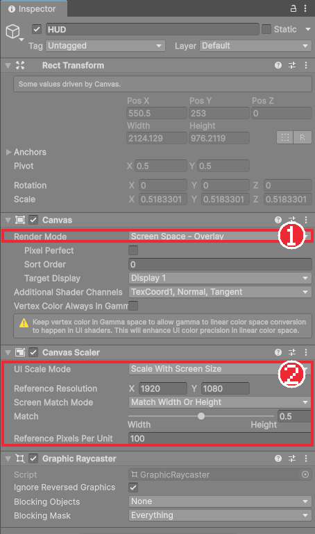
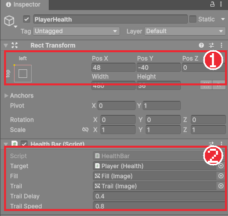
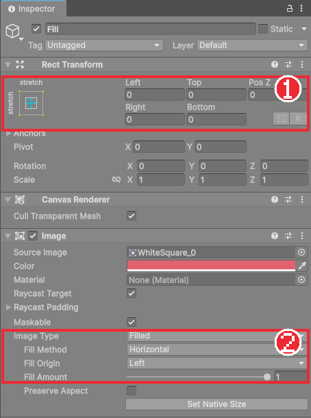

# Chapter 28 UI 기초와 체력바

## 학습 목표

- Canvas의 역할과 Render Mode를 설명할 수 있다.
- Canvas Scaler로 화면 크기가 달라도 UI 크기가 같은 비율로 보이게 할 수 있다.
- Rect Transform의 앵커와 피벗으로 UI를 화면 모서리에 고정할 수 있다.
- Image의 Filled 타입과 `Health.Changed` 이벤트로 체력바와 잔상 효과를 만들 수 있다.

## 본문

### 28-1 게임 화면 위에 붙는 그림

지금까지 만든 기사, 타일, 적은 모두 **게임 세계 안**에 있습니다. 카메라가 움직이면 같이 화면에서 움직입니다. 체력바나 메뉴는 다릅니다. 카메라가 어디를 보든 **화면의 같은 자리**에 붙어 있어야 합니다. 이런 화면용 그림과 글자를 **UI**(User Interface)라고 합니다.

Unity의 UI는 모두 **Canvas**라는 오브젝트의 자식으로 만듭니다. Canvas는 "여기 아래에 있는 것은 화면에 붙여 그린다"는 판입니다.

Hierarchy의 **+ > UI > Image**처럼 UI 오브젝트를 처음 만들면 Unity가 자동으로 두 오브젝트를 함께 만듭니다.

| 오브젝트 | 역할 |
|---|---|
| `Canvas` | UI를 그리는 판. Canvas, Canvas Scaler, Graphic Raycaster 컴포넌트가 붙어 있다 |
| `EventSystem` | 마우스, 키보드, 패드 입력을 UI 버튼에 전달한다 (Chapter 31) |

완성본은 Canvas 이름을 `HUD`(Head-Up Display, 게임 중 늘 보이는 정보 화면)로 바꿨습니다.

### 28-2 Canvas와 Canvas Scaler

**Canvas**의 Render Mode는 UI를 어디에 그릴지 정합니다.

| Render Mode | 그리는 곳 | 쓰임 |
|---|---|---|
| Screen Space - Overlay | 모든 카메라 그림 위에 덮어 그린다 | 체력바, 메뉴 (이 게임) |
| Screen Space - Camera | 지정한 카메라 앞에 일정 거리를 두고 그린다 | UI에 카메라 효과를 주고 싶을 때 |
| World Space | 게임 세계 안의 판으로 그린다 | 적 머리 위 체력바, 게임 속 간판 |

UI는 픽셀 단위로 크기를 정합니다. 체력바 너비를 480으로 두면 1920×1080 화면에서는 4분의 1이지만, 3840×2160 화면에서는 8분의 1로 작아집니다. **Canvas Scaler**는 이것을 막아 줍니다.

- **UI Scale Mode**: `Scale With Screen Size`. 화면 크기에 맞춰 UI 전체를 키우고 줄인다.
- **Reference Resolution**: `1920 × 1080`. 이 크기를 기준으로 UI를 배치한다.
- **Match**: `0.5`. 화면의 가로세로 비율이 기준과 다를 때 너비(0)와 높이(1) 중 무엇에 맞출지 정한다. 0.5는 반반이다.



이렇게 두면 UI는 언제나 1920×1080 화면이라고 생각하고 배치하면 됩니다. 4K 화면에서는 Unity가 두 배로 키워 줍니다. Rect Transform의 Scale이 0.518처럼 이상한 값이고 회색으로 잠겨 있는 것은 Canvas Scaler가 지금 Game 뷰 크기에 맞춰 대신 정한 값이기 때문입니다.

Game 뷰 위쪽의 해상도 목록을 `Full HD (1920x1080)`로 고르면 완성본과 같은 화면으로 볼 수 있습니다.

### 28-3 Rect Transform과 앵커

UI 오브젝트는 Transform 대신 **Rect Transform**을 씁니다. 위치와 함께 **크기**(Width, Height)와 **앵커**(Anchor)가 있습니다.

**앵커**는 "화면의 어디를 기준으로 위치를 잴까"입니다. 체력바는 왼쪽 위 모서리에서 일정 거리에 있어야 합니다. 앵커를 왼쪽 위에 두고 Pos X 48, Pos Y -40으로 두면 화면이 어떤 크기든 왼쪽 위 모서리에서 오른쪽으로 48, 아래로 40 떨어진 자리에 붙습니다. 앵커를 가운데에 두면 화면 크기가 바뀔 때 체력바가 모서리에서 멀어지거나 화면 밖으로 나갑니다.

Rect Transform 왼쪽 위의 네모 그림(Anchor Presets)을 클릭하면 앵커를 고르는 표가 나옵니다.

- 그냥 클릭: 앵커만 바꾼다.
- **Shift**를 누른 채 클릭: 피벗도 같은 자리로 바꾼다.
- **Alt**를 누른 채 클릭: 위치도 그 자리로 옮긴다.

**피벗**(Pivot)은 오브젝트 자신의 기준점입니다. 왼쪽 위에 붙일 체력바는 피벗도 왼쪽 위 (0, 1)로 두어야 Pos가 "체력바의 왼쪽 위 모서리"의 위치가 됩니다.



앵커 표의 오른쪽 아래 칸(**stretch**)은 부모 크기에 맞춰 늘어나게 합니다. 이때는 Pos와 Width 대신 Left, Top, Right, Bottom으로 부모 테두리에서 얼마나 안쪽인지 적습니다. 체력바의 속 그림들은 모두 stretch로 두어 부모 크기를 따라가게 했습니다.

### 28-4 체력바 오브젝트 구성

체력바는 이미지 네 장을 겹쳐 만듭니다. 그림은 모두 하얀 4×4 픽셀 그림 `Art/WhiteSquare.png`이고 **Color**로 색만 바꿉니다.

| 오브젝트 | Rect Transform | Image | 역할 |
|---|---|---|---|
| `PlayerHealth` | 앵커·피벗 왼쪽 위, (48, -40), 480×36 | (없음) | `HealthBar` 컴포넌트 |
| └ `Frame` | stretch, 0 0 0 0 | Simple, 거의 검정 `#0D0A12` | 테두리 |
| └ `Inner` | stretch, 4 4 4 4 | (없음) | 테두리 안쪽 영역 |
| 　└ `Back` | stretch | Simple, 어두운 자주 `#261A26` | 빈 체력 |
| 　└ `Trail` | stretch | **Filled**, 연한 금색 `#F2D999` | 방금 잃은 체력 (잔상) |
| 　└ `Fill` | stretch | **Filled**, 빨강 `#BF1F26` | 현재 체력 |

Hierarchy에서 **아래에 있는 오브젝트가 위에 그려집니다.** Back 위에 Trail, 그 위에 Fill이 겹칩니다. Frame보다 4픽셀 작은 Inner를 위에 두어 둘레에 4픽셀 테두리가 보입니다.

### 28-5 Image의 Filled 타입

**Image**의 Image Type을 `Filled`로 바꾸면 그림의 일부만 채워 그릴 수 있습니다.

- **Fill Method**: `Horizontal`. 가로로 채운다.
- **Fill Origin**: `Left`. 왼쪽부터 채운다.
- **Fill Amount**: 0~1. 0.7이면 왼쪽 70%만 그린다.



체력이 70/100이면 Fill Amount를 0.7로 두면 됩니다. 크기를 줄이는 방식(Width를 바꾸는 방식)과 달리 그림이 찌그러지지 않고, 앵커 계산도 필요 없습니다. Inspector에서 Fill Amount 슬라이더를 끌어 보면 빨간 막대가 줄었다 늘었다 합니다.

### 28-6 HealthBar 컴포넌트

`Scripts/UI/HealthBar.cs`를 만듭니다.

```csharp
using Bastion.Combat;
using UnityEngine;
using UnityEngine.UI;

namespace Bastion.UI
{
    /// <summary>
    /// 체력 바. 실제 체력(fill)은 즉시, 잔상(trail)은 잠시 뒤에 따라 줄어들어 받은 피해량이 보이게 한다.
    /// </summary>
    public sealed class HealthBar : MonoBehaviour
    {
        [SerializeField] Health target;
        [SerializeField] Image fill;
        [SerializeField] Image trail;
        [SerializeField, Min(0f)] float trailDelay = 0.4f;
        [SerializeField, Min(0f)] float trailSpeed = 0.8f;

        float trailHoldUntil;

        public Health Target
        {
            get => target;
            set
            {
                Unbind();
                target = value;
                Bind();
            }
        }

        void OnEnable() => Bind();

        void OnDisable() => Unbind();

        void Bind()
        {
            if (target == null || !isActiveAndEnabled)
                return;
            target.Changed += OnChanged;
            Refresh();
        }

        // 대상 Health의 Awake가 이 컴포넌트의 OnEnable보다 늦을 수 있어 Start에서 한 번 더 맞춘다.
        void Start() => Refresh();

        void Refresh()
        {
            if (target == null)
                return;
            float ratio = target.Max > 0 ? (float)target.Current / target.Max : 0f;
            fill.fillAmount = ratio;
            if (trail != null)
                trail.fillAmount = ratio;
        }

        void Unbind()
        {
            if (target != null)
                target.Changed -= OnChanged;
        }

        void OnChanged(int current, int max)
        {
            fill.fillAmount = max > 0 ? (float)current / max : 0f;
            trailHoldUntil = Time.unscaledTime + trailDelay;
            if (trail != null && trail.fillAmount < fill.fillAmount)
                trail.fillAmount = fill.fillAmount; // 회복은 즉시 반영
        }

        void Update()
        {
            if (trail == null || Time.unscaledTime < trailHoldUntil)
                return;
            trail.fillAmount = Mathf.MoveTowards(trail.fillAmount, fill.fillAmount, trailSpeed * Time.unscaledDeltaTime);
        }
    }
}
```

#### 코드 해석

**구독 (Bind, Unbind)**

- Chapter 19의 이벤트 구독 모양 그대로 `OnEnable`에서 `Changed`를 구독하고 `OnDisable`에서 해제합니다. 체력바는 매 프레임 체력을 물어보지 않고, **체력이 바뀔 때만** 알림을 받아 다시 그립니다.
- `(float)target.Current / target.Max`: 정수끼리 나누면 소수점이 버려져 70 / 100 = 0이 됩니다. 한쪽을 `float`로 바꿔 0.7을 얻습니다. C# 과정에서 배운 정수 나눗셈입니다.
- `Target` 속성: 코드에서 대상을 바꿀 때 쓰는 통로입니다. 이전 대상의 구독을 끊고 새 대상을 구독합니다. 바꾸기 전에 끊지 않으면 이전 대상이 맞아도 체력바가 움직입니다.
- `Start`에서 한 번 더 `Refresh`: 씬이 시작될 때 `HealthBar`의 `OnEnable`이 기사 `Health`의 `Awake`(체력을 최대로 채우는 곳)보다 먼저 불릴 수 있습니다. 그러면 체력 0으로 그려지므로, 모든 `Awake`가 끝난 뒤인 `Start`에서 다시 맞춥니다.

**잔상 (OnChanged, Update)**

- 맞으면 `fill`은 **바로** 줄고, `trail`은 그대로 남아 있다가 `trailDelay`(0.4초) 뒤부터 `trailSpeed`(1초에 막대의 80%) 속도로 따라 줄어듭니다. 그 사이 금색으로 보이는 부분이 **방금 잃은 체력**입니다. 큰 공격을 맞았는지 작은 공격을 맞았는지 한눈에 보입니다.
- `Mathf.MoveTowards(현재, 목표, 최대 이동량)`: 현재 값을 목표 쪽으로 최대 이동량만큼만 옮깁니다. 목표를 지나치지 않습니다.
- 회복이면 `fill`이 `trail`보다 길어집니다. 이때는 `trail`도 바로 맞춰 금색 잔상이 남지 않게 합니다.
- `Time.unscaledTime`, `Time.unscaledDeltaTime`: Chapter 20의 히트 스톱이나 Chapter 33의 일시정지로 `Time.timeScale`이 0이 되어도 흐르는 시간입니다. 일시정지 중에도 잔상이 마저 줄어들게 합니다.

### 28-7 보스 체력바

보스 체력바는 같은 `HealthBar`를 하나 더 써서 만듭니다. 위치와 크기만 다릅니다.

| 오브젝트 | Rect Transform | 내용 |
|---|---|---|
| `BossHUD` | 앵커 아래 가운데, (0, 60), 1100×90 | 묶음 |
| └ `Name` / `Text` | 앵커 위 가운데, 높이 44 | 보스 이름 "THE FALLEN WARDEN" (TextMeshPro) |
| └ `BossHealth` | 앵커 아래 가운데, 1100×32 | `HealthBar`, Target은 보스의 `Health`. 속은 플레이어 체력바와 같고 Fill만 보라 `#8C2673` |

글자는 **+ > UI > Text - TextMeshPro**로 만듭니다. 처음 만들 때 **Import TMP Essentials** 창이 뜨면 누릅니다. TextMeshPro와 한글 글꼴은 다음 장에서 자세히 다룹니다.

보스 체력바는 보스방에 들어가기 전에는 보이면 안 됩니다. Chapter 25의 `BossArena`에 비워 두었던 **Boss Hud** 칸에 `BossHUD`를 넣습니다. `BossArena`는 시작할 때 `bossHud.SetActive(false)`로 끄고, 플레이어가 들어오면 켭니다.

```csharp
void Awake()
{
    GetComponent<Collider2D>().isTrigger = true;
    if (gate != null) gate.SetActive(false);
    if (bossHud != null) bossHud.SetActive(false);
}
```

`BossHUD`가 꺼져 있는 동안 `HealthBar`의 `OnDisable`이 구독을 끊고, 켜질 때 `OnEnable`이 다시 구독하며 현재 체력으로 맞춥니다. 꺼져 있는 동안 체력이 바뀌어도 켜지는 순간 올바르게 보입니다.

### 28-8 따라하기 — 체력바

1. Hierarchy의 **+ > UI > Canvas**로 Canvas를 만들고 이름을 `HUD`로 바꾼다. 28-2대로 Canvas Scaler를 설정한다.
2. `HUD`를 오른쪽 클릭해 **Create Empty**로 자식을 만든다. Canvas 아래에 만든 빈 오브젝트는 Rect Transform을 갖는다. 이름을 `PlayerHealth`로 바꾸고, 앵커를 Shift+Alt로 왼쪽 위에 둔 뒤 (48, -40), 480×36으로 둔다.
3. 28-4의 표대로 Frame, Inner, Back, Trail, Fill을 만든다. Source Image에 `WhiteSquare`를 넣고 색을 바꾼다.
4. Trail과 Fill의 Image Type을 Filled, Horizontal, Left로 바꾼다.
5. `HealthBar.cs`를 만들어 `PlayerHealth`에 붙이고 Target에 기사, Fill과 Trail에 각 이미지를 넣는다.
6. 실행해서 함정에 맞으면 빨간 막대가 줄고 금색 잔상이 따라 줄어드는지, 물약을 먹으면 늘어나는지 확인한다.
7. 28-7대로 보스 체력바를 만들고 `BossArena`의 Boss Hud에 연결한다. 보스방에 들어가야 나타나는지 확인한다.
8. Game 뷰 해상도를 `Full HD`에서 `4K UHD`로 바꿔도 체력바가 같은 비율, 같은 자리에 보이는지 확인한다.

### 연습문제

1. 문제: Canvas Scaler 없이(Constant Pixel Size) 너비 480인 체력바를 1920×1080 화면과 3840×2160 화면에서 볼 때 화면 너비 대비 비율을 각각 계산하세요.
2. 문제: 체력바의 앵커를 화면 가운데에 두고 위치를 (-912, 500)으로 맞췄을 때 화면 크기가 바뀌면 어떤 문제가 생기는지 쓰세요.
3. 문제: `fill.fillAmount = target.Current / target.Max;`로 쓰면 체력 70/100일 때 Fill Amount가 얼마가 되는지와 그 이유를 쓰세요.
4. 문제: 체력바가 매 프레임 `Update`에서 체력을 읽어 그리는 방식과 `Changed` 이벤트를 듣는 방식의 차이를 쓰세요.

### 정답 포인트

- 480 ÷ 1920 = 25%, 480 ÷ 3840 = 12.5%. Canvas Scaler(Scale With Screen Size)를 쓰면 둘 다 25%가 된다.
- 위치가 화면 가운데에서 잰 거리라서 화면이 작아지면 체력바가 화면 밖으로 나가고, 커지면 모서리에서 멀어진다. 앵커를 왼쪽 위에 둬야 모서리에 붙는다.
- `int`끼리 나누면 70 / 100 = 0이 되어 체력바가 비어 보인다. 한쪽을 `(float)`로 바꿔야 0.7이 된다.
- `Update`는 바뀌지 않아도 매 프레임 계산한다. 이벤트는 바뀔 때만 계산하고, 체력바가 체력의 내부 구조를 몰라도 된다. 다만 구독 해제를 잊으면 꺼진 체력바가 계속 알림을 받는다.

---

[상위 문서로 돌아가기](./README.md)
