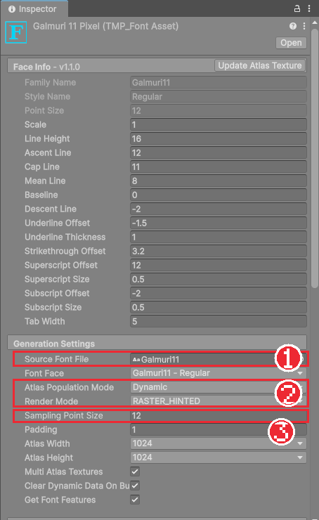
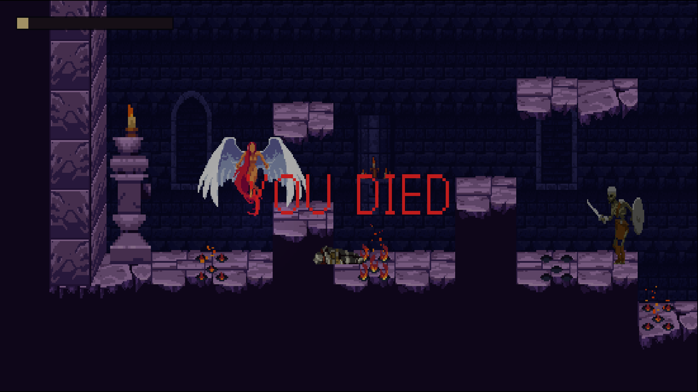

# Chapter 29 한글 폰트와 게임 흐름

## 학습 목표

- TextMeshPro로 글자를 표시하고, 한글이 네모로 깨지는 이유를 설명할 수 있다.
- 한글 픽셀 폰트로 TextMeshPro 폰트 에셋을 만들어 적용할 수 있다.
- 플레이어 사망, 낙사, 보스 처치에 따라 씬을 다시 불러오거나 클리어 문구를 띄우는 게임 흐름을 만들 수 있다.
- `Time.timeScale`의 영향을 받지 않는 시간으로 연출을 기다릴 수 있다.

## 본문

### 29-1 TextMeshPro

Unity에서 글자는 **TextMeshPro**(줄여서 TMP)로 표시합니다. Chapter 28에서 보스 이름을 만들 때 쓴 **+ > UI > Text - TextMeshPro**가 그것입니다. 글자 컴포넌트는 두 종류입니다.

| 컴포넌트 | 만드는 메뉴 | 놓이는 곳 |
|---|---|---|
| TextMeshPro - Text (UI) | + > UI > Text - TextMeshPro | Canvas 안. 체력바 이름, 대화창, 메뉴 |
| TextMeshPro - Text | + > 3D Object > Text - TextMeshPro | 게임 세계 안. NPC 머리 위 안내 문구 (Chapter 30) |

TMP는 글꼴 파일(.ttf)을 그대로 쓰지 않습니다. 글꼴에서 필요한 글자를 그림으로 그려 한 장의 큰 텍스처(**아틀라스**)에 모아 둔 **폰트 에셋**을 씁니다. 처음에 Import TMP Essentials로 들어온 기본 폰트 에셋 `LiberationSans SDF`에는 영어 알파벳과 숫자만 들어 있습니다.

그래서 기본 폰트로 "성채의 수호령"이라고 쓰면 **네모(□)** 로 보입니다. 폰트 에셋에 없는 글자이기 때문입니다. 한글을 쓰려면 한글이 들어 있는 글꼴로 폰트 에셋을 새로 만들어야 합니다.

### 29-2 한글 픽셀 폰트 Galmuri

이 게임은 픽셀 아트라서 글자도 픽셀 모양이어야 어울립니다. **Galmuri**는 한글 픽셀 폰트이며 **SIL Open Font License(OFL)** 로 배포됩니다. OFL 폰트는 게임에 넣어 무료로 배포할 수 있습니다. 다만 폰트 파일만 따로 팔 수는 없고, 함께 받은 라이선스 문서(`LICENSE.txt`)를 지우지 않아야 합니다. Chapter 35의 크레딧에도 적습니다.

강사가 나눠 준 `Galmuri11.ttf`와 `LICENSE.txt`를 `Assets/ThirdParty/Galmuri`에 넣습니다. 이름의 11은 글자 높이가 11픽셀(줄 높이 12픽셀)로 그려진 폰트라는 뜻입니다.

### 29-3 폰트 에셋 만들기

1. Project 창에서 `Galmuri11.ttf`를 오른쪽 클릭한다.
2. **Create > TextMeshPro > Font Asset > Bitmap**을 고른다. 같은 폴더에 `Galmuri11 Bitmap` 같은 이름의 폰트 에셋이 생긴다.
3. 만든 에셋을 `Art/Fonts`로 옮기고 이름을 `Galmuri11 Pixel`로 바꾼다.
4. Inspector의 **Generation Settings**를 아래 표대로 확인하고 고친다.

| 칸 | 값 | 뜻 |
|---|---|---|
| Source Font File | Galmuri11 | 글자를 가져올 글꼴 |
| Atlas Population Mode | **Dynamic** | 처음 쓰이는 글자를 그때그때 아틀라스에 그려 넣는다 |
| Render Mode | **RASTER_HINTED** | 글자를 부드럽게 번지지 않은 픽셀 그대로 그린다 |
| Sampling Point Size | **12** | 폰트가 그려진 원래 크기로 글자를 그린다 |
| Atlas Width / Height | 1024 / 1024 | 아틀라스 한 장의 크기 |
| Multi Atlas Textures | 체크 | 한 장이 가득 차면 새 장을 만든다 |



**Dynamic이 필요한 이유**: 한글은 조합 가능한 글자가 11,172자입니다. 영어처럼 모든 글자를 미리 그려 두면 아틀라스가 아주 커집니다. Dynamic은 대사에 실제로 나온 글자만 실행 중에 그려 넣으므로 작게 유지됩니다.

**SDF와 Bitmap**: 기본 폰트 에셋은 SDF 방식이라 크게 키워도 테두리가 매끈하지만, 픽셀 폰트를 SDF로 그리면 모서리가 둥글게 뭉개집니다. Bitmap(RASTER_HINTED)은 픽셀을 그대로 옮겨 각진 모양을 살립니다.

**글자 크기**: 픽셀 폰트는 원래 크기 12의 정수 배(24, 36, 48)일 때 모든 픽셀이 같은 크기로 보여 가장 또렷합니다. 완성본의 대사와 버튼은 36, 제목은 48입니다. 크게 띄우는 사망 문구(110)처럼 아주 큰 글자는 정수 배가 아니어도 차이가 잘 보이지 않습니다.

만든 폰트 에셋을 글자 컴포넌트의 **Font Asset** 칸에 넣으면 한글이 보입니다. 모든 글자에 매번 넣기 번거로우면 **Edit > Project Settings > TextMesh Pro > Settings**의 Default Font Asset을 바꿔 두면 새로 만드는 글자에 자동으로 들어갑니다.

### 29-4 게임 흐름이란

지금은 기사가 죽으면 쓰러진 채로 아무 일도 일어나지 않고, 보스를 쓰러뜨려도 마찬가지입니다. 게임에는 **흐름**이 필요합니다.

| 사건 | 화면 | 그다음 |
|---|---|---|
| 플레이어 사망 | "YOU DIED" 문구가 서서히 나타난다 | 2.5초 뒤 씬을 다시 불러와 마지막 체크포인트에서 시작 |
| 구덩이로 떨어짐 | 위와 같음 | 위와 같음 |
| 보스 처치 | 2초 뒤 "OATH FULFILLED" 문구가 나타난다 | Chapter 31에서 타이틀 화면으로 돌아가게 한다 |

이 흐름을 맡는 `GameFlow`, 낙사를 처리하는 `KillZone`, 문구를 띄우는 `ScreenMessage`를 만듭니다.

### 29-5 GameFlow

`Scripts/Core/GameFlow.cs`입니다. 타이틀로 돌아가는 부분과 음악을 끄는 부분은 Chapter 31, 32에서 추가합니다.

```csharp
using System;
using System.Collections;
using Bastion.Combat;
using UnityEngine;
using UnityEngine.SceneManagement;

namespace Bastion.Core
{
    /// <summary>
    /// 스테이지 흐름: 체크포인트에서 시작, 플레이어 사망 시 재시작, 보스 처치 시 클리어.
    /// </summary>
    public sealed class GameFlow : MonoBehaviour
    {
        [SerializeField] Health player;
        [SerializeField] Health boss;
        [SerializeField, Min(0f)] float respawnDelay = 2.5f;
        [SerializeField, Min(0f)] float victoryDelay = 2f;

        public static event Action PlayerDied;
        public static event Action StageCleared;

        void Start()
        {
            if (CheckpointSystem.HasCheckpoint && CheckpointSystem.SceneName == gameObject.scene.name)
                player.transform.position = CheckpointSystem.Position;
        }

        void OnEnable()
        {
            player.Died += OnPlayerDied;
            if (boss != null)
                boss.Died += OnBossDied;
        }

        void OnDisable()
        {
            player.Died -= OnPlayerDied;
            if (boss != null)
                boss.Died -= OnBossDied;
        }

        void OnPlayerDied()
        {
            PlayerDied?.Invoke();
            StartCoroutine(ReloadAfterDelay());
        }

        void OnBossDied() => StartCoroutine(ClearAfterDelay());

        IEnumerator ReloadAfterDelay()
        {
            yield return new WaitForSecondsRealtime(respawnDelay);
            SceneManager.LoadScene(gameObject.scene.name);
        }

        IEnumerator ClearAfterDelay()
        {
            yield return new WaitForSecondsRealtime(victoryDelay);
            StageCleared?.Invoke();
        }
    }
}
```

#### 코드 해석

- `Start`: 기억된 체크포인트가 **이 씬의 것**이면 기사를 그 자리로 옮깁니다. Chapter 26의 `CheckpointSystem`이 씬을 다시 불러와도 값을 지키고 있기 때문에 가능합니다. 체크포인트가 없으면 씬에 놓인 처음 자리에서 시작합니다.
- `OnEnable`, `OnDisable`: 기사와 보스의 `Health.Died`를 구독합니다. 보스가 없는 스테이지도 있을 수 있어 `boss != null`을 확인합니다.
- `SceneManager.LoadScene(gameObject.scene.name)`: 지금 씬을 **처음부터 다시 불러옵니다.** 적, 함정, 물약, 체력이 모두 처음 상태로 돌아갑니다. 하나하나 되돌리는 코드를 쓰지 않아도 됩니다. 이 방식에서는 씬 안의 값이 모두 사라지므로, 남겨야 하는 체크포인트만 `static`에 둔 것입니다.
- `WaitForSecondsRealtime`: Chapter 20의 `WaitForSeconds`는 `Time.timeScale`을 따릅니다. 기사가 죽는 순간 히트 스톱으로 `timeScale`이 잠깐 0이 될 수 있고, Chapter 33의 일시정지도 0으로 만듭니다. 연출 대기는 실제 시간을 따르는 `Realtime`으로 기다려야 멈추지 않습니다.
- `static event Action PlayerDied`, `StageCleared`: 화면 문구(`ScreenMessage`)가 이 이벤트를 듣습니다. `GameFlow`는 누가 듣는지 모르고, 문구를 바꾸거나 소리를 더하고 싶으면 듣는 쪽만 고치면 됩니다.

`SceneManager.LoadScene`으로 불러올 씬은 **Build Profiles의 씬 목록**에 들어 있어야 합니다. 지금 열린 씬은 목록에 없어도 에디터에서는 다시 불러올 수 있지만, Chapter 31에서 씬 목록을 정리합니다.

### 29-6 낙사 처리

레벨에 바닥이 없는 구덩이가 있으면 기사가 끝없이 떨어집니다(Chapter 13). 레벨 아래에 넓은 트리거를 깔고, 닿으면 즉시 죽게 합니다.

먼저 `Health`에 즉사 함수를 추가합니다. `TakeDamage`는 무적이나 방어에 막힐 수 있어서, 구르는 중에 떨어지면 죽지 않고 계속 떨어집니다. 낙사는 이런 것을 무시해야 합니다.

```csharp
/// <summary>무적과 방어를 무시하고 즉시 사망시킨다 (낙사 등).</summary>
public void Kill()
{
    if (IsDead)
        return;

    Current = 0;
    Changed?.Invoke(Current, maxHealth);
    Died?.Invoke();
}
```

`Scripts/Hazards/KillZone.cs`를 만듭니다.

```csharp
using Bastion.Combat;
using UnityEngine;

namespace Bastion.Hazards
{
    /// <summary>
    /// 레벨 아래에 까는 넓은 트리거. 떨어진 대상은 무적이어도 즉시 사망한다 (낙사).
    /// </summary>
    [RequireComponent(typeof(Collider2D))]
    public sealed class KillZone : MonoBehaviour
    {
        void Awake() => GetComponent<Collider2D>().isTrigger = true;

        void OnTriggerEnter2D(Collider2D other)
        {
            var health = other.GetComponentInParent<Health>();
            if (health != null && !health.IsDead)
                health.Kill();
        }
    }
}
```

빈 오브젝트 `KillZone`에 Box Collider 2D와 `KillZone`을 붙이고, 레벨에서 가장 낮은 바닥보다 몇 칸 아래에 레벨 전체 너비로 놓습니다. 완성본은 위치 (48.5, -10), 크기 140×4입니다. 플레이어만 확인하지 않고 `Health`가 있으면 누구든 죽이므로, 떨어진 해골도 사라집니다.

기사가 죽으면 Chapter 19의 사망 상태가 되어 중력만 받으며 계속 떨어지고, 2.5초 뒤 `GameFlow`가 씬을 다시 불러옵니다. 카메라는 Chapter 14의 카메라 영역 아래로 내려가지 않으므로 떨어지는 기사가 화면 밖으로 사라집니다.

### 29-7 ScreenMessage

화면 가운데에 큰 문구를 서서히 띄우는 `Scripts/UI/ScreenMessage.cs`입니다.

```csharp
using System.Collections;
using Bastion.Core;
using TMPro;
using UnityEngine;

namespace Bastion.UI
{
    /// <summary>사망/클리어 시 화면 중앙에 큰 문구를 페이드 인한다.</summary>
    [RequireComponent(typeof(CanvasGroup))]
    public sealed class ScreenMessage : MonoBehaviour
    {
        [SerializeField] TMP_Text label;
        [SerializeField] string deathText = "YOU DIED";
        [SerializeField] Color deathColor = new Color(0.75f, 0.1f, 0.1f);
        [SerializeField] string clearText = "OATH FULFILLED";
        [SerializeField] Color clearColor = new Color(0.95f, 0.85f, 0.55f);
        [SerializeField, Min(0.01f)] float fadeTime = 1f;

        CanvasGroup group;

        void Awake()
        {
            group = GetComponent<CanvasGroup>();
            group.alpha = 0f;
        }

        void OnEnable()
        {
            GameFlow.PlayerDied += OnPlayerDied;
            GameFlow.StageCleared += OnStageCleared;
        }

        void OnDisable()
        {
            GameFlow.PlayerDied -= OnPlayerDied;
            GameFlow.StageCleared -= OnStageCleared;
        }

        void OnPlayerDied() => Show(deathText, deathColor);

        void OnStageCleared() => Show(clearText, clearColor);

        public void Show(string text, Color color)
        {
            label.text = text;
            label.color = color;
            StopAllCoroutines();
            StartCoroutine(Fade());
        }

        IEnumerator Fade()
        {
            for (float t = 0f; t < fadeTime; t += Time.unscaledDeltaTime)
            {
                group.alpha = t / fadeTime;
                yield return null;
            }
            group.alpha = 1f;
        }
    }
}
```

#### 코드 해석

- **Canvas Group**: 자식 UI 전체의 투명도(`alpha`)를 한꺼번에 정하는 컴포넌트입니다. 어두운 바탕(`Shade`)과 글자(`Text`)를 따로 흐리게 할 필요 없이 부모의 `alpha` 하나만 0에서 1로 올리면 됩니다.
- `Awake`에서 `alpha = 0`: 평소에는 투명해서 보이지 않습니다. 오브젝트를 끄지 않는 이유는, 꺼 두면 `OnEnable`이 불리지 않아 이벤트를 듣지 못하기 때문입니다.
- `TMP_Text`: UI 글자와 세계 안 글자의 공통 부모 타입입니다. 어느 쪽을 넣어도 됩니다.
- `Fade`: 코루틴으로 `fadeTime`(1초) 동안 매 프레임 `alpha`를 조금씩 올립니다. `Time.unscaledDeltaTime`을 써서 히트 스톱 중에도 진행됩니다.
- `deathText`, `clearText`: 문구를 코드에 고정하지 않고 Inspector 칸으로 열어 두었습니다. 기본값은 처음 붙였을 때 채워지는 값일 뿐이고, 씬에서 바꾼 값이 우선합니다.

`HUD` 아래에 만드는 구성입니다.

| 오브젝트 | Rect Transform | 컴포넌트 |
|---|---|---|
| `ScreenMessage` | stretch (화면 전체) | Canvas Group, ScreenMessage |
| └ `Shade` | stretch | Image, 검정에 투명도 60% (`#00000099`) |
| └ `Text` | stretch | TextMeshPro - Text (UI), Font Asset `Galmuri11 Pixel`, 크기 110, 가운데 정렬 |

Canvas Group의 **Interactable**과 **Blocks Raycasts**는 끕니다. 켜 두면 투명한 상태에서도 화면 전체를 덮는 판이 되어, 이 아래에 그려지는 버튼(Chapter 31, 33)의 클릭을 가로챌 수 있습니다.



### 29-8 따라하기 — 한글 폰트와 게임 흐름

1. `Galmuri11.ttf`와 `LICENSE.txt`를 `Assets/ThirdParty/Galmuri`에 넣고 29-3대로 `Galmuri11 Pixel` 폰트 에셋을 만든다.
2. 보스 이름 글자의 Font Asset을 `Galmuri11 Pixel`로 바꾸고 이름을 한글로 바꿔 네모가 아닌 글자로 보이는지 확인한 뒤 되돌린다.
3. `GameFlow.cs`를 만들어 `Systems` 오브젝트에 붙이고 Player에 기사의 `Health`, Boss에 보스의 `Health`를 넣는다.
4. `ScreenMessage`를 29-7대로 만든다.
5. 함정에 일부러 죽어 YOU DIED가 나타나고 2.5초 뒤 처음 자리에서 다시 시작하는지 확인한다.
6. 체크포인트를 켠 뒤 죽어서 체크포인트에서 다시 시작하는지, 촛불이 켜진 채인지 확인한다.
7. `Health`에 `Kill`을, `KillZone.cs`를 만들어 레벨 아래에 깔고, 구덩이로 떨어져 다시 시작하는지 확인한다.
8. 보스를 쓰러뜨려 2초 뒤 OATH FULFILLED가 나타나는지 확인한다.

### 연습문제

1. 문제: 기본 폰트 에셋으로 한글을 쓰면 네모로 보이는 이유를 쓰세요.
2. 문제: 한글 폰트 에셋을 Dynamic으로 만드는 이유를 쓰세요.
3. 문제: 사망 후 대기를 `WaitForSeconds`로 바꾸면 어떤 상황에서 씬이 다시 불러와지지 않을 수 있는지 쓰세요.
4. 문제: 죽었을 때 적과 함정을 하나하나 되돌리지 않고 씬을 다시 불러오는 방식의 장점과, 이 방식에서 주의할 점을 쓰세요.
5. 문제: 낙사 처리에 `TakeDamage` 대신 `Kill`을 만든 이유를 쓰세요.

### 정답 포인트

- 폰트 에셋은 글자를 그림으로 모아 둔 아틀라스를 쓰는데, 기본 폰트 에셋에는 영문과 숫자만 들어 있어 한글 글자 그림이 없다.
- 한글은 조합 가능한 글자가 11,172자라 모두 미리 그리면 아틀라스가 너무 커진다. Dynamic은 실제로 쓰인 글자만 그려 넣는다.
- `WaitForSeconds`는 `Time.timeScale`을 따르므로 사망 순간이나 그 뒤에 `timeScale`이 0으로 남으면(히트 스톱, 일시정지) 대기가 끝나지 않는다.
- 모든 오브젝트가 씬 파일에 저장된 처음 상태로 돌아가므로 되돌리는 코드가 필요 없고 빠뜨릴 일도 없다. 대신 씬 안의 값이 모두 사라지므로 체크포인트처럼 남겨야 하는 값은 `static` 같은 씬 밖에 둬야 한다.
- `TakeDamage`는 무적 시간이나 방어에 막혀 피해가 들어가지 않을 수 있다. 구르는 중에 떨어지면 죽지 않고 끝없이 떨어진다. `Kill`은 이를 무시하고 바로 사망시킨다.

---

[다음 문서: Chapter 30 NPC 대화](./30-npc-dialogue.md)

[상위 문서로 돌아가기](./README.md)
