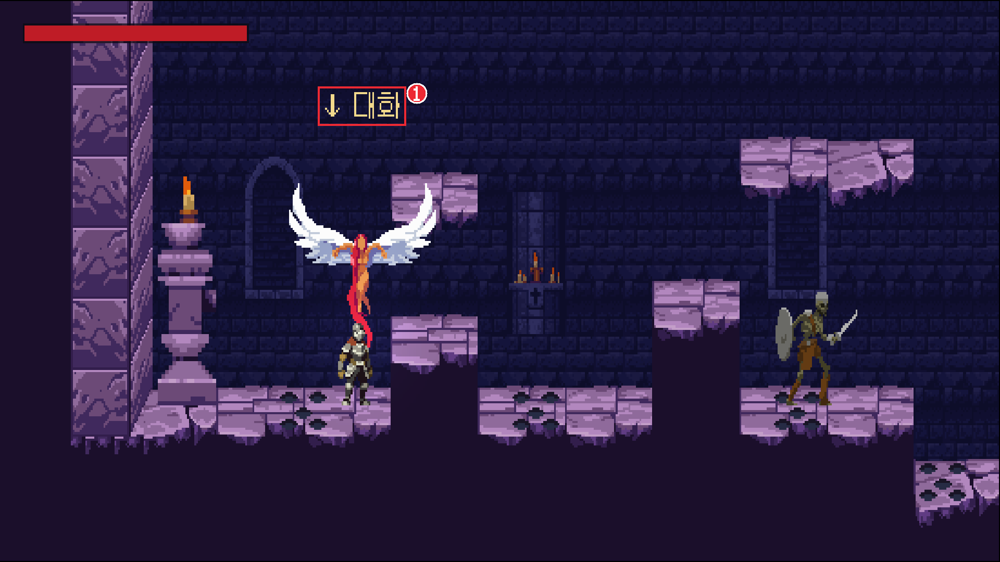
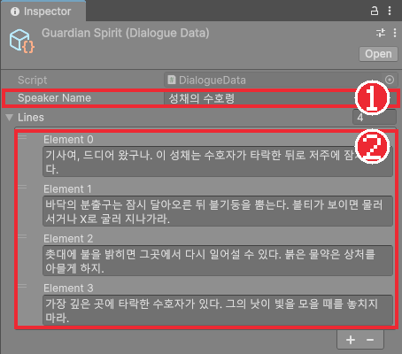
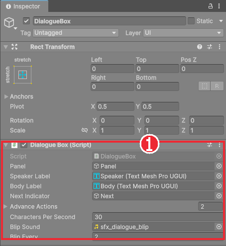
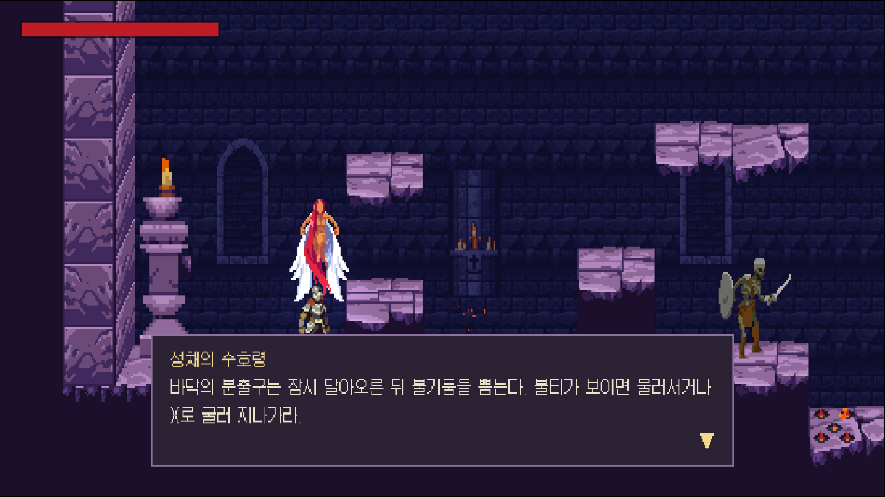
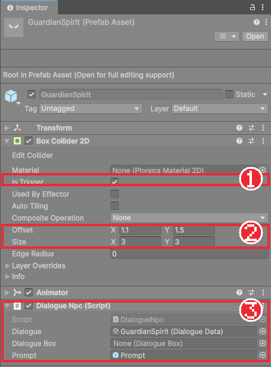

# Chapter 30 NPC 대화

## 학습 목표

- 대사를 코드가 아닌 ScriptableObject 에셋에 저장하고 Inspector에서 고칠 수 있다.
- 글자를 한 자씩 보여 주는 대화 상자를 TextMeshPro의 `maxVisibleCharacters`로 만들 수 있다.
- 대화 중에 `Time.timeScale`로 게임을 멈추고 플레이어 입력을 끌 수 있다.
- 트리거 범위와 상호작용 키로 말을 거는 NPC를 만들 수 있다.

## 본문

### 30-1 말을 거는 캐릭터

게임 처음에는 플레이어가 조작법도, 이 성채에 무엇이 있는지도 모릅니다. 화면에 설명 글을 띄울 수도 있지만, 게임 세계 안의 인물이 알려 주면 더 자연스럽습니다. 플레이어가 조종하지 않는 인물을 **NPC**(Non-Player Character)라고 합니다.

이 게임의 NPC는 레벨 처음에 떠 있는 **성채의 수호령**입니다. 동작은 다음과 같습니다.

1. 기사가 가까이 가면 머리 위에 "↓ 대화" 안내가 뜬다.
2. ↓ 키(패드는 Y 버튼)를 누르면 화면 아래에 대화 상자가 열리고 게임이 멈춘다.
3. 대사가 한 글자씩 나타난다. 상호작용 키나 공격 키를 누르면 남은 글자를 한 번에 보여 주고, 다 보였을 때 누르면 다음 문장으로 넘어간다.
4. 마지막 문장에서 누르면 대화 상자가 닫히고 게임이 다시 움직인다.



### 30-2 대사를 에셋에 담기

대사를 코드에 문자열로 적어 두면 문장 하나를 고칠 때마다 프로그래머가 코드를 열어야 합니다. 게임 회사에서 대사는 기획자나 작가가 씁니다. 그래서 대사는 Chapter 10에서 배운 **ScriptableObject 에셋**에 담아, 코드를 몰라도 Inspector에서 고칠 수 있게 합니다.

`Scripts/Dialogue/DialogueData.cs`입니다.

```csharp
using UnityEngine;

namespace Bastion.Dialogue
{
    /// <summary>대화 한 묶음. 말하는 사람 이름과 차례로 보여 줄 문장들을 에셋으로 저장한다.</summary>
    [CreateAssetMenu(fileName = "DialogueData", menuName = "Bastion/Dialogue Data")]
    public sealed class DialogueData : ScriptableObject
    {
        public string SpeakerName;
        [TextArea(2, 4)] public string[] Lines;
    }
}
```

#### 코드 해석

- `[CreateAssetMenu]`: Project 창의 **Create > Bastion > Dialogue Data** 메뉴로 에셋을 만들 수 있게 합니다. Chapter 10의 `PlayerData`와 같습니다.
- `[TextArea(2, 4)]`: 한 줄 입력칸 대신 여러 줄 입력칸으로 보여 줍니다. 최소 2줄, 내용이 길면 4줄까지 늘어나고 그 뒤로는 스크롤됩니다. 긴 대사를 읽고 고치기 편합니다.
- `string[] Lines`: 배열은 Inspector에서 목록으로 보이고, 오른쪽 아래 **+**, **-** 로 문장을 늘리고 줄입니다.

`Data/Dialogue` 폴더에서 **Create > Bastion > Dialogue Data**로 `GuardianSpirit` 에셋을 만들고 대사를 적습니다.



완성본의 네 문장은 처음 보는 사람에게 필요한 것만 알려 줍니다. 저주받은 성채라는 배경, 불기둥 함정과 구르기, 체크포인트와 물약, 보스의 공격 예고입니다. 설명을 길게 늘어놓기보다 곧 만날 위험을 짧게 알려 주는 것이 좋습니다.

### 30-3 대화 상자 화면

`HUD` 아래에 대화 상자 UI를 만듭니다.

| 오브젝트 | Rect Transform | 컴포넌트 |
|---|---|---|
| `DialogueBox` | stretch (화면 전체) | DialogueBox |
| └ `Panel` | 앵커 아래 가운데, (0, 60), 1400×260 | Image, 테두리 색 |
| 　└ `Inner` | stretch, 4픽셀 안쪽 | Image, 어두운 바탕 |
| 　└ `Speaker` | 앵커 왼쪽 위, (48, -28), 800×48 | TextMeshPro (UI), 금색, 크기 36 |
| 　└ `Body` | stretch, 안쪽 여백 | TextMeshPro (UI), 흰색, 크기 36, 자동 줄바꿈 |
| 　└ `Next` | 앵커 오른쪽 아래, (-40, 24), 48×48 | TextMeshPro (UI), "▼" |

글자는 모두 Chapter 29의 `Galmuri11 Pixel`을 씁니다. `DialogueBox` 오브젝트는 켜 두고, 실제로 보였다 사라지는 것은 자식 `Panel`입니다. `DialogueBox`를 끄면 스크립트도 멈춰 입력을 받을 수 없기 때문입니다.





### 30-4 DialogueBox 컴포넌트

`Scripts/Dialogue/DialogueBox.cs`입니다. 글자가 나올 때 나는 소리는 Chapter 32에서 추가합니다.

```csharp
using System;
using TMPro;
using UnityEngine;
using UnityEngine.InputSystem;

namespace Bastion.Dialogue
{
    /// <summary>
    /// 화면 아래 대화 상자. 열려 있는 동안 게임 시간을 멈추고, 글자를 한 자씩 보여 준다.
    /// 넘기기 키를 누르면 글자를 모두 보여 주거나 다음 문장으로 넘어가고, 마지막 문장이면 닫는다.
    /// </summary>
    public sealed class DialogueBox : MonoBehaviour
    {
        [SerializeField] GameObject panel;
        [SerializeField] TMP_Text speakerLabel;
        [SerializeField] TMP_Text bodyLabel;
        [Tooltip("문장을 다 보여 줬을 때 나타나는 '다음' 표시")]
        [SerializeField] GameObject nextIndicator;
        [Tooltip("대화를 넘기는 입력 (예: 상호작용, 공격)")]
        [SerializeField] InputActionReference[] advanceActions;
        [SerializeField, Min(1f)] float charactersPerSecond = 30f;

        public static bool IsOpen { get; private set; }

        // 도메인 리로드를 끈 에디터에서도 플레이마다 초기화한다.
        [RuntimeInitializeOnLoadMethod(RuntimeInitializeLoadType.SubsystemRegistration)]
        static void ResetStatic() => IsOpen = false;

        DialogueData current;
        Action onClosed;
        int lineIndex;
        float visibleCount;
        int openedFrame;
        float savedTimeScale = 1f;

        bool IsTyping => bodyLabel.maxVisibleCharacters < bodyLabel.textInfo.characterCount;

        void Awake() => panel.SetActive(false);

        void OnEnable()
        {
            foreach (var action in advanceActions)
                action.action.Enable();
        }

        void OnDisable()
        {
            if (IsOpen && current != null)
                Close();
        }

        public void Open(DialogueData data, Action closed = null)
        {
            if (data == null || data.Lines == null || data.Lines.Length == 0)
            {
                closed?.Invoke();
                return;
            }

            current = data;
            onClosed = closed;
            IsOpen = true;
            openedFrame = Time.frameCount;
            savedTimeScale = Time.timeScale;
            Time.timeScale = 0f;

            panel.SetActive(true);
            speakerLabel.text = data.SpeakerName;
            ShowLine(0);
        }

        void ShowLine(int index)
        {
            lineIndex = index;
            visibleCount = 0f;
            bodyLabel.text = current.Lines[index];
            bodyLabel.maxVisibleCharacters = 0;
            bodyLabel.ForceMeshUpdate();
            nextIndicator.SetActive(false);
        }

        void Update()
        {
            if (!IsOpen || current == null)
                return;

            // 대화를 연 키 입력이 같은 프레임에 '넘기기'로 처리되지 않게 한다.
            if (Time.frameCount != openedFrame && AdvancePressed())
            {
                if (IsTyping)
                    bodyLabel.maxVisibleCharacters = bodyLabel.textInfo.characterCount;
                else if (lineIndex + 1 < current.Lines.Length)
                    ShowLine(lineIndex + 1);
                else
                {
                    Close();
                    return;
                }
            }

            if (IsTyping)
            {
                visibleCount += charactersPerSecond * Time.unscaledDeltaTime;
                bodyLabel.maxVisibleCharacters = Mathf.Min(Mathf.FloorToInt(visibleCount), bodyLabel.textInfo.characterCount);
            }

            nextIndicator.SetActive(!IsTyping);
        }

        bool AdvancePressed()
        {
            foreach (var action in advanceActions)
                if (action.action.WasPressedThisFrame())
                    return true;
            return false;
        }

        void Close()
        {
            panel.SetActive(false);
            IsOpen = false;
            current = null;
            Time.timeScale = savedTimeScale;
            var callback = onClosed;
            onClosed = null;
            callback?.Invoke();
        }
    }
}
```

#### 코드 해석

**게임 멈추기 (Open, Close)**

- `Time.timeScale = 0f`: 게임 시간의 흐르는 속도입니다. 1이면 보통, 0.5면 느리게, **0이면 멈춥니다.** `Time.deltaTime`이 0이 되고 물리 계산(`FixedUpdate`)도 멈추므로 적, 함정, 기사가 모두 그 자리에 섭니다. Chapter 20의 히트 스톱도 같은 원리였습니다.
- `savedTimeScale`: 열기 전의 값을 기억했다가 닫을 때 되돌립니다. 무조건 1로 되돌리면, 다른 이유로 느려져 있던 게임이 대화 뒤에 갑자기 빨라집니다.
- `Update`는 `timeScale`이 0이어도 매 프레임 불립니다. 그래서 대화 상자는 `Time.unscaledDeltaTime`(멈춤과 상관없는 실제 시간)으로 글자를 진행합니다.
- `public static bool IsOpen`: 대화가 열려 있는지 다른 스크립트가 물어볼 수 있습니다. NPC는 대화 중에 다시 열지 않고, Chapter 33의 일시정지는 대화 중에 Esc를 무시합니다. Chapter 26의 `CheckpointSystem`처럼 플레이를 시작할 때 `false`로 비웁니다.

**한 글자씩 (ShowLine, Update)**

- TextMeshPro의 `maxVisibleCharacters`는 "앞에서부터 몇 글자까지 보여 줄지"입니다. 문장 전체를 `text`에 넣어 두고 이 값만 0부터 늘리면 한 글자씩 나타납니다. 줄바꿈 위치가 처음부터 정해져 있어서, 글자가 나오는 도중에 단어가 다음 줄로 튀는 일이 없습니다.
- `ForceMeshUpdate()`: `text`를 바꾼 직후에는 글자 수(`textInfo.characterCount`)가 아직 계산되지 않았습니다. 바로 계산하게 합니다.
- `visibleCount`를 `float`로 둔 이유: 1초에 30글자면 한 프레임(60분의 1초)에 0.5글자씩 늘어납니다. 정수로 더하면 0.5가 버려져 영원히 0입니다. 소수로 모아 두고 보여 줄 때만 `FloorToInt`로 자릅니다.
- `IsTyping`: 보이는 글자 수가 전체보다 적으면 아직 나오는 중입니다. 다 나오면 `Next`(▼)를 켭니다.

**넘기기 (AdvancePressed)**

- `InputActionReference[] advanceActions`: Chapter 06의 입력 액션을 여러 개 받습니다. 완성본은 Interact와 Attack을 넣었습니다. 공격 키로도 넘길 수 있으면 손을 옮기지 않아도 됩니다.
- `WasPressedThisFrame()`: 이번 프레임에 눌렸는지 물어봅니다. 플레이어 입력은 이벤트로 받았지만, 대화 상자는 열려 있을 때만 확인하면 되므로 물어보는 방식이 간단합니다.
- `Time.frameCount != openedFrame`: NPC가 ↓ 키를 보고 대화를 연 바로 그 프레임에, 대화 상자가 같은 ↓ 키를 "넘기기"로 읽으면 첫 문장의 글자가 한꺼번에 나와 버립니다. 연 프레임은 건너뜁니다.
- `Close`에서 `onClosed`를 지역 변수로 옮긴 뒤 비우고 부르는 이유: 콜백 안에서 곧바로 다른 대화를 열면 `onClosed`가 새 콜백으로 바뀝니다. 먼저 비워 두지 않으면 새 콜백을 지워 버릴 수 있습니다.

### 30-5 상호작용 입력

Chapter 06에서 만들어 둔 **Interact** 액션(키보드 ↓, 패드 Y)을 `PlayerInputReader`가 읽게 합니다. 점프, 공격과 같은 **입력 보관** 방식입니다(Chapter 09). 추가하는 부분만 보입니다.

```csharp
[SerializeField] InputActionReference interactAction;
[Tooltip("상호작용 입력을 보관하는 시간 (실시간)")]
[SerializeField, Min(0f)] float interactBufferTime = 0.2f;

public float LastInteractPressedTime { get; private set; } = NotPressed;

// OnEnable에 추가
if (interactAction != null)
{
    interactAction.action.Enable();
    interactAction.action.performed += OnInteractPerformed;
}

// OnDisable에 추가
if (interactAction != null)
    interactAction.action.performed -= OnInteractPerformed;

void OnInteractPerformed(InputAction.CallbackContext _) => LastInteractPressedTime = Time.unscaledTime;

/// <summary>상호작용 키가 보관 시간 안에 눌렸으면 true를 돌려주고 입력을 소비한다.</summary>
public bool ConsumeInteract()
{
    if (Time.unscaledTime - LastInteractPressedTime > interactBufferTime)
        return false;
    LastInteractPressedTime = NotPressed;
    return true;
}
```

- 점프와 달리 `Time.unscaledTime`을 씁니다. 히트 스톱으로 시간이 멈춘 순간에 누른 키도 실제 시간으로 기억해 둡니다.
- `ConsumeInteract`는 "보관 시간 안에 눌렸는가"를 확인하고, 맞으면 바로 지워서 같은 입력으로 두 번 말을 걸지 않게 합니다. 확인과 지우기를 한 함수로 묶어 두면 쓰는 쪽이 지우기를 잊을 일이 없습니다.
- `interactAction != null` 확인: 상호작용이 필요 없는 테스트 장면에서는 칸을 비워 둘 수 있게 했습니다.

Player 프리팹의 `PlayerInputReader`에서 Interact Action 칸에 `BastionControls/Gameplay/Interact`를 넣습니다.

### 30-6 DialogueNpc 컴포넌트

`Scripts/Dialogue/DialogueNpc.cs`입니다.

```csharp
using Bastion.Player;
using UnityEngine;

namespace Bastion.Dialogue
{
    /// <summary>
    /// 말을 거는 NPC. 플레이어가 주변(트리거 범위)에 들어오면 안내 표시를 띄우고,
    /// 상호작용 키를 누르면 대화 상자를 연다. 대화 중에는 플레이어 입력을 끈다.
    /// </summary>
    [RequireComponent(typeof(Collider2D))]
    public sealed class DialogueNpc : MonoBehaviour
    {
        [SerializeField] DialogueData dialogue;
        [SerializeField] DialogueBox dialogueBox;
        [Tooltip("말을 걸 수 있을 때 머리 위에 보여 줄 안내 표시")]
        [SerializeField] GameObject prompt;

        PlayerInputReader playerInput;

        void Awake()
        {
            GetComponent<Collider2D>().isTrigger = true;
            if (prompt != null)
                prompt.SetActive(false);
        }

        void OnTriggerEnter2D(Collider2D other)
        {
            if (!other.CompareTag("Player"))
                return;
            playerInput = other.GetComponentInParent<PlayerInputReader>();
            SetPrompt(true);
        }

        void OnTriggerExit2D(Collider2D other)
        {
            if (!other.CompareTag("Player"))
                return;
            playerInput = null;
            SetPrompt(false);
        }

        void Update()
        {
            if (playerInput == null || DialogueBox.IsOpen || !playerInput.enabled)
                return;

            if (playerInput.ConsumeInteract())
            {
                SetPrompt(false);
                playerInput.enabled = false;
                dialogueBox.Open(dialogue, OnDialogueClosed);
            }
        }

        void OnDialogueClosed()
        {
            if (playerInput == null)
                return;
            playerInput.enabled = true;
            SetPrompt(true);
        }

        void SetPrompt(bool visible)
        {
            if (prompt != null)
                prompt.SetActive(visible);
        }
    }
}
```

#### 코드 해석

- `OnTriggerEnter2D`, `OnTriggerExit2D`: 기사가 범위에 들어오면 입력 컴포넌트를 기억하고 안내를 켜며, 나가면 잊고 끕니다. 범위 밖에서는 `playerInput`이 `null`이라 ↓ 키를 눌러도 아무 일도 없습니다.
- `playerInput.enabled = false`: 대화 중에는 기사의 입력 컴포넌트를 꺼 둡니다. 대화를 넘기려고 누른 공격 키가 대화가 끝난 뒤 기사의 공격으로 남지 않게 합니다. `PlayerInputReader`의 `OnDisable`은 이동 값도 0으로 비워서, 걷던 중에 말을 걸어도 대화가 끝난 뒤 저절로 걸어가지 않습니다.
- `dialogueBox.Open(dialogue, OnDialogueClosed)`: 대화가 끝나면 불러 달라고 함수를 넘깁니다. 이렇게 "끝나면 이것을 해 줘"라고 넘기는 함수를 **콜백**(Callback)이라고 합니다. 대화 상자는 누가 열었는지 몰라도 되고, NPC는 대화가 언제 끝나는지 매 프레임 확인하지 않아도 됩니다.
- `!playerInput.enabled` 확인: 대화가 끝난 바로 그 프레임에 ↓ 키가 남아 있으면 같은 대화가 곧바로 다시 열릴 수 있습니다. 입력이 꺼져 있는 동안은 말을 걸지 않습니다.

### 30-7 NPC 프리팹

1. GothicVania Church Pack에 들어 있는 천사 그림(`SPRITES/angel`)을 Chapter 05대로 가져오고, Chapter 15대로 대기 애니메이션 클립과 Animator Controller를 만든다. 완성본은 `Animations/NPC` 폴더에 있다.
2. 빈 오브젝트 `GuardianSpirit`에 Sprite Renderer, Animator, Box Collider 2D, `DialogueNpc`를 붙인다.
3. Box Collider 2D는 말을 걸 수 있는 범위다. Is Trigger를 켜고 크기를 정한다.
4. 자식으로 **+ > 3D Object > Text - TextMeshPro**를 만들어 이름을 `Prompt`로 바꾸고, 글자를 "↓ 대화", Font Asset을 `Galmuri11 Pixel`, 크기를 8로 둔다. 날개에 가리지 않도록 그림 위쪽(Position Y 8.4)에 놓는다.
5. `DialogueNpc`의 Dialogue에 `GuardianSpirit` 대화 에셋, Prompt에 `Prompt`를 넣고 프리팹으로 만든다.
6. 레벨에 놓은 뒤 Dialogue Box 칸에 `HUD`의 `DialogueBox`를 넣는다. 씬 안의 오브젝트는 프리팹에 미리 넣을 수 없으므로 씬에서 연결한다.



**말을 거는 범위는 함정을 피해서** 정합니다. 완성본 수호령은 x = 10에 있고 바로 왼쪽 x = 8에 첫 불기둥이 있습니다. 처음에는 범위를 NPC 그림 전체(Size X 5)로 잡았더니 범위 왼쪽이 불기둥과 겹쳐, 말을 걸려고 다가간 기사가 불에 맞았습니다. 범위를 오른쪽으로 옮겨(Offset X 1.1, Size X 3) 불기둥의 판정과 겹치지 않게 했습니다. 레벨 오브젝트를 놓을 때는 서로의 범위가 겹치는지 Scene 뷰의 기즈모로 확인하세요.

**World Space 글자의 크기**: 3D Object 쪽 TextMeshPro는 게임 세계 안에 놓이므로 크기 단위가 픽셀이 아니라 세계 단위에 가깝습니다. UI 글자처럼 36으로 두면 화면을 가릴 만큼 커집니다. 화면을 보며 작은 값부터 맞춥니다.

### 30-8 따라하기 — NPC 대화

1. `DialogueData.cs`를 만들고 `GuardianSpirit` 대화 에셋에 네 문장을 적는다.
2. 30-3대로 `HUD` 아래에 대화 상자를 만들고 `DialogueBox`를 붙인다. Advance Actions에 Interact와 Attack을 넣는다.
3. `PlayerInputReader`에 상호작용 입력을 추가하고 Player 프리팹에 연결한다.
4. `DialogueNpc.cs`를 만들고 30-7대로 NPC를 레벨 처음에 놓는다.
5. 실행해 NPC 근처에서 안내가 뜨고, ↓ 키로 대화가 열리며, 대화 중에는 적과 함정이 멈추는지 확인한다.
6. 글자가 나오는 도중에 키를 누르면 문장이 한 번에 나오고, 다시 누르면 다음 문장으로 넘어가는지 확인한다.
7. 마지막 문장 뒤에 대화가 닫히고 기사가 다시 움직이는지 확인한다.
8. Characters Per Second를 10과 60으로 바꿔 보고 읽기 편한 값을 고른다.

### 연습문제

1. 문제: 대사를 `DialogueNpc` 코드 안에 문자열 배열로 적지 않고 `DialogueData` 에셋으로 분리하면 좋은 점을 두 가지 쓰세요.
2. 문제: 대화 중 `Time.timeScale`이 0일 때 `Update`, `FixedUpdate`, `Time.deltaTime`, `Time.unscaledDeltaTime`이 각각 어떻게 되는지 쓰세요.
3. 문제: 초당 30글자, 프레임 시간 1/60초일 때 `visibleCount`를 `int`로 두고 `(int)(30 * 1/60f)`씩 더하면 어떻게 되는지 쓰세요.
4. 문제: `openedFrame` 확인을 빼면 어떤 일이 생기는지 쓰세요.

### 정답 포인트

- 코드를 몰라도 Inspector에서 대사를 고칠 수 있고, 대사를 고쳐도 코드를 다시 컴파일하지 않는다. 같은 NPC 스크립트에 다른 대화 에셋을 넣어 여러 NPC를 만들 수 있다.
- `Update`는 계속 불리고 `FixedUpdate`는 불리지 않는다. `Time.deltaTime`은 0, `Time.unscaledDeltaTime`은 실제로 흐른 시간이다.
- 30 × 1/60 = 0.5를 정수로 자르면 0이라 매 프레임 0을 더해 글자가 영원히 나오지 않는다. `float`로 모아야 2프레임마다 1글자씩 늘어난다.
- 대화를 연 ↓ 키를 대화 상자가 같은 프레임에 넘기기로 읽어 첫 문장이 타자 효과 없이 한 번에 나온다.

---

[상위 문서로 돌아가기](./README.md)
