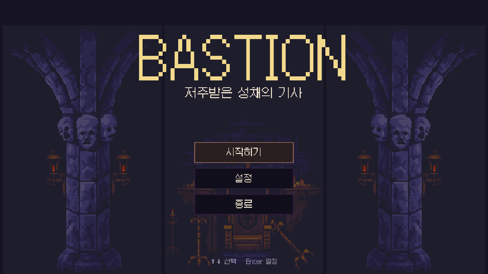
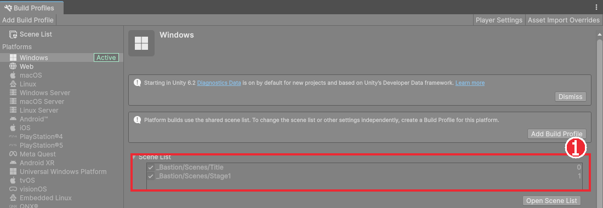
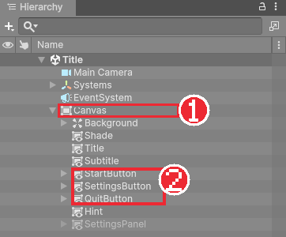
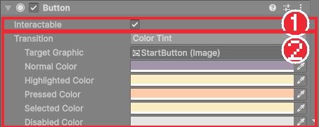
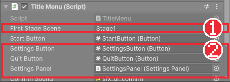

# Chapter 31 타이틀 화면과 씬 전환

## 학습 목표

- 게임을 여러 씬으로 나누고 Build Profiles의 씬 목록으로 순서를 정할 수 있다.
- `SceneManager.LoadScene`으로 씬을 바꿀 수 있다.
- Button 컴포넌트와 `onClick.AddListener`로 버튼에 기능을 연결할 수 있다.
- EventSystem과 Navigation으로 키보드와 패드만으로 메뉴를 고를 수 있게 할 수 있다.

## 본문

### 31-1 게임의 첫 화면

지금은 플레이 버튼을 누르면 곧바로 성채 안에서 시작합니다. 완성된 게임은 보통 **타이틀 화면**에서 시작합니다. 게임 이름을 보여 주고, 시작, 설정, 종료를 고르게 합니다. 스테이지를 클리어하거나 일시정지 메뉴에서 나가면 다시 타이틀로 돌아옵니다.



타이틀 화면은 스테이지와 전혀 다른 화면이므로 **씬을 따로** 만듭니다. Chapter 02에서 씬은 "게임의 한 장면"이라고 배웠습니다. 이 게임은 이제 씬이 두 개입니다.

| 씬 | 내용 | 다음으로 가는 때 |
|---|---|---|
| `Title` | 제목, 메뉴 버튼, 설정 창 | 시작하기 → `Stage1` |
| `Stage1` | 지금까지 만든 레벨 | 보스 처치 → `Title`, 일시정지의 "타이틀로" → `Title` |

### 31-2 씬 목록

**File > Build Profiles**를 엽니다. 왼쪽의 **Scene List**에 빌드에 들어갈 씬과 번호가 있습니다.

1. Project 창에서 **Create > Scene > Scene**으로 `Scenes/Title` 씬을 만든다.
2. Build Profiles의 Scene List로 `Title`과 `Stage1`을 끌어 놓는다.
3. `Title`이 0번, `Stage1`이 1번이 되도록 순서를 끌어 바꾼다.



이 목록에는 두 가지 뜻이 있습니다.

- **0번 씬이 게임을 켰을 때 처음 열리는 씬**입니다. 그래서 타이틀이 0번이어야 합니다.
- `SceneManager.LoadScene`은 **이 목록에 있는 씬만** 불러올 수 있습니다. 목록에 없는 씬 이름을 넣으면 에디터에서는 오류가 나고, 빌드한 게임에서는 그 씬이 아예 들어 있지 않습니다.

에디터의 플레이 버튼은 목록과 상관없이 **지금 열린 씬**에서 시작합니다. 타이틀부터 확인하려면 `Title` 씬을 열고 플레이합니다.

### 31-3 타이틀 씬 구성

`Title` 씬에는 기사도, 레벨도 없습니다. Canvas 하나에 그림과 버튼만 있습니다.

| 오브젝트 | 내용 |
|---|---|
| `Main Camera` | 화면을 지우는 카메라. Background를 어두운 색으로 둔다 |
| `Systems` | Chapter 32에서 소리 관리자를 넣는다 |
| `EventSystem` | 버튼 입력을 전달한다 (31-5) |
| `Canvas` | Chapter 28과 같은 Canvas Scaler(1920×1080) |
| └ `Background` | 성채 배경 그림 세 장(Image)을 나란히 깐다 |
| └ `Shade` | 반투명 검정. 배경을 어둡게 눌러 글자가 잘 보이게 한다 |
| └ `Title`, `Subtitle` | "BASTION", "저주받은 성채의 기사" |
| └ `StartButton`, `SettingsButton`, `QuitButton` | 메뉴 버튼 세 개 |
| └ `Hint` | "↑↓ 선택    Enter 결정" |
| └ `SettingsPanel` | 설정 창 (Chapter 33). 처음에는 꺼 둔다 |



Hierarchy에서 아래에 있는 오브젝트가 위에 그려진다는 점(Chapter 28)을 떠올리면, 배경 → 어둡게 → 글자와 버튼 → 설정 창 순서로 놓은 이유를 알 수 있습니다.

### 31-4 버튼

**+ > UI > Button - TextMeshPro**로 버튼을 만들면 Image와 **Button** 컴포넌트가 붙은 오브젝트와, 자식 글자가 생깁니다. 완성본은 버튼 안쪽에 어두운 `Inner` 이미지를 하나 더 겹쳐, 바깥 이미지가 테두리처럼 보이게 했습니다.

Button 컴포넌트의 중요한 칸입니다.

| 칸 | 뜻 |
|---|---|
| Interactable | 끄면 누를 수 없는 회색 버튼이 된다 |
| Transition | 상태에 따라 모양을 바꾸는 방법. `Color Tint`는 Target Graphic의 색을 바꾼다 |
| Normal / Highlighted / Pressed / Selected / Disabled Color | 평소, 마우스를 올렸을 때, 누르는 순간, 선택되었을 때, 꺼졌을 때의 색 |
| Navigation | 키보드와 패드로 다음 버튼을 고르는 방법 (31-5) |
| On Click () | 눌렀을 때 실행할 함수 목록 |



**Selected Color**가 특히 중요합니다. 키보드나 패드로 고를 때는 마우스가 없으므로, 지금 어느 버튼이 골라졌는지 색으로만 알 수 있습니다. 완성본은 선택된 버튼을 밝은 금색으로 둡니다.

On Click () 목록의 **+** 를 눌러 Inspector에서 함수를 연결할 수도 있습니다. 완성본은 코드에서 연결합니다. Inspector 연결은 버튼만 보고는 무엇이 실행되는지 코드에서 찾기 어렵고, 함수 이름을 바꾸면 연결이 조용히 끊어지기 때문입니다.

### 31-5 EventSystem과 Navigation

버튼을 처음 만들 때 함께 생긴 **EventSystem**은 입력을 UI에 전달합니다. 붙어 있는 **Input System UI Input Module**은 Chapter 06의 Input System으로 마우스 클릭, 방향키, Enter, 패드 스틱과 A 버튼을 읽어 버튼에 전합니다. 씬마다 EventSystem이 하나 있어야 버튼이 반응합니다.

키보드나 패드로 버튼을 고를 수 있게 하는 것이 Button의 **Navigation**입니다.

- `Automatic`: Unity가 화면 위치를 보고 위아래 버튼을 알아서 정한다.
- `Explicit`: 위, 아래, 왼쪽, 오른쪽으로 갈 버튼을 직접 정한다.

완성본은 `Explicit`로 두고 시작하기의 Select On Down에 설정, 설정의 Select On Up에 시작하기와 Select On Down에 종료를 넣었습니다. 버튼이 세 개뿐이라도 직접 정해 두면 설정 창처럼 다른 UI가 겹쳤을 때 엉뚱한 곳으로 가지 않습니다. Button의 Navigation 칸 아래 **Visualize** 버튼을 누르면 Scene 뷰에 버튼 사이의 이동이 노란 화살표로 보입니다.

마지막으로, **처음 선택된 버튼**이 없으면 방향키를 눌러도 아무것도 골라지지 않습니다. 화면이 열릴 때 코드에서 시작하기 버튼을 골라 둡니다.

### 31-6 TitleMenu 컴포넌트

`Scripts/UI/TitleMenu.cs`입니다. 설정 창과 효과음은 Chapter 32, 33에서 만들므로, 지금은 해당 줄을 주석으로 막아 두었다가 그 장에서 풉니다.

```csharp
using Bastion.Audio;
using Bastion.Core;
using UnityEngine;
using UnityEngine.EventSystems;
using UnityEngine.SceneManagement;
using UnityEngine.UI;

namespace Bastion.UI
{
    /// <summary>타이틀 화면: 게임 시작, 설정, 종료.</summary>
    public sealed class TitleMenu : MonoBehaviour
    {
        [Tooltip("시작 버튼을 누르면 불러올 씬 이름 (Build Profiles의 씬 목록에 있어야 한다)")]
        [SerializeField] string firstStageScene;
        [SerializeField] Button startButton;
        [SerializeField] Button settingsButton;
        [SerializeField] Button quitButton;
        [SerializeField] SettingsPanel settingsPanel;
        [SerializeField] AudioClip confirmSound;

        void Awake()
        {
            startButton.onClick.AddListener(StartGame);
            settingsButton.onClick.AddListener(OpenSettings);
            quitButton.onClick.AddListener(Quit);
            settingsPanel.Closed += OnSettingsClosed;
            settingsPanel.gameObject.SetActive(false);
        }

        void Start()
        {
            Time.timeScale = 1f;
            Select(startButton);
        }

        void StartGame()
        {
            SoundManager.PlaySfx(confirmSound);
            // 새 게임은 처음부터 시작한다.
            CheckpointSystem.Clear();
            SceneManager.LoadScene(firstStageScene);
        }

        void OpenSettings()
        {
            SoundManager.PlaySfx(confirmSound);
            settingsPanel.Open();
        }

        void OnSettingsClosed() => Select(settingsButton);

        void Quit()
        {
#if UNITY_EDITOR
            UnityEditor.EditorApplication.isPlaying = false;
#else
            Application.Quit();
#endif
        }

        static void Select(Selectable selectable)
        {
            if (EventSystem.current != null)
                EventSystem.current.SetSelectedGameObject(selectable.gameObject);
        }
    }
}
```

#### 코드 해석

- `startButton.onClick.AddListener(StartGame)`: 버튼의 `onClick` 이벤트에 함수를 등록합니다. C#의 `event`와 같은 생각이며, Unity의 `UnityEvent`라서 `+=` 대신 `AddListener`를 씁니다.
- `string firstStageScene`: 불러올 씬 이름을 코드에 적지 않고 Inspector 칸으로 받습니다. 완성본은 `Stage1`을 적었습니다. 스테이지 이름이 바뀌거나 앞에 튜토리얼 씬을 넣어도 코드를 고치지 않아도 됩니다.
- `CheckpointSystem.Clear()`: 이전 판의 체크포인트가 남아 있으면 새 게임이 중간부터 시작합니다. 새 게임은 기억을 비우고 시작합니다.
- `SceneManager.LoadScene(이름)`: 지금 씬을 모두 내리고 그 씬을 불러옵니다. 지금 씬의 오브젝트는 모두 사라집니다.
- `Time.timeScale = 1f`: 일시정지 메뉴에서 "타이틀로"를 고르면 `timeScale`이 0인 채로 이 씬에 올 수 있습니다. `timeScale`은 씬을 바꿔도 그대로 남는 값이라, 타이틀이 시작할 때 1로 되돌립니다.
- `EventSystem.current.SetSelectedGameObject`: 처음 선택될 버튼을 정합니다. 설정 창을 닫고 돌아왔을 때도 설정 버튼을 다시 골라, 키보드 사용자가 길을 잃지 않게 합니다.
- `#if UNITY_EDITOR ... #else ... #endif`: **조건부 컴파일**입니다. 에디터에서 실행할 때와 빌드한 게임에서 다른 코드가 들어갑니다. `Application.Quit()`은 빌드한 게임을 끄지만 에디터에서는 아무 일도 하지 않으므로, 에디터에서는 플레이 모드를 끝냅니다.

Chapter 32, 33을 하기 전이라면 `SoundManager` 두 줄, `settingsPanel`이 들어간 줄들, `confirmSound`, `using Bastion.Audio;`를 주석으로 막고 설정 버튼은 잠시 비워 둡니다.

`Canvas`에 `TitleMenu`를 붙이고 칸을 채웁니다.



### 31-7 클리어 후 타이틀로

Chapter 29의 `GameFlow`는 보스를 쓰러뜨리면 OATH FULFILLED 문구만 띄웠습니다. 몇 초 뒤 타이틀로 돌아가게 합니다. 칸 두 개를 추가하고 `ClearAfterDelay`를 늘립니다.

```csharp
[Tooltip("클리어 문구가 뜬 뒤 이동할 씬 (비워 두면 이동하지 않음)")]
[SerializeField] string sceneAfterClear;
[SerializeField, Min(0f)] float sceneAfterClearDelay = 4f;
```

```csharp
IEnumerator ClearAfterDelay()
{
    yield return new WaitForSecondsRealtime(victoryDelay);
    StageCleared?.Invoke();

    if (string.IsNullOrEmpty(sceneAfterClear))
        yield break;
    yield return new WaitForSecondsRealtime(sceneAfterClearDelay);
    CheckpointSystem.Clear();
    SceneManager.LoadScene(sceneAfterClear);
}
```

- `yield break`: 코루틴을 여기서 끝냅니다. 칸을 비워 두면 문구만 띄우고 멈춥니다. 스테이지가 늘어나면 `Stage2`를 적어 다음 스테이지로 넘어가게 할 수도 있습니다.
- 다음 씬으로 가기 전에 체크포인트를 비웁니다. 그대로 두면 타이틀에서 다시 시작했을 때 보스방 앞에서 시작할 수 있습니다. `TitleMenu`도 비우지만, 다음 씬이 타이틀이 아닐 수도 있으므로 여기서도 비웁니다.

`Stage1`의 `Systems`에 있는 `GameFlow`에서 Scene After Clear에 `Title`을 적습니다.

### 31-8 따라하기 — 타이틀 화면

1. `Title` 씬을 만들고 Build Profiles의 Scene List에 `Title`(0번), `Stage1`(1번)을 넣는다.
2. 31-3대로 Canvas, 배경, 제목, 버튼 세 개, 안내 글자를 만든다. 글자는 `Galmuri11 Pixel`을 쓴다.
3. 세 버튼의 Navigation을 Explicit로 바꾸고 위아래 버튼을 연결한다. Visualize로 화살표를 확인한다.
4. `TitleMenu.cs`를 만들어 `Canvas`에 붙이고 First Stage Scene에 `Stage1`, 버튼 칸에 각 버튼을 넣는다.
5. `Title` 씬을 열고 플레이해 방향키로 버튼을 고르고 Enter로 시작하기를 눌러 `Stage1`로 넘어가는지 확인한다. 마우스 클릭으로도 확인한다.
6. 종료를 눌러 플레이 모드가 끝나는지 확인한다.
7. `GameFlow`에 31-7의 코드를 추가하고 Scene After Clear에 `Title`을 적는다. 보스를 쓰러뜨려 문구 4초 뒤 타이틀로 돌아오는지 확인한다.
8. First Stage Scene에 일부러 `Stage2`처럼 없는 이름을 적어 Console에 나오는 오류를 읽어 보고 되돌린다.

### 연습문제

1. 문제: Build Profiles의 씬 목록에서 `Stage1`이 0번, `Title`이 1번이면 빌드한 게임을 켰을 때 무엇이 보이는지 쓰세요.
2. 문제: 일시정지 중(`timeScale` 0)에 타이틀로 돌아왔을 때 `TitleMenu.Start`에서 `timeScale`을 1로 되돌리지 않으면 어떤 문제가 생길 수 있는지 쓰세요.
3. 문제: 타이틀 화면이 열렸을 때 아무 버튼도 선택하지 않으면 패드만 가진 사람에게 어떤 문제가 생기는지 쓰세요.
4. 문제: 불러올 씬 이름을 `SceneManager.LoadScene("Stage1")`처럼 코드에 적는 대신 Inspector 칸으로 받으면 좋은 점을 쓰세요.

### 정답 포인트

- 0번 씬이 처음 열리므로 타이틀 없이 스테이지가 바로 시작한다.
- `timeScale`은 씬을 바꿔도 남으므로 타이틀 이후 스테이지에서도 시간이 멈춘 채로 시작해 아무것도 움직이지 않는다.
- 방향키나 스틱은 "지금 선택된 버튼"을 기준으로 다음 버튼을 고르므로, 선택된 버튼이 없으면 아무것도 고를 수 없고 시작할 수 없다.
- 씬 이름이 바뀌거나 첫 스테이지 앞에 다른 씬을 넣을 때 코드를 고치고 다시 컴파일할 필요 없이 Inspector에서 바꾸면 된다. 같은 스크립트를 다른 게임 모드 메뉴에도 쓸 수 있다.

---

[다음 문서: Chapter 32 사운드](./32-sound.md)

[상위 문서로 돌아가기](./README.md)
