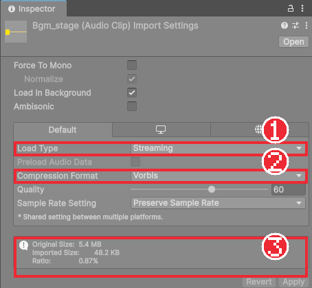
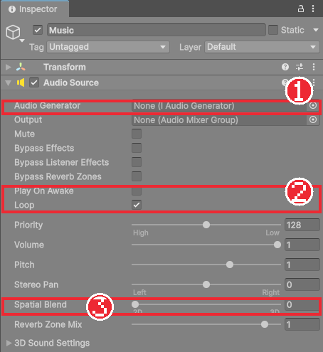
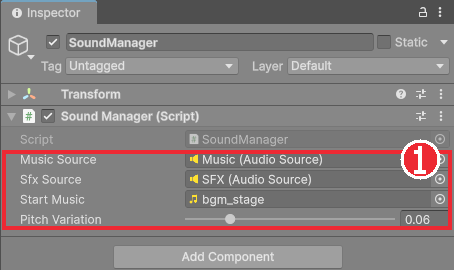
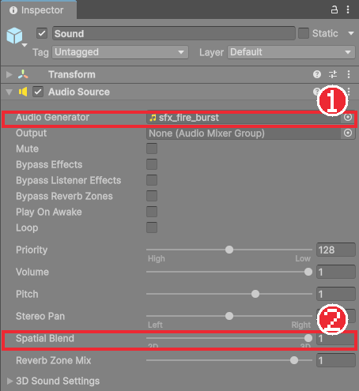

# Chapter 32 사운드

## 학습 목표

- AudioListener, AudioSource, AudioClip의 역할을 구분할 수 있다.
- 효과음과 배경음에 맞게 소리 파일의 가져오기 설정을 고를 수 있다.
- 효과음은 `PlayOneShot`으로, 배경음은 반복 재생과 페이드로 관리하는 소리 관리자를 만들 수 있다.
- 게임 로직의 이벤트를 듣고 소리를 내는 컴포넌트를 만들어, 로직 코드를 고치지 않고 소리를 붙일 수 있다.
- Spatial Blend로 함정처럼 위치가 있는 소리를 만들 수 있다.

## 본문

### 32-1 소리가 주는 정보

지금 게임에서 소리를 모두 끄고 해 보면 이상하게 밋밋합니다. 소리는 꾸밈이 아니라 **정보**입니다.

| 소리 | 알려 주는 것 |
|---|---|
| 칼을 휘두르는 소리, 맞히는 소리 | 공격이 나갔다, 맞았다 (Chapter 20의 타격감) |
| 해골이 칼을 내지르는 소리 | 화면 밖이나 등 뒤에서도 공격이 온다 |
| 불기둥이 솟는 소리 | 가까운 함정이 작동했다. 멀수록 작게 들린다 |
| 체크포인트, 회복 소리 | 좋은 일이 일어났다 |
| 배경음이 보스 음악으로 바뀜 | 분위기가 바뀌었다, 긴장하라 |

### 32-2 소리의 세 부품

| 부품 | 비유 | 하는 일 |
|---|---|---|
| **AudioClip** | 음반 | 소리 파일(.wav, .ogg, .mp3)을 가져온 에셋 |
| **AudioSource** | 스피커 | 클립을 재생하는 컴포넌트. 음량, 반복, 위치 효과를 정한다 |
| **AudioListener** | 귀 | 소리를 듣는 위치. 씬에 **하나만** 있어야 한다 |

새 씬의 `Main Camera`에는 처음부터 **Audio Listener**가 붙어 있습니다. 카메라가 곧 플레이어의 눈이자 귀입니다. 두 개 이상 있으면 Console에 경고가 나오므로, 카메라를 복사해 만들었다면 하나를 지웁니다.

### 32-3 소리 파일 준비

이 과정의 효과음 22개와 배경음 3곡은 강사가 나눠 줍니다. 이 게임을 위해 새로 만든 소리라 함께 배포해도 됩니다. 직접 구할 때는 Chapter 05의 에셋 조건(CC0, 크레딧 표기, 재배포 금지)을 똑같이 확인합니다.

- `Audio/SFX`: `sfx_jump`, `sfx_swing_1`~`3`, `sfx_hit`, `sfx_roll`, `sfx_player_hurt`, `sfx_fire_burst`, `sfx_checkpoint`, `sfx_pickup`, `sfx_dialogue_blip`, `sfx_ui_confirm` 등
- `Audio/Music`: `bgm_title`, `bgm_stage`, `bgm_boss`

파일 이름 앞에 `sfx_`, `bgm_`을 붙여 두면 칸에 끌어 넣을 때 검색창에서 바로 찾을 수 있습니다.

### 32-4 가져오기 설정

Project 창에서 소리 파일을 고르면 Inspector에 가져오기 설정이 나옵니다. 효과음과 배경음은 성격이 달라 설정도 다릅니다.

| 칸 | 효과음 (짧고 자주) | 배경음 (길고 하나씩) |
|---|---|---|
| Load Type | **Decompress On Load** | **Streaming** |
| Compression Format | ADPCM | Vorbis |
| Force To Mono | 켜도 됨 | 끔 (좌우 소리를 살린다) |

- **Decompress On Load**: 게임을 켤 때 압축을 풀어 메모리에 올려 둡니다. 재생할 때 지연이 없어서, 칼을 휘두르는 순간 바로 소리가 나야 하는 효과음에 맞습니다. 대신 메모리를 많이 씁니다.
- **Streaming**: 파일을 조금씩 읽으며 재생합니다. 메모리를 거의 쓰지 않아 몇 분짜리 배경음에 맞습니다. 처음 재생할 때 아주 작은 지연이 있습니다.
- **Vorbis**: 압축률이 높아 파일이 작습니다. 완성본의 32초 배경음은 원본 5.4MB가 약 48KB가 되었습니다. 압축을 푸는 계산이 들어서 효과음 수십 개를 동시에 쓰기에는 무겁습니다.
- **ADPCM**: 압축률은 낮지만 풀기 가볍습니다. 짧은 효과음에 알맞습니다.



설정을 바꾼 뒤에는 오른쪽 아래 **Apply**를 눌러야 적용됩니다. 여러 파일을 한꺼번에 골라 한 번에 바꿀 수도 있습니다.

### 32-5 AudioSource

**AudioSource**의 중요한 칸입니다.

| 칸 | 뜻 |
|---|---|
| Audio Generator | 재생할 소리. 이 에디터 버전에서는 AudioClip을 넣는 칸의 이름이 Audio Generator다 |
| Play On Awake | 오브젝트가 켜지자마자 재생 |
| Loop | 끝나면 처음부터 다시 |
| Volume, Pitch | 음량(0~1), 음높이(1이 원래 높이, 2는 한 옥타브 위이면서 두 배 빠르게) |
| Spatial Blend | 0(2D)이면 어디서나 같은 크기, 1(3D)이면 듣는 위치에서 멀수록 작게 (32-9) |



AudioSource로 소리를 내는 함수는 두 가지입니다.

| 함수 | 동작 | 쓰임 |
|---|---|---|
| `source.Play()` | `clip` 칸의 소리를 처음부터 재생. 재생 중이었으면 끊고 다시 | 배경음 |
| `source.PlayOneShot(clip, 음량배율)` | 넘겨준 소리를 **겹쳐서** 재생. 이전 소리를 끊지 않음 | 효과음 |

칼을 빠르게 세 번 휘두를 때 `Play()`를 쓰면 앞의 소리가 잘려 "칫칫칫"이 됩니다. `PlayOneShot`은 세 소리가 자연스럽게 겹칩니다. 그래서 AudioSource 하나로 효과음 여러 개를 낼 수 있습니다.

### 32-6 SoundManager

소리를 내야 하는 곳은 기사, 해골, 마법사, 보스, 함정, 체크포인트, 물약, 대화 상자, 메뉴로 아주 많습니다. 모두가 각자 AudioSource를 들고 음량을 따로 관리하면, 나중에 "효과음 음량" 설정(Chapter 33)을 만들 때 모든 곳을 고쳐야 합니다. 그래서 씬마다 **소리 관리자 하나**를 두고, 다른 스크립트는 관리자에게 "이 소리를 내 줘"라고만 부탁합니다.

`Scripts/Audio/SoundManager.cs`입니다. 음량 값은 Chapter 33에서 만드는 `GameSettings`에서 읽습니다. 지금은 완성본의 `Scripts/Core/GameSettings.cs`를 그대로 가져와 넣어 두세요. 내용은 다음 장에서 설명합니다.

```csharp
using System.Collections;
using Bastion.Core;
using UnityEngine;

namespace Bastion.Audio
{
    /// <summary>
    /// 씬마다 하나 두는 소리 담당. 배경음(반복 재생)과 효과음(한 번 재생)을 각각의 AudioSource로 낸다.
    /// 다른 스크립트는 SoundManager.PlaySfx(clip)처럼 정적 함수로 부른다.
    /// </summary>
    public sealed class SoundManager : MonoBehaviour
    {
        [SerializeField] AudioSource musicSource;
        [SerializeField] AudioSource sfxSource;
        [Tooltip("씬이 시작될 때 재생할 배경음 (비워 두면 재생하지 않음)")]
        [SerializeField] AudioClip startMusic;
        [Tooltip("같은 효과음을 반복해도 덜 단조롭게 들리도록 주는 음높이 흔들림")]
        [SerializeField, Range(0f, 0.3f)] float pitchVariation = 0.06f;

        static SoundManager instance;
        float musicFade = 1f;
        Coroutine fadeRoutine;

        void Awake()
        {
            instance = this;
            musicSource.loop = true;
            musicSource.playOnAwake = false;
            sfxSource.playOnAwake = false;
            ApplyVolume();
        }

        void OnEnable() => GameSettings.Changed += ApplyVolume;

        void OnDisable() => GameSettings.Changed -= ApplyVolume;

        void OnDestroy()
        {
            if (instance == this)
                instance = null;
        }

        void Start()
        {
            if (startMusic != null)
                PlayMusic(startMusic, 0f);
        }

        void ApplyVolume()
        {
            musicSource.volume = GameSettings.MusicVolume * musicFade;
            sfxSource.volume = GameSettings.SfxVolume;
        }

        /// <summary>효과음을 한 번 재생한다. 볼륨 배율(0~1)을 줄 수 있다.</summary>
        public static void PlaySfx(AudioClip clip, float volumeScale = 1f)
        {
            if (instance == null || clip == null)
                return;
            var source = instance.sfxSource;
            source.pitch = 1f + Random.Range(-instance.pitchVariation, instance.pitchVariation);
            source.PlayOneShot(clip, volumeScale);
        }

        /// <summary>배경음을 바꾼다. fadeTime 동안 이전 곡을 줄이고 새 곡을 키운다.</summary>
        public static void PlayMusic(AudioClip clip, float fadeTime = 1f)
        {
            if (instance == null || clip == null || instance.musicSource.clip == clip && instance.musicSource.isPlaying)
                return;
            instance.StartFade(clip, fadeTime);
        }

        /// <summary>배경음을 서서히 멈춘다.</summary>
        public static void StopMusic(float fadeTime = 1f)
        {
            if (instance != null)
                instance.StartFade(null, fadeTime);
        }

        void StartFade(AudioClip next, float fadeTime)
        {
            if (fadeRoutine != null)
                StopCoroutine(fadeRoutine);
            fadeRoutine = StartCoroutine(Fade(next, fadeTime));
        }

        // 일시정지(Time.timeScale = 0) 중에도 진행되도록 실제 시간 기준으로 줄이고 키운다.
        IEnumerator Fade(AudioClip next, float fadeTime)
        {
            if (musicSource.isPlaying)
            {
                for (float t = 0f; t < fadeTime; t += Time.unscaledDeltaTime)
                {
                    musicFade = 1f - t / fadeTime;
                    ApplyVolume();
                    yield return null;
                }
            }

            musicSource.Stop();
            musicSource.clip = next;
            if (next == null)
                yield break;

            musicSource.Play();
            for (float t = 0f; t < fadeTime; t += Time.unscaledDeltaTime)
            {
                musicFade = t / fadeTime;
                ApplyVolume();
                yield return null;
            }
            musicFade = 1f;
            ApplyVolume();
            fadeRoutine = null;
        }
    }
}
```

#### 코드 해석

**어디서나 부르기 (instance)**

- `static SoundManager instance`: 씬에 있는 관리자 하나를 클래스 자체에 기억해 둡니다. `Awake`에서 자신을 넣고 `OnDestroy`에서 비웁니다.
- `public static void PlaySfx(...)`: `static` 함수라서 다른 스크립트는 관리자를 찾거나 칸에 연결하지 않고 `SoundManager.PlaySfx(clip)`로 바로 부릅니다. 이렇게 "하나만 있고 어디서나 접근하는 객체"를 **싱글턴**(Singleton)이라고 합니다.
- `instance == null`이나 `clip == null`이면 조용히 아무것도 하지 않습니다. 관리자가 없는 테스트 장면이나 소리 칸을 비워 둔 적도 오류 없이 동작합니다. 소리는 없어도 게임이 돌아가야 하는 부가 기능이기 때문입니다.
- 씬마다 관리자를 따로 두므로 씬이 바뀌면 이전 관리자는 사라지고 새 씬의 관리자가 `instance`가 됩니다. 타이틀과 스테이지가 서로 다른 시작 음악을 갖게 하기 쉽습니다.

**효과음 (PlaySfx)**

- AudioSource 두 개를 나눠 둔 이유는 음량을 따로 정하기 위해서입니다. 배경음 소스의 음량은 배경음 설정, 효과음 소스의 음량은 효과음 설정을 따릅니다.
- `pitch = 1 ± 0.06`: 같은 칼 소리를 수십 번 들으면 기계처럼 들립니다. 음높이를 매번 조금씩 흔들면 같은 파일이라도 덜 단조롭습니다.
- `volumeScale`: 대화 글자 소리처럼 자주 나는 소리는 0.6처럼 작게 냅니다.

**배경음 (PlayMusic, StopMusic, Fade)**

- 같은 곡이 이미 나오고 있으면 무시합니다. 그러지 않으면 보스방에 다시 들어갈 때마다 곡이 처음부터 다시 시작합니다.
- `Fade`: 지금 곡을 `fadeTime`초 동안 줄인 뒤 멈추고, 새 곡을 0부터 키웁니다. 곡이 갑자기 끊기지 않고 자연스럽게 넘어갑니다. `musicFade`(0~1)는 설정 음량에 곱하는 값이라, 페이드 중에 설정을 바꿔도 둘이 함께 반영됩니다.
- `Time.unscaledDeltaTime`: 일시정지 중에도 페이드가 진행되게 합니다.
- `fadeRoutine`: 페이드 도중에 새 곡을 요청하면 이전 페이드를 멈추고 새로 시작합니다. 두 페이드가 동시에 음량을 바꾸며 다투지 않게 합니다.

### 32-7 SoundManager 오브젝트

1. `Systems` 아래에 빈 오브젝트 `SoundManager`를 만들고 `SoundManager`를 붙인다.
2. 그 아래에 빈 오브젝트 `Music`, `SFX`를 만들고 각각 AudioSource를 붙인다. 둘 다 Play On Awake를 끄고 Spatial Blend는 0(2D)으로 둔다. `Music`은 Loop를 켠다.
3. `SoundManager`의 Music Source, Sfx Source 칸에 두 AudioSource를 넣고, Start Music에 `bgm_stage`를 넣는다.
4. `Title` 씬에도 같은 오브젝트를 만들고 Start Music에 `bgm_title`을 넣는다. 오브젝트를 프리팹으로 만들어 두면 편하다.



### 32-8 이벤트로 소리 붙이기

이제 기사가 점프할 때 소리를 내야 합니다. `PlayerController`의 점프 코드에 `SoundManager.PlaySfx(jumpSound)`를 넣으면 될 것 같지만, 그렇게 하면 이동 로직 안에 소리 코드가 섞입니다. 소리를 바꾸거나 빼려면 로직을 열어야 하고, Chapter 34의 테스트도 소리 관리자 없이는 돌기 어려워집니다.

Chapter 19의 `PlayerAnimator`를 떠올려 보세요. 애니메이션은 로직의 상태와 이벤트를 **듣기만** 했습니다. 소리도 똑같이 합니다. 로직은 이미 필요한 이벤트를 모두 알리고 있습니다.

| 이벤트 | 알리는 곳 | 만든 장 |
|---|---|---|
| `Jumped`, `AirJumped` | PlayerController | 17 |
| `AttackStarted`, `AttackLanded` | PlayerController | 18 |
| `StateMachine.StateChanged` | StateMachine | 17 |
| `Damaged`, `Blocked`, `Died`, `Healed` | Health | 19, 27 |
| `AttackReleased` | EnemyController | 22 |
| `ActionStarted` | BossController | 25 |

이 이벤트를 듣는 소리 컴포넌트를 만듭니다. 먼저 `Health`가 있는 모두(기사, 적, 보스)에 공통으로 붙이는 `Scripts/Audio/HealthSounds.cs`입니다.

```csharp
using Bastion.Combat;
using UnityEngine;

namespace Bastion.Audio
{
    /// <summary>Health 이벤트(피격, 방어, 사망)에 맞춰 효과음을 낸다. 플레이어, 적, 보스에 공통으로 붙인다.</summary>
    [RequireComponent(typeof(Health))]
    public sealed class HealthSounds : MonoBehaviour
    {
        [SerializeField] AudioClip hurtSound;
        [SerializeField] AudioClip blockSound;
        [SerializeField] AudioClip deathSound;
        [SerializeField] AudioClip healSound;

        Health health;

        void Awake() => health = GetComponent<Health>();

        void OnEnable()
        {
            health.Damaged += OnDamaged;
            health.Blocked += OnBlocked;
            health.Died += OnDied;
            health.Healed += OnHealed;
        }

        void OnDisable()
        {
            health.Damaged -= OnDamaged;
            health.Blocked -= OnBlocked;
            health.Died -= OnDied;
            health.Healed -= OnHealed;
        }

        // 죽는 순간에는 피격음 대신 사망음만 낸다.
        void OnDamaged(DamageInfo _)
        {
            if (!health.IsDead)
                SoundManager.PlaySfx(hurtSound);
        }

        void OnBlocked(DamageInfo _) => SoundManager.PlaySfx(blockSound);

        void OnDied() => SoundManager.PlaySfx(deathSound);

        void OnHealed(int amount) => SoundManager.PlaySfx(healSound);
    }
}
```

- 칸을 비워 두면 `PlaySfx`가 아무것도 하지 않으므로, 해골은 방어음을 넣고 회복음은 비워 두는 식으로 필요한 소리만 채웁니다.
- 마지막 일격에는 `Damaged`와 `Died`가 연달아 옵니다. 피격음과 사망음이 겹치지 않게 죽었으면 피격음을 건너뜁니다.
- `DamageInfo _`: 이벤트 모양을 맞추려고 받지만 쓰지 않는 값은 이름을 `_`로 둡니다.

기사 전용 `Scripts/Audio/PlayerSounds.cs`입니다.

```csharp
using Bastion.Combat;
using Bastion.Core;
using Bastion.Player;
using UnityEngine;

namespace Bastion.Audio
{
    /// <summary>플레이어 행동 이벤트에 맞춰 효과음을 낸다. 게임 로직은 이 컴포넌트를 모른다.</summary>
    [RequireComponent(typeof(PlayerController))]
    public sealed class PlayerSounds : MonoBehaviour
    {
        [SerializeField] AudioClip jumpSound;
        [SerializeField] AudioClip airJumpSound;
        [SerializeField] AudioClip rollSound;
        [Tooltip("콤보 순서대로 (1타, 2타, 3타)")]
        [SerializeField] AudioClip[] swingSounds;
        [SerializeField] AudioClip hitSound;

        PlayerController player;

        void Awake() => player = GetComponent<PlayerController>();

        void OnEnable()
        {
            player.Jumped += OnJumped;
            player.AirJumped += OnAirJumped;
            player.AttackStarted += OnAttackStarted;
            player.AttackLanded += OnAttackLanded;
            player.StateMachine.StateChanged += OnStateChanged;
        }

        void OnDisable()
        {
            player.Jumped -= OnJumped;
            player.AirJumped -= OnAirJumped;
            player.AttackStarted -= OnAttackStarted;
            player.AttackLanded -= OnAttackLanded;
            player.StateMachine.StateChanged -= OnStateChanged;
        }

        void OnJumped() => SoundManager.PlaySfx(jumpSound);

        void OnAirJumped() => SoundManager.PlaySfx(airJumpSound);

        void OnAttackStarted(int comboIndex)
        {
            if (swingSounds != null && swingSounds.Length > 0)
                SoundManager.PlaySfx(swingSounds[Mathf.Min(comboIndex, swingSounds.Length - 1)]);
        }

        void OnAttackLanded(AttackStep step, int hits) => SoundManager.PlaySfx(hitSound);

        void OnStateChanged(IState previous, IState next)
        {
            if (next == player.DashState)
                SoundManager.PlaySfx(rollSound);
        }
    }
}
```

- `swingSounds[Mathf.Min(comboIndex, Length - 1)]`: 콤보 1, 2, 3타에 다른 소리를 냅니다. 소리를 두 개만 넣어도 3타에서 범위를 벗어나지 않게 마지막 소리를 씁니다.
- 구르기는 따로 알리는 이벤트가 없지만, 상태 머신이 구르기 상태로 바뀌는 순간을 `StateChanged`로 알 수 있습니다.
- `player.StateMachine`은 `PlayerController`가 만들어질 때 필드 초기화(`= new StateMachine()`)로 생기므로, `PlayerSounds.OnEnable`이 `PlayerController.Awake`보다 먼저 불려도 안전합니다. Chapter 19의 `PlayerAnimator`도 같은 방식으로 구독합니다.

적과 보스용도 같은 모양입니다. 완성본의 `EnemySounds.cs`는 `AttackReleased`를 듣고 공격음 하나를 냅니다. `BossSounds.cs`는 행동 이름과 소리의 짝 목록을 받아, `ActionStarted`로 온 이름(`Attack`, `Skill`, `Summon`, `Phase`)에 맞는 소리를 냅니다. 행동이 늘어나도 코드를 고치지 않고 Inspector에서 짝을 추가하면 됩니다.

```csharp
[Serializable]
struct ActionSound
{
    public string Action;
    public AudioClip Clip;
}

[SerializeField] ActionSound[] sounds;

void OnActionStarted(string action)
{
    foreach (var sound in sounds)
    {
        if (sound.Action == action)
        {
            SoundManager.PlaySfx(sound.Clip);
            return;
        }
    }
}
```

`[Serializable]`을 붙인 구조체는 Inspector에서 칸 묶음으로 보입니다. 배열로 두면 짝을 여러 개 적는 표가 됩니다.

### 32-9 위치가 있는 소리

불기둥 소리는 화면 끝에 있는 함정에서도, 바로 옆에 있는 함정에서도 같은 크기로 들리면 어느 함정이 작동했는지 알 수 없습니다. 함정마다 AudioSource를 붙이고 **Spatial Blend를 1(3D)** 로 두면 듣는 위치(카메라)에서 멀수록 작게 들립니다.

`FireTrap` 프리팹 아래에 `Sound` 오브젝트를 만들고 AudioSource를 붙입니다.

| 칸 | 값 |
|---|---|
| Audio Generator | `sfx_fire_burst` |
| Play On Awake, Loop | 끔 |
| Spatial Blend | 1 (3D) |
| 3D Sound Settings > Volume Rolloff | Linear Rolloff |
| 3D Sound Settings > Min Distance | 11 |
| 3D Sound Settings > Max Distance | 22 |



**Min Distance 11은 어디서 나왔을까요?** 2D 게임이지만 소리 거리는 3D로 잽니다. 카메라(귀)는 Z = -10에 있으므로 함정 바로 앞에 서도 거리가 **10**입니다. Min Distance를 기본값 1로 두면 화면 한가운데 함정도 거리 10이라 아주 작게 들립니다. Min Distance(이 거리까지는 최대 음량)를 10보다 조금 큰 11로 두면, 화면 가운데의 함정은 최대 음량으로 들립니다.

화면 가로 반 폭은 약 14칸이라, 화면 끝의 함정까지는 √(14² + 10²) ≈ 17.2입니다. Linear Rolloff는 Min과 Max 사이에서 음량이 곧게 줄어들므로 화면 끝에서는 약 44%, Max Distance 22(가로로 약 19칸)보다 멀면 들리지 않습니다. 화면 밖 멀리 있는 함정 소리는 나지 않게 됩니다.

`Trap`에 소리 칸을 추가합니다.

```csharp
[Header("Sound (optional)")]
[Tooltip("작동할 때 재생할 소리. 함정 위치에서 나도록 AudioSource의 Spatial Blend를 3D로 둔다")]
[SerializeField] AudioSource activeSound;
```

`SetFrame`에서 피해 단계에 들어서는 순간 재생합니다. 이 소리는 `SoundManager`를 거치지 않으므로 Chapter 33의 효과음 음량을 직접 반영합니다.

```csharp
if (phase == Phase.Active && CurrentPhase != Phase.Active && activeSound != null)
{
    // SoundManager를 거치지 않는 위치 소리라서 효과음 볼륨 설정을 직접 반영한다.
    activeSound.volume = GameSettings.SfxVolume;
    activeSound.Play();
}
```

파일 위쪽에 `using Bastion.Core;`도 추가합니다.

### 32-10 나머지 소리 연결

앞 장들에서 비워 두었던 소리 자리를 채웁니다.

| 스크립트 | 추가하는 것 | 소리 |
|---|---|---|
| `Checkpoint` | `[SerializeField] AudioClip activateSound;`, 켜질 때 `SoundManager.PlaySfx(activateSound);` | `sfx_checkpoint` |
| `DialogueBox` | `blipSound`, `blipEvery` 칸과 글자가 나올 때 소리 (아래) | `sfx_dialogue_blip` |
| `BossArena` | `[SerializeField] AudioClip bossMusic;`, 보스전 시작 때 `SoundManager.PlayMusic(bossMusic);` | `bgm_boss` |
| `GameFlow` | 보스 처치 때 `ClearAfterDelay` 첫 줄에 `SoundManager.StopMusic(victoryDelay);` | (음악 끄기) |
| `TitleMenu` | Chapter 31에서 막아 둔 `confirmSound` 줄 풀기 | `sfx_ui_confirm` |
| `HealthSounds` (기사) | Heal Sound 칸 | `sfx_pickup` |

대화 상자는 글자가 나올 때마다 짧은 소리를 냅니다. 모든 글자마다 내면 너무 시끄러워서 `blipEvery`(2)글자마다 냅니다.

```csharp
[SerializeField] AudioClip blipSound;
[Tooltip("몇 글자마다 소리를 낼지")]
[SerializeField, Min(1)] int blipEvery = 2;

// Update의 글자 진행 부분
if (IsTyping)
{
    int before = bodyLabel.maxVisibleCharacters;
    visibleCount += charactersPerSecond * Time.unscaledDeltaTime;
    bodyLabel.maxVisibleCharacters = Mathf.Min(Mathf.FloorToInt(visibleCount), bodyLabel.textInfo.characterCount);
    if (bodyLabel.maxVisibleCharacters / blipEvery != before / blipEvery)
        SoundManager.PlaySfx(blipSound, 0.6f);
}
```

`보인 글자 수 / 2`(정수 나눗셈)는 0, 0, 1, 1, 2, 2…로 2글자마다 1씩 늘어납니다. 이 값이 바뀐 프레임에만 소리를 냅니다.

### 32-11 따라하기 — 사운드

1. 소리 파일을 `Audio/SFX`, `Audio/Music`에 넣고 32-4대로 가져오기 설정을 한다.
2. 완성본의 `GameSettings.cs`를 가져오고 `SoundManager.cs`를 만든다. 32-7대로 두 씬에 SoundManager를 놓는다. 실행해 배경음이 나오는지 확인한다.
3. `HealthSounds`, `PlayerSounds`를 만들어 Player 프리팹에 붙이고 소리를 넣는다. 점프, 공격 1~3타, 구르기, 맞기, 죽기 소리를 확인한다.
4. 해골과 마법사에 `HealthSounds`, `EnemySounds`, 보스에 `HealthSounds`, `BossSounds`를 붙인다. `BossSounds`에 Attack, Skill, Summon, Phase 짝을 적는다.
5. 불기둥 프리팹에 3D AudioSource를 32-9대로 붙이고 `Trap`에 연결한다. 기사를 함정에서 점점 멀리 옮기며 소리가 작아지는지 들어 본다.
6. 32-10의 나머지 소리를 연결한다. 보스방에 들어가면 음악이 부드럽게 바뀌는지, 보스를 쓰러뜨리면 음악이 꺼지는지 확인한다.
7. 3D AudioSource의 Min Distance를 1로 바꿔 함정 바로 앞에서도 소리가 작은지 확인하고 되돌린다.

### 연습문제

1. 문제: 효과음과 배경음의 Load Type을 각각 무엇으로 두는지와 그 이유를 쓰세요.
2. 문제: 칼을 빠르게 세 번 휘두를 때 효과음을 `Play()`로 내면 어떻게 들리는지와 `PlayOneShot`과의 차이를 쓰세요.
3. 문제: 점프 소리를 `PlayerController`의 점프 코드에 직접 넣지 않고 `PlayerSounds`가 `Jumped` 이벤트를 듣게 만든 이유를 쓰세요.
4. 문제: 카메라가 Z = -10에 있을 때 3D 소리의 Min Distance를 1로 두면 함정 바로 앞에서 어떻게 들리는지와 그 이유를 쓰세요.
5. 문제: 함정의 3D 소리가 Min 11, Max 22, Linear Rolloff일 때 카메라와 가로로 0칸, 14칸 떨어진 함정 소리의 음량을 계산하세요.

### 정답 포인트

- 효과음은 Decompress On Load. 미리 풀어 두어 누르는 순간 지연 없이 나야 한다. 배경음은 Streaming. 길어서 통째로 메모리에 올리면 낭비이고, 조금 늦게 시작해도 티가 나지 않는다.
- `Play()`는 재생 중인 소리를 끊고 처음부터 다시 재생해 앞 소리가 잘린다. `PlayOneShot`은 이전 소리를 그대로 두고 겹쳐 재생한다.
- 로직 코드를 고치지 않고 소리를 바꾸거나 뺄 수 있고, 소리 관리자 없이도 로직만 테스트할 수 있다. 애니메이션처럼 연출은 로직의 이벤트를 듣기만 한다.
- 함정 바로 앞이어도 Z 방향 거리가 10이라 Min Distance 1보다 훨씬 멀어서 소리가 많이 줄어든다.
- 0칸: 거리 10 ≤ 11이므로 100%. 14칸: 거리 √(196 + 100) ≈ 17.2이므로 1 − (17.2 − 11) ÷ (22 − 11) ≈ 44%.

---

[다음 문서: Chapter 33 일시정지와 설정 저장](./33-pause-settings.md)

[상위 문서로 돌아가기](./README.md)
