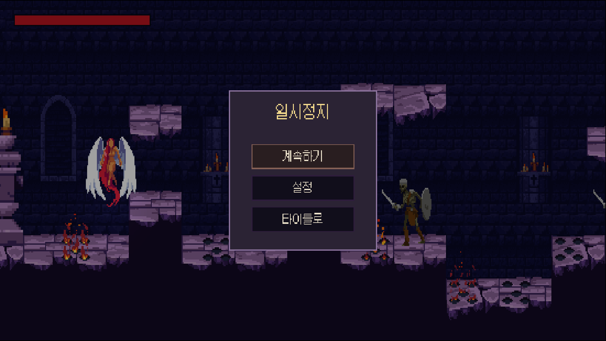
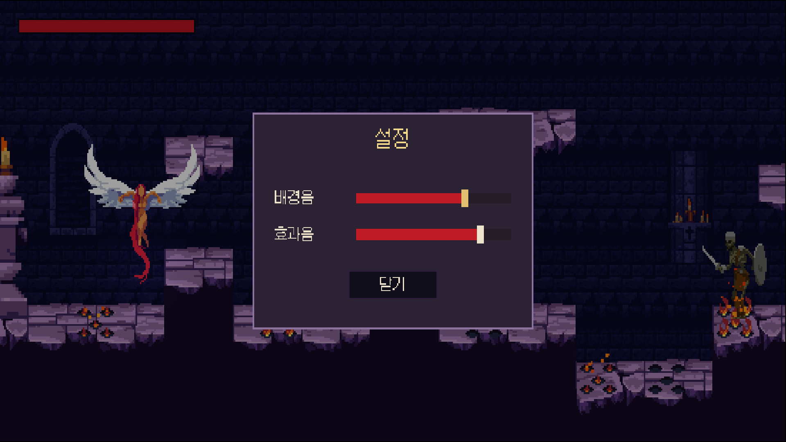

# Chapter 33 일시정지와 설정 저장

## 학습 목표

- 일시정지 메뉴를 열고 닫으며 `Time.timeScale`과 플레이어 입력을 관리할 수 있다.
- `PlayerPrefs`로 게임을 껐다 켜도 남는 설정을 저장하고 불러올 수 있다.
- 기본값을 한 곳에 모은 설정 클래스를 만들고, 값이 바뀌면 이벤트로 알릴 수 있다.
- Slider UI로 음량을 조절하는 설정 창을 만들 수 있다.

## 본문

### 33-1 멈추고, 고르고, 기억하기

게임 중에 Esc를 누르면 게임이 멈추고 메뉴가 떠야 합니다. 메뉴에서는 계속하기, 설정, 타이틀로 돌아가기를 고릅니다. 설정에서 바꾼 음량은 **게임을 껐다 켜도 남아 있어야** 합니다. 매번 음량을 다시 맞춰야 하는 게임은 불편합니다.

| 화면 | 열리는 곳 | 버튼 |
|---|---|---|
| 일시정지 메뉴 | 게임 중 Esc (패드 Start) | 계속하기, 설정, 타이틀로 |
| 설정 창 | 일시정지 메뉴의 설정, 타이틀의 설정 | 배경음 슬라이더, 효과음 슬라이더, 닫기 |



### 33-2 PlayerPrefs

씬을 다시 불러와도 남는 값은 `static`에 두었습니다(Chapter 26). 하지만 `static`도 **게임을 끄면 사라집니다.** 게임을 꺼도 남는 값은 파일처럼 컴퓨터에 저장해야 합니다. Unity가 제공하는 가장 간단한 저장소가 **PlayerPrefs**입니다.

```csharp
PlayerPrefs.SetFloat("Bastion.MusicVolume", 0.5f);      // 저장
float volume = PlayerPrefs.GetFloat("Bastion.MusicVolume", 0.7f); // 불러오기, 없으면 0.7
PlayerPrefs.DeleteKey("Bastion.MusicVolume");           // 지우기
PlayerPrefs.Save();                                     // 바로 디스크에 기록
```

- 이름(키)과 값의 짝으로 저장합니다. 값은 `int`, `float`, `string` 세 종류입니다.
- `Get`의 두 번째 값은 **저장된 것이 없을 때** 돌려줄 기본값입니다. 처음 켠 게임에도 알맞은 음량이 나옵니다.
- Windows에서는 레지스트리의 `HKEY_CURRENT_USER\Software\회사 이름\제품 이름` 아래에 저장됩니다. 회사와 제품 이름은 **Edit > Project Settings > Player**에서 정합니다. 완성본은 제품 이름이 `Bastion`입니다.
- 키 앞에 `Bastion.`을 붙인 이유는 다른 값과 이름이 겹치지 않게 하기 위해서입니다.

PlayerPrefs는 음량, 화면 설정처럼 **작은 설정값**에 알맞습니다. 세이브 파일처럼 크고 복잡한 데이터는 JSON 파일로 저장하는 방법을 쓰는데, 이 과정에서는 다루지 않습니다. PlayerPrefs는 사용자가 쉽게 고칠 수 있으므로 점수나 재화처럼 속이면 안 되는 값을 넣기에도 알맞지 않습니다.

### 33-3 GameSettings

Chapter 32에서 미리 가져온 `Scripts/Core/GameSettings.cs`입니다.

```csharp
using System;
using UnityEngine;

namespace Bastion.Core
{
    /// <summary>
    /// 플레이어가 바꾸는 설정(음량)을 PlayerPrefs에 저장하고 불러온다.
    /// 기본값은 이 클래스 한 곳에만 두고, 실제 값은 설정 화면에서 바꾼다.
    /// </summary>
    public static class GameSettings
    {
        const string MusicVolumeKey = "Bastion.MusicVolume";
        const string SfxVolumeKey = "Bastion.SfxVolume";
        const float DefaultMusicVolume = 0.7f;
        const float DefaultSfxVolume = 0.8f;

        /// <summary>음량이 바뀌었을 때 (배경음, 효과음).</summary>
        public static event Action Changed;

        public static float MusicVolume
        {
            get => PlayerPrefs.GetFloat(MusicVolumeKey, DefaultMusicVolume);
            set => SetVolume(MusicVolumeKey, value);
        }

        public static float SfxVolume
        {
            get => PlayerPrefs.GetFloat(SfxVolumeKey, DefaultSfxVolume);
            set => SetVolume(SfxVolumeKey, value);
        }

        static void SetVolume(string key, float value)
        {
            PlayerPrefs.SetFloat(key, Mathf.Clamp01(value));
            PlayerPrefs.Save();
            Changed?.Invoke();
        }

        /// <summary>저장된 설정을 지우고 기본값으로 되돌린다.</summary>
        public static void ResetToDefaults()
        {
            PlayerPrefs.DeleteKey(MusicVolumeKey);
            PlayerPrefs.DeleteKey(SfxVolumeKey);
            PlayerPrefs.Save();
            Changed?.Invoke();
        }
    }
}
```

#### 코드 해석

- **기본값을 한 곳에**: 기본 음량 0.7, 0.8은 이 클래스에만 있습니다. 소리 관리자, 설정 창, 함정이 각자 기본값을 갖고 있으면 하나만 바꿨을 때 서로 달라집니다. 키 이름도 `const`로 한 번만 적어 오타를 막습니다.
- **속성(Property)으로 감싸기**: 다른 코드는 `GameSettings.MusicVolume = 0.5f`처럼 변수를 쓰듯 씁니다. 안에서 PlayerPrefs를 읽고 쓰는 것은 숨겨져 있어서, 나중에 저장 방식을 바꿔도 쓰는 쪽은 고치지 않아도 됩니다.
- `Mathf.Clamp01(value)`: 0~1 밖의 값이 들어와도 잘라서 저장합니다.
- `public static event Action Changed`: 음량이 바뀌면 알립니다. Chapter 32의 `SoundManager`가 이 이벤트를 듣고 AudioSource의 음량을 바로 바꿉니다. 설정 창은 소리 관리자를 몰라도 됩니다.
- `ResetToDefaults`: 저장값을 지우면 `Get`이 기본값을 돌려주므로 기본값으로 돌아갑니다. Chapter 34의 테스트가 시작 전에 설정을 깨끗이 할 때 씁니다.

### 33-4 Slider

**+ > UI > Slider**로 만드는 **Slider**는 막대를 끌어 값을 고르는 UI입니다. 자식으로 `Background`(빈 막대), `Fill Area/Fill`(채워진 부분), `Handle Slide Area/Handle`(손잡이)이 생깁니다. Chapter 28의 체력바처럼 이미지 색만 바꿔 꾸밉니다.

| 칸 | 값 |
|---|---|
| Direction | Left To Right |
| Min Value / Max Value | 0 / 1 |
| Whole Numbers | 끔 (0.5 같은 소수 값) |
| Navigation | Explicit. 배경음 ↓ 효과음 ↓ 닫기 |

키보드나 패드로 슬라이더를 고른 상태에서 ←, →를 누르면 값이 바뀝니다. 마우스가 없어도 음량을 조절할 수 있습니다.

### 33-5 SettingsPanel

`Scripts/UI/SettingsPanel.cs`입니다.

```csharp
using System;
using Bastion.Audio;
using Bastion.Core;
using UnityEngine;
using UnityEngine.EventSystems;
using UnityEngine.UI;

namespace Bastion.UI
{
    /// <summary>음량 설정 창. 슬라이더 값은 GameSettings를 통해 PlayerPrefs에 바로 저장된다.</summary>
    public sealed class SettingsPanel : MonoBehaviour
    {
        [SerializeField] Slider musicSlider;
        [SerializeField] Slider sfxSlider;
        [SerializeField] Button closeButton;
        [Tooltip("효과음 슬라이더를 움직일 때 들려줄 소리")]
        [SerializeField] AudioClip previewSound;

        public event Action Closed;

        void Awake()
        {
            musicSlider.onValueChanged.AddListener(value => GameSettings.MusicVolume = value);
            sfxSlider.onValueChanged.AddListener(OnSfxChanged);
            closeButton.onClick.AddListener(Close);
        }

        void OnEnable()
        {
            // 저장된 값으로 슬라이더를 맞춘다. 이때는 저장 이벤트가 다시 일어나지 않게 한다.
            musicSlider.SetValueWithoutNotify(GameSettings.MusicVolume);
            sfxSlider.SetValueWithoutNotify(GameSettings.SfxVolume);
            if (EventSystem.current != null)
                EventSystem.current.SetSelectedGameObject(musicSlider.gameObject);
        }

        void OnSfxChanged(float value)
        {
            GameSettings.SfxVolume = value;
            SoundManager.PlaySfx(previewSound);
        }

        public void Open() => gameObject.SetActive(true);

        public void Close()
        {
            gameObject.SetActive(false);
            Closed?.Invoke();
        }
    }
}
```

#### 코드 해석

- `onValueChanged.AddListener(value => GameSettings.MusicVolume = value)`: 슬라이더가 움직일 때마다 새 값을 받아 바로 저장합니다. `value => ...`는 이름 없는 짧은 함수(**람다**)입니다. C# 과정에서 배운 문법입니다. 따로 "저장" 버튼이 없어도 움직인 순간 저장되고 소리도 바로 바뀝니다.
- `SetValueWithoutNotify`: 창이 열릴 때 저장된 값으로 슬라이더를 맞춥니다. 그냥 `value = ...`로 넣으면 `onValueChanged`가 불려 같은 값을 다시 저장하고, 효과음 미리듣기 소리까지 납니다. 알림 없이 값만 바꿉니다.
- `previewSound`: 효과음 슬라이더를 움직이면 짧은 소리를 들려줘 지금 크기를 바로 알 수 있게 합니다. 배경음은 이미 나오고 있으므로 필요 없습니다.
- `event Action Closed`: 닫혔다고 알립니다. 타이틀 메뉴(Chapter 31)와 일시정지 메뉴가 듣고 각자 알맞은 버튼을 다시 고릅니다. 설정 창은 누가 자신을 열었는지 몰라도 되므로 두 곳에서 같은 창을 씁니다.



이제 Chapter 31의 `TitleMenu`에서 막아 두었던 설정 창 줄들을 풀고, 타이틀 씬의 `SettingsPanel`을 연결합니다.

### 33-6 일시정지 입력

Chapter 06에서 만들어 둔 **Pause** 액션(키보드 Esc, 패드 Start)을 씁니다. 대화 상자(Chapter 30)처럼 `InputActionReference`로 받아 메뉴가 직접 읽습니다.

### 33-7 PauseMenu

`Scripts/UI/PauseMenu.cs`입니다.

```csharp
using Bastion.Combat;
using Bastion.Dialogue;
using Bastion.Player;
using UnityEngine;
using UnityEngine.EventSystems;
using UnityEngine.InputSystem;
using UnityEngine.SceneManagement;
using UnityEngine.UI;

namespace Bastion.UI
{
    /// <summary>
    /// 일시정지 메뉴. 일시정지 키로 열고 닫으며, 열려 있는 동안 Time.timeScale을 0으로 둔다.
    /// </summary>
    public sealed class PauseMenu : MonoBehaviour
    {
        [SerializeField] InputActionReference pauseAction;
        [SerializeField] GameObject panel;
        [SerializeField] Button resumeButton;
        [SerializeField] Button settingsButton;
        [SerializeField] Button titleButton;
        [SerializeField] SettingsPanel settingsPanel;
        [Tooltip("일시정지 동안 끌 플레이어 입력")]
        [SerializeField] PlayerInputReader playerInput;
        [Tooltip("'타이틀로' 버튼을 누르면 불러올 씬 이름")]
        [SerializeField] string titleScene;

        public bool IsPaused { get; private set; }

        void Awake()
        {
            resumeButton.onClick.AddListener(Resume);
            settingsButton.onClick.AddListener(() => settingsPanel.Open());
            titleButton.onClick.AddListener(GoToTitle);
            settingsPanel.Closed += () => Select(settingsButton);
            panel.SetActive(false);
            settingsPanel.gameObject.SetActive(false);
        }

        void OnEnable() => pauseAction.action.Enable();

        void Update()
        {
            if (!pauseAction.action.WasPressedThisFrame())
                return;

            if (!IsPaused)
            {
                // 대화 중이거나 히트스톱으로 잠깐 멈춘 순간에는 열지 않는다.
                if (!DialogueBox.IsOpen && !HitStop.IsStopped)
                    Pause();
            }
            else if (settingsPanel.gameObject.activeSelf)
                settingsPanel.Close();
            else
                Resume();
        }

        public void Pause()
        {
            IsPaused = true;
            Time.timeScale = 0f;
            if (playerInput != null)
                playerInput.enabled = false;
            panel.SetActive(true);
            Select(resumeButton);
        }

        public void Resume()
        {
            IsPaused = false;
            Time.timeScale = 1f;
            if (playerInput != null)
                playerInput.enabled = true;
            settingsPanel.gameObject.SetActive(false);
            panel.SetActive(false);
        }

        void GoToTitle()
        {
            Time.timeScale = 1f;
            SceneManager.LoadScene(titleScene);
        }

        // 일시정지한 채로 씬이 바뀌거나 종료돼도 시간이 멈춘 상태로 남지 않게 한다.
        void OnDestroy()
        {
            if (IsPaused)
                Time.timeScale = 1f;
        }

        static void Select(Selectable selectable)
        {
            if (EventSystem.current != null)
                EventSystem.current.SetSelectedGameObject(selectable.gameObject);
        }
    }
}
```

#### 코드 해석

**Esc 하나로 세 가지 (Update)**

- 멈춰 있지 않으면 → 일시정지합니다.
- 멈춰 있고 설정 창이 열려 있으면 → 설정 창만 닫습니다.
- 멈춰 있고 설정 창이 닫혀 있으면 → 게임으로 돌아갑니다.

"뒤로 가기" 키가 한 단계씩 되돌아가는 방식이라 사용자가 예상하기 쉽습니다.

**다른 멈춤과 겹치지 않기**

`Time.timeScale`을 바꾸는 곳은 이제 세 군데입니다. 히트 스톱(Chapter 20), 대화(Chapter 30), 일시정지입니다. 서로 겹치면 문제가 생깁니다. 대화 중에 일시정지했다가 계속하기를 누르면 `timeScale`이 1이 되어 대화창이 열린 채로 게임이 움직입니다. 그래서 `DialogueBox.IsOpen`이나 `HitStop.IsStopped`일 때는 일시정지를 열지 않습니다. 히트 스톱은 0.1초도 안 되므로 사용자는 차이를 느끼지 못합니다.

**입력 끄기**

일시정지 중에는 기사의 입력을 끕니다. 메뉴를 고르려고 누른 Enter나 공격 키가 게임으로 돌아간 뒤 기사의 행동으로 남지 않게 합니다. 대화 상자의 NPC와 같은 방법입니다.

**안전장치 (GoToTitle, OnDestroy)**

`timeScale`은 씬을 바꿔도 남습니다(Chapter 31). 타이틀로 갈 때 1로 되돌리고, 혹시 멈춘 채로 메뉴가 사라져도 `OnDestroy`에서 되돌립니다. 에디터에서 일시정지한 채 플레이를 멈췄을 때도 이 덕분에 다음 플레이가 멈춘 채 시작하지 않습니다.

### 33-8 일시정지 메뉴 화면

`HUD` 아래에 만듭니다.

| 오브젝트 | Rect Transform | 내용 |
|---|---|---|
| `PauseMenu` | stretch | PauseMenu. 켜 둔다 |
| └ `Panel` | stretch | Image, 반투명 검정. 게임 화면을 어둡게 덮는다 |
| 　└ `Box` | 가운데, 520×460 | 테두리 있는 상자, 제목 "일시정지", 버튼 세 개 |
| └ `SettingsPanel` | 가운데, 760×480 | SettingsPanel, 슬라이더 두 개, 닫기 버튼 |

`PauseMenu`의 칸을 채웁니다. Pause Action에 `BastionControls/Gameplay/Pause`, Player Input에 기사, Title Scene에 `Title`을 적습니다. 설정 창은 일시정지 메뉴의 `Panel` **밖**에 두어서, 설정 창이 열려도 어두운 바탕은 그대로 남습니다.

`PauseMenu`가 `ScreenMessage`(Chapter 29)보다 Hierarchy 아래에 있어야 사망 문구 위에 메뉴가 그려집니다.

### 33-9 따라하기 — 일시정지와 설정

1. `GameSettings.cs`의 내용을 33-3과 비교하며 읽는다.
2. `SettingsPanel.cs`를 만들고, 33-4대로 슬라이더 두 개와 닫기 버튼이 있는 설정 창을 만든다. Preview Sound에 `sfx_ui_move`를 넣는다.
3. 타이틀 씬에 설정 창을 놓고 `TitleMenu`의 설정 관련 줄을 푼다. 타이틀에서 음량을 바꿔 배경음이 바로 작아지는지 확인한다.
4. `PauseMenu.cs`를 만들고 33-8대로 `Stage1`의 `HUD`에 일시정지 메뉴와 설정 창을 놓는다.
5. 게임 중 Esc로 멈추고, 설정을 열고, Esc로 설정만 닫히고, 다시 Esc로 게임에 돌아오는지 확인한다.
6. 대화 중에 Esc를 눌러도 일시정지가 열리지 않는지 확인한다.
7. 음량을 바꾸고 플레이를 끈 뒤 다시 켜서 슬라이더가 바꾼 값으로 열리는지 확인한다.
8. 일시정지에서 타이틀로 간 뒤 다시 시작해 게임이 멈추지 않고 움직이는지 확인한다.

### 연습문제

1. 문제: `static` 변수와 PlayerPrefs에 저장한 값이 각각 언제 사라지는지 쓰세요.
2. 문제: `PlayerPrefs.GetFloat("Bastion.SfxVolume", 0.8f)`가 0.8을 돌려주는 경우를 쓰세요.
3. 문제: 설정 창이 열릴 때 슬라이더 값을 `SetValueWithoutNotify` 대신 `value`로 넣으면 어떤 일이 생기는지 쓰세요.
4. 문제: 대화 중에 일시정지를 허용하면 어떤 문제가 생기는지 `Time.timeScale`로 설명하세요.
5. 문제: 기본 음량을 `SoundManager`와 `SettingsPanel`에 각각 적어 두면 어떤 문제가 생길 수 있는지 쓰세요.

### 정답 포인트

- `static` 변수는 게임(또는 에디터 플레이)을 끄면 사라지고, PlayerPrefs는 컴퓨터에 저장되어 `DeleteKey`로 지우기 전까지 남는다.
- 그 키로 저장된 값이 없을 때(처음 실행했거나 `ResetToDefaults`로 지운 뒤)이다.
- `onValueChanged`가 불려 같은 값을 다시 저장하고, 효과음 슬라이더는 미리듣기 소리가 창을 열 때마다 난다.
- 대화가 `timeScale`을 0으로 둔 상태에서 일시정지 후 계속하기를 누르면 `Resume`이 1로 바꿔, 대화창이 열린 채로 적과 함정이 움직인다.
- 한쪽만 바꾸면 처음 실행할 때 들리는 음량과 슬라이더에 보이는 값이 달라진다. 기본값은 `GameSettings` 한 곳에만 둔다.

---

[다음 문서: Chapter 34 테스트로 기능 지키기](./34-playmode-test.md)

[상위 문서로 돌아가기](./README.md)
