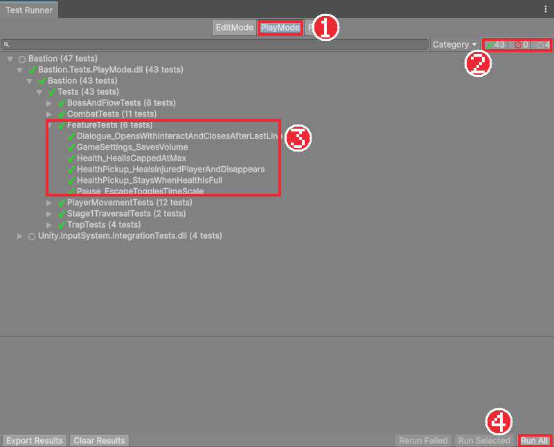

# Chapter 34 테스트로 기능 지키기

## 학습 목표

- 자동 테스트가 왜 필요한지 설명할 수 있다.
- Assembly Definition으로 게임 코드와 테스트 코드를 나눌 수 있다.
- Test Runner에서 PlayMode 테스트를 만들고 실행할 수 있다.
- `[Test]`, `[UnityTest]`, `Assert`로 기능이 기대대로 동작하는지 확인하는 테스트를 쓸 수 있다.
- Input System 테스트 도구로 키 입력을 흉내 내 조작까지 테스트할 수 있다.

## 본문

### 34-1 고칠 때마다 다시 해 보기

지금까지는 기능을 만들 때마다 플레이 버튼을 눌러 직접 확인했습니다. 기능이 33장 분량으로 늘어난 지금, 점프 높이 하나를 고친 뒤 **다른 기능이 망가지지 않았는지** 매번 직접 다 해 보기는 어렵습니다. 대화를 고쳤더니 일시정지가 안 되거나, 함정 판정을 고쳤더니 체크포인트가 안 켜지는 일은 실제로 자주 생깁니다.

**자동 테스트**는 "이렇게 하면 이렇게 되어야 한다"를 코드로 적어 두고, 버튼 한 번으로 모두 확인하는 방법입니다. 완성본에는 44개의 테스트가 있고, 모두 도는 데 1분 남짓 걸립니다. 사람이 하면 30분이 넘게 걸릴 확인입니다.

이 자료를 만드는 동안에도 테스트가 문제를 여러 번 잡았습니다. Chapter 30의 NPC 범위를 옮긴 뒤에는 "대화가 열린다" 테스트를, Chapter 29의 낙사를 추가한 뒤에는 기존 테스트 전체를 다시 돌려 다른 기능이 그대로인지 확인했습니다.

### 34-2 EditMode와 PlayMode

Unity의 테스트는 두 종류입니다.

| 종류 | 실행되는 곳 | 알맞은 대상 |
|---|---|---|
| EditMode | 에디터에서, 플레이하지 않고 | 계산 함수, 에디터 도구 |
| PlayMode | 플레이 모드로 들어가서 | `Update`, 물리, 코루틴, 씬이 필요한 게임 기능 |

점프, 공격, 함정은 물리와 프레임이 흘러야 확인할 수 있으므로 이 게임의 테스트는 모두 **PlayMode**입니다.

### 34-3 Assembly Definition

테스트 코드는 게임 코드를 불러 써야 하지만, 게임을 빌드할 때는 빠져야 합니다. 이렇게 코드를 묶음으로 나누는 것이 **Assembly Definition**(어셈블리 정의, 파일 확장자 `.asmdef`)입니다.

Unity는 평소에 `Assets` 안의 모든 스크립트를 `Assembly-CSharp`라는 하나의 묶음으로 컴파일합니다. 폴더에 `.asmdef` 파일을 두면 그 폴더 아래의 스크립트는 별도의 묶음이 됩니다.

| 파일 | 묶음 이름 | 참조하는 것 |
|---|---|---|
| `Scripts/Bastion.Runtime.asmdef` | Bastion.Runtime | Unity.InputSystem, Unity.Cinemachine, Unity.TextMeshPro, UnityEngine.UI, Unity.RenderPipelines.Universal.2D.Runtime |
| `Scripts/Editor/Bastion.Editor.asmdef` | Bastion.Editor | Bastion.Runtime (에디터 전용) |
| `Tests/PlayMode/Bastion.Tests.PlayMode.asmdef` | Bastion.Tests.PlayMode | Bastion.Runtime, Unity.InputSystem, Unity.InputSystem.TestFramework, 테스트 프레임워크 |

만드는 순서입니다.

1. `Scripts` 폴더에서 **Create > Scripting > Assembly Definition**으로 `Bastion.Runtime`을 만든다.
2. Inspector의 **Assembly Definition References**에 위 표의 패키지 묶음을 추가하고 Apply를 누른다. 게임 코드가 쓰는 패키지를 하나라도 빠뜨리면 Console에 "형식을 찾을 수 없다"는 오류가 나므로, 오류에 나온 이름을 보고 추가한다.
3. `Scripts/Editor`처럼 에디터 전용 스크립트가 있는 폴더에는 따로 asmdef를 만들고 **Platforms**에서 Editor만 체크한다.
4. `Tests/PlayMode` 폴더를 만들고 **Create > Testing > Test Assembly Folder**를 쓰면 테스트용 asmdef가 자동으로 만들어진다. 이름을 `Bastion.Tests.PlayMode`로 바꾸고, References에 `Bastion.Runtime`, `Unity.InputSystem`, `Unity.InputSystem.TestFramework`를 추가한다. Platforms가 **Any Platform**이어야 PlayMode 테스트가 된다.

asmdef를 나누면 덤으로 **컴파일이 빨라집니다.** 테스트 코드 한 줄을 고쳐도 게임 코드 묶음은 다시 컴파일하지 않습니다.

`Unity.InputSystem.TestFramework`가 보이지 않으면 `Packages/manifest.json` 맨 앞에 `"testables": ["com.unity.inputsystem"]`가 있어야 합니다. Input System 패키지의 테스트 도구를 프로젝트 테스트에서 쓸 수 있게 해 주는 설정입니다.

### 34-4 Test Runner

**Window > General > Test Runner**를 열고 위쪽의 **PlayMode** 탭을 고릅니다. 테스트 묶음 아래에 클래스, 그 아래에 테스트 함수가 나무 모양으로 보입니다.



- **Run All**: 모든 테스트를 실행합니다. 실행하는 동안 에디터가 플레이 모드로 들어갔다 나오므로 건드리지 않고 기다립니다.
- 테스트를 더블클릭하면 그 테스트만 실행합니다. 오른쪽 클릭하면 코드를 열 수 있습니다.
- 초록 체크는 통과, 빨간 표시는 실패입니다. 실패한 테스트를 고르면 아래 칸에 실패 이유와 줄 번호가 나옵니다.

### 34-5 첫 테스트

가장 간단한 테스트는 플레이 모드의 시간이 필요 없는 확인입니다. `Tests/PlayMode/FeatureTests.cs`의 첫 테스트입니다.

```csharp
[Test]
public void Health_HealIsCappedAtMax()
{
    var go = new GameObject("HealTarget");
    var health = go.AddComponent<Health>();
    health.TakeDamage(new DamageInfo(30, Vector2.right, 0f, null));
    Assert.IsTrue(health.Heal(100));
    Assert.AreEqual(health.Max, health.Current);
    Assert.IsFalse(health.Heal(10), "가득 찬 상태에서는 회복하지 않는다");
    Object.DestroyImmediate(go);
}
```

- `[Test]`: 이 함수가 테스트라는 표시입니다. 처음부터 끝까지 한 번에 실행됩니다.
- 테스트는 보통 **준비 → 실행 → 확인** 세 단계입니다. 빈 오브젝트에 `Health`를 붙이고(준비), 30을 깎은 뒤 100을 회복하고(실행), 결과를 확인합니다.
- `Assert.IsTrue(조건)`, `Assert.AreEqual(기대값, 실제값)`: 조건이 틀리면 그 자리에서 테스트가 **실패**합니다. 마지막 문자열은 실패했을 때 보일 설명입니다.
- 끝에서 만든 오브젝트를 지웁니다. 다음 테스트에 남은 오브젝트가 영향을 주지 않게 합니다.

Chapter 27에서 "체력은 최대를 넘지 않는다", "가득 차면 회복하지 않는다"고 말로 정한 규칙이 그대로 코드가 되었습니다. 누군가 나중에 `Mathf.Min`을 지우면 이 테스트가 바로 알려 줍니다.

### 34-6 시간이 흐르는 테스트

물리와 프레임이 필요하면 `[UnityTest]`를 씁니다. 함수가 `IEnumerator`를 돌려주고, Chapter 20의 코루틴처럼 `yield return`으로 프레임을 기다릴 수 있습니다. Chapter 29의 낙사 테스트입니다.

```csharp
[UnityTest]
public IEnumerator KillZone_KillsFallingTargetEvenIfInvincible()
{
    var zone = new GameObject("KillZone");
    zone.transform.position = new Vector3(0f, -50f, 0f);
    zone.AddComponent<BoxCollider2D>().size = new Vector2(20f, 2f);
    zone.AddComponent<Bastion.Hazards.KillZone>();

    var faller = new GameObject("Faller");
    faller.transform.position = new Vector3(0f, -46f, 0f);
    faller.AddComponent<Rigidbody2D>();
    faller.AddComponent<BoxCollider2D>();
    var health = faller.AddComponent<Health>();
    health.InvincibleUntil = float.PositiveInfinity;
    bool died = false;
    health.Died += () => died = true;

    for (float t = 0f; t < 2f && !health.IsDead; t += Time.deltaTime)
        yield return null;

    Assert.IsTrue(health.IsDead, "떨어지면 무적이어도 사망한다");
    Assert.IsTrue(died);
    Object.Destroy(zone);
    Object.Destroy(faller);
}
```

- 씬 없이 필요한 것만 코드로 만듭니다. 낙사 구역과, 그 위 4칸에 떨어질 물체입니다. Rigidbody 2D가 있으니 중력으로 떨어집니다.
- `InvincibleUntil = float.PositiveInfinity`: 영원히 무적으로 만들어, **무적이어도 죽는다**는 규칙을 확인합니다. 확인하고 싶은 상황을 일부러 만드는 것이 테스트의 핵심입니다.
- `yield return null`: 한 프레임 기다립니다. 죽거나 2초가 지날 때까지 기다립니다. 무조건 2초를 기다리지 않고 조건이 맞으면 바로 넘어가서 테스트가 빨라집니다. 영원히 기다리지 않도록 시간 제한도 둡니다.
- `health.Died += () => died = true`: 이벤트가 실제로 불렸는지도 확인합니다. `GameFlow`가 이 이벤트를 들어야 씬을 다시 불러오기 때문입니다.

### 34-7 프리팹과 씬을 쓰는 테스트

실제 프리팹을 불러와 확인하면 Inspector 값까지 함께 검사됩니다. `TrapTests.cs`의 일부입니다.

```csharp
public override void Setup()
{
    base.Setup();
    InputSystem.AddDevice<Keyboard>();
    floor = new GameObject("TestFloor") { layer = LayerMask.NameToLayer("Ground") };
    floor.transform.position = new Vector3(0f, -0.5f, 0f);
    floor.AddComponent<BoxCollider2D>().size = new Vector2(40f, 1f);
    player = Object.Instantiate(LoadPrefab("Assets/_Bastion/Prefabs/Player.prefab"), Vector3.zero, Quaternion.identity)
        .GetComponent<PlayerController>();
}

[UnityTest]
public IEnumerator FireTrap_NoDamageWhileIdleOrWarning()
{
    SpawnTrap("FireTrap", Vector3.zero);
    yield return WaitForPhase(Trap.Phase.Warning);

    Assert.AreEqual(player.Health.Max, player.Health.Current);
}
```

- `Setup`: 클래스 안의 **모든 테스트 전에** 불립니다. 바닥과 기사를 깔아 둡니다. 짝이 되는 `TearDown`은 모든 테스트 뒤에 불려 지웁니다.
- `LoadPrefab`은 `AssetDatabase.LoadAssetAtPath`로 프리팹 파일을 읽습니다. 에디터에서만 쓸 수 있는 기능이라 `#if UNITY_EDITOR`로 감쌌습니다(Chapter 31의 조건부 컴파일).
- 기사 바로 위에 불기둥을 놓고 예고 단계가 될 때까지 기다린 뒤, **아직 체력이 그대로인지** 확인합니다. Chapter 26에서 "예고 중에는 피해가 없다"고 한 규칙입니다. 프리팹의 Active Frames를 실수로 바꾸면 이 테스트가 실패합니다.

씬 전체가 필요하면 `EditorSceneManager.LoadSceneAsyncInPlayMode`로 `Stage1`을 불러옵니다. `FeatureTests`의 물약, 대화, 일시정지 테스트가 그렇게 합니다. 확인과 상관없는 적과 함정은 불러온 뒤 지워서 테스트가 흔들리지 않게 합니다.

### 34-8 키 입력 흉내 내기

조작까지 테스트하려면 키를 누른 것처럼 만들어야 합니다. Input System의 **InputTestFixture**는 가짜 키보드를 만들어 키를 누를 수 있게 해 줍니다. 완성본은 이것을 물려받은 `BastionInputTestFixture`를 테스트 클래스의 부모로 씁니다.

```csharp
public sealed class FeatureTests : BastionInputTestFixture
{
    Keyboard keyboard;

    public override void Setup()
    {
        base.Setup();
        keyboard = InputSystem.AddDevice<Keyboard>();
    }

    [UnityTest]
    public IEnumerator Pause_EscapeTogglesTimeScale()
    {
        yield return LoadStage();
        var pause = Object.FindAnyObjectByType<PauseMenu>();
        yield return Frames(2);

        PressAndRelease(keyboard.escapeKey);
        yield return Frames(2);
        Assert.IsTrue(pause.IsPaused);
        Assert.AreEqual(0f, Time.timeScale);

        PressAndRelease(keyboard.escapeKey);
        yield return Frames(2);
        Assert.IsFalse(pause.IsPaused);
        Assert.AreEqual(1f, Time.timeScale);
    }
}
```

- `InputSystem.AddDevice<Keyboard>()`: 테스트 전용 가짜 키보드를 붙입니다. 실제 키보드와 섞이지 않고, 테스트가 끝나면 원래 입력 설정으로 돌아갑니다.
- `PressAndRelease(keyboard.escapeKey)`: Esc를 눌렀다 뗍니다. `Press`, `Release`로 누르고 있기도 할 수 있습니다.
- Chapter 33의 "Esc를 누르면 멈추고, 다시 누르면 풀린다"가 그대로 테스트가 되었습니다.

`BastionInputTestFixture`는 에디터 창이 포커스를 잃어도 가짜 입력이 사라지지 않게 하고, 테스트가 불러온 씬을 다음 테스트 전에 내려 주는 공통 준비를 담고 있습니다. 완성본에서 가져와 씁니다.

### 34-9 완성본의 테스트

| 파일 | 확인하는 것 |
|---|---|
| `PlayerMovementTests` | 최고 속도, 점프 높이, 짧게 누른 점프, 코요테 타임, 점프 버퍼, 2단 점프, 구르기 |
| `CombatTests` | 앞의 적만 맞음, 3타 콤보, 히트 스톱 뒤 시간 복구, 방패, 해골과 마법사의 공격, 사망 |
| `TrapTests` | 예고 중 무피해, 주기당 한 번, 밀치기 방향 |
| `BossAndFlowTests` | 보스방 전 무적, 2페이즈, 공격 예고, 소환, 클리어, 체크포인트, 부활 위치 |
| `FeatureTests` | 회복 상한, 낙사, 물약, 대화, 일시정지, 설정 저장 |
| `Stage1TraversalTests` | 오른쪽+점프만 눌러 레벨 끝까지 갈 수 있는지, 경사에서 미끄러지지 않는지 |

Chapter 09에서 말로 정한 "누르고 있으면 3칸, 짧게 누르면 낮게"가 `Jump_HeldReachesConfiguredHeight`, `Jump_ReleasedEarlyIsLower`가 되었습니다. 기획에서 정한 수치를 테스트로 적어 두면, 수치를 바꾸는 사람이 무엇을 깨뜨리는지 바로 압니다.

### 34-10 따라하기 — 테스트

1. 34-3대로 `Bastion.Runtime`, `Bastion.Editor`, `Bastion.Tests.PlayMode` 세 asmdef를 만들고 Console에 오류가 없는지 확인한다.
2. 완성본의 `BastionInputTestFixture.cs`를 `Tests/PlayMode`에 넣는다.
3. `FeatureTests.cs`를 만들고 34-5, 34-6, 34-8의 테스트를 적는다.
4. Test Runner의 PlayMode 탭에서 Run All을 눌러 모두 통과하는지 확인한다.
5. `Health.Heal`의 `Mathf.Min`을 잠시 지우고 다시 실행해 `Health_HealIsCappedAtMax`가 실패하는지, 실패 메시지가 무엇인지 읽는다. 되돌린다.
6. `PauseMenu`에서 `Time.timeScale = 0f`를 주석으로 막고 일시정지 테스트가 실패하는지 확인한 뒤 되돌린다.
7. 완성본의 나머지 테스트 파일을 가져와 전체를 돌려 본다.

### 연습문제

1. 문제: `[Test]`와 `[UnityTest]`의 차이와 각각 알맞은 상황을 쓰세요.
2. 문제: 테스트 코드를 Assembly Definition으로 따로 묶는 이유를 두 가지 쓰세요.
3. 문제: 낙사 테스트에서 `for (t < 2f && !health.IsDead)`로 기다리는 대신 `yield return new WaitForSeconds(2f)`로 기다리면 어떤 차이가 있는지 쓰세요.
4. 문제: Chapter 27의 "체력이 가득하면 물약이 남는다" 규칙을 확인하는 테스트의 준비, 실행, 확인 단계를 말로 쓰세요.

### 정답 포인트

- `[Test]`는 한 번에 끝나는 확인으로 시간이 필요 없는 계산에 알맞다. `[UnityTest]`는 `IEnumerator`로 프레임을 기다릴 수 있어 물리, `Update`, 코루틴이 필요한 기능에 알맞다.
- 테스트 코드가 빌드한 게임에 들어가지 않는다. 테스트 도구(NUnit, Input System 테스트 도구)를 테스트 묶음에서만 참조할 수 있다. 한쪽만 고치면 그쪽만 다시 컴파일한다.
- 무조건 2초를 기다려 테스트가 느려진다. 조건으로 기다리면 죽는 순간 바로 확인으로 넘어가고, 2초 제한은 끝없이 기다리는 것만 막는다.
- 준비: 씬을 불러오고 기사의 체력이 가득한지 확인한다. 실행: 기사를 물약 위로 옮기고 잠시 기다린다. 확인: 물약이 아직 남아 있고 체력이 그대로인지 `Assert`로 확인한다. (완성본 `HealthPickup_StaysWhenHealthIsFull`)

---

[상위 문서로 돌아가기](./README.md)
