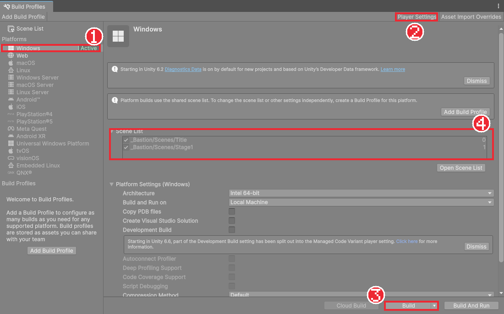

# Chapter 35 빌드와 포트폴리오

## 학습 목표

- Player Settings에서 게임 이름, 화면 모드, 버전을 정할 수 있다.
- Build Profiles로 Windows용 실행 파일을 만들고 빌드한 게임을 점검할 수 있다.
- 에셋 라이선스에 맞게 크레딧을 쓰고, 재배포 금지 에셋을 저장소에서 뺄 수 있다.
- 완성한 게임을 포트폴리오로 정리할 수 있다.

## 본문

### 35-1 에디터 밖에서 돌아가는 게임

지금까지 게임은 Unity 에디터 안에서만 돌았습니다. 다른 사람이 해 보려면 Unity 없이 실행되는 파일이 필요합니다. 프로젝트를 실행 파일로 만드는 것을 **빌드**(Build)라고 합니다.

빌드하면 에디터에서 보이지 않던 문제가 드러나기도 합니다.

- 씬 목록에 없는 씬은 빌드에 들어가지 않아 `LoadScene`이 실패한다 (Chapter 31).
- `#if UNITY_EDITOR` 안의 코드는 빌드에 들어가지 않는다 (Chapter 31의 종료 버튼).
- 에디터는 창 크기가 제각각이지만 빌드는 전체 화면 1920×1080 같은 정해진 크기로 돈다.

### 35-2 Player Settings

**Edit > Project Settings > Player**에서 빌드한 게임의 정보를 정합니다. Build Profiles 창 오른쪽 위의 **Player Settings** 버튼으로도 열립니다.

| 칸 | 완성본 값 | 뜻 |
|---|---|---|
| Company Name | (각자) | 만든 사람이나 팀 이름. PlayerPrefs 저장 위치에도 쓰인다 (Chapter 33) |
| Product Name | Bastion | 게임 이름. 실행 파일과 창 제목이 된다 |
| Version | 1.0 | 버전. 고쳐서 다시 낼 때마다 올린다 |
| Default Icon | (선택) | 실행 파일 아이콘. 비워 두면 Unity 기본 아이콘 |
| Resolution and Presentation > Fullscreen Mode | Fullscreen Window | 테두리 없는 전체 화면 |
| Default Screen Width / Height | 1920 / 1080 | 창 모드일 때 크기 |

Chapter 28의 Canvas Scaler와 Chapter 14의 Pixel Perfect Camera 덕분에 화면 크기가 달라도 UI와 그림이 같은 비율로 보입니다.

Company Name을 바꾸면 PlayerPrefs 저장 위치가 바뀌어 이전에 저장한 음량이 사라집니다. 처음에 정해 두고 바꾸지 않는 것이 좋습니다.

### 35-3 Build Profiles

**File > Build Profiles**를 엽니다.



1. 왼쪽 Platforms에서 **Windows**가 Active인지 확인한다. 다른 플랫폼이면 고르고 **Switch Platform**을 누른다.
2. **Scene List**에 `Title`(0), `Stage1`(1)이 체크되어 있는지 확인한다. 연습용 `Sandbox` 씬은 넣지 않는다.
3. **Development Build**는 끈다. 켜면 화면 구석에 개발용 정보가 보이고 조금 느려진다. 빌드에서만 생기는 문제를 찾을 때만 켠다.
4. 오른쪽 아래 **Build**를 누르고 저장할 폴더를 고른다. 프로젝트 폴더 안의 `Builds/Windows`를 새로 만들어 고른다.

빌드가 끝나면 폴더에 다음 파일들이 생깁니다.

| 파일·폴더 | 내용 |
|---|---|
| `Bastion.exe` | 실행 파일 |
| `Bastion_Data` | 씬, 그림, 소리 등 게임 데이터 |
| `UnityPlayer.dll`, `MonoBleedingEdge` 등 | Unity 실행 엔진 |
| `Bastion_BackUpThisFolder_ButDontShipItWithYourGame` | 오류 분석용 자료. **배포하지 않는다** |

`Bastion.exe` 하나만 복사하면 실행되지 않습니다. 다른 사람에게 줄 때는 마지막 폴더를 뺀 나머지를 **폴더째 압축**합니다. 완성본의 빌드 폴더는 약 120MB입니다.

`Builds` 폴더는 저장소에 올리지 않습니다. Unity용 `.gitignore`에 `/[Bb]uilds/`가 들어 있는지 확인합니다.

### 35-4 빌드 점검

빌드한 게임은 에디터에서 해 보던 것과 같은 순서로 끝까지 해 봅니다. 고친 것이 많은 마지막 장일수록 꼭 해야 합니다.

- [ ] 실행하면 타이틀 화면과 타이틀 음악이 나온다.
- [ ] 키보드와 패드로 메뉴를 고를 수 있고 시작하기로 `Stage1`에 들어간다.
- [ ] 수호령과 대화하고 한글이 네모 없이 보인다 (Chapter 29의 Dynamic 폰트 에셋은 빌드에서도 글자를 그려 넣는다).
- [ ] 죽으면 체크포인트에서 다시 시작하고, 구덩이에 떨어져도 다시 시작한다.
- [ ] Esc로 멈추고 설정에서 음량을 바꾼 뒤, 게임을 껐다 켜도 음량이 남아 있다.
- [ ] 보스를 쓰러뜨리면 문구가 나오고 타이틀로 돌아간다.
- [ ] 타이틀의 종료로 게임이 꺼진다.

문제가 생기면 Development Build를 켜고 다시 빌드합니다. 빌드한 게임의 로그는 `%USERPROFILE%\AppData\LocalLow\회사 이름\Bastion\Player.log`에 남습니다. Console 창에서 보던 오류가 여기에 적힙니다.

Chapter 34의 테스트를 빌드 전에 한 번 더 모두 돌리는 것도 좋은 습관입니다.

### 35-5 크레딧

Chapter 05에서 확인한 에셋 조건을 지킬 차례입니다. **크레딧 표기 조건**이 있는 에셋은 물론, CC0처럼 표기가 필수가 아닌 에셋도 만든 사람을 적어 주는 것이 예의입니다. 타이틀 화면이나 저장소 README에 적습니다.

```text
Bastion — 크레딧

그림
- 기사: Fantasy Knight — aamatniekss
- 보스: Undead Executioner — Kronovi-
- 몬스터: Monsters Creatures Fantasy 1, 2 — LuizMelo (CC0)
- 성채 배경·타일·마법사·수호령: GothicVania Church Pack — ansimuz (CC0)
- 다리·환경 추가 그림: Gothicvania Bridge Expansion Pack 1 — ansimuz (CC0)
- 함정: Animated Traps — Stealthix (CC0)
- 회복 물약: 직접 제작

글꼴
- Galmuri — 이민서, SIL Open Font License 1.1

소리
- 효과음·배경음: 이 게임을 위해 제작
```

**OFL 폰트**는 함께 받은 `LICENSE.txt`를 지우지 않고 프로젝트에 남겨 둡니다(Chapter 29). 빌드한 게임 폴더에도 라이선스 문서를 함께 넣으면 가장 확실합니다.

### 35-6 재배포 금지 에셋을 저장소에서 빼기

포트폴리오를 공개 저장소(GitHub 등)에 올리면 누구나 파일을 받을 수 있습니다. **재배포 금지** 에셋(Fantasy Knight, Undead Executioner)을 그대로 올리면 라이선스를 어기게 됩니다. `.gitignore`에 그 폴더를 적어 저장소에서 뺍니다.

```gitignore
# Project: redistribution-restricted assets (download via README links)
/[Aa]ssets/ThirdParty/FreeKnight_v1/
/[Aa]ssets/ThirdParty/FreeKnight_v1.meta
/[Aa]ssets/ThirdParty/Undead executioner puppet/
/[Aa]ssets/ThirdParty/Undead executioner puppet.meta
```

주의할 점이 두 가지 있습니다.

1. **이미 커밋한 파일은 `.gitignore`에 적어도 빠지지 않습니다.** `.gitignore`는 아직 추적하지 않는 파일에만 적용됩니다. 이미 올린 폴더는 아래 명령으로 추적을 끊은 뒤 커밋해야 합니다. 내 컴퓨터의 파일은 지워지지 않습니다.

   ```bash
   git rm -r --cached "Assets/ThirdParty/Undead executioner puppet"
   ```

   과거 커밋에는 파일이 그대로 남아 있으므로, 처음부터 올리지 않는 것이 가장 좋습니다. 저장소를 만들기 전에 `.gitignore`부터 정리하세요.

2. 그림을 빼면 저장소를 받은 사람의 프로젝트에서는 기사와 보스가 보이지 않습니다. README에 "에셋 이름과 만든 사람을 적고, 각자 받아 어느 폴더에 넣으면 된다"고 안내합니다. `.meta` 파일도 함께 빠지므로, 받은 사람이 넣으면 GUID가 새로 만들어져 애니메이션 연결이 끊어질 수 있다는 점도 적어 둡니다. 완성본은 프리팹과 애니메이션이 참조하는 `.meta`의 GUID를 맞추는 방법을 개발 문서에 정리해 두었습니다.

### 35-7 포트폴리오 정리

게임을 만든 것만으로는 다른 사람이 그 가치를 알기 어렵습니다. 저장소 첫 화면의 **README**를 이렇게 채웁니다.

| 항목 | 내용 |
|---|---|
| 한 줄 소개와 대표 이미지 | 게임 화면 캡처나 짧은 플레이 영상(GIF) |
| 조작법 | 이동, 점프, 구르기, 공격, 대화, 일시정지 키 |
| 내가 만든 것 | 상태 머신, ScriptableObject 수치 분리, 이벤트로 나눈 소리·애니메이션, 공격 예고, 테스트 44개 등 기술적으로 고민한 부분 |
| 문제와 해결 | 만들면서 겪은 문제와 해결 과정. 예: 물약이 점처럼 보인 문제(Pixels Per Unit), NPC 범위가 함정과 겹친 문제 |
| 실행 방법 | 빌드 받는 곳, 또는 Unity 버전과 에셋 받는 방법 |
| 크레딧 | 35-5 |

면접관이 가장 궁금해하는 것은 "무엇을 만들었나"보다 **"왜 그렇게 만들었나"** 입니다. Chapter 26에서 함정을 Animator 대신 코드로 프레임을 넘긴 이유, Chapter 32에서 소리를 이벤트로 붙인 이유처럼 각 장의 "왜"를 자신의 말로 정리해 두세요.

빌드 압축 파일은 저장소에 직접 넣지 말고, 저장소의 Releases 기능이나 인디 게임 배포 사이트에 올려 링크를 겁니다.

### 35-8 따라하기 — 빌드와 포트폴리오

1. Player Settings에서 Company Name, Product Name `Bastion`, Version `1.0`, Fullscreen Window를 정한다.
2. Build Profiles에서 씬 목록을 확인하고 `Builds/Windows`로 빌드한다.
3. `Bastion.exe`를 실행해 35-4의 점검 목록을 모두 확인한다.
4. 빌드 폴더에서 `..._BackUpThisFolder_ButDontShipItWithYourGame`을 뺀 나머지를 압축한다.
5. `.gitignore`에 재배포 금지 에셋과 `Builds`가 들어 있는지, `git status`에 그 파일들이 보이지 않는지 확인한다.
6. README에 35-7의 항목과 35-5의 크레딧을 적는다.

### 연습문제

1. 문제: `Bastion.exe` 파일 하나만 친구에게 보내면 실행되지 않는 이유를 쓰세요.
2. 문제: 이미 커밋한 재배포 금지 에셋 폴더를 `.gitignore`에 추가했는데도 저장소에 계속 남아 있는 이유와 해결 방법을 쓰세요.
3. 문제: Build Profiles의 씬 목록에서 `Title`의 체크를 끄고 빌드하면 어떤 일이 생기는지 쓰세요.
4. 문제: 이 게임에서 쓴 에셋 가운데 크레딧 표기가 필수가 아닌 것과, 라이선스 문서를 함께 남겨야 하는 것을 하나씩 쓰세요.

### 정답 포인트

- 씬과 그림, 소리는 `Bastion_Data` 폴더에, 실행 엔진은 `UnityPlayer.dll` 등에 들어 있어 실행 파일만으로는 실행할 수 없다. 폴더째 압축해 보낸다.
- `.gitignore`는 아직 추적하지 않는 파일에만 적용된다. `git rm -r --cached 폴더`로 추적을 끊고 커밋한다. 과거 커밋에는 남아 있으므로 처음부터 올리지 않는 것이 가장 좋다.
- 체크한 씬 가운데 첫 번째인 `Stage1`이 0번이 되어 타이틀 없이 시작하고, `Title`을 불러오는 클리어와 "타이틀로"가 실패한다.
- CC0 에셋(Monsters Creatures Fantasy, GothicVania Church Pack, Animated Traps)은 표기가 필수가 아니다. Galmuri는 OFL이라 라이선스 문서를 함께 둬야 한다.

---

[상위 문서로 돌아가기](./README.md)
