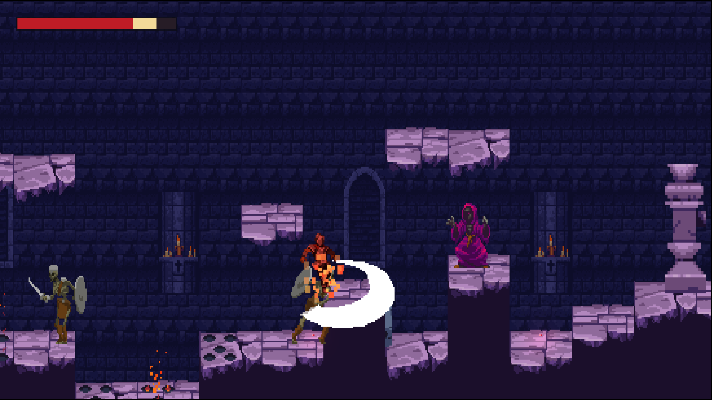

# Unity 자습 자료

Unity를 처음 여는 사람이 **2D 횡스크롤 액션 게임 한 편**을 처음부터 끝까지 만들며 엔진을 배우는 자료입니다.
완성할 게임은 저주받은 성채에 들어간 기사가 해골 병사와 마법사를 물리치고 타락한 수호자(보스)를 쓰러뜨리는 **Bastion**입니다.
장 번호는 만드는 순서입니다. 앞 장에서 만든 씬과 스크립트를 뒤 장에서 이어서 고치므로 순서대로 진행합니다.

## 권장 대상

- Unity를 처음 다루는 학습자
- C# 문법은 배웠지만 게임으로 만들어 본 적이 없는 학습자

## 선수지식

- C# 변수, 조건문, 반복문, 메서드, 클래스, 상속, 인터페이스, 델리게이트와 이벤트. [C#](../csharp/README.md) 과정 Chapter 01~22를 먼저 마치기를 권합니다.
- 컴퓨터에 프로그램을 설치하고 압축 파일을 풀 수 있으면 됩니다. 그 밖의 Unity 지식은 필요 없습니다.

## 완주 후 역량

- Unity 에디터에서 씬, 게임 오브젝트, 컴포넌트, 프리팹, 에셋을 다룰 수 있다.
- 입력, 물리, 타일맵, 카메라, 애니메이션, 파티클, UI, 사운드를 조합해 2D 액션 게임을 만들 수 있다.
- 상태 머신, ScriptableObject, 인터페이스, 이벤트로 기능을 나눠 고치기 쉬운 코드를 짤 수 있다.
- 게임을 Windows용으로 빌드하고 포트폴리오로 정리할 수 있다.

## 읽기 전에

- **에디터 버전**: 본문과 스크린샷은 Unity 6(6000.6)의 영어 에디터 기준입니다. 메뉴와 창 이름은 화면에 보이는 영어 그대로 적고, 처음 나올 때 뜻을 함께 적었습니다. 다른 Unity 6 버전이면 메뉴 위치가 조금 다를 수 있으니 같은 이름을 찾아 진행하세요.
- **완성본**: 완성된 게임 프로젝트(Bastion)는 강사가 따로 나눠 줍니다. 막히면 완성본에서 같은 이름의 파일을 열어 비교하세요. 본문의 폴더와 파일 이름은 완성본과 같게 맞췄습니다.
- **그림과 소리**: 무료 에셋을 씁니다. 받는 방법과 사용 조건은 Chapter 05에서 다룹니다.
- 본 과정 문서에는 설치용 공식 주소 외의 외부 사이트 링크를 넣지 않습니다.
- 본문의 `` 가운데 Unity Hub처럼 에디터 밖의 화면 일부는 아직 파일이 없는 자리표시입니다. 목록은 [이미지 목록](./img/README.md)에 있습니다.

## 목차

### Part 01. 유니티 시작하기

- [Chapter 01 유니티 설치와 첫 프로젝트](./01-install-first-project.md)
- [Chapter 02 씬과 게임 오브젝트](./02-scene-gameobject.md)
- [Chapter 03 컴포넌트와 첫 스크립트](./03-component-first-script.md)
- [Chapter 04 스크립트로 움직이기](./04-move-with-script.md)

### Part 02. 플레이어 만들기

- [Chapter 05 에셋 가져오기와 스프라이트](./05-import-assets-sprite.md)
- [Chapter 06 입력 시스템](./06-input-system.md)
- [Chapter 07 물리와 충돌](./07-physics-collision.md)
- [Chapter 08 점프와 바닥 판정](./08-jump-ground-check.md)
- [Chapter 09 손맛 있는 점프](./09-jump-feel.md)
- [Chapter 10 ScriptableObject로 수치 나누기](./10-scriptable-object.md)

### Part 03. 레벨 만들기

- [Chapter 11 타일맵과 타일 팔레트](./11-tilemap-palette.md)
- [Chapter 12 그리기 순서와 레벨 꾸미기](./12-sorting-decoration.md)
- [Chapter 13 타일맵 충돌](./13-tilemap-collision.md)
- [Chapter 14 카메라](./14-camera.md)

### Part 04. 애니메이션과 상태

- [Chapter 15 스프라이트 애니메이션](./15-sprite-animation.md)
- [Chapter 16 애니메이터 컨트롤러](./16-animator-controller.md)
- [Chapter 17 상태 머신과 구르기](./17-state-machine-roll.md)

### Part 05. 전투

- [Chapter 18 공격 판정과 콤보](./18-attack-combo.md)
- [Chapter 19 체력과 피해](./19-health-damage.md)
- [Chapter 20 타격감](./20-hit-feedback.md)

### Part 06. 적과 보스

- [Chapter 21 프리팹과 첫 번째 적](./21-prefab-first-enemy.md)
- [Chapter 22 적 AI 상태](./22-enemy-ai.md)
- [Chapter 23 원거리 적과 투사체](./23-ranged-projectile.md)
- [Chapter 24 파티클로 공격 예고](./24-particle-telegraph.md)
- [Chapter 25 보스](./25-boss.md)

### Part 07. 레벨 오브젝트

- [Chapter 26 함정과 체크포인트](./26-trap-checkpoint.md)
- [Chapter 27 회복 아이템](./27-health-pickup.md)

### Part 08. UI와 게임 흐름

- [Chapter 28 UI 기초와 체력바](./28-ui-health-bar.md)
- [Chapter 29 한글 폰트와 게임 흐름](./29-font-game-flow.md)
- [Chapter 30 NPC 대화](./30-npc-dialogue.md)
- [Chapter 31 타이틀 화면과 씬 전환](./31-title-scene.md)

### Part 09. 사운드와 마무리

- [Chapter 32 사운드](./32-sound.md)
- [Chapter 33 일시정지와 설정 저장](./33-pause-settings.md)
- [Chapter 34 테스트로 기능 지키기](./34-playmode-test.md)
- [Chapter 35 빌드와 포트폴리오](./35-build-portfolio.md)

---

[상위 문서로 돌아가기](../../README.md)
